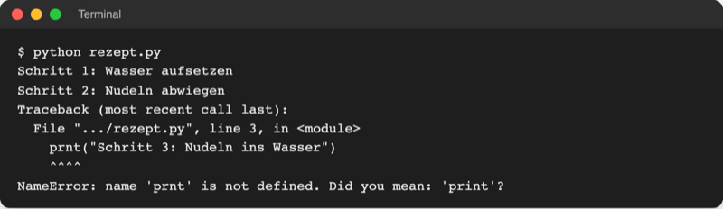
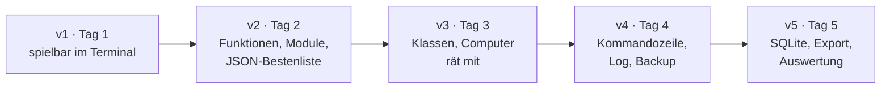

# Überblick: Python Programmierung

## Die Entwicklung von Python

- Seit 1991 verfügbar, seit 2008 Python 3, Python 2 seit 2020 eingestellt.
- Platz 1 im TIOBE-Index (November 2026).
- Standard für Automatisierung, Datenanalyse und KI.
- Neue Versionen jedes Jahr im Oktober: 3.14 (2025), 3.15 (2026).
- Fehlermeldungen und interaktiver Modus sind seit 3.13 deutlich einsteigerfreundlicher.

Details: [Lab 1.1](../m01-introduction/l01-overview/l01-overview-thx.md), Neuerungen: [python-updates.md](python-updates.md)

## Was ist Python?

Python ist eine interpretierte, universell einsetzbare Programmiersprache mit sehr klarer, knapper Schreibweise.

| Begriff | Bedeutung |
| --- | --- |
| Programm | Folge von Anweisungen, die der Computer der Reihe nach ausführt |
| Quelltext | der Text in einer Programmiersprache; bei Python Dateien `.py` |
| Interpreter | führt Quelltext Zeile für Zeile aus, wie eine Dolmetscherin |
| Bibliothek | fertiger, wiederverwendbarer Code für eine Aufgabe |

_Der Interpreter führt Zeile 1 und 2 aus und stoppt bei Zeile 3. Quelle: eigener Screenshot, Kurs-Repo, 08.11.2026._

## Warum Python?

- gut lesbar, wenig Schreibarbeit
- riesige Auswahl an Bibliotheken (PyPI)
- läuft auf Windows, macOS und Linux
- sofort ausprobieren, ohne Übersetzungsschritt

| Merkmal | Interpretiert (Python) | Kompiliert (C, C++, Rust) |
| --- | --- | --- |
| Start | `python hello.py` | erst übersetzen, dann Programmdatei starten |
| Ausprobieren | sofort, auch im interaktiven Modus | nach jeder Änderung neu übersetzen |
| Geschwindigkeit | langsamer bei reiner Rechenarbeit | sehr schnell |
| Weitergabe | Empfänger braucht Python | Programmdatei läuft ohne Zusatz |

Details: [Lab 1.1](../m01-introduction/l01-overview/l01-overview-thx.md)

## Ziel und Ergebnis

Am Ende ohne Vorlage machbar: eigene Skripte, Funktionen, Klassen, Dateien und SQLite.

> **Leitmotiv:** Ein Spiel, fünf Ausbaustufen.

## Das Projekt: Zahlenraten

- Das Programm denkt sich eine Zahl, der Mensch rät.
- Antwort: „zu hoch“, „zu niedrig“ oder „richtig“.
- Jedes neue Thema löst ein echtes Problem im Spiel.
- Eingabe „abc“ stürzt ab → Fehlerbehandlung.
- Bestenliste nach Neustart weg → Dateien, später SQLite.
- Code wird unübersichtlich → Funktionen, Module, Klassen.

| Wohin mit Daten? | Lab | Rolle im Spiel |
| --- | --- | --- |
| Variable | 2.2 | Geheimzahl, aktueller Tipp |
| Liste, Set, Dictionary | 4.1–4.3 | Tipps, Schwierigkeitsstufen |
| Textdatei, JSON, CSV | 8.1–8.3 | Bestenliste, Spielverlauf |
| Objekt (Klasse) | 9.2 | Spiel und Spielende als Einheiten |
| pickle | 17.3 | Spielstand speichern und fortsetzen |
| SQLite | 18.1–18.3 | dauerhafte, abfragbare Bestenliste |

## Tagesplan

| Zeit | Tag 1 | Tag 2 | Tag 3 | Tag 4 | Tag 5 |
| --- | --- | --- | --- | --- | --- |
| 09:00–10:30 | Auftakt, 1 Python kennenlernen | Recap, 5 Funktionen | Recap, 9 OOP-Grundlagen | Recap, 13 Pythonic Code | Recap, 17 Datenformate |
| 10:30–10:45 | Pause | Pause | Pause | Pause | Pause |
| 10:45–12:15 | 2 Grundlagen | 6 Module und Pakete | 10 Klassenbeziehungen | 14 Scripting | 18 SQLite |
| 12:15–13:15 | Mittag | Mittag | Mittag | Mittag | Mittag |
| 13:15–14:45 | 3 Programmfluss | 7 Fehlerbehandlung | 11 Fortgeschrittene OOP | 15 Betriebssystem, Regex | 19 Datenanalyse |
| 14:45–15:00 | Pause | Pause | Pause | Pause | Pause |
| 15:00–16:30 | 4 Datensammlungen, Recap | 8 Dateien, Recap | 12 Funktionale Werkzeuge, Recap | 16 Remote und Automatisierung, Recap | 20 Abschlussprojekt, Abschluss |
| **Stand** | **v1** | **v2** | **v3** | **v4** | **v5** |

Alle Labs mit Minuten: [topics.md](topics.md)

## Arbeitsweise

Ablauf jeder Station:

1. **Generisch:** Konzept an einem kurzen Beispiel aus `code/` (Rabatt-Check, Bank-Konto, Notendurchschnitt).
2. **Transfer:** Wo braucht das Spiel dieses Konzept?
3. **Übersetzen:** Das Konzept ins eigene Spiel einbauen; das ist die Übung.

| Ordner in `project/` | Zweck |
| --- | --- |
| `code/` | kurze Beispiele je Thema, einzeln startbar |
| `playground/` | eigener Arbeitsbereich, hier wächst das Spiel |
| `starters/` | Startstand je Übung, enthält alle vorherigen Labs |
| `examples/` | fertiger Spielstand nach jedem Lab zum Vergleichen |
| `data/` | Beispieldateien ab Modul 8 |

- Pro Lab: Theorie (`-thx`), Übung (`-exc`), Lösung (`-sol`).
- Früh fertig: generische Aufgabe zusätzlich selbst lösen.

Details: [project/README.md](../project/README.md)

## Voraussetzungen

- Keine Programmiererfahrung nötig.
- Sicherer Umgang mit Dateien und Ordnern am eigenen Rechner.
- Laptop mit Python 3.14 und VS Code: [Setup und Installation](../00-setup-and-installation.md).
