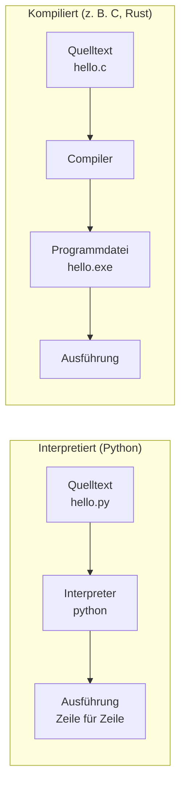
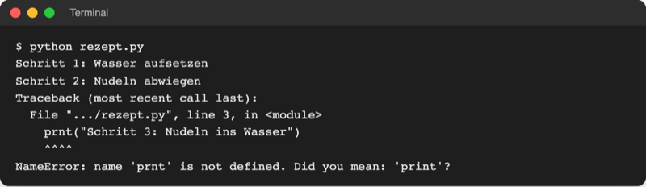
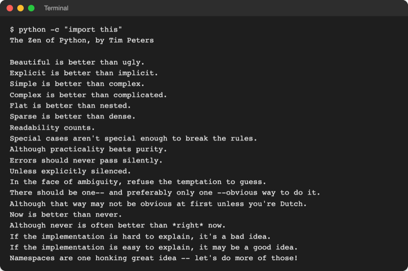

# Lab 1.1: Python im Überblick: Geschichte, Einsatz, Ausführung

**Leitfragen:**

<details>
<summary>Welche Aufgabe am Rechner wiederholt sich im Studium jede Woche?</summary>

Typisch sind Dateien umbenennen und sortieren, Noten oder Punkte ausrechnen, Daten aus mehreren Tabellen zusammentragen. Alles, was nach festen Regeln immer gleich abläuft, lässt sich als Programm aufschreiben und automatisch ausführen.

</details>

<details>
<summary>Woher „weiß“ ein Computer, was eine Textzeile bedeutet?</summary>

Er weiß es nicht von selbst. Ein Übersetzungsprogramm liest den Text nach festen Regeln und wandelt ihn in Befehle für den Prozessor um; bei Python heißt dieses Programm Interpreter.

</details>

<details>
<summary>Warum würde eine Firma eine „langsame“ Sprache einsetzen?</summary>

Meist kostet die Zeit der Menschen mehr als die Rechenzeit: Ein Skript, das in einer Stunde geschrieben ist und zwei Sekunden läuft, schlägt eines, das drei Tage Arbeit kostet und 0,1 Sekunden läuft. Rechenintensive Teile erledigen in Python fertige, schnelle Bibliotheken.

</details>

- Python ist eine Programmiersprache: Anweisungen für den Computer in gut lesbarer Textform.
- Ein Interpreter führt Python-Quelltext Zeile für Zeile aus; ein eigener Übersetzungsschritt zu einer Programmdatei entfällt.
- Python prüft vor dem Start die ganze Datei auf Schreibfehler (Syntax); erst danach läuft sie Zeile für Zeile. Laufzeitfehler zeigen sich, wenn die Zeile erreicht wird.
- Python gibt es seit 1991; Kursversion ist Python 3.14 (Stand: 08.11.2026).

## Begriffe

| Begriff | Bedeutung |
| --- | --- |
| Programm | Folge von Anweisungen, die ein Computer der Reihe nach ausführt, wie ein Rezept Schritt für Schritt |
| Programmiersprache | festgelegte Schreibweise für solche Anweisungen, die Menschen schreiben und lesen und ein Programm übersetzen kann |
| Quelltext (Code) | der Text, den Menschen in einer Programmiersprache schreiben; bei Python Dateien mit der Endung `.py` |
| Skript | kurzes Programm, das eine Aufgabe erledigt und dann endet, etwa „alle Fotos umbenennen“ |
| Interpreter | Programm, das Quelltext liest und jede Anweisung sofort ausführt, wie eine Dolmetscherin, die Satz für Satz übersetzt |
| Compiler | Programm, das den ganzen Quelltext vorab in eine fertige Programmdatei übersetzt, wie ein Buchübersetzer vor dem Druck |
| Bibliothek | fertiger, wiederverwendbarer Code für eine Aufgabe (z. B. Tabellen auswerten), den andere geschrieben haben |
| Standardbibliothek | die Bibliotheken, die bei jeder Python-Installation schon dabei sind |

## Python auf einen Blick


_Guido van Rossum, Erfinder von Python, 2014. Quelle: Wikimedia Commons, Foto Daniel Stroud, CC BY-SA 4.0 (https://commons.wikimedia.org/wiki/File:Guido-portrait-2014-drc.jpg), abgerufen am 08.11.2026._

**Definition:** Python ist eine interpretierte, universell einsetzbare Programmiersprache mit sehr klarer, knapper Schreibweise (python.org: „interpreted, interactive, object-oriented programming language … with very clear syntax“, [Python FAQ](https://docs.python.org/3/faq/general.html)). Der Name stammt von der Comedy-Serie „Monty Python's Flying Circus“, nicht von der Schlange.

**Bild dafür:** Ein Python-Programm liest sich fast wie eine Arbeitsanweisung auf Englisch. Wer `print("Hallo")` liest, ahnt schon, dass „Hallo“ ausgegeben wird.

| Jahr | Ereignis |
| --- | --- |
| 1989 | Guido van Rossum beginnt in den Weihnachtsferien am Forschungsinstitut CWI (Amsterdam) mit Python |
| 1991 | Februar: erste Veröffentlichung im Usenet, einem frühen Internet-Diskussionsforum |
| 2008 | 3. Dezember: Python 3.0 erscheint, bewusst nicht rückwärtskompatibel zu Python 2 |
| 2020 | 1. Januar: Python 2 wird eingestellt; letzte Version 2.7.18 im April 2020 |
| 2024 | Python 3.13: neuer interaktiver Modus mit Farben |
| 2025 | 7. Oktober: Python 3.14 erscheint (Kursversion) |
| 2026 | 9. Oktober: Python 3.15 erscheint; aktuell 3.14.10 und 3.15.2 vom 25.10.2026 |

_Quellen: [Python FAQ](https://docs.python.org/3/faq/general.html), [Python 3.0 Release](https://www.python.org/download/releases/3.0/), [Sunsetting Python 2](https://www.python.org/doc/sunset-python-2/), [python.org/downloads](https://www.python.org/downloads/), abgerufen am 08.11.2026._

Der Kurs nutzt Python 3.14, weil 3.15 erst seit Oktober 2026 verfügbar ist und noch nicht alle Bibliotheken dafür fertige Pakete anbieten. Anleitungen mit `print "Hallo"` (ohne Klammern) stammen aus Python 2 und sind veraltet.

| Verbreitung | Wert | Quelle (Stand) |
| --- | --- | --- |
| TIOBE-Index (Beliebtheit nach Suchanfragen) | Platz 1 mit 20,86 % | [tiobe.com](https://www.tiobe.com/tiobe-index/) (November 2026) |
| Stack Overflow Developer Survey (genutzte Sprachen) | Platz 4, 58,0 % aller Befragten; davor JavaScript, SQL, HTML/CSS | [survey.stackoverflow.co/2026](https://survey.stackoverflow.co/2026/technology) (Umfrage 2026) |

| Bekanntes Beispiel | Was Python dort tut | Quelle |
| --- | --- | --- |
| Dropbox | Desktop-Programm für Windows, macOS und Linux, über 1 Mio. Zeilen Python | [dropbox.tech](https://dropbox.tech/application/how-we-rolled-out-one-of-the-largest-python-3-migrations-ever) (25.09.2018) |
| Erstes Foto eines Schwarzen Lochs (2019) | Auswertung der Teleskopdaten mit NumPy, Matplotlib und weiteren Python-Bibliotheken | [numpy.org](https://numpy.org/case-studies/blackhole-image/) |
| PyTorch | verbreitete Bibliothek zum Trainieren von KI-Modellen, bedient über Python | [pytorch.org](https://pytorch.org/) |

## Vom Quelltext zur Ausführung

Ein Prozessor versteht nur Maschinenbefehle aus Nullen und Einsen. Zwischen dem lesbaren Quelltext und der Ausführung steht deshalb immer ein Übersetzer.



| Merkmal | Interpretiert (Python) | Kompiliert (C, C++, Rust) |
| --- | --- | --- |
| Start | Quelltext direkt starten: `python hello.py` | erst übersetzen, dann die erzeugte Programmdatei starten |
| Fehler im Code | Schreibfehler (Syntax) meldet Python vor dem Start für die ganze Datei; alle anderen Fehler zeigen sich erst, wenn die Zeile erreicht wird | viele Fehler fallen schon beim Übersetzen auf |
| Ausprobieren | sofort, auch Zeile für Zeile im interaktiven Modus | nach jeder Änderung neu übersetzen |
| Geschwindigkeit | langsamer bei reiner Rechenarbeit | sehr schnell |
| Weitergabe | Empfänger braucht Python | Programmdatei läuft ohne Zusatz |

Eine fehlende Klammer wäre ein Schreibfehler, und die Datei startete gar nicht. Das folgende Beispielskript `rezept.py` hat dagegen in Zeile 3 einen Laufzeitfehler: `prnt` statt `print` verstößt gegen keine Schreibregel, ist aber ein unbekannter Name. Der Interpreter führt Zeile 1 und 2 aus und stoppt erst bei Zeile 3:

```python
print("Schritt 1: Wasser aufsetzen")
print("Schritt 2: Nudeln abwiegen")
prnt("Schritt 3: Nudeln ins Wasser")
print("Schritt 4: Abgießen")
```



_Quelle: eigener Screenshot, Kurs-Repo, 08.11.2026 (Dateipfad gekürzt)._

Die Fehlermeldung nennt Datei, Zeile und einen Vorschlag („Did you mean: 'print'?“). Fehlermeldungen lesen ist Thema in Lab 2.1 und Modul 7.

## Einsatzgebiete

| Einsatzgebiet | Typische Aufgabe | Im Kurs |
| --- | --- | --- |
| Automatisierung | Dateien umbenennen, sortieren, sichern | Modul 14 |
| Administration und DevOps | Log-Dateien auswerten, Abläufe auf Servern steuern | Module 15, 16 |
| Datenanalyse | Tabellen einlesen, Mittelwerte bilden, Diagramme zeichnen | Module 8, 19 |
| Web | Daten von Webseiten und Schnittstellen abrufen, eigene Webanwendungen | Modul 16 (Abrufen), Webanwendungen als Ausblick |
| KI und maschinelles Lernen | Modelle trainieren und nutzen (PyTorch, scikit-learn) | Ausblick |
| Lernen und Prototypen | Ideen schnell ausprobieren | ganzer Kurs |

## Stärken und Grenzen

| Stärken | Grenzen |
| --- | --- |
| gut lesbar, wenig Schreibarbeit | bei reiner Rechenarbeit langsamer als C oder Rust |
| riesige Auswahl an Bibliotheken (Paketverzeichnis PyPI, Lab 6.2) | Apps für Smartphones entstehen selten in Python |
| läuft auf Windows, macOS und Linux | Programme brauchen ein installiertes Python |
| große Gemeinschaft, viele Anleitungen | viele Anleitungen im Netz sind veraltet (Python 2) |

## Die Philosophie: „The Zen of Python“

Python bringt seine Leitsätze selbst mit. Der Befehl `python -c "import this"` gibt sie aus (ab Lab 1.2 selbst ausprobierbar):



_Quelle: eigener Screenshot, Python 3.14, 08.11.2026._

| Leitsatz | Bedeutung |
| --- | --- |
| Beautiful is better than ugly. | Code soll sauber und ordentlich aussehen. |
| Simple is better than complex. | Die einfache Lösung ist die bessere. |
| Readability counts. | Code wird öfter gelesen als geschrieben. |
| Errors should never pass silently. | Fehler sollen sichtbar werden, nicht still verschwinden. |

> **Merksatz:** Python-Code wird für Menschen geschrieben, die ihn später lesen; der Interpreter führt ihn nur aus.

## Fazit

- Eine Programmiersprache beschreibt Anweisungen; der Interpreter `python` führt Python-Quelltext Zeile für Zeile aus.
- Python ist seit 1991 verfügbar, Python 2 ist seit 2020 eingestellt, der Kurs nutzt Python 3.14.
- Python ist verbreitet in Automatisierung, Datenanalyse, Web und KI; die Grenze liegt bei Rechengeschwindigkeit und Smartphone-Apps.

Die Übung sammelt drei eigene wiederkehrende Aufgaben und ordnet sie den Einsatzgebieten zu.
