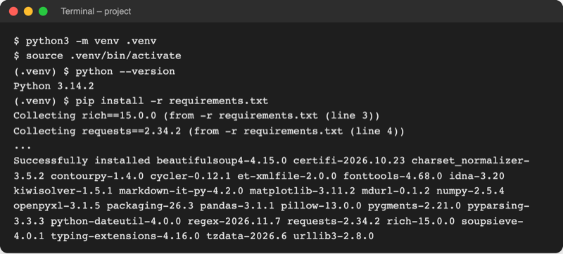
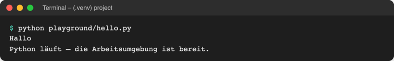

# Lab 1.2 – Lösung: Arbeitsumgebung einrichten

## Aufgabe 1: Projekt öffnen

In VS Code **File → Open Folder…** und den Ordner `project/` wählen (nicht den Ordner darüber). Der Explorer links zeigt `code/`, `examples/`, `playground/`, `starters/`, `data/` und `requirements.txt`. **Terminal → New Terminal** öffnet das Terminal unten; es steht automatisch im Ordner `project/`.

Grund: Öffnet VS Code genau `project/`, stimmen alle Pfade wie `playground/hello.py` ohne `cd`.

## Aufgabe 2: venv anlegen und aktivieren

Windows (PowerShell):

```powershell
python -m venv .venv
.venv\Scripts\Activate.ps1
python --version
```

macOS, Linux (zsh, bash):

```bash
python3 -m venv .venv
source .venv/bin/activate
python --version
```

Erwartet (Patchnummer kann abweichen):

```text
(.venv) $ python --version
Python 3.14.2
```

`python -m venv .venv` gibt nichts aus; danach existiert der Ordner `.venv/` im Explorer. Mit dem Python Install Manager unter Windows lautet die erste Zeile `py -V:3.14 -m venv .venv`. Ist `python3` unter macOS oder Linux ein älteres System-Python, lautet sie `python3.14 -m venv .venv`.

## Aufgabe 3: Pakete installieren

```bash
pip install -r requirements.txt
```

Letzte Zeile der Ausgabe (gekürzt):

```text
Successfully installed beautifulsoup4-4.15.0 ... matplotlib-3.11.2 ... numpy-2.5.4 openpyxl-3.1.5 ... pandas-3.1.1 ... regex-2026.11.7 requests-2.34.2 rich-15.0.0 ...
```



_Quelle: eigener Screenshot, Kurs-Repo unter macOS, 08.11.2026 (Download-Zeilen gekürzt)._

Ein Hinweis `[notice] A new release of pip is available` ist für den Kurs unkritisch.

## Aufgabe 4: Interaktiver Modus

```text
(.venv) $ python
Python 3.14.2 (main, Jan  5 2026, 22:47:39) [Clang 14.0.3 (clang-1403.0.22.14.1)] on darwin
Type "help", "copyright", "credits" or "license" for more information.
>>> 2 + 3
5
>>> print("Hallo")
Hallo
>>> exit
(.venv) $
```

Die erste Zeile nennt Version und Betriebssystem und sieht auf jedem Rechner etwas anders aus. Im interaktiven Modus erscheint das Ergebnis von `2 + 3` ohne `print`; in einer Skriptdatei wäre dafür `print(2 + 3)` nötig.

## Aufgabe 5: Interpreter wählen und `hello.py` starten

`Strg+Shift+P` (macOS `Cmd+Shift+P`), **Python: Select Interpreter**, Eintrag mit `.venv` wählen (oft als „Recommended“ markiert). Die Statusleiste unten rechts zeigt danach z. B. `3.14.2 ('.venv': venv)`:


_Quelle: VS Code Docs, „Python in Visual Studio Code“ (https://code.visualstudio.com/docs/languages/python), CC BY 4.0, abgerufen am 08.11.2026. Die Versionsnummer im Kurs lautet 3.14.x._

```bash
python playground/hello.py
```



_Quelle: eigener Screenshot, Kurs-Repo, 08.11.2026._

Inhalt von `playground/hello.py`:

```python
# Erstes Python-Skript im Kurs.
# print() gibt den Text zwischen den Anführungszeichen im Terminal aus.
# Start im Terminal (Ordner project/, .venv aktiv):  python playground/hello.py

print("Hallo")
print("Python läuft – die Arbeitsumgebung ist bereit.")
```

Die Zeilen mit `#` sind Kommentare; Python überspringt sie (Lab 2.1). Alternativ startet der Run-Knopf ▷ oben rechts im Editor die geöffnete Datei mit dem gewählten Interpreter.

## Erweiterung

```text
>>> import this
The Zen of Python, by Tim Peters

Beautiful is better than ugly.
...
Readability counts.
...
```

„Readability counts.“ ist der siebte Leitsatz.
