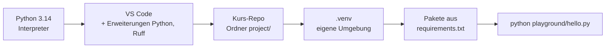
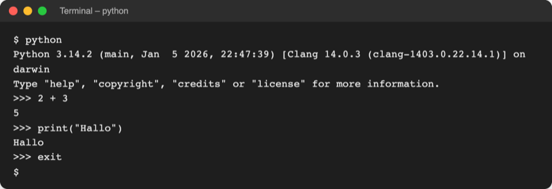
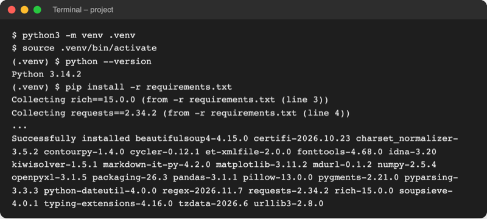

# Lab 1.2: Arbeitsumgebung: Python, VS Code, venv

**Leitfragen:**

<details>
<summary>Was ist der Unterschied zwischen einer Zeile im Terminal und einer gespeicherten Datei?</summary>

Eine Zeile im interaktiven Modus wird sofort ausgeführt und ist danach weg. Eine gespeicherte `.py`-Datei lässt sich beliebig oft starten, ändern und weitergeben.

</details>

<details>
<summary>Zwei Projekte brauchen dasselbe Werkzeug in zwei verschiedenen Versionen – wie lässt sich das trennen?</summary>

Jedes Projekt bekommt einen eigenen Werkzeugkasten: eine virtuelle Umgebung (Ordner `.venv`) mit eigenen Paketen. Was in einem Projekt installiert wird, stört das andere nicht.

</details>

<details>
<summary>Was gehört alles auf einen Rechner, bevor eine Zeile Code läuft?</summary>

Python selbst (der Interpreter), ein Editor zum Schreiben (VS Code), der Projektordner, eine virtuelle Umgebung und die Pakete, die das Projekt braucht.

</details>

- Python lässt sich auf zwei Arten nutzen: interaktiv Zeile für Zeile (REPL) oder als gespeichertes Skript.
- Jedes Projekt bekommt eine eigene virtuelle Umgebung `.venv`; danach ist `python` auf allen Systemen derselbe Befehl.

## Begriffe

| Begriff | Bedeutung |
| --- | --- |
| Terminal | Fenster, in dem Befehle als Text eingetippt werden; im Kurs das Terminal in VS Code |
| Shell | das Programm im Terminal, das die Befehle ausführt: PowerShell (Windows), zsh oder bash (macOS, Linux) |
| REPL | interaktiver Modus von Python (Read, Eval, Print, Loop): Zeile eingeben, Ergebnis sehen, nächste Zeile |
| Skript | Datei mit Python-Code und der Endung `.py`, gestartet mit `python <datei>.py` |
| Editor / IDE | Programm zum Schreiben von Code; eine IDE (integrierte Entwicklungsumgebung) bringt zusätzlich Ausführen und Fehlersuche mit |
| Erweiterung | Zusatzmodul für VS Code, z. B. „Python“ von Microsoft für Python-Unterstützung |
| Paket | Bibliothek zum Nachinstallieren, z. B. `rich` für farbige Ausgabe |
| `pip` | Installationsprogramm für Pakete, wird mit Python mitgeliefert |
| virtuelle Umgebung (venv) | Projektordner `.venv` mit eigener Python-Kopie und eigenen Paketen, wie ein eigener Werkzeugkasten pro Projekt |
| aktivieren | Terminal auf die virtuelle Umgebung umschalten; erkennbar an `(.venv)` vor der Eingabezeile |

## Was vor der ersten Zeile Code bereitsteht



Installation von Python und VS Code je Betriebssystem: [00-setup-and-installation.md](../../00-setup-and-installation.md). Alle Befehle laufen im Terminal von VS Code im Ordner `project/`: unter Windows in PowerShell, unter macOS und Linux in zsh oder bash.

## Python-Version prüfen

| System | Befehl vor der venv | Erwartet |
| --- | --- | --- |
| Windows | `python --version` oder `py --version` | `Python 3.14.x` |
| macOS, Linux | `python3 --version` (bei mehreren Versionen `python3.14 --version`) | `Python 3.14.x` |

Unter macOS und Linux heißt der Befehl vor dem Aktivieren `python3`, weil `python` dort fehlt oder zu einer alten Version gehört. Nach dem Aktivieren der venv heißt er überall `python`.

## Interaktiver Modus (REPL) und Skriptdatei

`python` ohne Dateiname startet den interaktiven Modus. Die Eingabezeile beginnt mit `>>>`; jede Zeile wird sofort ausgeführt.



_Quelle: eigener Screenshot, Python 3.14, 08.11.2026. Im echten Terminal sind Eingabezeile und Code farbig._

Seit Python 3.13 hat der interaktive Modus Farben, mehrzeiliges Bearbeiten und versteht `exit` und `help` ohne Klammern; 3.14 färbt zusätzlich den Code ein (Stand: 08.11.2026, Quelle: [What's New in Python 3.13](https://docs.python.org/3/whatsnew/3.13.html), [3.14](https://docs.python.org/3/whatsnew/3.14.html)).

| | Interaktiver Modus (REPL) | Skriptdatei `.py` |
| --- | --- | --- |
| Start | `python` | `python playground/hello.py` |
| Ausführung | jede Zeile sofort | ganze Datei von oben nach unten |
| Ergebnis einer Rechnung | erscheint automatisch (`2 + 3` → `5`) | erscheint nur mit `print(...)` |
| Gespeichert | nein, nach `exit` weg | ja, beliebig oft startbar |
| Einsatz | kurz ausprobieren, nachrechnen | alles, was bleiben soll |
| Beenden | `exit` eingeben | endet nach der letzten Zeile |

`print("Hallo")` ist ein Befehl, der Text im Terminal ausgibt; der Text steht in Anführungszeichen. Details folgen in Lab 2.1.

## Entwicklungsumgebungen im Vergleich

| Werkzeug | Stärke | Einsatz | Im Kurs |
| --- | --- | --- | --- |
| VS Code | kostenlos, für viele Sprachen, Erweiterungen „Python“ und „Ruff“ | Skripte und Projekte | ja, Standard |
| PyCharm | IDE nur für Python, viele eingebaute Prüfungen | große Python-Projekte | Alternative |
| Jupyter Notebook | Code in Zellen, Ergebnis und Diagramm direkt darunter | Datenanalyse, Experimente | Ausblick |
| IDLE | mit Python installiert, sehr einfach | erste Schritte ohne Zusatzprogramm | nein |


_VS Code mit Python-Projekt: Explorer links (mit `.venv` und `requirements.txt`), Editor in der Mitte, Terminal unten, Run-Knopf oben rechts (G), gewählter Interpreter unten rechts (F). Quelle: VS Code Docs, „Quick Start Guide for Python in VS Code“ (https://code.visualstudio.com/docs/python/python-quick-start), CC BY 4.0, abgerufen am 08.11.2026._

## Rundgang durch das Kurs-Repo

Das Kurs-Repo kommt als ZIP von GitHub (**Code → Download ZIP**, ohne git). Gearbeitet wird im Ordner `project/`, der in VS Code geöffnet wird.

| Pfad in `project/` | Inhalt |
| --- | --- |
| `code/<modul>/` | kurze Beispiele zu jedem Thema, einzeln startbar |
| `examples/<modul>/<lab>/guess_game.py` | fertiger Stand des Zahlenratespiels nach jedem Lab, zum Vergleichen |
| `starters/` | Startdatei je Übung, z. B. `m02-l01-guess_game.py` |
| `playground/` | eigener Arbeitsbereich; enthält zu Beginn `hello.py` |
| `data/` | Beispieldateien für spätere Module |
| `requirements.txt` | Liste aller Pakete des Kurses mit fester Version |
| `.venv/` | virtuelle Umgebung, entsteht in dieser Übung |

## Virtuelle Umgebung: ein Werkzeugkasten pro Projekt

Ohne venv landen alle Pakete in der einen Python-Installation des Rechners. Braucht Projekt A ein Paket in Version 1 und Projekt B in Version 2, geht eines kaputt. Eine venv ist ein Ordner im Projekt mit eigener Python-Kopie und eigenen Paketen.

| Schritt | Windows (PowerShell) | macOS, Linux (zsh, bash) |
| --- | --- | --- |
| anlegen (einmal) | `python -m venv .venv` | `python3 -m venv .venv` |
| aktivieren (jedes neue Terminal) | `.venv\Scripts\Activate.ps1` | `source .venv/bin/activate` |
| prüfen | `(.venv)` vor der Eingabezeile, `python --version` | wie Windows |
| deaktivieren | `deactivate` | `deactivate` |

Wer Python unter Windows mit dem Python Install Manager installiert hat, legt die venv mit `py -V:3.14 -m venv .venv` an. Zeigt `python3 --version` unter macOS oder Linux eine ältere Version (z. B. das System-Python 3.9), entsteht die venv mit `python3.14 -m venv .venv`. Nur die Zeile zum Aktivieren unterscheidet sich. Danach sind `python` und `pip` auf allen Systemen dieselben Befehle. Den Ordner `.venv` nie von Hand bearbeiten; bei Problemen löschen und neu anlegen.

## Pakete einmal installieren: `pip install -r requirements.txt`

`requirements.txt` listet alle Pakete des Kurses mit fester Version, zum Beispiel:

```text
rich==15.0.0            # farbige Ausgabe im Terminal (Lab 6.2)
requests==2.34.2        # HTTP-Anfragen (Lab 16.1)
```

`pip install -r requirements.txt` lädt alle Pakete in die aktive venv; das genügt einmal für den ganzen Kurs. Woher die Pakete kommen (PyPI), erklärt Lab 6.2.



_Quelle: eigener Screenshot, Kurs-Repo unter macOS, 08.11.2026 (Download-Zeilen gekürzt)._

## Interpreter in VS Code wählen

VS Code muss wissen, welches Python es für das Projekt nutzt. `Strg+Shift+P` (macOS `Cmd+Shift+P`) öffnet die Befehlspalette; dort **Python: Select Interpreter** wählen und den Eintrag mit `.venv` nehmen.


_Quelle: VS Code Docs, „Python in VS Code tutorial“ (https://code.visualstudio.com/docs/python/python-tutorial), CC BY 4.0, abgerufen am 08.11.2026._

Danach steht die venv unten rechts in der Statusleiste, z. B. `3.14.x ('.venv': venv)`.

## Typische Fehler

| Symptom | Ursache | Lösung |
| --- | --- | --- |
| `python` wird nicht gefunden oder öffnet den Microsoft Store (Windows) | Python fehlt oder ist nicht im Suchpfad (PATH) | Setup-Anleitung, Abschnitt Windows; VS Code danach neu starten |
| `zsh: command not found: python` (macOS) | vor dem Aktivieren heißt der Befehl `python3` | `python3 -m venv .venv`, dann aktivieren |
| `Activate.ps1 cannot be loaded because running scripts is disabled` | PowerShell erlaubt keine Skripte | einmal `Set-ExecutionPolicy -Scope CurrentUser RemoteSigned` |
| `(.venv)` fehlt nach dem Öffnen eines neuen Terminals | Aktivierung gilt nur für ein Terminal | Aktivierungszeile erneut ausführen |
| `can't open file '...hello.py'` | Terminal steht nicht im Ordner `project/` | in VS Code den Ordner `project/` öffnen, neues Terminal |
| `python --version` zeigt in der aktiven venv 3.9 oder eine andere alte Version (macOS, Linux) | `python3` war ein älteres System-Python | `deactivate`, Ordner `.venv` löschen, mit `python3.14 -m venv .venv` neu anlegen, aktivieren |
| `>>>` erscheint und Befehle wie `pip` gehen nicht | Terminal steckt noch im interaktiven Modus | `exit` eingeben, dann den Befehl wiederholen |

## Fazit

- `python` startet den interaktiven Modus zum Ausprobieren; `python <datei>.py` führt ein gespeichertes Skript aus.
- Jedes Projekt bekommt eine `.venv`: einmal anlegen, in jedem neuen Terminal aktivieren.
- `pip install -r requirements.txt` installiert alle Kurspakete; VS Code nutzt danach `.venv` als Interpreter.

Die Übung richtet die eigene Arbeitsumgebung ein und startet `playground/hello.py`.
