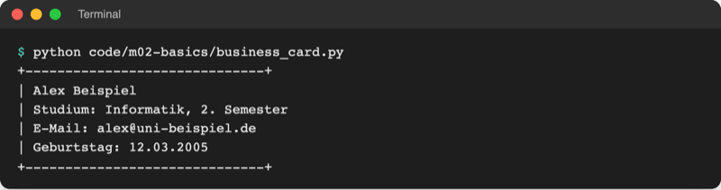

# Lab 2.1 – Lösung: Begrüßungsbanner für das Zahlenraten

## Aufgabe 1: Arbeitsdatei anlegen

Im Explorer von VS Code den Ordner `playground` anklicken, oben das Symbol **New File…** wählen (alternativ Rechtsklick auf `playground` → **New File…**) und `guess_game.py` eingeben. Dann `starters/m02-l01-guess_game.py` öffnen, alles markieren (`Strg+A`), kopieren, in die neue Datei einfügen und speichern. Inhalt des Starters:

```python
# Zahlenraten – Starter für Lab 2.1 (Stand nach Lab 1.2)
# TODO Lab 2.1: Begrüßungsbanner mit print() ausgeben
```

## Aufgabe 2: Banner schreiben

```python
# Zahlenraten – Stand Lab 2.1: Begrüßungsbanner
# Das Programm läuft von oben nach unten: eine print-Zeile nach der anderen.

print("=" * 40)
print("Zahlenraten")
print("Rate eine Zahl zwischen 1 und 10.")
print("=" * 40)
```

`"=" * 40` spart das Abzählen von 40 Zeichen; `print("========================================")` ist gleichwertig. Der Kommentar oben beschreibt die Datei. Referenz: [`examples/m02-basics/l01-syntax/guess_game.py`](../../project/examples/m02-basics/l01-syntax/guess_game.py).

## Aufgabe 3: Starten

```text
$ python playground/guess_game.py
========================================
Zahlenraten
Rate eine Zahl zwischen 1 und 10.
========================================
```

## Aufgabe 4: Einrückungsfehler

```text
$ python playground/guess_game.py
  File "…/project/playground/guess_game.py", line 5
    print("Zahlenraten")
IndentationError: unexpected indent
```

Zeile 5 (in der eigenen Datei je nach Kommentaren eine andere Zahl), Fehlerart `IndentationError`. Python gibt nichts aus, auch nicht die erste Linie: Bei einem Syntaxfehler startet das Programm gar nicht.

## Aufgabe 5: Fehlende Klammer

```text
$ python playground/guess_game.py
  File "…/project/playground/guess_game.py", line 5
    print("Zahlenraten"
         ^
SyntaxError: '(' was never closed
```

Das `^` zeigt auf die geöffnete Klammer, die nie geschlossen wurde. Mit `)` am Zeilenende läuft das Banner wieder wie in Aufgabe 3.

## Erweiterung

```python
# code/m02-basics/business_card.py
# Lab 2.1: Visitenkarte mit print ausgeben

print("+" + "-" * 30 + "+")
print("| Alex Beispiel")
print("| Studium: Informatik, 2. Semester")
print("| E-Mail:", "alex@uni-beispiel.de")
print("| Geburtstag:", end=" ")  # kein Zeilenumbruch, sondern Leerzeichen
print("12", "03", "2005", sep=".")  # Punkt zwischen den Werten
print("+" + "-" * 30 + "+")
```

`"+" + "-" * 30 + "+"` hängt drei Texte aneinander: Plus, 30 Striche, Plus.



_Quelle: eigener Screenshot, Kurs-Repo, 08.11.2026._
