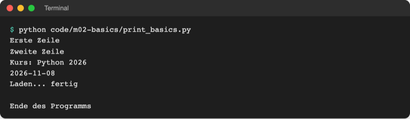
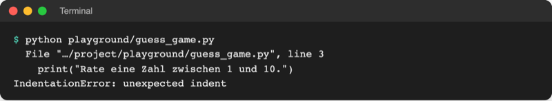
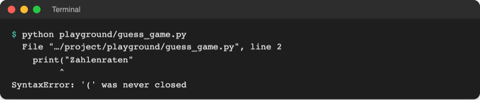
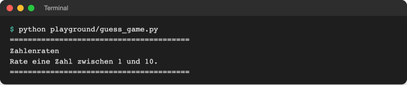

# Lab 2.1: Syntax: Anweisungen, Kommentare, Einrückung

**Leitfragen:**

<details>
<summary>In welcher Reihenfolge führt ein Computer eine Liste von Anweisungen aus?</summary>

Von oben nach unten, eine Zeile nach der anderen. Erst Bedingungen (Lab 3.1) und Schleifen (Lab 3.3) ändern diese Reihenfolge.

</details>

<details>
<summary>Woran erkennt ein Leser in einem Rezept, welche Schritte zusammengehören?</summary>

An Einrückung, Nummerierung oder Überschriften. Python nutzt dafür die Einrückung: Zeilen mit gleichem Abstand vom linken Rand bilden einen Block.

</details>

<details>
<summary>Wozu schreibt man Text in ein Programm, den der Computer ignoriert?</summary>

Für Menschen: Kommentare erklären, warum etwas so gemacht ist. Python überspringt alles ab `#` bis zum Zeilenende.

</details>

- Ein Python-Programm ist eine Folge von Anweisungen, die von oben nach unten laufen.
- Die Einrückung ist Teil der Sprache: Ein Leerzeichen zu viel am Zeilenanfang ist ein Fehler.

## Begriffe

| Begriff | Bedeutung |
| --- | --- |
| Syntax | die Schreibregeln einer Sprache; wie Grammatik und Zeichensetzung im Deutschen |
| Anweisung | ein Befehl an Python, z. B. „gib diesen Text aus“; meist eine Zeile |
| Kommentar | Text ab `#` bis zum Zeilenende, nur für Menschen; Python ignoriert ihn |
| Funktion | ein fertiges Werkzeug mit Namen; wird mit Klammern aufgerufen, z. B. `print(...)` |
| Argument | ein Wert, der in den Klammern an eine Funktion übergeben wird |
| String | ein Text in Anführungszeichen, z. B. `"Hallo"`; Details in Lab 2.4 |
| Einrückung | Leerzeichen am Zeilenanfang; in Python Teil der Syntax |
| Block | mehrere Zeilen mit gleicher Einrückung, die zusammengehören, wie die Unterpunkte eines Rezeptschritts |
| Syntaxfehler | Verstoß gegen die Schreibregeln; Python prüft die ganze Datei vor dem Start und startet sie dann gar nicht erst |
| PEP 8 | der offizielle Stil-Leitfaden für Python-Code (PEP = Python Enhancement Proposal) |
| Formatter | Werkzeug, das Code automatisch nach Stilregeln umformatiert; im Kurs: Ruff |

## Ein Programm läuft von oben nach unten

Python prüft vor dem Start die ganze Datei auf Schreibfehler (Syntax); erst danach läuft sie Zeile für Zeile. Laufzeitfehler zeigen sich, wenn die Zeile erreicht wird. Kommentare und Leerzeilen werden übersprungen.

```python
# code/m02-basics/print_basics.py (Anfang)
# Jede Zeile ist eine Anweisung. Python führt sie von oben nach unten aus.

print("Erste Zeile")
print("Zweite Zeile")  # Kommentar am Zeilenende: Python ignoriert alles ab #
```

| Element | Regel |
| --- | --- |
| eine Anweisung pro Zeile | Standard in Python; kein `;` am Zeilenende nötig |
| Kommentar `#` | eigene Zeile oder am Zeilenende (dann zwei Leerzeichen davor) |
| Leerzeilen | gliedern den Code in Abschnitte, haben keine Wirkung |
| Groß-/Kleinschreibung | zählt: `print` funktioniert, `Print` nicht |

Datei: [code/m02-basics/print_basics.py](../../project/code/m02-basics/print_basics.py), Start im Ordner `project/` mit `python code/m02-basics/print_basics.py`.

## `print()`: Ausgabe im Terminal

`print()` schreibt Werte ins Terminal. Mehrere Werte stehen durch Kommas getrennt in den Klammern; Python setzt ein Leerzeichen dazwischen und am Ende einen Zeilenumbruch.

```python
print("Kurs:", "Python", 2026)          # Kurs: Python 2026
print("2026", "11", "08", sep="-")      # 2026-11-08
print("Laden", end="")                  # kein Zeilenumbruch am Ende
print("...", end="")
print(" fertig")                        # Laden... fertig
print()                                 # leere Zeile
print("=" * 40)                         # Text mal Zahl: 40 Gleichheitszeichen
```

| Schreibweise | Wirkung |
| --- | --- |
| `print(a, b, c)` | Werte mit Leerzeichen dazwischen, danach neue Zeile |
| `sep="-"` | legt fest, was **zwischen** den Werten steht (Standard: Leerzeichen) |
| `end=""` | legt fest, was **am Ende** steht (Standard: Zeilenumbruch) |
| `print()` | gibt eine leere Zeile aus |
| `"=" * 40` | wiederholt den Text 40-mal; Rechenzeichen folgen in Lab 2.3 |



_Quelle: eigener Screenshot, Kurs-Repo, 08.11.2026._

`sep` und `end` heißen benannte Argumente: Name, Gleichheitszeichen, Wert. Sie stehen immer hinter den auszugebenden Werten.

## Einrückung gehört zur Syntax

In einem Rezept zeigen eingerückte Unterpunkte, was zu einem Schritt gehört. Viele Sprachen (Java, C, JavaScript) nutzen dafür geschweifte Klammern `{ }`; Python nutzt nur die Einrückung.

```text
Nudeln kochen:
    Wasser aufsetzen          <- eingerückt: gehört zu „Nudeln kochen“
    Nudeln ins Wasser geben   <- gleiche Einrückung: gehört ebenfalls dazu
Tisch decken                  <- wieder am Rand: eigener Schritt
```

Genauso bildet Python Blöcke aus Zeilen mit gleicher Einrückung. Bis Lab 3.1 (`if`) gibt es noch keine Blöcke; jede Zeile beginnt deshalb ganz links. Ein Leerzeichen zu viel am Zeilenanfang führt zum `IndentationError` („unerwartete Einrückung“):



_Quelle: eigener Screenshot, Kurs-Repo, 08.11.2026 (Pfad gekürzt)._

> **Merksatz:** Gleiche Einrückung heißt „gehört zusammen“; Standard sind 4 Leerzeichen pro Ebene.

## Stilregeln: PEP 8 und Ruff

Python-Code soll überall gleich aussehen, damit ihn jede Person schnell lesen kann. Die Regeln stehen in [PEP 8](https://peps.python.org/pep-0008/).

| Regel (PEP 8) | Beispiel |
| --- | --- |
| 4 Leerzeichen pro Einrückungsebene, keine Tabs | `····print("Richtig!")` |
| Leerzeichen um Rechen- und Vergleichszeichen | `10 + 5`, nicht `10+5` |
| Leerzeichen nach dem Komma, keines innen an Klammern | `print("a", "b")`, nicht `print( "a","b" )` |
| zwei Leerzeichen vor einem Kommentar am Zeilenende | `x = 1  # Kommentar` |
| Namen klein mit Unterstrich (snake_case) | `guess_game.py`, `secret_number` |
| kurze Zeilen (PEP 8: 79 Zeichen; Ruff-Standard: 88) | lange Ausgaben auf mehrere `print` verteilen |

Die Ruff-Erweiterung aus Lab 1.2 formatiert Code automatisch nach diesen Regeln. Vorher und nachher:

```python
# vorher
print( 'Zahlenraten' )
print('Punkte:',10+5)   #Summe

# nachher (Ruff)
print("Zahlenraten")
print("Punkte:", 10 + 5)  # Summe
```

Einmalig formatiert der Befehl **Format Document** (`Shift+Alt+F`, macOS `Shift+Option+F`) die geöffnete Datei. Automatisches Formatieren beim Speichern: Abschnitt „Vertiefung“.

## Syntaxfehler lesen

Bei einem Syntaxfehler startet Python das Programm nicht. Die Meldung hat drei Teile; für den Anfang genügt die erste Meldung:



_Quelle: eigener Screenshot, Kurs-Repo, 08.11.2026 (Pfad gekürzt)._

| Teil | Bedeutung im Beispiel |
| --- | --- |
| `File "…/guess_game.py", line 2` | Datei und Zeile, in der Python den Fehler bemerkt hat |
| Codezeile mit `^` | die Stelle, an der Python stutzt |
| letzte Zeile | Fehlerart und Grund: `'(' was never closed` = Klammer nie geschlossen |

Der eigentliche Fehler liegt oft in der gemeldeten Zeile oder direkt davor. VS Code markiert ihn schon vor dem Start mit einer roten Wellenlinie und listet ihn im Bereich **Problems** (**View → Problems**).

Fehlermeldungen im Detail und mit Vorschlägen („Did you mean …?“) folgen in Lab 7.1.

## Im Spiel: Begrüßungsbanner

Das Zahlenratespiel beginnt mit einem Banner aus vier `print`-Zeilen in `playground/guess_game.py`. Oben steht ein Kommentar, der die Datei beschreibt; Linien aus `=` rahmen den Titel ein:

```python
# Zahlenraten – ...
print("=" * 40)
print("Zahlenraten")
...
```



_Quelle: eigener Screenshot, Kurs-Repo, 08.11.2026._

## Typische Fehler

| Symptom | Ursache | Lösung |
| --- | --- | --- |
| `IndentationError: unexpected indent` | Leerzeichen am Zeilenanfang | Zeile ganz nach links rücken |
| `SyntaxError: '(' was never closed` | schließende Klammer fehlt | `)` am Ende der Zeile ergänzen |
| `SyntaxError: unterminated string literal (detected at line 1)` | Anführungszeichen nicht geschlossen | Text mit demselben Zeichen schließen: `"..."` |
| `NameError: name 'Print' is not defined. Did you mean: 'print'?` | Großschreibung falsch | `print` klein schreiben |
| Ausgabe klebt zusammen: `Laden...fertig` | `end=""` ohne Leerzeichen danach | Leerzeichen in den Text oder `end=" "` |
| `python: can't open file ... guess_game.py` | Terminal nicht im Ordner `project/` | in VS Code `project/` öffnen (**File → Open Folder…**), neues Terminal (**Terminal → New Terminal**), dann erneut starten |

## Vertiefung: Format on save (optional)

Ruff kann jede Datei beim Speichern automatisch formatieren. Dafür in der Befehlspalette (`Strg+Shift+P`, macOS `Cmd+Shift+P`) den Befehl **Preferences: Open User Settings (JSON)** öffnen und ergänzen:

```json
{
  "[python]": {
    "editor.formatOnSave": true,
    "editor.defaultFormatter": "charliermarsh.ruff"
  }
}
```

Ab dann formatiert jedes Speichern (`Strg+S`, macOS `Cmd+S`) die Datei. Ohne diese Einstellung formatiert der Befehl **Format Document** (`Shift+Alt+F`, macOS `Shift+Option+F`) die Datei einmalig. Ruff formatiert nur Dateien ohne Syntaxfehler. Quelle: [Ruff-Erweiterung für VS Code, README](https://github.com/astral-sh/ruff-vscode), Stand: 08.11.2026.

## Fazit

- Python führt Anweisungen von oben nach unten aus; `#` leitet einen Kommentar ein.
- `print()` gibt mehrere Werte aus; `sep` steuert den Abstand, `end` das Zeilenende.
- Einrückung ist Syntax: Bis Lab 3.1 beginnt jede Zeile ganz links.
- Ruff formatiert nach PEP 8; bei Syntaxfehlern zuerst Datei, Zeile und letzte Zeile lesen.

Die Übung baut das Begrüßungsbanner des Zahlenratespiels in `playground/guess_game.py`.
