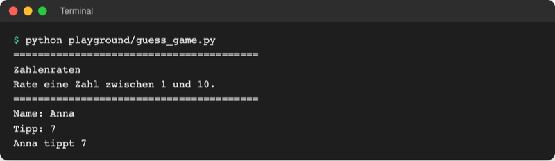
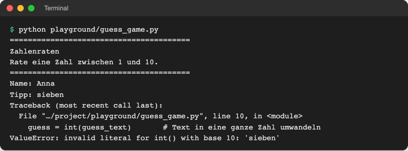

# Lab 2.2 – Lösung: Name und Tipp abfragen

## Aufgabe 1: Namen abfragen

```python
name = input("Name: ")
```

`input()` zeigt `Name: ` an und wartet auf Enter. Das Getippte landet als `str` in `name`.

## Aufgabe 2: Tipp abfragen

```python
guess_text = input("Tipp: ")  # input() liefert immer Text (str)
```

## Aufgabe 3: Tipp umwandeln

```python
guess = int(guess_text)  # Text in eine ganze Zahl umwandeln
```

Der Name `guess_text` macht sichtbar, dass hier noch Text steht. Kürzer und ebenso richtig: `guess = int(input("Tipp: "))` (so ab Lab 2.3).

## Aufgabe 4: Ausgabe mit f-String

Vollständige Datei:

```python
# Zahlenraten – Stand Lab 2.2: Name und Tipp abfragen

print("=" * 40)
print("Zahlenraten")
print("Rate eine Zahl zwischen 1 und 10.")
print("=" * 40)

name = input("Name: ")
guess_text = input("Tipp: ")  # input() liefert immer Text (str)
guess = int(guess_text)  # Text in eine ganze Zahl umwandeln

print(f"{name} tippt {guess}")
```

Referenz: [`examples/m02-basics/l02-variables/guess_game.py`](../../project/examples/m02-basics/l02-variables/guess_game.py)



_Quelle: eigener Screenshot, Kurs-Repo, 08.11.2026._

Alternative ohne f-String: `print(name, "tippt", guess)` liefert dieselbe Ausgabe, weil `print` Werte mit Leerzeichen trennt.

## Aufgabe 5: Eingabe „sieben“



_Quelle: eigener Screenshot, Kurs-Repo, 08.11.2026 (Pfad gekürzt)._

- `int()` kann nur Ziffern umwandeln; „sieben“ ist für Python kein Zahlwort, sondern beliebiger Text.
- Die Meldung nennt die Zeile mit `int(guess_text)` und die Fehlerart `ValueError` (falscher Wert).
- Das Programm bricht ab. Wie das Spiel stattdessen erneut fragt, zeigt Modul 7 (Fehlerbehandlung).

## Erweiterung

```python
# code/m02-basics/birth_year.py
# Lab 2.2: Alter abfragen und Geburtsjahr berechnen

current_year = 2026

age_text = input("Alter: ")  # input() liefert immer Text
age = int(age_text)  # Text in eine ganze Zahl umwandeln

birth_year = current_year - age
print(f"Geburtsjahr: {birth_year} oder {birth_year - 1}")
print(type(age_text), type(age))
```

```text
$ python code/m02-basics/birth_year.py
Alter: 21
Geburtsjahr: 2005 oder 2004
<class 'str'> <class 'int'>
```

Eine Ausgabe nur mit `{birth_year}` ist ebenfalls richtig; die zweite Jahreszahl deckt einen Geburtstag ab, der in diesem Jahr noch kommt.
