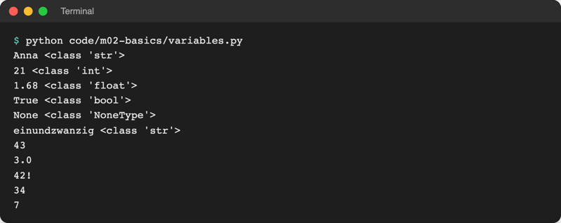
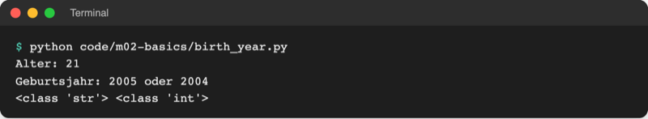

# Lab 2.2: Variablen, Datentypen und Eingabe

**Leitfragen:**

<details>
<summary>Ist „7“ auf einem Zettel dasselbe wie die Zahl 7?</summary>

Für Menschen meist ja, für Python nein: `"7"` ist Text (`str`), `7` ist eine Zahl (`int`). Mit Text lässt sich nicht rechnen, erst nach der Umwandlung mit `int()`.

</details>

<details>
<summary>Wie merkt sich ein Programm etwas, das eben eingegeben wurde?</summary>

In einer Variablen: Ein Name zeigt auf den gespeicherten Wert, z. B. `name = input("Name: ")`. Später im Programm liefert `name` den Wert wieder.

</details>

<details>
<summary>Was ergibt „3“ + „4“ – und was sollte es ergeben?</summary>

`"3" + "4"` ergibt `"34"`: Zwei Texte werden aneinandergehängt. Die Summe `7` entsteht erst mit `int("3") + int("4")`.

</details>

- Eine Variable ist ein Name für einen Wert; jeder Wert hat einen Datentyp.
- `input()` liefert immer Text; Zahlen entstehen erst durch Umwandlung mit `int()` oder `float()`.

## Begriffe

| Begriff | Bedeutung |
| --- | --- |
| Variable | ein Name, der auf einen Wert zeigt; wie ein Etikett an einer Schachtel |
| Zuweisung `=` | klebt das Etikett links an den Wert rechts; kein Gleichheitszeichen wie in Mathe |
| Wert | ein konkretes Datum, z. B. `7`, `"Anna"`, `True` |
| Ausdruck | Schreibweise, die Python zu einem Wert ausrechnet, z. B. `int("3") + int("4")` → `7`; Details in Lab 2.3 |
| Datentyp | die Art eines Wertes; bestimmt, was mit ihm geht (rechnen, aneinanderhängen …) |
| `type()` | Funktion, die den Datentyp eines Wertes anzeigt |
| dynamische Typisierung | der Typ hängt am Wert, nicht am Namen; eine Variable kann später einen Wert anderen Typs tragen |
| `input()` | Funktion, die eine Frage ausgibt, auf die Eingabe mit Enter wartet und sie als Text zurückgibt |
| Umwandlung | aus einem Wert einen Wert anderen Typs machen, z. B. `int("7")` → `7` |
| f-String | Text mit `f` davor, in dem `{name}` durch den Wert der Variablen ersetzt wird |

## Variable: Etikett an einer Schachtel

Eine Zuweisung legt einen Wert in den Speicher und klebt einen Namen daran. Der Name steht links, der Wert rechts.

```python
name = "Anna"
guess = 7
guess = 8      # das Etikett wandert zum neuen Wert
```

```text
name  ──►  "Anna"
guess ──►  8         (der alte Wert 7 wird nicht mehr gebraucht)
```

| Regel für Namen | Beispiel |
| --- | --- |
| Buchstaben, Ziffern, Unterstrich; nicht mit Ziffer beginnen | `guess_2` ja, `2guess` nein |
| Groß-/Kleinschreibung zählt | `Name` und `name` sind zwei Variablen |
| PEP 8: klein mit Unterstrich, sprechend | `secret_number` statt `sn` |
| keine reservierten Wörter | nicht `if`, `for`, `True`, `None` … |

## Skalare Datentypen

„Skalar“ heißt: ein einzelner Wert, keine Sammlung (Sammlungen folgen in Modul 4).

| Typ | Bedeutung | Beispiele |
| --- | --- | --- |
| `int` | ganze Zahl (integer) | `7`, `-3`, `2026` |
| `float` | Kommazahl, mit **Punkt** geschrieben | `1.68`, `3.0`, `-0.5` |
| `str` | Text (string) in `"..."` oder `'...'` | `"Anna"`, `"7"`, `""` |
| `bool` | Wahrheitswert | `True`, `False` |
| `None` | „noch kein Wert“ | `None` |

```python
# code/m02-basics/variables.py (Auszug)
name = "Anna"       # str
age = 21            # int
height = 1.68       # float
is_student = True   # bool
phone = None        # None: noch kein Wert

print(name, type(name))
...
age = "einundzwanzig"   # dynamische Typisierung: jetzt ein str
print(age, type(age))
```



_Quelle: eigener Screenshot, Kurs-Repo, 08.11.2026._

`type()` antwortet in der Form `<class 'int'>`: „class“ heißt hier einfach „Typ“, der Name in Anführungszeichen ist der Typ, also `int`. Der Typ von `None` heißt `NoneType` (`<class 'NoneType'>`); `None` ist sein einziger Wert.

Datei: [code/m02-basics/variables.py](../../project/code/m02-basics/variables.py). Dynamische Typisierung ist bequem, kann aber überraschen: Wer `age` später als Zahl nutzen will, bekommt einen Fehler, wenn dort inzwischen Text steht.

## Eingabe mit `input()` und Umwandlung

`input("Alter: ")` zeigt den Text `Alter: ` an, wartet auf Enter und liefert das Getippte **immer als `str`**, auch wenn es wie eine Zahl aussieht.

| Ausdruck | Ergebnis | Typ |
| --- | --- | --- |
| `"3" + "4"` | `"34"` | `str` (aneinandergehängt) |
| `int("3") + int("4")` | `7` | `int` |
| `float("1.5") * 2` | `3.0` | `float` |
| `str(42) + "!"` | `"42!"` | `str` |
| `int(7.9)` | `7` | `int` (schneidet ab, rundet nicht) |
| `int("sieben")` | Fehler `ValueError` | – |

Beispiel „Alter abfragen, Geburtsjahr berechnen“:

```python
# code/m02-basics/birth_year.py
current_year = 2026

age_text = input("Alter: ")  # input() liefert immer Text
age = int(age_text)  # Text in eine ganze Zahl umwandeln

birth_year = current_year - age
print(f"Geburtsjahr: {birth_year} oder {birth_year - 1}")
print(type(age_text), type(age))
```

Zwei Jahre sind möglich, weil das Programm nicht weiß, ob der Geburtstag dieses Jahr schon war; die Entscheidung folgt mit `if` in Lab 3.1.



_Quelle: eigener Screenshot, Kurs-Repo, 08.11.2026._

## f-Strings: Werte in Text einsetzen

Ein `f` vor dem Anführungszeichen macht aus `{...}` einen Platzhalter. Python setzt den Wert ein und wandelt ihn dabei selbst in Text um.

```python
name = "Anna"
guess = 7
print(f"{name} tippt {guess}")        # Anna tippt 7
print(f"Doppelt: {guess * 2}")        # Doppelt: 14 – Rechnen im Platzhalter geht auch
print("Tipp: " + str(guess))          # ohne f-String: selbst umwandeln
```

| Ohne `f` | Mit `f` |
| --- | --- |
| `"Hallo {name}"` gibt wörtlich `Hallo {name}` aus | `f"Hallo {name}"` gibt `Hallo Anna` aus |

Weitere Beispiele: [code/m02-basics/greet.py](../../project/code/m02-basics/greet.py).

## Im Spiel: Name und Tipp abfragen

Das Spiel fragt nach dem Banner zwei Werte ab und wandelt den Tipp in eine Zahl um, damit es ab Lab 2.3 mit der Geheimzahl vergleichen kann:

```python
guess_text = input("Tipp: ")  # Text, z. B. "7"
guess = int(guess_text)       # Zahl 7
```

Die Ausgabe am Ende lautet z. B. „Anna tippt 7“.

## Typische Fehler

| Symptom | Ursache | Lösung |
| --- | --- | --- |
| `TypeError: can only concatenate str (not "int") to str` | Text und Zahl mit `+` verbunden | f-String nutzen oder `str(zahl)` |
| Ergebnis `34` statt `7` | zwei Texte aus `input()` addiert | vorher `int()` anwenden |
| `ValueError: invalid literal for int() with base 10: 'sieben'` | Text ist keine ganze Zahl | Ziffern eingeben; Abfangen folgt in Modul 7 |
| `ValueError: could not convert string to float: '1,5'` | Komma statt Punkt | `1.5` eingeben |
| Ausgabe zeigt `{name}` wörtlich | `f` vor dem String vergessen | `f"..."` schreiben |
| `NameError: name 'guess' is not defined` | Variable vor der Zuweisung benutzt oder vertippt | Zuweisung weiter oben, Namen prüfen |

## Fazit

- Variablen sind Namen für Werte; `=` weist zu, `type()` zeigt den Datentyp.
- Skalare Typen: `int`, `float`, `str`, `bool`, `None`.
- `input()` liefert Text; `int()`, `float()`, `str()` wandeln um.
- f-Strings setzen Werte direkt in Text ein: `f"{name} tippt {guess}"`.

Die Übung erweitert das Spiel um Name und Tipp und gibt „Anna tippt 7“ aus.
