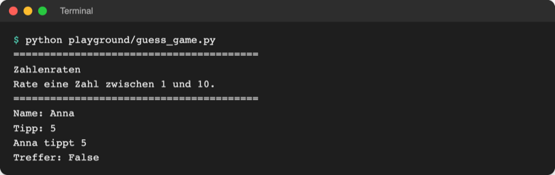

# Lab 2.3 – Lösung: Tipp mit der Geheimzahl vergleichen

## Aufgabe 1: Geheimzahl anlegen

```python
secret = 7  # vorerst fest; ab Lab 3.2 zufällig
```

Die Geheimzahl steht oben, weil sie vor dem ersten Tipp feststehen muss und so schnell zu finden ist.

## Aufgabe 2: Vergleich ausgeben

Vollständige Datei:

```python
# Zahlenraten – Stand Lab 2.3: Tipp mit der Geheimzahl vergleichen

secret = 7  # vorerst fest; ab Lab 3.2 zufällig

print("=" * 40)
print("Zahlenraten")
print("Rate eine Zahl zwischen 1 und 10.")
print("=" * 40)

name = input("Name: ")
guess = int(input("Tipp: "))

print(f"{name} tippt {guess}")
print("Treffer:", guess == secret)  # == liefert True oder False
```

`int(input("Tipp: "))` fasst die beiden Zeilen aus Lab 2.2 zusammen: Python wertet von innen nach außen aus, erst `input`, dann `int`. Die Variante mit `guess_text` bleibt ebenso richtig.

Referenz: [`examples/m02-basics/l03-operators/guess_game.py`](../../project/examples/m02-basics/l03-operators/guess_game.py)

## Aufgabe 3: Zwei Testläufe

```text
$ python playground/guess_game.py
========================================
Zahlenraten
Rate eine Zahl zwischen 1 und 10.
========================================
Name: Anna
Tipp: 7
Anna tippt 7
Treffer: True
```



_Quelle: eigener Screenshot, Kurs-Repo, 08.11.2026._

## Aufgabe 4: Bereich prüfen

```python
print("Im Bereich:", 1 <= guess <= 10)
```

```text
Tipp: 5
Anna tippt 5
Treffer: False
Im Bereich: True
```

```text
Tipp: 12
Anna tippt 12
Treffer: False
Im Bereich: False
```

Gleichwertig, aber länger: `1 <= guess and guess <= 10`. Die Zeile ist eine Zusatzübung; der Referenzstand in `examples/` enthält sie nicht.

## Aufgabe 5: Ohne `int()`

```python
guess = input("Tipp: ")
```

```text
Tipp: 7
Anna tippt 7
Treffer: False
Traceback (most recent call last):
  File "…/project/playground/guess_game.py", line 15, in <module>
    print("Im Bereich:", 1 <= guess <= 10)
                         ^^^^^^^^^^^^^^^^
TypeError: '<=' not supported between instances of 'int' and 'str'
```

- `guess` ist jetzt der Text `"7"`. Text und Zahl sind nie gleich, deshalb liefert `"7" == 7` `False`. „Anna tippt 7“ sieht trotzdem gleich aus, weil `print` beides gleich anzeigt.
- Die Bereichsprüfung aus Aufgabe 4 bricht ab: `<=` kann eine Zahl nicht mit Text vergleichen (`TypeError`). `==` dagegen darf alles vergleichen und meldet nur `False`.

## Erweiterung

```python
# code/m02-basics/even.py
# Lab 2.3: gerade oder ungerade? (Rest mit %)

number = int(input("Zahl: "))

remainder = number % 2  # Rest beim Teilen durch 2: 0 oder 1
print(f"{number} % 2 = {remainder}")
print("gerade:", remainder == 0)
```

```text
$ python code/m02-basics/even.py
Zahl: 7
7 % 2 = 1
gerade: False

$ python code/m02-basics/even.py
Zahl: 12
12 % 2 = 0
gerade: True
```
