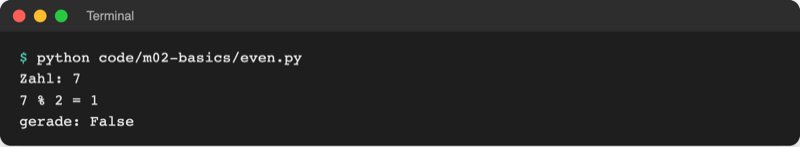
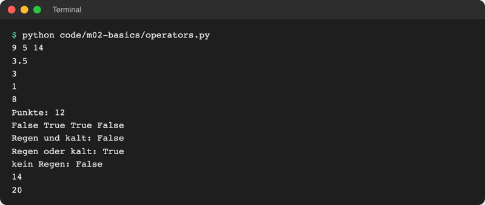
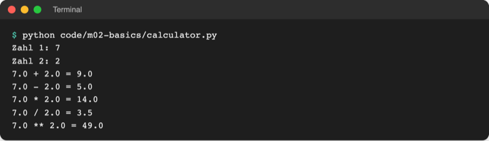

# Lab 2.3: Operatoren und Vergleiche

**Leitfragen:**

<details>
<summary>Wie lässt sich prüfen, ob eine Zahl gerade ist, ohne sie zu halbieren?</summary>

Über den Rest beim Teilen durch 2: Bleibt 0 übrig, ist die Zahl gerade. In Python liefert `%` diesen Rest: `12 % 2` ist `0`, `7 % 2` ist `1`.

</details>

<details>
<summary>Was ergibt 7 / 2 – und wie viele ganze Pizzen bekommt jede von zwei Personen bei 7 Stück?</summary>

`7 / 2` ergibt `3.5`. Ganze Pizzen: `7 // 2` ergibt `3`; übrig bleibt `7 % 2`, also `1` Pizza.

</details>

<details>
<summary>Wann ist „Regen und kalt“ wahr, wann „Regen oder kalt“?</summary>

„Und“ ist nur wahr, wenn beides zutrifft. „Oder“ ist wahr, sobald mindestens eines zutrifft, auch wenn beides zutrifft.

</details>

- Operatoren verbinden Werte zu Ausdrücken: Rechnen liefert Zahlen, Vergleichen liefert `True` oder `False`.
- `=` weist zu, `==` vergleicht.

## Begriffe

| Begriff | Bedeutung |
| --- | --- |
| Operator | Zeichen für eine Operation, z. B. `+`, `==`, `and` |
| Ausdruck | Kombination aus Werten, Variablen und Operatoren, die Python zu **einem** Wert ausrechnet, z. B. `guess == secret` |
| ganzzahlige Division `//` | teilt und schneidet die Nachkommastellen ab (rundet nach unten) |
| Rest `%` (Modulo) | was beim ganzzahligen Teilen übrig bleibt |
| Vergleich | Ausdruck, der zwei Werte prüft und `True` oder `False` liefert |
| logischer Operator | verknüpft Wahrheitswerte: `and` (und), `or` (oder), `not` (nicht) |
| Vorrang | Reihenfolge, in der Python Operatoren ausrechnet; wie „Punkt vor Strich“ |

## Rechnen

| Operator | Bedeutung | Beispiel | Ergebnis |
| --- | --- | --- | --- |
| `+` | Addition | `7 + 2` | `9` |
| `-` | Subtraktion | `7 - 2` | `5` |
| `*` | Multiplikation | `7 * 2` | `14` |
| `/` | Division, liefert immer `float` | `7 / 2` | `3.5` |
| `//` | ganzzahlige Division | `7 // 2` | `3` |
| `%` | Rest der Division | `7 % 2` | `1` |
| `**` | Potenz | `2 ** 3` | `8` |

`+` und `*` funktionieren auch mit Text: `"Hallo " + "Anna"` hängt an, `"=" * 40` wiederholt (bekannt aus Lab 2.1). Text plus Zahl geht nicht (Lab 2.2).

**Zuweisungsoperatoren** kürzen „Variable mit sich selbst verrechnen“ ab:

| Kurzform | Langform | Typischer Einsatz |
| --- | --- | --- |
| `points += 5` | `points = points + 5` | Punkte addieren |
| `tries -= 1` | `tries = tries - 1` | Versuche herunterzählen (ab Lab 3.3) |
| `price *= 2` | `price = price * 2` | verdoppeln |

## Gerade oder ungerade mit `%`

```python
# code/m02-basics/even.py
number = int(input("Zahl: "))

remainder = number % 2  # Rest beim Teilen durch 2: 0 oder 1
print(f"{number} % 2 = {remainder}")
print("gerade:", remainder == 0)
```



_Quelle: eigener Screenshot, Kurs-Repo, 08.11.2026._

Das Programm gibt den Wahrheitswert aus. Eine Ausgabe „gerade“ oder „ungerade“ als Wort braucht eine Entscheidung mit `if` (Lab 3.1).

## Vergleiche

| Operator | Bedeutung | Beispiel | Ergebnis |
| --- | --- | --- | --- |
| `==` | gleich | `7 == 7` | `True` |
| `!=` | ungleich | `7 != 7` | `False` |
| `<` / `>` | kleiner / größer | `3 < 5` | `True` |
| `<=` / `>=` | kleiner gleich / größer gleich | `5 >= 5` | `True` |

Vergleiche lassen sich verketten: `1 <= guess <= 10` prüft, ob `guess` im Bereich liegt.

`==` vergleicht Werte. Daneben gibt es `is`, das prüft, ob zwei Namen auf **dasselbe** Objekt zeigen; Details in Lab 5.3, bis dahin immer `==` verwenden.

## Logische Operatoren

```python
raining = True
cold = False
print("Regen und kalt:", raining and cold)   # False
print("Regen oder kalt:", raining or cold)   # True
print("kein Regen:", not raining)            # False
```

| `a` | `b` | `a and b` | `a or b` | `not a` |
| --- | --- | --- | --- | --- |
| `True` | `True` | `True` | `True` | `False` |
| `True` | `False` | `False` | `True` | `False` |
| `False` | `True` | `False` | `True` | `True` |
| `False` | `False` | `False` | `False` | `True` |

Als Bild: Kreis links = „Regen“, Kreis rechts = „kalt“, die rote Fläche ist wahr.

| `and`: nur die Schnittmenge | `or`: alles, was in einem der Kreise liegt |
| --- | --- |
|  |  |

_Quelle: Wikimedia Commons, „Venn0001.svg“ (https://commons.wikimedia.org/wiki/File:Venn0001.svg) und „Venn0111.svg“ (https://commons.wikimedia.org/wiki/File:Venn0111.svg), abgerufen am 08.11.2026, gemeinfrei._

## Vorrang und Klammern

Python rechnet wie in der Schule „Punkt vor Strich“. Die vollständige Reihenfolge, von oben nach unten:

| Rang | Operatoren |
| --- | --- |
| 1 | `( )` Klammern |
| 2 | `**` |
| 3 | `*`, `/`, `//`, `%` |
| 4 | `+`, `-` |
| 5 | Vergleiche `==`, `!=`, `<`, `>`, `<=`, `>=` |
| 6 | `not` |
| 7 | `and` |
| 8 | `or` |

`2 + 3 * 4` ergibt `14`, `(2 + 3) * 4` ergibt `20`. Klammern kosten nichts und machen die Absicht sichtbar, auch wenn der Vorrang sie nicht verlangt.

Alle Beispiele in einer Datei: [code/m02-basics/operators.py](../../project/code/m02-basics/operators.py)



_Quelle: eigener Screenshot, Kurs-Repo, 08.11.2026._

## Einfacher Rechner

[code/m02-basics/calculator.py](../../project/code/m02-basics/calculator.py) liest zwei Zahlen mit `float(input(...))` und gibt alle Grundrechenarten aus. `round(a / b, 2)` rundet auf zwei Nachkommastellen.



_Quelle: eigener Screenshot, Kurs-Repo, 08.11.2026._

## Im Spiel: Tipp mit der Geheimzahl vergleichen

Das Spiel bekommt eine feste Geheimzahl (ab Lab 3.2 zufällig) und gibt das Ergebnis des Vergleichs aus:

```python
secret = 7
...
print("Treffer:", guess == secret)  # True oder False
```

## Typische Fehler

| Symptom | Ursache | Lösung |
| --- | --- | --- |
| `TypeError: print() got an unexpected keyword argument 'guess'` | `print(guess = secret)`: `=` statt `==` | `==` für Vergleiche |
| `Treffer: False`, obwohl die Zahl stimmt | Tipp nicht mit `int()` umgewandelt: `"7" == 7` ist `False` | `int(input(...))` |
| `ZeroDivisionError: division by zero` | Division durch 0 | anderen Wert eingeben; Abfangen in Modul 7 |
| `0.1 + 0.2` ergibt `0.30000000000000004` | Kommazahlen werden binär gespeichert und sind nicht exakt | für die Anzeige `round(x, 2)` |
| `3.5` statt `3` | `/` statt `//` | `//` für ganze Ergebnisse |

## Fazit

- Rechenoperatoren: `+ - * / // % **`; `/` liefert immer `float`, `%` den Rest.
- Vergleiche liefern `True` oder `False`; `==` vergleicht, `=` weist zu.
- `and`, `or`, `not` verknüpfen Wahrheitswerte; Klammern machen den Vorrang eindeutig.

Die Übung lässt das Spiel einen Tipp mit einer festen Geheimzahl vergleichen.
