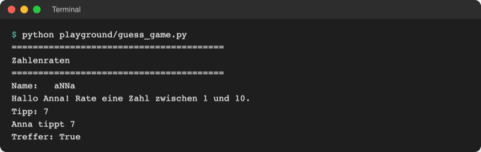

# Lab 2.4 – Lösung: Spielernamen aufräumen und persönlich begrüßen

## Aufgabe 1: Namen bereinigen

```python
name = input("Name: ").strip().title()  # "  aNNa " -> "Anna"
```

Die Kette läuft von links nach rechts: `input()` liefert `"  aNNa "`, `strip()` macht daraus `"aNNa"`, `title()` daraus `"Anna"`. Gleichwertig in drei Zeilen:

```python
name = input("Name: ")
name = name.strip()
name = name.title()
```

## Aufgabe 2: Banner kürzen

```python
print("=" * 40)
print("Zahlenraten")
print("=" * 40)
```

## Aufgabe 3: Persönliche Begrüßung

Vollständige Datei:

```python
# Zahlenraten – Stand Lab 2.4: Spielernamen normalisieren

secret = 7

print("=" * 40)
print("Zahlenraten")
print("=" * 40)

name = input("Name: ").strip().title()  # "  aNNa " -> "Anna"
print(f"Hallo {name}! Rate eine Zahl zwischen 1 und 10.")

guess = int(input("Tipp: "))

print(f"{name} tippt {guess}")
print("Treffer:", guess == secret)
```

Die Begrüßung steht nach `input()`, weil der Name vorher noch nicht bekannt ist: Das Programm läuft von oben nach unten (Lab 2.1).

Referenz: [`examples/m02-basics/l04-strings/guess_game.py`](../../project/examples/m02-basics/l04-strings/guess_game.py)

## Aufgabe 4: Testlauf



_Quelle: eigener Screenshot, Kurs-Repo, 08.11.2026._

## Aufgabe 5: Name mit Bindestrich

```text
Name: aNNA-lena
Hallo Anna-Lena! Rate eine Zahl zwischen 1 und 10.
```

`title()` behandelt jeden Teil nach einem Nicht-Buchstaben (Bindestrich, Leerzeichen) als neues Wort. Nebenwirkung: Aus `mcdonald` wird `Mcdonald`, aus `o'neil` `O'Neil`; für Spielernamen reicht das.

## Erweiterung

```python
# code/m02-basics/email_parts.py
# Lab 2.4: E-Mail-Adresse zerlegen

email = input("E-Mail: ").strip().lower()

at = email.find("@")  # Position des @ (Index)
user = email[:at]  # alles vor dem @
domain = email[at + 1 :]  # alles nach dem @

print(f"Name:   {user}")
print(f"Domain: {domain}")
print("Endet auf .de:", domain.endswith(".de"))
```

```text
$ python code/m02-basics/email_parts.py
E-Mail:  anna@Uni-Beispiel.DE 
Name:   anna
Domain: uni-beispiel.de
Endet auf .de: True
```

`find("@")` liefert den Index 4; `email[:4]` ist alles davor, `email[5:]` alles danach. Die Zeile `Endet auf .de` ist eine Zugabe. Prüfen, ob eine Adresse gültig ist, folgt in Lab 15.2 mit regulären Ausdrücken.
