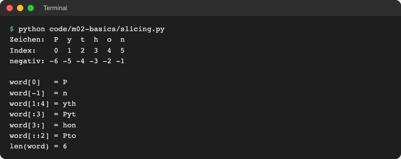
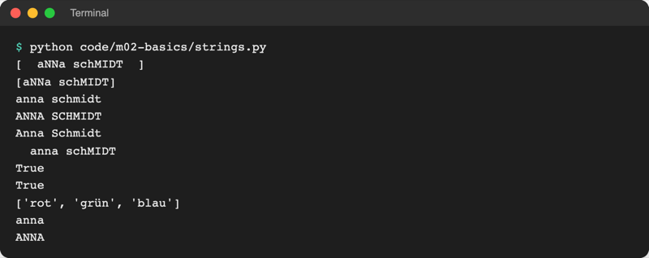
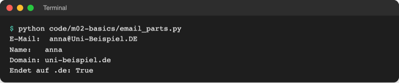

# Lab 2.4: Strings verarbeiten

**Leitfragen:**

<details>
<summary>Wie kommt man an die ersten drei Buchstaben eines Wortes?</summary>

Jedes Zeichen hat eine Position, gezählt ab 0. `word[:3]` schneidet die Zeichen an den Positionen 0, 1 und 2 heraus („Slicing“).

</details>

<details>
<summary>Ein Formular liefert „ anna@Uni-Beispiel.DE “ – was muss vor dem Speichern passieren?</summary>

Leerzeichen am Rand entfernen (`strip()`) und einheitlich klein schreiben (`lower()`), sonst gelten gleiche Adressen als verschieden.

</details>

<details>
<summary>Ist „Anna“ gleich „anna“?</summary>

Für Python nicht: `"Anna" == "anna"` ist `False`, weil `A` und `a` verschiedene Zeichen mit verschiedenen Codes sind. Erst nach `lower()` auf beiden Seiten sind sie gleich.

</details>

- Ein String ist eine Folge von Zeichen; jedes Zeichen hat einen Index ab 0.
- String-Methoden liefern immer einen **neuen** String; das Original bleibt unverändert.

## Begriffe

| Begriff | Bedeutung |
| --- | --- |
| String (`str`) | Text als Folge von Zeichen, wie Buchstaben auf einer Perlenkette |
| Index | Position eines Zeichens, gezählt ab 0; negativ von hinten ab -1 |
| Slicing | Ausschnitt mit `[start:ende]`; das Zeichen bei `ende` gehört nicht dazu |
| `len()` | Funktion, die die Anzahl der Zeichen liefert |
| Methode | Funktion, die zu einem Wert gehört; Aufruf mit Punkt: `name.upper()` |
| `in` | prüft, ob ein Text in einem anderen vorkommt; liefert `True`/`False` |
| unveränderlich | ein String lässt sich nicht verändern, nur durch einen neuen ersetzen |
| Escape-Zeichen | Backslash-Folge für Sonderzeichen, z. B. `\n` für eine neue Zeile |

## Zeichen haben Codes

Der Computer speichert jedes Zeichen als Zahl. Die ASCII-Tabelle von 1963 legte die ersten 128 Codes fest; Unicode erweitert sie heute auf alle Schriften (ä, €, ж, 中). Python-Strings sind Unicode.


_Quelle: Wikimedia Commons, „ASCII-Table-wide.svg“ (https://commons.wikimedia.org/wiki/File:ASCII-Table-wide.svg), abgerufen am 08.11.2026, gemeinfrei._

`A` hat den Code 65, `a` den Code 97. Deshalb ist `"Anna" == "anna"` `False`.

## Index und Slicing

```text
Zeichen:   P   y   t   h   o   n
Index:     0   1   2   3   4   5
negativ:  -6  -5  -4  -3  -2  -1
```

| Ausdruck | Ergebnis | Bedeutung |
| --- | --- | --- |
| `word[0]` | `"P"` | erstes Zeichen |
| `word[-1]` | `"n"` | letztes Zeichen |
| `word[1:4]` | `"yth"` | Index 1 bis 3 (4 nicht mehr) |
| `word[:3]` | `"Pyt"` | die ersten drei |
| `word[3:]` | `"hon"` | ab Index 3 bis zum Ende |
| `word[::2]` | `"Pto"` | jedes zweite Zeichen |
| `len(word)` | `6` | Anzahl der Zeichen |
| `"th" in word` | `True` | kommt vor |



_Quelle: eigener Screenshot, Kurs-Repo, 08.11.2026._

Datei: [code/m02-basics/slicing.py](../../project/code/m02-basics/slicing.py). Merkhilfe: Bei `[1:4]` liefert `4 - 1` die Länge des Ausschnitts.

## String-Methoden

Methoden hängen mit einem Punkt am String. Sie lassen sich verketten und werden von links nach rechts ausgeführt: `"  aNNa ".strip().title()` → `"Anna"`.

| Methode | Wirkung | Beispiel → Ergebnis |
| --- | --- | --- |
| `strip()` | Leerzeichen am Anfang und Ende entfernen | `"  Anna ".strip()` → `"Anna"` |
| `lower()` / `upper()` | alles klein / groß | `"Anna".lower()` → `"anna"` |
| `title()` | jedes Wort mit Großbuchstaben beginnen | `"aNNa schMIDT".title()` → `"Anna Schmidt"` |
| `replace(alt, neu)` | Teil ersetzen | `"Uni-Beispiel".replace("-", " ")` → `"Uni Beispiel"` |
| `startswith(x)` / `endswith(x)` | beginnt / endet mit `x`? | `"anna@uni.de".endswith(".de")` → `True` |
| `find(x)` | Index des ersten Vorkommens, sonst `-1` | `"anna@uni.de".find("@")` → `4` |
| `split(x)` | an `x` zerlegen; Ergebnis ist eine Liste (Lab 4.1) | `"rot;grün".split(";")` → `['rot', 'grün']` |



_Quelle: eigener Screenshot, Kurs-Repo, 08.11.2026._

Datei: [code/m02-basics/strings.py](../../project/code/m02-basics/strings.py)

## Strings sind unveränderlich

Ein einzelnes Zeichen lässt sich nicht austauschen. `name[0] = "A"` ergibt `TypeError: 'str' object does not support item assignment`. Methoden ändern das Original nicht, sondern liefern einen neuen String:

```python
name = "anna"
name.upper()         # Ergebnis wird nicht gespeichert
print(name)          # anna
name = name.upper()  # neues Ergebnis unter demselben Namen speichern
print(name)          # ANNA
```

> **Merksatz:** Eine String-Methode wirkt nur, wenn das Ergebnis gespeichert oder direkt verwendet wird.

## Beispiel: E-Mail-Adresse zerlegen

```python
# code/m02-basics/email_parts.py
email = input("E-Mail: ").strip().lower()

at = email.find("@")  # Position des @ (Index)
user = email[:at]  # alles vor dem @
domain = email[at + 1 :]  # alles nach dem @

print(f"Name:   {user}")
print(f"Domain: {domain}")
print("Endet auf .de:", domain.endswith(".de"))
```



_Quelle: eigener Screenshot, Kurs-Repo, 08.11.2026._

`email[at + 1 :]` mit Leerzeichen vor dem Doppelpunkt ist die Schreibweise von Ruff, wenn im Slice gerechnet wird.

## Escape-Zeichen und mehrzeilige Strings

| Schreibweise | Ergebnis |
| --- | --- |
| `\n` | neue Zeile |
| `\t` | Tabulator (Einrückung) |
| `\\` | ein Backslash, z. B. in Windows-Pfaden |
| `\"` bzw. `\'` | Anführungszeichen im Text; einfacher: andere Sorte außen, `'Er sagte: "Hallo"'` |
| `"""..."""` | mehrzeiliger String; Zeilenumbrüche bleiben erhalten |

```python
text = """Zahlenraten
- rate eine Zahl
- zwischen 1 und 10"""
print(text)
```

Datei: [code/m02-basics/escapes.py](../../project/code/m02-basics/escapes.py)

## Randnotiz: Template-Strings `t"..."` (seit Python 3.14)

Seit Python 3.14 gibt es neben `f"..."` auch `t"..."` (PEP 750). Ein t-String wird nicht sofort zu Text, sondern zu einem `Template`-Objekt, das Textteile und eingesetzte Werte getrennt aufbewahrt. Bibliotheken können die Werte so vor dem Zusammensetzen prüfen, etwa für HTML oder Datenbankabfragen.

```python
name = "Anna"
print(type(t"Hallo {name}"))  # <class 'string.templatelib.Template'>
```

Im Kurs bleibt `f"..."` der Standard. Quellen: [PEP 750](https://peps.python.org/pep-0750/), [What's New in Python 3.14](https://docs.python.org/3/whatsnew/3.14.html), Stand: 08.11.2026.

## Im Spiel: Spielernamen aufräumen

Der Name aus `input()` wird direkt bereinigt, die Begrüßung nutzt ihn danach:

```python
name = input("Name: ").strip().title()  # "  aNNa " -> "Anna"
```

So begrüßt das Spiel „  aNNa “ als „Anna“.

## Typische Fehler

| Symptom | Ursache | Lösung |
| --- | --- | --- |
| Name bleibt `"  aNNa "` | `name.strip()` ohne Speichern | `name = name.strip()` oder direkt an `input()` hängen |
| `IndexError: string index out of range` | Index hinter dem letzten Zeichen, z. B. `"Anna"[4]` | höchster Index ist `len(text) - 1` |
| `TypeError: 'str' object does not support item assignment` | Zeichen im String ändern | neuen String bauen, z. B. mit `replace` |
| `AttributeError: 'str' object has no attribute 'Upper'. Did you mean: 'upper'?` | Methode falsch geschrieben | Methoden klein: `upper()` |
| `"Anna" == "anna"` ist `False` | Groß-/Kleinschreibung zählt | beide Seiten mit `lower()` vergleichen |
| Ausgabe zeigt `<built-in method upper ...>` | Klammern vergessen: `name.upper` | `name.upper()` |

## Fazit

- Index ab 0, negativ von hinten; `[start:ende]` schneidet aus, `ende` zählt nicht mit.
- `strip`, `lower`, `upper`, `title`, `replace`, `split`, `startswith`, `find` und `in` decken die meisten Textaufgaben ab.
- Strings sind unveränderlich: Ergebnis einer Methode immer speichern.
- `\n` erzeugt eine neue Zeile, `"""..."""` mehrzeiligen Text.

Die Übung räumt den Spielernamen auf und personalisiert die Begrüßung.
