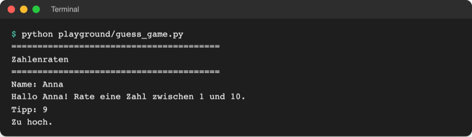

# Lab 3.1 – Lösung: Tipp bewerten

Fertiger Stand: [project/examples/m03-control-flow/l01-conditions/guess_game.py](../../project/examples/m03-control-flow/l01-conditions/guess_game.py)

## Aufgabe 1: Alte Ausgabe entfernen

Die Zeile `print("Treffer:", guess == secret)` fällt weg. Die Zeile `print(f"{name} tippt {guess}")` darf bleiben oder ebenfalls entfallen; das Beispiel verzichtet darauf, weil die Bewertung den Tipp schon kommentiert.

## Aufgabe 2: if für „zu hoch“

```python
if guess > secret:
    print("Zu hoch.")
```

## Aufgabe 3: elif und else

```python
if guess > secret:
    print("Zu hoch.")
elif guess < secret:
    print("Zu niedrig.")
else:
    print(f"Richtig, {name}!")
```

Der `else`-Zweig braucht keine Bedingung: Ist der Tipp weder größer noch kleiner, ist er gleich. Gleichwertig wäre `elif guess == secret:` als dritter Zweig; `else` spart eine Prüfung.

Vollständige Datei:

```python
# Zahlenraten – Stand Lab 3.1: Tipp bewerten

secret = 7

print("=" * 40)
print("Zahlenraten")
print("=" * 40)

name = input("Name: ").strip().title()
print(f"Hallo {name}! Rate eine Zahl zwischen 1 und 10.")

guess = int(input("Tipp: "))

if guess > secret:
    print("Zu hoch.")
elif guess < secret:
    print("Zu niedrig.")
else:
    print(f"Richtig, {name}!")
```

## Aufgabe 4: Drei Fälle testen

```text
$ python playground/guess_game.py
========================================
Zahlenraten
========================================
Name: Anna
Hallo Anna! Rate eine Zahl zwischen 1 und 10.
Tipp: 9
Zu hoch.
```



_Quelle: eigener Screenshot, Kurs-Repo, 08.11.2026._

Mit Tipp `3` erscheint `Zu niedrig.`, mit Tipp `7` erscheint `Richtig, Anna!`.

## Aufgabe 5: Grenzwerte

- Tipp `1`: `Zu niedrig.` (1 < 7)
- Tipp `10`: `Zu hoch.` (10 > 7)

Es erscheint jeweils genau eine Zeile, weil von einer `if`-`elif`-`else`-Kette nur ein Zweig läuft.

## Erweiterung

```python
age = int(input("Alter: "))
is_student = input("Studierend? (j/n): ").strip().lower() == "j"
is_cinema_day = input("Kinotag? (j/n): ").strip().lower() == "j"

if age < 12:
    price = 6
elif is_cinema_day:
    price = 7
elif is_student and age < 30:
    price = 8
else:
    price = 12

print(f"Preis: {price} €")
```

```text
Alter: 22
Studierend? (j/n): j
Kinotag? (j/n): n
Preis: 8 €
```

Die Reihenfolge folgt dem günstigsten Preis: Kinder zuerst, dann Kinotag, dann Studierende. Mit Alter `22`, studierend und Kinotag ergibt sich `Preis: 7 €`, weil die Kinotag-Regel vor der Studierenden-Regel steht.
