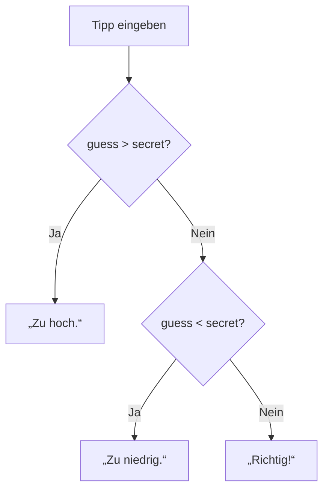
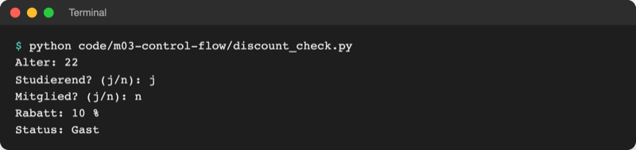
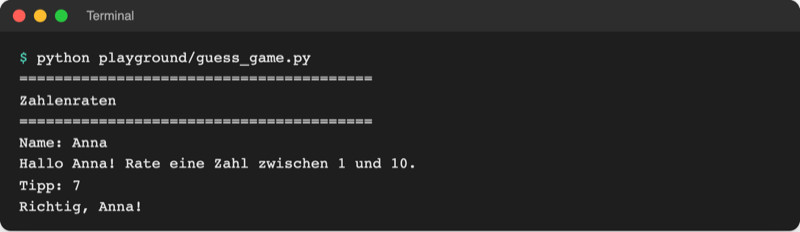

# Lab 3.1: Bedingte Anweisungen

**Leitfragen:**

<details>
<summary>Nach welchen Regeln entscheidet eine Ampel, ob ein Fußgänger gehen darf?</summary>

Grün: gehen, Rot: stehen bleiben. Eine Bedingung („Ist die Ampel grün?“) entscheidet, welche Handlung folgt; genau so wählt ein Programm mit `if` zwischen zwei Wegen.

</details>

<details>
<summary>Wie viele Möglichkeiten gibt es, wenn ein Tipp mit der Geheimzahl verglichen wird?</summary>

Drei: zu hoch, zu niedrig oder richtig. Mehr gibt es nicht, deshalb reicht eine Kette aus `if`, `elif` und `else`.

</details>

<details>
<summary>Spielt die Reihenfolge von Prüfungen eine Rolle?</summary>

Ja. Python prüft von oben nach unten und nimmt den ersten passenden Zweig; alle weiteren werden übersprungen. Die wichtigste oder engste Regel gehört deshalb nach oben.

</details>

- Bisher läuft jedes Programm Zeile für Zeile von oben nach unten durch. Mit einer Bedingung führt es manche Zeilen nur unter bestimmten Umständen aus.
- Bedingungen bauen auf den Vergleichen und `and`/`or`/`not` aus Lab 2.3 auf: Jeder Vergleich liefert `True` oder `False`.

## Begriffe

| Begriff | Bedeutung |
| --- | --- |
| Bedingung | Ausdruck, der `True` oder `False` ergibt, z. B. `age >= 18`; wie die Frage „Ist die Ampel grün?“ |
| bedingte Anweisung | `if`-Block: Zeilen, die nur laufen, wenn die Bedingung wahr ist |
| Zweig | einer der möglichen Wege durch eine `if`-`elif`-`else`-Kette; genau einer wird ausgeführt |
| Block | zusammengehörige, gleich weit eingerückte Zeilen unter einer Zeile mit Doppelpunkt |
| Wahrheitswert | was Python aus einem beliebigen Wert macht, wenn er als Bedingung dient (`0` gilt als falsch) |
| Bedingungsausdruck | Kurzform `a if bedingung else b`: liefert einen von zwei Werten |
| Ablaufdiagramm | Zeichnung eines Programmablaufs: Rechtecke für Schritte, Rauten für Entscheidungen |

## Entscheidungen als Bild

Ein Ablaufdiagramm (englisch *flowchart*) zeigt Entscheidungen als Raute mit zwei Ausgängen (Ja/Nein) und Handlungen als Rechteck. Das klassische Beispiel prüft eine Lampe, die nicht leuchtet:


_Quelle: Wikimedia Commons, „LampFlowchart.svg“ (https://commons.wikimedia.org/wiki/File:LampFlowchart.svg), Booyabazooka nach Wapcaplet, CC BY-SA 3.0, abgerufen am 08.11.2026._

Dieselbe Logik als Diagramm für die Bewertung eines Tipps im Zahlenraten:



## if, elif, else

```python
temperature = 12

if temperature >= 25:          # Bedingung, dann Doppelpunkt
    print("T-Shirt")           # Block: 4 Leerzeichen eingerückt
elif temperature >= 10:        # nur geprüft, wenn die erste Bedingung falsch war
    print("Pullover")
else:                          # alles Übrige, ohne Bedingung
    print("Jacke")

print("Fertig.")               # nicht eingerückt: läuft immer
```

| Teil | Pflicht? | Wirkung |
| --- | --- | --- |
| `if bedingung:` | ja | Block läuft nur, wenn die Bedingung `True` ist |
| `elif bedingung:` | nein, beliebig viele | weitere Prüfung, nur wenn alle vorherigen falsch waren |
| `else:` | nein, höchstens eins, am Ende | läuft, wenn keine Bedingung passte |

- Doppelpunkt am Zeilenende und Einrückung um 4 Leerzeichen sind Pflicht (Einrückung als Syntax, Lab 2.1). Die erste nicht eingerückte Zeile beendet den Block.
- Von einer Kette läuft immer höchstens ein Zweig, auch wenn später noch eine Bedingung wahr wäre.

Original: [Python-Dokumentation, Tutorial Abschnitt 4.1 if Statements mit einem Beispiel aus if, elif und else](https://docs.python.org/3.14/tutorial/controlflow.html#if-statements), Stand 08.11.2026.

## Beispiel: Rabatt-Check

Datei: [code/m03-control-flow/discount_check.py](../../project/code/m03-control-flow/discount_check.py). Regeln: Mitglieder 20 %, unter 14 oder ab 65 Jahren 15 %, Studierende unter 30 Jahren 10 %, sonst nichts.

```python
age = int(input("Alter: "))
is_student = input("Studierend? (j/n): ").strip().lower() == "j"   # Vergleich liefert True/False
is_member = input("Mitglied? (j/n): ").strip().lower() == "j"

if is_member:                    # höchster Rabatt zuerst prüfen
    discount = 20
elif age < 14 or age >= 65:      # eine der beiden Bedingungen genügt
    discount = 15
elif is_student and age < 30:    # beide Bedingungen müssen stimmen
    discount = 10
else:
    discount = 0
```

Start im Ordner `project/`: `python code/m03-control-flow/discount_check.py`



_Quelle: eigener Screenshot, Kurs-Repo, 08.11.2026._

**Reihenfolge:** Stünde die Studierenden-Regel oben, bekäme ein 20-jähriges Mitglied, das studiert, nur 10 % statt 20 %. Die erste passende Regel gewinnt.

## Verschachtelt oder kombiniert

Ein `if` darf in einem anderen `if` stehen. Oft ist eine Bedingung mit `and` kürzer und gleichwertig:

Verschachtelt (zwei Ebenen Einrückung):

```python
if is_student:
    if age < 30:
        discount = 10
```

Kombiniert (eine Bedingung):

```python
if is_student and age < 30:
    discount = 10
```

Verschachteln lohnt sich, wenn der innere Teil mehrere eigene Zweige hat. Für eine reine „beides muss stimmen“-Prüfung ist `and` lesbarer.

## Wahrheitswerte: was als wahr gilt

Eine Bedingung muss kein Vergleich sein. Python macht aus jedem Wert einen Wahrheitswert; `bool(wert)` zeigt ihn an.

| Wert | gilt als | Beispiel |
| --- | --- | --- |
| `0`, `0.0` | falsch | `if count:` läuft nicht bei `0` |
| jede andere Zahl | wahr | `-1`, `7`, `0.5` |
| `""` (leerer String) | falsch | `if name:` läuft nicht bei leerer Eingabe |
| jeder andere String | wahr | auch `" "` und `"0"` |
| `None` | falsch | „noch kein Wert“ |
| `True` / `False` | wahr / falsch | unverändert |

```python
nickname = input("Spitzname (leer lassen = keiner): ").strip()
if nickname:                 # wahr, sobald etwas eingegeben wurde
    print(f"Hallo {nickname}!")
else:
    print("Hallo!")
```

## Bedingungsausdruck: a if x else b

Wenn nur ein Wert von einer Bedingung abhängt, passt die Kurzform in eine Zeile:

```python
status = "Mitglied" if is_member else "Gast"
```

Gelesen: „`"Mitglied"`, wenn `is_member` wahr ist, sonst `"Gast"`“. Für mehr als zwei Fälle bleibt die `if`-`elif`-Kette lesbarer.

## Im Spiel: Tipp bewerten

Bis Lab 2.4 gibt das Spiel nur `Treffer: True` oder `Treffer: False` aus. Jetzt ersetzt eine Kette mit drei Zweigen diese Zeile:

```python
if guess > secret:
    print("Zu hoch.")
elif guess < secret:
    print("Zu niedrig.")
else:                        # weder größer noch kleiner: gleich
    print(f"Richtig, {name}!")
```



_Quelle: eigener Screenshot, Kurs-Repo, 08.11.2026._

## Typische Fehler

| Symptom | Ursache | Lösung |
| --- | --- | --- |
| `SyntaxError: expected ':'` | Doppelpunkt nach `if`/`elif`/`else` fehlt | Doppelpunkt ans Zeilenende |
| `IndentationError: expected an indented block after 'if' statement` | Zeile unter `if` nicht eingerückt | 4 Leerzeichen einrücken (VS Code: `Tab`) |
| `SyntaxError: invalid syntax. Maybe you meant '==' …` bei `if guess = secret:` | `=` weist zu, `==` vergleicht | `==` verwenden |
| immer derselbe Zweig, obwohl ein anderer passt | Reihenfolge: eine allgemeinere Bedingung steht weiter oben | engere Regel nach oben |
| Vergleich mit Eingabe nie wahr | `input()` liefert Text, `"7" == 7` ist `False` | mit `int()` umwandeln (Lab 2.2) |
| `if answer == "j" or "J":` ist immer wahr | `"J"` allein ist ein nicht leerer String, also wahr | `answer == "j" or answer == "J"` oder `answer.lower() == "j"` |

## Fazit

- `if`, `elif` und `else` wählen genau einen Zweig; die Reihenfolge der Prüfungen entscheidet.
- Blöcke entstehen durch Doppelpunkt und Einrückung.
- `0`, `""` und `None` gelten als falsch, fast alles andere als wahr.
- `a if x else b` liefert einen von zwei Werten in einer Zeile.

In der Übung bewertet das eigene Spiel jeden Tipp mit „zu hoch“, „zu niedrig“ oder „richtig“.
