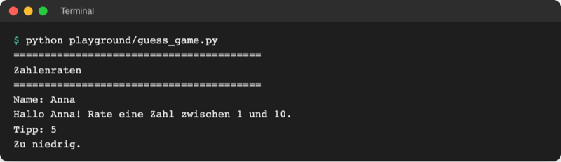

# Lab 3.2 – Lösung: Geheimzahl per Zufall

Fertiger Stand: [project/examples/m03-control-flow/l02-random/guess_game.py](../../project/examples/m03-control-flow/l02-random/guess_game.py)

## Aufgabe 1: random importieren

```python
# Zahlenraten – Stand Lab 3.2: Geheimzahl per Zufall

import random  # Werkzeug aus der Standardbibliothek
```

Der `import` steht oben, damit das Modul bereitsteht, bevor eine Zeile es benutzt.

## Aufgabe 2: Zufallszahl statt fester Zahl

```python
secret = random.randint(1, 10)  # 1 und 10 sind beide möglich
```

## Aufgabe 3: Kontrollausgabe

```python
secret = random.randint(1, 10)
print("Geheimzahl:", secret)  # nur vorübergehend
```

Drei Starts zeigen zum Beispiel `Geheimzahl: 4`, `Geheimzahl: 9`, `Geheimzahl: 4`. Wiederholungen sind möglich: Bei zehn möglichen Zahlen ist jede Zahl bei jedem Start gleich wahrscheinlich.

## Aufgabe 4: Fester Seed

```python
import random

random.seed(1)
secret = random.randint(1, 10)
print("Geheimzahl:", secret)
```

Beide Starts zeigen `Geheimzahl: 3` (Python 3.14). Gleicher Startwert ergibt dieselbe Folge; so lässt sich ein bestimmter Spielverlauf beliebig oft wiederholen.

## Aufgabe 5: Aufräumen

Seed-Zeile und Kontrollausgabe entfernen. Vollständige Datei:

```python
# Zahlenraten – Stand Lab 3.2: Geheimzahl per Zufall

import random  # Werkzeug aus der Standardbibliothek

secret = random.randint(1, 10)  # 1 und 10 sind beide möglich

print("=" * 40)
print("Zahlenraten")
print("=" * 40)

name = input("Name: ").strip().title()
print(f"Hallo {name}! Rate eine Zahl zwischen 1 und 10.")

guess = int(input("Tipp: "))

if guess > secret:
    print("Zu hoch.")
elif guess < secret:
    print("Zu niedrig.")
else:
    print(f"Richtig, {name}!")
```



_Quelle: eigener Screenshot, Kurs-Repo, 08.11.2026._

Dieselbe Eingabe `5` kann beim nächsten Start `Zu hoch.` oder `Richtig, Anna!` ergeben.

## Erweiterung

```python
import random

first = random.randint(1, 6)
second = random.randint(1, 6)
third = random.randint(1, 6)

print(f"Würfe: {first}, {second}, {third}")
print(f"Summe: {first + second + third}")

if first == second == third:
    print("Dreierpasch!")
elif first == second or first == third or second == third:
    print("Pasch!")
```

Beispiellauf (Zahlen weichen ab):

```text
Würfe: 2, 5, 5
Summe: 12
Pasch!
```

`first == second == third` ist ein verketteter Vergleich wie `1 <= guess <= 10` (Lab 2.3). Die Dreierpasch-Prüfung steht zuerst, sonst meldete das Programm bei `1, 1, 1` nur `Pasch!`.
