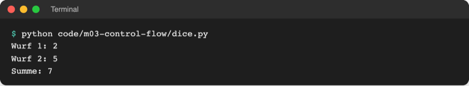
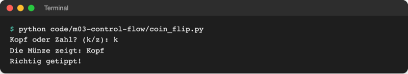
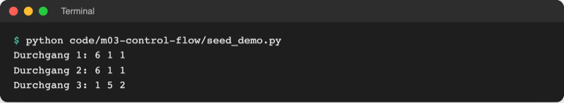

# Lab 3.2: Zufall und das erste Modul

**Leitfragen:**

<details>
<summary>Wie würfelt ein Computer, der nur Anweisungen befolgt?</summary>

Gar nicht wirklich: Er berechnet aus einem Startwert mit einer festen Formel eine Zahlenfolge, die zufällig aussieht. Man nennt das Pseudozufall.

</details>

<details>
<summary>Warum kann es beim Testen nützlich sein, immer dieselbe „Zufallszahl“ zu bekommen?</summary>

Ein Fehler, der nur bei der Geheimzahl 4 auftritt, lässt sich nur prüfen, wenn die 4 wieder kommt. Ein fester Startwert macht den Ablauf wiederholbar.

</details>

- Bisher steht die Geheimzahl fest im Code; wer die Datei kennt, gewinnt immer.
- Python bringt eine große Standardbibliothek mit: fertige Werkzeuge, die ohne Installation bereitliegen. Eines davon ist das Modul `random`.

## Begriffe

| Begriff | Bedeutung |
| --- | --- |
| Modul | Python-Datei mit fertigen Werkzeugen (Funktionen), die ein Programm nutzen kann; wie ein Werkzeugkasten im Regal |
| Standardbibliothek | alle Module, die mit Python mitgeliefert werden, z. B. `random`, `math`, `datetime` |
| `import` | holt ein Modul ins Programm: `import random` |
| Funktion | benannter Befehl, der mit Klammern aufgerufen wird, z. B. `print(...)`, `random.randint(1, 6)` |
| Pseudozufall | Zahlenfolge, die zufällig aussieht, aber aus einem Startwert berechnet wird |
| Seed (Startwert) | Zahl, mit der die Pseudozufallsfolge beginnt; gleicher Seed, gleiche Folge |

## import: ein Werkzeug aus der Standardbibliothek holen

```python
import random                     # einmal, ganz oben in der Datei

number = random.randint(1, 6)     # Modulname, Punkt, Funktionsname
print(number)
```

- `import random` steht üblicherweise am Dateianfang. Danach sind alle Funktionen des Moduls über `random.` erreichbar.
- Der Punkt bedeutet „aus“: `random.randint` ist „die Funktion `randint` aus dem Modul `random`“.
- Ohne `import` meldet Python `NameError: name 'random' is not defined. Did you forget to import 'random'?`.

Eigene Module und weitere Formen von `import` folgen in Modul 6.

## Die wichtigsten Zufallsfunktionen

| Aufruf | Ergebnis | Beispiel |
| --- | --- | --- |
| `random.randint(a, b)` | ganze Zahl von `a` bis `b`, **beide Grenzen eingeschlossen** | `random.randint(1, 6)` → `4` |
| `random.choice(folge)` | ein zufälliges Element einer Folge, z. B. ein Zeichen eines Strings | `random.choice("KZ")` → `"Z"` |
| `random.random()` | Kommazahl von `0.0` bis unter `1.0` | `0.374…` |
| `random.seed(zahl)` | Startwert festlegen: danach immer dieselbe Folge | `random.seed(42)` |

Original: [Python-Dokumentation zum Modul random: Beschreibung von random.randint und random.choice](https://docs.python.org/3.14/library/random.html#random.randint), Stand 08.11.2026.

Die Dokumentation beschreibt `randint(a, b)` mit „`a <= N <= b`“: Die obere Grenze ist dabei, anders als bei `range()` in Lab 3.3.

## Beispiel: Würfel

Datei: [code/m03-control-flow/dice.py](../../project/code/m03-control-flow/dice.py)

```python
import random

first = random.randint(1, 6)
second = random.randint(1, 6)

print(f"Wurf 1: {first}")
print(f"Wurf 2: {second}")
print(f"Summe: {first + second}")

if first == second:
    print("Pasch!")
```



_Quelle: eigener Screenshot, Kurs-Repo, 08.11.2026._

Jeder Start liefert andere Würfe.

## Beispiel: Münzwurf

Datei: [code/m03-control-flow/coin_flip.py](../../project/code/m03-control-flow/coin_flip.py). Ein String ist eine Folge von Zeichen (Lab 2.4), deshalb wählt `random.choice("KZ")` eines der beiden Zeichen.

```python
side = random.choice("KZ")                       # "K" oder "Z"
call = input("Kopf oder Zahl? (k/z): ").strip().upper()

name = "Kopf" if side == "K" else "Zahl"         # Bedingungsausdruck aus Lab 3.1
print(f"Die Münze zeigt: {name}")
```



_Quelle: eigener Screenshot, Kurs-Repo, 08.11.2026._

## Pseudozufall und seed

Ein Computer führt nur Anweisungen aus und hat keinen echten Würfel. Das Modul `random` berechnet deshalb aus einem Startwert (Seed) mit einer festen Formel eine lange Zahlenfolge, die zufällig wirkt. Ohne eigenen Seed wählt Python beim Start einen unvorhersehbaren Startwert, deshalb ist jeder Lauf anders.

Mit `random.seed(42)` beginnt die Folge immer an derselben Stelle. Datei: [code/m03-control-flow/seed_demo.py](../../project/code/m03-control-flow/seed_demo.py)

```python
random.seed(42)
print("Durchgang 1:", random.randint(1, 6), random.randint(1, 6), random.randint(1, 6))

random.seed(42)              # derselbe Startwert noch einmal
print("Durchgang 2:", random.randint(1, 6), random.randint(1, 6), random.randint(1, 6))

random.seed()                # ohne Wert: wieder unvorhersehbar
print("Durchgang 3:", random.randint(1, 6), random.randint(1, 6), random.randint(1, 6))
```



_Quelle: eigener Screenshot, Kurs-Repo, 08.11.2026._

Durchgang 1 und 2 zeigen auf jedem Rechner mit Python 3.14 dieselben Zahlen, Durchgang 3 ändert sich bei jedem Start.

| Einsatz | Seed setzen? |
| --- | --- |
| Spiel, Auslosung | nein, jeder Lauf soll anders sein |
| Fehlersuche, Test, Vorführung | ja, derselbe Ablauf lässt sich wiederholen |
| Passwörter, Sicherheitscodes | `random` gar nicht verwenden, sondern das Modul `secrets` (vorhersagbar ist unsicher) |

## Im Spiel: zufällige Geheimzahl

Aus der festen Zahl wird eine Zufallszahl; der Rest des Spiels bleibt gleich:

```python
import random  # Werkzeug aus der Standardbibliothek

secret = random.randint(1, 10)  # vorher: secret = 7
```

## Typische Fehler

| Symptom | Ursache | Lösung |
| --- | --- | --- |
| `NameError: name 'random' is not defined. Did you forget to import 'random'?` | `import random` fehlt oder steht unter der ersten Verwendung | `import random` an den Dateianfang |
| `AttributeError: module 'random' has no attribute 'randInt'. Did you mean: 'randint'?` | Tippfehler, Groß-/Kleinschreibung | `randint` klein schreiben |
| Zahl 10 kommt nie, obwohl erwartet | Verwechslung mit `range()` | `randint(1, 10)` schließt 10 ein; Code prüfen |
| immer dieselbe „Zufallszahl“ | `random.seed(...)` mit fester Zahl im Code vergessen | Zeile entfernen |
| `AttributeError: module 'random' has no attribute 'randint' (consider renaming '…/random.py' …)` | eigene Datei heißt `random.py` und überdeckt das Modul | Datei umbenennen, z. B. `dice.py` |

## Fazit

- `import random` holt das Modul; Funktionen ruft man mit `random.name(...)` auf.
- `random.randint(a, b)` liefert eine ganze Zahl, beide Grenzen eingeschlossen.
- Computerzufall ist Pseudozufall: gleicher Seed, gleiche Folge.

In der Übung zieht das eigene Spiel bei jedem Start eine neue Geheimzahl.
