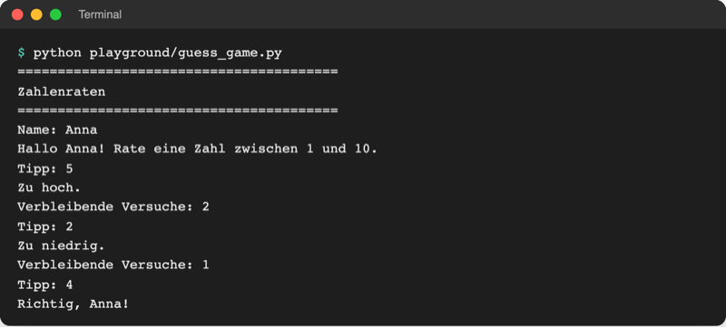
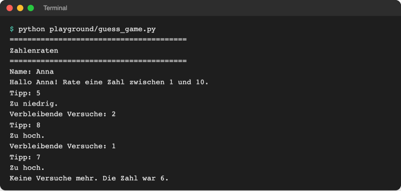

# Lab 3.3 – Lösung: Drei Versuche

Fertiger Stand: [project/examples/m03-control-flow/l03-loops/guess_game.py](../../project/examples/m03-control-flow/l03-loops/guess_game.py)

## Aufgabe 1: Zähler anlegen

```python
secret = random.randint(1, 10)
tries_left = 3
```

## Aufgabe 2: Schleife um Eingabe und Bewertung

```python
while tries_left > 0:
    guess = int(input("Tipp: "))
    tries_left -= 1  # jeder Tipp kostet einen Versuch

    if guess > secret:
        ...
```

Die Abfrage `name = input("Name: ")` bleibt **vor** der Schleife: Der Name wird nur einmal gebraucht. Der Abzug steht direkt nach der Eingabe, damit jeder Tipp zählt, egal welcher Zweig folgt.

## Aufgabe 3: Treffer zuerst, mit break

```python
    if guess == secret:
        print(f"Richtig, {name}!")
        break  # Treffer: Schleife sofort verlassen
    elif guess > secret:
        print("Zu hoch.")
    else:
        print("Zu niedrig.")
```

Steht der Treffer oben, endet die Schleife vor der Meldung „Verbleibende Versuche: …“.

## Aufgabe 4: Restversuche melden

```python
    if tries_left > 0:
        print(f"Verbleibende Versuche: {tries_left}")
    else:
        print(f"Keine Versuche mehr. Die Zahl war {secret}.")
```

Vollständige Datei:

```python
# Zahlenraten – Stand Lab 3.3: drei Versuche in einer while-Schleife

import random

secret = random.randint(1, 10)
tries_left = 3

print("=" * 40)
print("Zahlenraten")
print("=" * 40)

name = input("Name: ").strip().title()
print(f"Hallo {name}! Rate eine Zahl zwischen 1 und 10.")

while tries_left > 0:
    guess = int(input("Tipp: "))
    tries_left -= 1  # jeder Tipp kostet einen Versuch

    if guess == secret:
        print(f"Richtig, {name}!")
        break  # Treffer: Schleife sofort verlassen
    elif guess > secret:
        print("Zu hoch.")
    else:
        print("Zu niedrig.")

    if tries_left > 0:
        print(f"Verbleibende Versuche: {tries_left}")
    else:
        print(f"Keine Versuche mehr. Die Zahl war {secret}.")
```

## Aufgabe 5: Zwei Fälle testen

Treffer im dritten Versuch:



_Quelle: eigener Screenshot, Kurs-Repo, 08.11.2026._

Drei Fehltipps:



_Quelle: eigener Screenshot, Kurs-Repo, 08.11.2026._

Hängt das Spiel nach einem Tipp (immer wieder `Tipp:` ohne Ende), fehlt `tries_left -= 1` im Schleifenblock oder steht in nur einem Zweig. `Strg+C` beendet das Programm.

## Erweiterung

```python
height = int(input("Höhe: "))

print(" " * height + "X")
for row in range(height):
    spaces = " " * (height - row)
    stars = "*" * (2 * row + 1)
    print(spaces + stars)
print(" " * (height - 1) + "###")
```

```text
Höhe: 4
    X
    *
   ***
  *****
 *******
   ###
```

Nur die erste Zeile ändert sich: `int(input(...))` statt einer festen Zahl. Alle anderen Zeilen rechnen mit `height` und passen sich an.
