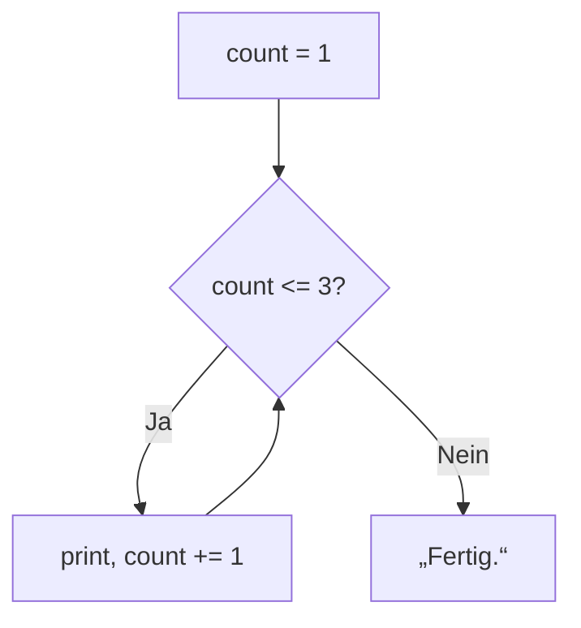
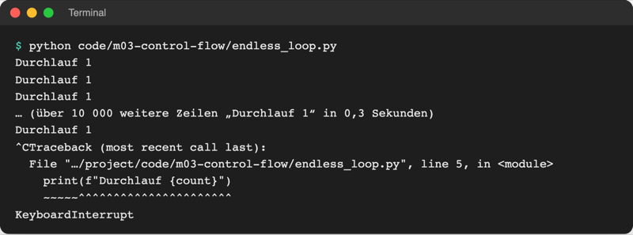
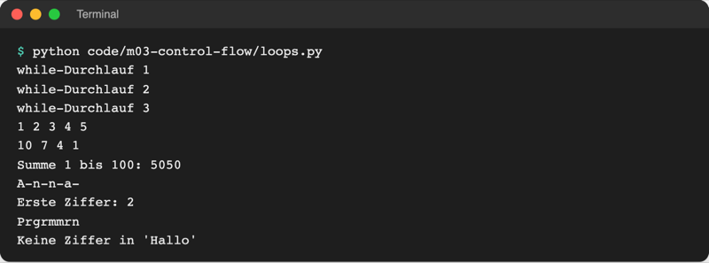
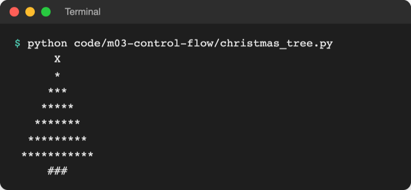

# Lab 3.3: Schleifen und Sprunganweisungen

**Leitfragen:**

<details>
<summary>Wie oft muss das Spiel nach einem Tipp fragen – und woher weiß es das vorher?</summary>

Es weiß es nicht: Bei einem Treffer reicht ein Tipp, sonst bis zu drei. Eine Wiederholung mit Bedingung („solange Versuche übrig sind“) löst das, ohne die Eingabe dreimal hinzuschreiben.

</details>

<details>
<summary>Wann soll eine Wiederholung vorzeitig enden?</summary>

Sobald das Ziel erreicht ist, etwa beim Treffer. Weiterfragen wäre sinnlos; `break` beendet die Schleife sofort.

</details>

<details>
<summary>Wie zeichnet man eine Treppe aus Sternen, ohne jede Zeile einzeln zu schreiben?</summary>

Eine Anweisung für „eine Zeile mit n Sternen“ und eine Wiederholung, die n hochzählt: `for n in range(1, 6): print("*" * n)`.

</details>

- Eine Schleife wiederholt einen Block. Ohne Schleife müsste jede Wiederholung einzeln im Code stehen, und die Anzahl wäre fest.
- Python kennt zwei Schleifen: `while` wiederholt, solange eine Bedingung gilt; `for` geht eine Folge Element für Element durch.

## Begriffe

| Begriff | Bedeutung |
| --- | --- |
| Schleife | Block, der mehrmals hintereinander ausgeführt wird; wie „Rühren, bis der Teig glatt ist“ |
| Durchlauf (Iteration) | eine einzelne Ausführung des Schleifenblocks |
| Endlosschleife | Schleife, deren Bedingung nie falsch wird; das Programm hört nicht auf |
| `range()` | erzeugt eine Zahlenfolge für `for`, z. B. `range(1, 4)` → 1, 2, 3 |
| Zähler | Variable, die bei jedem Durchlauf erhöht oder verringert wird, z. B. `count += 1` |
| `break` | verlässt die Schleife sofort |
| `while True:` | Schleife ohne eigenes Ende; läuft, bis ein `break` sie verlässt |
| `continue` | überspringt den Rest des aktuellen Durchlaufs und macht mit dem nächsten weiter |

## while: wiederholen, solange die Bedingung gilt

```python
count = 1
while count <= 3:              # Bedingung vor jedem Durchlauf prüfen
    print(f"while-Durchlauf {count}")
    count += 1                 # Zähler ändern, sonst endet die Schleife nie
print("Fertig.")
```

Ablauf: Bedingung prüfen → wahr: Block ausführen, zurück nach oben → falsch: hinter der Schleife weitermachen.



### Endlosschleife erkennen und abbrechen

Fehlt die Zeile, die den Zähler ändert, bleibt die Bedingung für immer wahr. Datei: [code/m03-control-flow/endless_loop.py](../../project/code/m03-control-flow/endless_loop.py)



_Quelle: eigener Screenshot, Kurs-Repo, 08.11.2026 (Ausgabe gekürzt, Abbruch nach 0,3 Sekunden)._

- **Abbrechen:** im Terminal `Strg+C` drücken (macOS: `control+C`). Python beendet das Programm mit `KeyboardInterrupt`; das ist kein Schaden.
- **Erkennen:** Das Terminal läuft voll mit derselben Zeile, oder das Programm reagiert nicht mehr.
- **Beheben:** prüfen, ob sich im Schleifenblock etwas ändert, das die Bedingung irgendwann falsch macht.

## for: eine Folge durchgehen

```python
for number in range(1, 6):     # number ist nacheinander 1, 2, 3, 4, 5
    print(number, end=" ")

for letter in "Anna":          # letter ist nacheinander "A", "n", "n", "a"
    print(letter, end="-")
```

`for` braucht keine eigene Bedingung und keinen eigenen Zähler: Die Schleife endet, wenn die Folge zu Ende ist.

| Aufruf | Zahlenfolge | Merkhilfe |
| --- | --- | --- |
| `range(5)` | 0, 1, 2, 3, 4 | fünf Zahlen, beginnt bei 0 |
| `range(1, 6)` | 1, 2, 3, 4, 5 | Ende ist **nicht** dabei |
| `range(0, 10, 3)` | 0, 3, 6, 9 | dritte Zahl = Schrittweite |
| `range(10, 0, -3)` | 10, 7, 4, 1 | negative Schrittweite zählt rückwärts |

Original: [Python-Dokumentation, Abschnitt 4.3 The range() Function mit Beispielen](https://docs.python.org/3.14/tutorial/controlflow.html#the-range-function), Stand 08.11.2026.

## while oder for?

| | `while` | `for` |
| --- | --- | --- |
| Frage | „Solange was gilt?“ | „Für welche Elemente?“ |
| Anzahl der Durchläufe | vorher unbekannt | steht fest (Länge der Folge) |
| Zähler | selbst anlegen und ändern | übernimmt `range()` |
| Risiko | Endlosschleife, wenn sich nichts ändert | kaum: endet mit der Folge |
| Beispiel | raten, bis getroffen oder keine Versuche mehr | 10 Zeilen zeichnen, jeden Buchstaben prüfen |

## Wiederholen, bis etwas eintritt: `while True` + `break`

Steht das Ende erst im Block fest (nach einer Eingabe, nach einem Wurf), läuft die Schleife mit `while True:` „für immer“, und ein `break` beendet sie, sobald das Ereignis eintritt:

```python
while True:                            # Bedingung ist immer wahr
    answer = input("Weiter? (j/n): ")
    if answer == "n":
        break                          # Ereignis eingetreten: Schleife verlassen
    print("Noch eine Runde.")
print("Ende.")
```

Ohne `break` im Block wäre `while True:` eine Endlosschleife.

## break, continue und Zähler

Datei: [code/m03-control-flow/loops.py](../../project/code/m03-control-flow/loops.py)

```python
total = 0
for number in range(1, 101):   # Zähler: Summe mitführen
    total += number
print(f"Summe 1 bis 100: {total}")

for char in "Raum B204":
    if char in "0123456789":
        print(f"Erste Ziffer: {char}")
        break                  # gefunden: Schleife sofort verlassen

for char in "Programmieren":
    if char in "aeiou":
        continue               # Vokal: Rest dieses Durchlaufs überspringen
    print(char, end="")
```



_Quelle: eigener Screenshot, Kurs-Repo, 08.11.2026._

**Randnotiz `else` an Schleifen:** Ein `else:` direkt unter einer Schleife läuft nur, wenn die Schleife **ohne** `break` zu Ende ging. Beispiel am Ende von `loops.py`: „Keine Ziffer in 'Hallo'“. Selten nötig, aber in fremdem Code anzutreffen.

## Beispiel: Weihnachtsbaum

Datei: [code/m03-control-flow/christmas_tree.py](../../project/code/m03-control-flow/christmas_tree.py). `" " * 3` wiederholt einen String dreimal.

```python
height = 6

print(" " * height + "X")              # Spitze
for row in range(height):              # row = 0, 1, ..., 5
    spaces = " " * (height - row)      # nach unten weniger Leerzeichen
    stars = "*" * (2 * row + 1)        # 1, 3, 5, ... Sterne
    print(spaces + stars)
print(" " * (height - 1) + "###")      # Stamm
```



_Quelle: eigener Screenshot, Kurs-Repo, 08.11.2026._

## Im Spiel: drei Versuche

Eingabe und Bewertung wandern in eine `while`-Schleife. Ein Zähler `tries_left` startet bei 3, jeder Tipp zieht einen ab, ein Treffer beendet die Schleife mit `break`:

```python
tries_left = 3

while tries_left > 0:
    guess = int(input("Tipp: "))
    tries_left -= 1

    if guess == secret:
        print(f"Richtig, {name}!")
        break
    # ... „Zu hoch.“ / „Zu niedrig.“ und „Verbleibende Versuche: 2“
```

## Typische Fehler

| Symptom | Ursache | Lösung |
| --- | --- | --- |
| Terminal läuft voll, Programm endet nicht | Endlosschleife: Bedingung wird nie falsch | `Strg+C`, dann Zähler im Block ändern |
| `SyntaxError: expected ':'` | Doppelpunkt nach `while`/`for` fehlt | Doppelpunkt ergänzen |
| Schleife läuft einmal zu wenig | `range(1, 10)` endet bei 9 | Ende um 1 erhöhen: `range(1, 11)` |
| Anweisung läuft nur einmal statt bei jedem Durchlauf | Zeile nicht eingerückt, steht also hinter der Schleife | einrücken |
| Anweisung läuft bei jedem Durchlauf statt einmal am Ende | Zeile zu weit eingerückt | ausrücken |
| `SyntaxError: 'break' outside loop` | `break` steht nicht in einer Schleife | `break` nur im Schleifenblock |

## Fazit

- `while` wiederholt, solange eine Bedingung gilt; `for` geht eine Folge durch, `range()` liefert Zahlenfolgen ohne das Ende.
- `break` verlässt die Schleife, `continue` springt zum nächsten Durchlauf.
- Eine Endlosschleife bricht `Strg+C` ab.

In der Übung bekommt das eigene Spiel drei Versuche in einer `while`-Schleife.
