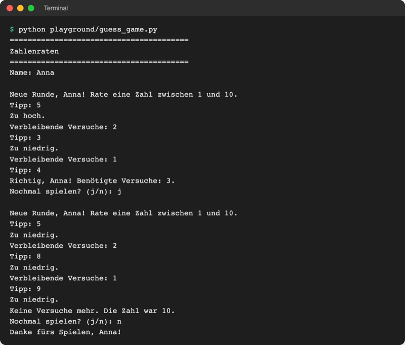

# Lab 3.4 – Lösung: Mehrere Runden und Fehlersuche

Fertiger Stand: [project/examples/m03-control-flow/l04-combining/guess_game.py](../../project/examples/m03-control-flow/l04-combining/guess_game.py)

## Aufgabe 1: Konstante und Hochzählen

```python
MAX_TRIES = 3  # Großbuchstaben: Wert ändert sich im Programm nicht
...
    tries = 0
    ...
    while tries < MAX_TRIES:
        guess = int(input("Tipp: "))
        tries += 1

        if guess == secret:
            print(f"Richtig, {name}! Benötigte Versuche: {tries}.")
            break
        ...
        if tries < MAX_TRIES:
            print(f"Verbleibende Versuche: {MAX_TRIES - tries}")
        else:
            print(f"Keine Versuche mehr. Die Zahl war {secret}.")
```

Die Restversuche ergeben sich aus dem Ausdruck `MAX_TRIES - tries`; eine zweite Zählvariable ist nicht nötig. Ändert sich `MAX_TRIES` später auf `5`, passen sich Schleife und Meldungen ohne weitere Änderung an.

## Aufgabe 2: Äußere Schleife

```python
play_again = "j"
while play_again == "j":  # äußere Schleife: eine Runde pro Durchlauf
    secret = random.randint(1, 10)
    tries = 0
    print(f"\nNeue Runde, {name}! Rate eine Zahl zwischen 1 und 10.")

    while tries < MAX_TRIES:  # innere Schleife: ein Tipp pro Durchlauf
        ...
```

`play_again = "j"` vor der Schleife sorgt dafür, dass die erste Runde startet. Geheimzahl und Zähler stehen in der äußeren Schleife, damit jede Runde frisch beginnt. `\n` erzeugt eine Leerzeile vor jeder Runde (Escape-Zeichen, Lab 2.4).

## Aufgabe 3: Nochmal spielen?

Auf der Einrückungsebene der äußeren Schleife, also nach der inneren:

```python
    play_again = input("Nochmal spielen? (j/n): ").strip().lower()

print(f"Danke fürs Spielen, {name}!")
```

Vollständige Datei:

```python
# Zahlenraten – Stand Lab 3.4: mehrere Runden, Versuchszähler

import random

MAX_TRIES = 3  # Großbuchstaben: Wert ändert sich im Programm nicht

print("=" * 40)
print("Zahlenraten")
print("=" * 40)

name = input("Name: ").strip().title()

play_again = "j"
while play_again == "j":  # äußere Schleife: eine Runde pro Durchlauf
    secret = random.randint(1, 10)
    tries = 0
    print(f"\nNeue Runde, {name}! Rate eine Zahl zwischen 1 und 10.")

    while tries < MAX_TRIES:  # innere Schleife: ein Tipp pro Durchlauf
        guess = int(input("Tipp: "))
        tries += 1

        if guess == secret:
            print(f"Richtig, {name}! Benötigte Versuche: {tries}.")
            break
        elif guess > secret:
            print("Zu hoch.")
        else:
            print("Zu niedrig.")

        if tries < MAX_TRIES:
            print(f"Verbleibende Versuche: {MAX_TRIES - tries}")
        else:
            print(f"Keine Versuche mehr. Die Zahl war {secret}.")

    play_again = input("Nochmal spielen? (j/n): ").strip().lower()

print(f"Danke fürs Spielen, {name}!")
```

## Aufgabe 4: Zwei Runden



_Quelle: eigener Screenshot, Kurs-Repo, 08.11.2026._

## Erweiterung: guess1.py reparieren

**Symptom:** Bei „Zu hoch.“ bleibt die Meldung `Verbleibende Versuche: 3`; nur „Zu niedrig.“ zieht einen Versuch ab. Wer immer zu hoch tippt, rät endlos.

**Ursache:** `tries -= 1` ist eine Ebene zu tief eingerückt und gehört damit zum `else`-Zweig. Sie läuft nur bei zu niedrigen Tipps.

Vorher (falsch):

```python
    else:
        print("Zu niedrig.")
        tries -= 1           # gehört zum else-Zweig
```

Nachher (richtig):

```python
    else:
        print("Zu niedrig.")

    tries -= 1               # Ebene der Schleife: läuft bei jedem Fehltipp
```

Ausgabe nach der Reparatur mit drei zu hohen Tipps (Geheimzahl 4):

```text
Rate eine Zahl zwischen 1 und 10. Es gibt 3 Versuche.
Tipp: 9
Zu hoch.
Verbleibende Versuche: 2
Tipp: 8
Zu hoch.
Verbleibende Versuche: 1
Tipp: 7
Zu hoch.
Keine Versuche mehr. Die Zahl war 4.
```

Alternative: `tries -= 1` direkt nach `guess = int(input("Tipp: "))` setzen, wie im eigenen Spiel aus Lab 3.3. Beide Stellen ziehen bei jedem Fehltipp einen Versuch ab; bei einem Treffer ist der Abzug egal, weil `break` folgt.

