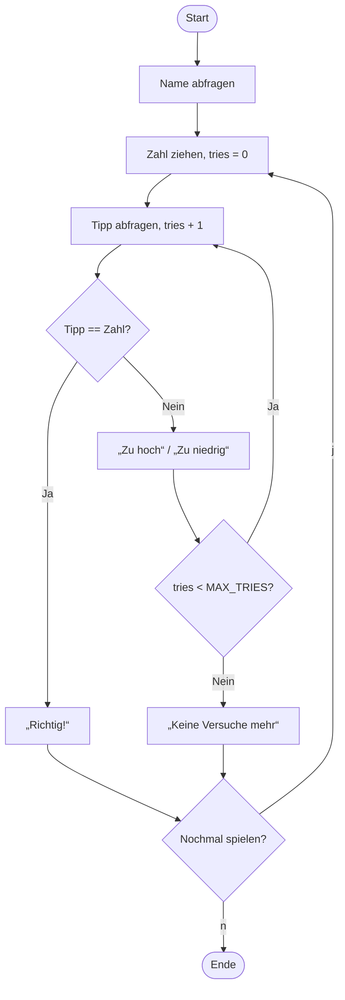
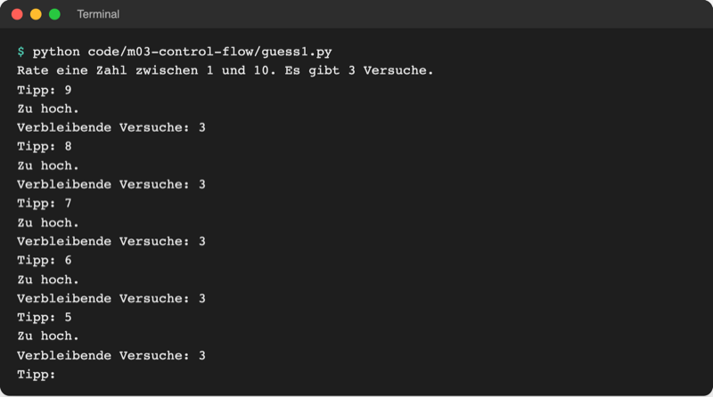
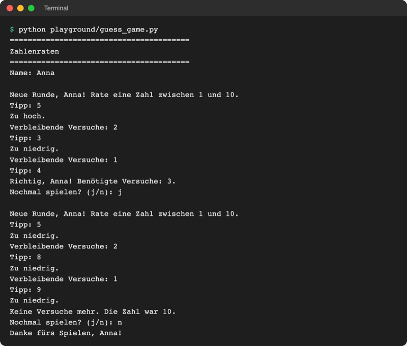

# Lab 3.4: Kontrollstrukturen kombinieren

**Leitfragen:**

<details>
<summary>Welche Schritte hat eine Spielrunde, aufgeschrieben als Ablauf auf Papier?</summary>

Zahl ziehen, Tipp abfragen, vergleichen, Hinweis geben, wiederholen bis Treffer oder keine Versuche mehr, Ergebnis melden. Wer das vor dem Programmieren aufschreibt, sieht sofort, welche Teile sich wiederholen.

</details>

<details>
<summary>Wo im Code beginnt eine neue Runde?</summary>

Dort, wo die Geheimzahl gezogen und der Versuchszähler zurückgesetzt wird. Genau diese Zeilen gehören in die äußere Schleife, nicht davor.

</details>

<details>
<summary>Was ändert eine einzige verrutschte Einrückung?</summary>

Die Zugehörigkeit einer Zeile: Vier Leerzeichen mehr oder weniger entscheiden, ob sie in einem Zweig, in der Schleife oder danach läuft. Der Code bleibt gültig, macht aber etwas anderes.

</details>

- Dieses Lab bringt keine neue Syntax. Es setzt `if`, `while`, `for` und `break` aus den Labs 3.1–3.3 zu einem vollständigen Programm zusammen.
- Zwei Werkzeuge helfen dabei: ein Ablaufdiagramm vor dem Schreiben und genaues Lesen der Einrückung bei der Fehlersuche.

## Begriffe

| Begriff | Bedeutung |
| --- | --- |
| verschachtelte Schleife | Schleife in einer anderen Schleife; die innere läuft bei jedem Durchlauf der äußeren komplett durch |
| Konstante | Wert, der sich im Programm nie ändert; per Konvention in GROSSBUCHSTABEN, z. B. `MAX_TRIES = 3` |
| Logikfehler | Programm läuft ohne Fehlermeldung, tut aber etwas anderes als gedacht |
| Fehlersuche (Debugging) | Symptom beobachten, Ursache eingrenzen, beheben, erneut testen |

## Programm planen: Ablaufdiagramm

Ein Ablaufdiagramm hat feste Formen: Oval für Start und Ende, Rechteck für einen Schritt, Raute für eine Entscheidung (Lab 3.1). Ein Pfeil, der nach oben zurückführt, ist eine Schleife. Das historische Beispiel unten zeigt einen Algorithmus mit Schleife (Rücksprung „GOTO 2“):


_Quelle: Wikimedia Commons, „Euclid flowchart.svg“ (https://commons.wikimedia.org/wiki/File:Euclid_flowchart.svg), Somepics, CC BY-SA 4.0, abgerufen am 08.11.2026._

Das Zahlenraten mit mehreren Runden als Ablaufdiagramm:



Zwei Pfeile führen zurück, also braucht das Programm zwei Schleifen:

| Rückpfeil | Schleife | läuft |
| --- | --- | --- |
| nach „Tipp abfragen“ | innere `while tries < MAX_TRIES:` | einmal pro Tipp |
| nach „Zahl ziehen“ | äußere `while play_again == "j":` | einmal pro Runde |

## Verschachtelte Schleifen

```python
for round_number in range(1, 3):            # äußere Schleife: 2 Runden
    print(f"Runde {round_number}")
    for attempt in range(1, 4):             # innere Schleife: je 3 Versuche
        print(f"  Versuch {attempt}")
```

```text
Runde 1
  Versuch 1
  Versuch 2
  Versuch 3
Runde 2
  Versuch 1
  Versuch 2
  Versuch 3
```

`break` verlässt immer nur die **innerste** Schleife, in der es steht. Ein Treffer beendet also die Runde, nicht das ganze Spiel.

## Konstanten in GROSSBUCHSTABEN

```python
MAX_TRIES = 3  # Großbuchstaben: Wert ändert sich im Programm nicht
```

Python verbietet das Ändern nicht; die Schreibweise ist eine Vereinbarung aus dem Stilleitfaden PEP 8 (Lab 2.1). Sie zeigt: Diese Zahl ist eine Einstellung. Wer das Spiel schwerer machen will, ändert nur diese eine Zeile.

## Hochzählen statt herunterzählen

| | herunter (Lab 3.3) | hoch (Lab 3.4) |
| --- | --- | --- |
| Start | `tries_left = 3` | `tries = 0` |
| je Tipp | `tries_left -= 1` | `tries += 1` |
| Bedingung | `while tries_left > 0:` | `while tries < MAX_TRIES:` |
| Vorteil | Rest direkt ablesbar | Anzahl für „Benötigte Versuche: 2“ direkt ablesbar |

## Fehlersuche: falsche Einrückung

Datei: [code/m03-control-flow/guess1.py](../../project/code/m03-control-flow/guess1.py). Das Programm startet ohne Fehlermeldung, verhält sich aber falsch:



_Quelle: eigener Screenshot, Kurs-Repo, 08.11.2026._

Vorgehen bei Logikfehlern:

1. **Symptom genau beschreiben:** Bei „Zu hoch.“ bleibt die Zahl der Versuche gleich, bei „Zu niedrig.“ sinkt sie.
2. **Verdächtige Zeile finden:** Welche Zeile soll das Symptom verhindern? Hier die Zeile, die Versuche abzieht.
3. **Einrückung lesen:** Zu welchem Block gehört die Zeile? Senkrechte Hilfslinien im Editor (VS Code zeigt sie automatisch) machen die Ebenen sichtbar.
4. **Ändern und mit demselben Fall erneut testen:** dieselben Eingaben wie beim Symptom.

## Im Spiel: mehrere Runden

```python
play_again = "j"
while play_again == "j":                    # äußere Schleife: eine Runde
    secret = random.randint(1, 10)          # neue Zahl je Runde
    tries = 0                               # Zähler je Runde zurücksetzen
    while tries < MAX_TRIES:                # innere Schleife: ein Tipp
        ...
    play_again = input("Nochmal spielen? (j/n): ").strip().lower()
```



_Quelle: eigener Screenshot, Kurs-Repo, 08.11.2026._

## Typische Fehler

| Symptom | Ursache | Lösung |
| --- | --- | --- |
| jede Runde hat dieselbe Geheimzahl | `random.randint` steht vor der äußeren Schleife | in die äußere Schleife verschieben |
| ab Runde 2 sofort „Keine Versuche mehr“ | `tries = 0` steht vor der äußeren Schleife | Zähler am Rundenanfang zurücksetzen |
| „Nochmal spielen?“ nach jedem Tipp | `input("Nochmal …")` zu weit eingerückt (in der inneren Schleife) | auf Ebene der äußeren Schleife ausrücken |
| Eingabe `J` beendet das Spiel | Vergleich mit `"j"` ist case-sensitiv | `.strip().lower()` an die Eingabe |
| `IndentationError: unindent does not match any outer indentation level` | Einrückung mit 3 statt 4 Leerzeichen oder Tab/Leerzeichen gemischt | einheitlich 4 Leerzeichen; VS Code zeigt die Einstellung unten rechts in der Statusleiste („Spaces: 4“) |

## Fazit

- Ein Ablaufdiagramm zeigt vor dem Schreiben, wo sich etwas wiederholt: jeder Rückpfeil ist eine Schleife.
- Eine Runde ist die äußere Schleife, ein Tipp die innere; `break` verlässt nur die innere.
- Feste Einstellungen stehen als Konstante in GROSSBUCHSTABEN oben.
- Bei Logikfehlern zuerst das Symptom beschreiben, dann die Einrückung der verdächtigen Zeile lesen.

In der Übung wird das eigene Spiel mehrfach spielbar; die Erweiterung repariert `guess1.py`.
