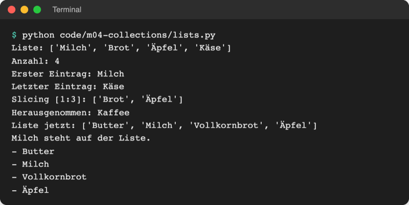
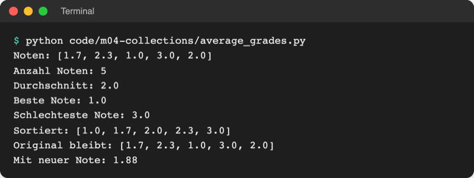

# Lab 4.1: Listen

**Leitfragen:**

<details>
<summary>Wie merkt sich ein Programm zehn Werte, ohne zehn Variablen?</summary>

Mit einer Liste: Eine einzige Variable zeigt auf eine geordnete Reihe von Werten, z. B. `guesses = [5, 8, 7]`. Neue Werte kommen hinzu, ohne dass neue Variablen nötig sind.

</details>

<details>
<summary>Was ist der erste, was der letzte Eintrag einer Einkaufsliste?</summary>

Der erste steht ganz oben, der letzte ganz unten. Python zählt die Plätze ab 0: `shopping[0]` ist der erste Eintrag, `shopping[-1]` der letzte.

</details>

<details>
<summary>Wie findet man den höchsten Wert, ohne selbst zu vergleichen?</summary>

Python bringt fertige Funktionen mit: `max(grades)` liefert den größten Wert, `min(grades)` den kleinsten, `sum(grades)` die Summe.

</details>

- Eine Liste ist eine geordnete, veränderbare Sammlung von Werten in eckigen Klammern.
- Jeder Platz hat eine Nummer (Index), gezählt ab 0; negative Indizes zählen von hinten.

## Begriffe

| Begriff | Bedeutung |
| --- | --- |
| Sammlung (Collection) | ein Wert, der mehrere Werte enthält; wie ein Ordner mit mehreren Blättern |
| Liste (`list`) | geordnete, veränderbare Sammlung: `[5, 8, 7]`; wie eine Einkaufsliste, auf der Einträge dazukommen und gestrichen werden |
| Element | ein einzelner Wert in einer Sammlung, z. B. `8` in `[5, 8, 7]` |
| Index | Platznummer eines Elements, beginnt bei 0; wie Hausnummern, nur dass die erste Nummer 0 ist |
| veränderbar | der Inhalt lässt sich nach dem Anlegen ändern (Liste); Strings aus Lab 2.4 sind dagegen unveränderlich |
| Methode | Funktion, die an einem Wert hängt und mit Punkt aufgerufen wird, z. B. `guesses.append(5)` (wie `name.strip()` aus Lab 2.4) |
| Array | Reihe von Werten desselben Typs, z. B. nur Kommazahlen; in Python über das Modul `array` |

## Liste anlegen und lesen

Eine Liste steht in eckigen Klammern, die Elemente sind durch Kommas getrennt. `[]` ist eine leere Liste.

```python
shopping = ["Milch", "Brot", "Äpfel", "Käse"]
guesses = []                  # leere Liste: noch kein Tipp
mixed = [12.5, "warm", True]  # verschiedene Typen sind erlaubt
```

Lesen funktioniert wie bei Strings (Lab 2.4): Index in eckigen Klammern, Slicing mit Doppelpunkt.

| Ausdruck | Ergebnis | Bedeutung |
| --- | --- | --- |
| `shopping[0]` | `'Milch'` | erstes Element |
| `shopping[2]` | `'Äpfel'` | drittes Element |
| `shopping[-1]` | `'Käse'` | letztes Element |
| `shopping[1:3]` | `['Brot', 'Äpfel']` | Index 1 bis vor 3 (neue Liste) |
| `len(shopping)` | `4` | Anzahl der Elemente |
| `"Brot" in shopping` | `True` | ist der Wert enthalten? |

Das Bild zeigt die Zählweise für einen String, eine Liste und ein Tupel (Lab 4.2). Die Namen sind französisch: `chaine` = String, `liste` = Liste, `nuplet` = Tupel. Die Zahlen im Bild markieren Grenzen zwischen den Elementen (für Slicing); der Index eines Elements ist die Grenze links von ihm. Bei vier Elementen ist `4` deshalb nur eine Slicing-Grenze, kein gültiger Index. Die Zahlen in Klammern sind die negativen Indizes.


_Quelle: Wikimedia Commons, „Slicing index Python.svg“ von Cdang, CC0 (https://commons.wikimedia.org/wiki/File:Slicing_index_Python.svg), abgerufen am 08.11.2026._

## Liste ändern

Anders als ein String lässt sich eine Liste nach dem Anlegen ändern. Die wichtigsten Methoden:

| Befehl | Wirkung | Beispiel mit `["Milch", "Brot"]` |
| --- | --- | --- |
| `liste[i] = wert` | Element an Platz `i` ersetzen | `shopping[1] = "Vollkornbrot"` |
| `liste.append(wert)` | hinten anhängen | `shopping.append("Kaffee")` → `['Milch', 'Brot', 'Kaffee']` |
| `liste.insert(i, wert)` | an Platz `i` einfügen | `shopping.insert(0, "Butter")` → `['Butter', 'Milch', 'Brot']` |
| `liste.remove(wert)` | ersten passenden Wert entfernen | `shopping.remove("Milch")` → `['Brot']` |
| `liste.pop()` | letztes Element herausnehmen und zurückgeben | `last = shopping.pop()` → `last` ist `'Brot'` |
| `liste.pop(i)` | Element an Platz `i` herausnehmen | `shopping.pop(0)` → `'Milch'` |
| `liste.sort()` | die Liste selbst sortieren | `[3, 1, 2]` wird zu `[1, 2, 3]` |
| `liste.count(wert)` | wie oft kommt der Wert vor? | `[5, 8, 5].count(5)` → `2` |

Die offizielle Python-Dokumentation listet alle Listen-Methoden (Stand: 08.11.2026, Python 3.14):

Original: [Python-Dokumentation, Abschnitt 5.1 More on Lists mit den Methoden append, extend, insert, remove, pop, clear und index](https://docs.python.org/3.14/tutorial/datastructures.html#more-on-lists), Stand 08.11.2026.

Die Datei [code/m04-collections/lists.py](../../project/code/m04-collections/lists.py) zeigt alles an einer Einkaufsliste:

```python
shopping = ["Milch", "Brot", "Äpfel", "Käse"]
shopping[1] = "Vollkornbrot"   # Eintrag ersetzen
shopping.append("Kaffee")      # hinten anhängen
shopping.insert(0, "Butter")   # an Position 0 einfügen
shopping.remove("Käse")        # ersten passenden Wert entfernen
last = shopping.pop()          # letzten Eintrag herausnehmen

for item in shopping:          # jeden Eintrag einzeln bearbeiten
    print("-", item)
```

`for item in shopping:` funktioniert wie `for` über die Zeichen eines Strings (Lab 3.3): Bei jedem Durchlauf steht in `item` das nächste Element.



_Quelle: eigener Screenshot, Kurs-Repo, 08.11.2026._

## Wie Python eine Liste ausgibt

`print()` zeigt eine Liste so, wie sie im Code geschrieben wird: mit eckigen Klammern, Kommas und bei Texten mit Anführungszeichen.

```python
print("Bisherige Tipps:", [5, 8, 7])        # Bisherige Tipps: [5, 8, 7]
print("Liste:", ["Milch", "Brot"])          # Liste: ['Milch', 'Brot']
```

Die Klammern zeigen: Hier steht ein einziger Wert, nämlich eine Liste. Die Anführungszeichen zeigen, dass die Elemente Strings sind. Für eine eigene Darstellung läuft eine `for`-Schleife über die Elemente und gibt jedes einzeln aus.

## Eingebaute Funktionen für Listen

Eingebaute Funktionen (Built-in-Functions) sind ohne `import` sofort verfügbar, wie `print`, `input` und `len`. Für Zahlenlisten nehmen sie das Vergleichen und Rechnen ab.

| Funktion | Ergebnis mit `grades = [1.7, 2.3, 1.0, 3.0, 2.0]` |
| --- | --- |
| `len(grades)` | `5` (Anzahl) |
| `sum(grades)` | `10.0` (Summe) |
| `min(grades)` / `max(grades)` | `1.0` / `3.0` |
| `sorted(grades)` | `[1.0, 1.7, 2.0, 2.3, 3.0]` (neue Liste, Original bleibt) |
| `round(2.0333, 2)` | `2.03` (auf 2 Nachkommastellen runden) |

`sorted(grades)` erzeugt eine neue, sortierte Liste; `grades.sort()` sortiert die vorhandene Liste selbst. Der Durchschnitt ergibt sich aus Summe geteilt durch Anzahl, wie in [code/m04-collections/average_grades.py](../../project/code/m04-collections/average_grades.py):

```python
grades = [1.7, 2.3, 1.0, 3.0, 2.0]
average = sum(grades) / len(grades)
print("Durchschnitt:", round(average, 2))
print("Beste Note:", min(grades))      # kleinste Zahl = beste Note
print("Sortiert:", sorted(grades))
```



_Quelle: eigener Screenshot, Kurs-Repo, 08.11.2026._

## Liste, Array oder NumPy?

Eine Liste nimmt beliebige Werte auf. Für lange Reihen gleichartiger Zahlen gibt es spezialisierte Behälter.

| | Liste | `array.array` (Standardbibliothek) | NumPy-Array (Paket `numpy`) |
| --- | --- | --- | --- |
| Inhalt | beliebige Typen gemischt | nur ein Zahlentyp (z. B. nur `float`) | ein Zahlentyp, auch Tabellen |
| Einsatz | Alltag, Tipps, Namen, Einkäufe | viele Messwerte speicherschonend ablegen | Rechnen mit großen Datenmengen |
| Installieren | nein | nein, `import array` | ja, über `requirements.txt` |
| Im Kurs | ab jetzt überall | dieses Lab | Lab 19.2 |

[code/m04-collections/array_demo.py](../../project/code/m04-collections/array_demo.py) legt eine Temperaturreihe an. Der Typcode `"d"` steht für Kommazahlen, `"i"` für ganze Zahlen:

```python
import array

temperatures = array.array("d", [12.5, 14.0, 9.8, 11.2])
temperatures.append(13.1)          # wie bei einer Liste
# temperatures.append("warm")      # TypeError: must be real number, not str
```

Index, `len`, `sum`, `append` und `for` funktionieren wie bei Listen. Im Alltag reicht fast immer die Liste.

## Im Spiel: alle Tipps einer Runde merken

Bisher vergisst das Spiel jeden Tipp, sobald der nächste kommt. Eine Liste sammelt sie: Zu Beginn jeder Runde ist sie leer, nach jedem Tipp wächst sie um ein Element.

```python
    tries = 0
    guesses = []                  # neu: leere Liste pro Runde
    ...
        tries += 1
        guesses.append(guess)     # neu: Tipp hinten anhängen
    ...
    print("Bisherige Tipps:", guesses)   # neu: nach der Runde
```

![Terminal: Zahlenraten mit den Tipps 5, 8, 7 und der Ausgabe Bisherige Tipps: [5, 8, 7]](https://raw.githubusercontent.com/kodschul/kodschul-python-5-open/assets/m04/guess-game-lists-run.png)

_Quelle: eigener Screenshot, Kurs-Repo, 08.11.2026._

## Typische Fehler

| Symptom | Ursache | Lösung |
| --- | --- | --- |
| `IndexError: list index out of range` | Index zu groß, z. B. `shopping[4]` bei 4 Elementen | letzter Index ist `len(liste) - 1` oder `-1` |
| `ValueError: list.remove(x): x not in list` | Wert steht nicht in der Liste | vorher mit `if wert in liste:` prüfen |
| Liste enthält Tipps aller Runden | `guesses = []` steht vor der äußeren Schleife | leere Liste am Anfang jeder Runde anlegen |
| `TypeError: unsupported operand type(s) for +: 'int' and 'str'` bei `sum` | Liste enthält Texte statt Zahlen | Eingaben vorher mit `int()` oder `float()` umwandeln |
| Ausgabe `None` nach `x = liste.sort()` | `sort()` ändert die Liste und gibt nichts zurück | `sorted(liste)` für eine neue Liste nutzen |

## Fazit

- Eine Liste speichert beliebig viele Werte unter einem Namen, geordnet und veränderbar.
- Index ab 0, `-1` für das letzte Element; `append`, `insert`, `remove`, `pop` ändern die Liste.
- `len`, `sum`, `min`, `max`, `sorted` und `round` ersparen eigene Vergleiche und Rechnungen.
- Für reine Zahlenreihen gibt es `array.array`, für große Datenmengen NumPy.

In der Übung sammelt das Zahlenraten alle Tipps einer Runde in einer Liste.
