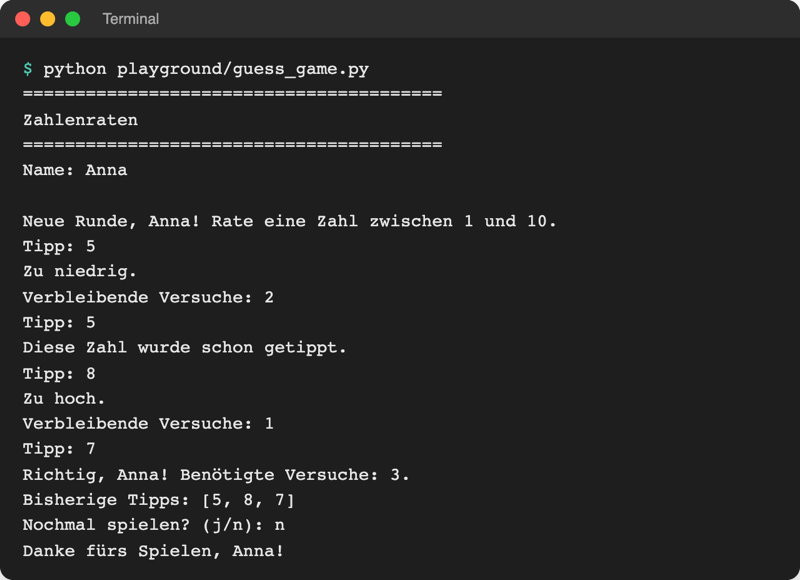
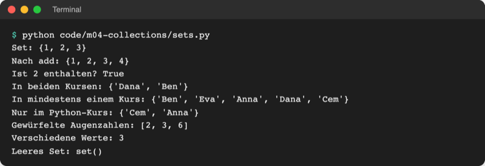

# Lab 4.2: Tupel und Sets

**Leitfragen:**

<details>
<summary>Welche Werte im Alltag dürfen sich nie ändern?</summary>

Ein Geburtsdatum, die Koordinaten eines Ortes, der Zahlenbereich eines Spiels. Für solche festen Gruppen gibt es in Python das Tupel: `(1, 10)` lässt sich nach dem Anlegen nicht mehr ändern.

</details>

<details>
<summary>Wie schnell findet man einen Namen in einer unsortierten Liste mit 10 000 Einträgen?</summary>

Im schlimmsten Fall erst nach 10 000 Vergleichen, denn eine Liste wird Element für Element durchsucht. Ein Set springt direkt an die passende Stelle und ist bei `in` viel schneller.

</details>

<details>
<summary>Braucht eine Gästeliste denselben Namen zweimal?</summary>

Nein. Ein Set (Menge) speichert jeden Wert nur einmal; doppelte Einträge verschwinden automatisch.

</details>

- Ein Tupel ist eine feste, unveränderliche Gruppe von Werten in runden Klammern.
- Ein Set ist eine Menge ohne Duplikate und ohne feste Reihenfolge, mit schneller `in`-Prüfung.

## Begriffe

| Begriff | Bedeutung |
| --- | --- |
| Tupel (`tuple`) | geordnete, unveränderliche Gruppe: `(1, 10)`; wie ein gedrucktes Datum, das niemand umschreibt |
| unveränderlich | nach dem Anlegen lässt sich kein Element ersetzen, anhängen oder löschen |
| Entpacken | die Werte eines Tupels in einzelne Variablen verteilen: `low, high = (1, 10)` |
| Set (Menge) | ungeordnete Sammlung ohne Duplikate: `{1, 2, 3}`; wie ein Stempel im Ausweis: zweimal stempeln ändert nichts |
| Vereinigung | alle Elemente, die in mindestens einem von zwei Sets stehen (`a \| b`) |
| Schnittmenge | nur die Elemente, die in beiden Sets stehen (`a & b`) |

## Tupel: feste Gruppen

Ein Tupel steht in runden Klammern. Lesen per Index, `len` und `for` funktionieren wie bei Listen; ändern lässt es sich nicht.

```python
point = (3, 5)              # Koordinate x, y
number_range = (1, 10)      # Bereich: kleinste und größte Zahl
birthday = (14, 3, 2005)    # Tag, Monat, Jahr

print(point[0])             # 3
# point[0] = 4              # würde abbrechen: TypeError: 'tuple' object does not support item assignment
```

| | Liste | Tupel |
| --- | --- | --- |
| Schreibweise | `[1, 10]` | `(1, 10)` |
| Ändern, anhängen, löschen | ja | nein |
| Typischer Inhalt | gleichartige Werte, deren Anzahl wächst (Tipps, Noten) | wenige Werte mit fester Bedeutung je Platz (x, y) |
| Signal an Lesende | „hier kommt noch etwas dazu“ | „diese Gruppe bleibt so“ |

## Entpacken

Beim Entpacken landet jeder Wert eines Tupels in einer eigenen Variablen. Links stehen genauso viele Namen, wie das Tupel Werte hat.

```python
low, high = number_range        # low = 1, high = 10
day, month, year = birthday     # day = 14, month = 3, year = 2005
```

Auch eine `for`-Schleife kann entpacken, z. B. bei einer Liste von Punkten aus [code/m04-collections/tuples.py](../../project/code/m04-collections/tuples.py):

```python
route = [(0, 0), (3, 5), (6, 2)]
for x, y in route:
    print(f"Gehe zu x={x}, y={y}")
```

## Sets: Mengen ohne Duplikate

Ein Set steht in geschweiften Klammern. Ein leeres Set entsteht mit `set()`, denn `{}` ist ein leeres Dictionary (Lab 4.3).

| Befehl | Wirkung | Beispiel |
| --- | --- | --- |
| `{1, 1, 2}` | Set anlegen, Duplikate fallen weg | ergibt `{1, 2}` |
| `set()` | leeres Set | `tried = set()` |
| `s.add(x)` | Element hinzufügen (schon vorhanden: nichts passiert) | `tried.add(5)` |
| `s.remove(x)` | Element entfernen | `tried.remove(5)` |
| `x in s` / `x not in s` | ist `x` enthalten / nicht enthalten? | `5 in tried` |
| `set(liste)` | Liste in ein Set umwandeln, Duplikate fallen weg | `set([6, 2, 6])` → `{2, 6}` |
| `len(s)`, `sorted(s)` | Anzahl / sortierte Liste der Elemente | `sorted({3, 1})` → `[1, 3]` |

Ein Set hat keine feste Reihenfolge und keinen Index: `tried[0]` führt zu `TypeError: 'set' object is not subscriptable`. Die Ausgabe von Texten in einem Set kann bei jedem Start anders sortiert erscheinen; `sorted()` sorgt für eine feste Reihenfolge.

## Schnelle `in`-Prüfung

Eine Liste prüft `in` Element für Element von vorn. Ein Set berechnet aus dem Wert direkt, wo er liegen müsste, wie eine Garderobe, die mit der Marke sofort den richtigen Haken findet. Für ein Spiel mit zehn Tipps ist der Unterschied unmerklich; bei großen Datenmengen entscheidet er (Messung: Abschnitt „Vertiefung“).

## Duplikate entfernen

Doppelte Einträge verschwinden, sobald die Werte in einem Set landen. [code/m04-collections/unique_emails.py](../../project/code/m04-collections/unique_emails.py) vereinheitlicht E-Mail-Adressen vorher mit `strip` und `lower` (Lab 2.4), damit `" Anna@Uni-Beispiel.DE "` und `"anna@uni-beispiel.de"` als gleich gelten:

```python
unique = set()
for email in signups:
    unique.add(email.strip().lower())

print("Anmeldungen:", len(signups))       # 5
print("Verschiedene Adressen:", len(unique))  # 3
```

## Im Spiel: Bereich als Tupel, doppelte Tipps per Set

Der Zahlenbereich ändert sich im Spiel nie, also wird er ein Tupel und beim Start entpackt. Ein Set merkt sich die schon getippten Zahlen; ein doppelter Tipp kostet keinen Versuch.

```python
NUMBER_RANGE = (1, 10)
low, high = NUMBER_RANGE
...
    tried = set()
    ...
        guess = int(input("Tipp: "))
        if guess in tried:
            print("Diese Zahl wurde schon getippt.")
            continue                      # kein Versuch abziehen
        tried.add(guess)
```

`continue` (Lab 3.3) springt sofort zur nächsten Runde der inneren Schleife, also zur nächsten Eingabe. Die Liste `guesses` bleibt für die Ausgabe in Eingabereihenfolge, das Set dient nur der Prüfung.



_Quelle: eigener Screenshot, Kurs-Repo, 08.11.2026._

## Typische Fehler

| Symptom | Ursache | Lösung |
| --- | --- | --- |
| `TypeError: 'tuple' object does not support item assignment` | Tupel nachträglich geändert | Liste verwenden oder ein neues Tupel anlegen |
| `ValueError: too many values to unpack` | links weniger Namen als Werte im Tupel | gleich viele Namen wie Werte schreiben |
| `AttributeError: 'dict' object has no attribute 'add'` | leeres Set mit `{}` angelegt | `set()` schreiben |
| `TypeError: 'set' object is not subscriptable` | Set per Index gelesen | `in` prüfen oder `sorted(s)` als Liste nutzen |
| doppelter Tipp kostet doch einen Versuch | Prüfung steht nach `tries += 1` | Prüfung mit `continue` direkt nach der Eingabe |

## Vertiefung

### Messung: `in` bei Liste und Set

Eigene Messung, Python 3.14.2, 08.11.2026, mit dem Standardmodul `timeit` im Terminal (`python -m timeit` führt eine Zeile sehr oft aus und meldet die beste Zeit; `-s` legt die Daten einmal vorher an):

```bash
python -m timeit -s "numbers = list(range(10_000))" "9_999 in numbers"
python -m timeit -s "numbers = set(range(10_000))" "9_999 in numbers"
```

```text
1000 loops, best of 5: 134 usec per loop
10000000 loops, best of 5: 32.6 nsec per loop
```

Die Suche nach der letzten von 10 000 Zahlen dauerte in der Liste rund 0,13 Millisekunden, im Set rund 0,00003 Millisekunden (32,6 Nanosekunden), also etwa 4 000-mal schneller. Die genauen Werte hängen vom Rechner ab.

### Mengenoperationen

Mit zwei Sets lassen sich Fragen wie „Wer ist in beiden Kursen?“ in einer Zeile beantworten ([code/m04-collections/sets.py](../../project/code/m04-collections/sets.py)):

```python
python_course = {"Anna", "Ben", "Cem", "Dana"}
excel_course = {"Ben", "Dana", "Eva"}

print(python_course & excel_course)   # Schnitt: {'Ben', 'Dana'}
print(python_course | excel_course)   # Vereinigung: alle fünf Namen
print(python_course - excel_course)   # Differenz: {'Anna', 'Cem'}
```

| Operation | Operator | Methode | Bild |
| --- | --- | --- | --- |
| Schnittmenge | `a & b` | `a.intersection(b)` | rot gefüllte Mitte im linken Bild |
| Vereinigung | `a \| b` | `a.union(b)` | beide Kreise gefüllt im rechten Bild |
| Differenz | `a - b` | `a.difference(b)` | nur der Teil von `a` ohne `b` |

 

_Quelle: Wikimedia Commons, „Venn0001.svg“ von Watchduck, gemeinfrei (https://commons.wikimedia.org/wiki/File:Venn0001.svg) und „Venn0111.svg“, gemeinfrei (https://commons.wikimedia.org/wiki/File:Venn0111.svg), abgerufen am 08.11.2026._



_Quelle: eigener Screenshot, Kurs-Repo, 08.11.2026._

## Fazit

- Tupel bündeln wenige, feste Werte; Entpacken verteilt sie auf eigene Variablen.
- Sets speichern jeden Wert nur einmal und beantworten `in` sehr schnell.
- Ein leeres Set entsteht mit `set()`; `{}` ist ein leeres Dictionary.

In der Übung bekommt das Spiel einen festen Zahlenbereich als Tupel und erkennt doppelte Tipps per Set.
