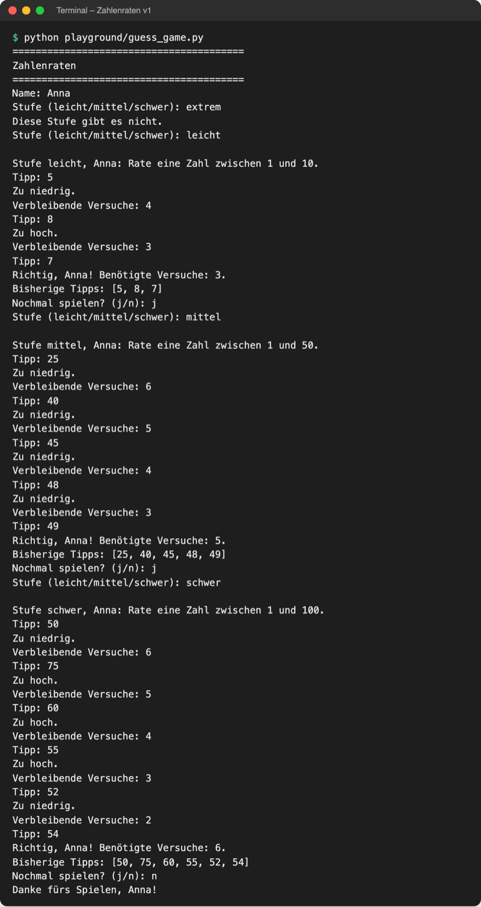

# Lab 4.3 – Lösung: Dictionaries

Fertiger Stand (Spiel v1): [examples/m04-collections/l03-dictionaries/guess_game.py](../../project/examples/m04-collections/l03-dictionaries/guess_game.py)

## Aufgabe 1: Dictionary `LEVELS`

```python
# Stufe -> (kleinste Zahl, größte Zahl, Versuche)
LEVELS = {
    "leicht": (1, 10, 5),
    "mittel": (1, 50, 7),
    "schwer": (1, 100, 7),
}
```

Schlüssel ist der Name der Stufe, Wert ein Tupel mit drei festen Angaben. `MAX_TRIES`, `NUMBER_RANGE` und `low, high = NUMBER_RANGE` entfallen.

## Aufgabe 2: Stufe abfragen

```python
while play_again == "j":
    level = input("Stufe (leicht/mittel/schwer): ").strip().lower()
```

Die Abfrage steht in der äußeren Schleife, damit jede Runde eine neue Stufe wählen kann. `.lower()` sorgt dafür, dass auch „Leicht“ den Schlüssel `"leicht"` trifft.

## Aufgabe 3: Unbekannte Stufe abfangen

```python
    while level not in LEVELS:  # unbekannte Stufe: erneut fragen
        print("Diese Stufe gibt es nicht.")
        level = input("Stufe (leicht/mittel/schwer): ").strip().lower()
```

`in` prüft die Schlüssel des Dictionaries. Ohne diese Schleife bricht `LEVELS["extrem"]` mit `KeyError: 'extrem'` ab.

## Aufgabe 4: Werte entpacken und verwenden

```python
    low, high, max_tries = LEVELS[level]  # Tupel aus dem Dictionary entpacken
    secret = random.randint(low, high)
    ...
    print(f"\nStufe {level}, {name}: Rate eine Zahl zwischen {low} und {high}.")

    while tries < max_tries:
        ...
        if tries < max_tries:
            print(f"Verbleibende Versuche: {max_tries - tries}")
```

`max_tries` ist klein geschrieben, weil sich der Wert je nach Stufe ändert.

## Aufgabe 5: Testlauf

```bash
python playground/guess_game.py
```

Beispiellauf (unbekannte Stufe, dann „leicht“ mit Geheimzahl 7):

```text
========================================
Zahlenraten
========================================
Name: Anna
Stufe (leicht/mittel/schwer): extrem
Diese Stufe gibt es nicht.
Stufe (leicht/mittel/schwer): leicht

Stufe leicht, Anna: Rate eine Zahl zwischen 1 und 10.
Tipp: 5
Zu niedrig.
Verbleibende Versuche: 4
Tipp: 8
Zu hoch.
Verbleibende Versuche: 3
Tipp: 7
Richtig, Anna! Benötigte Versuche: 3.
Bisherige Tipps: [5, 8, 7]
Nochmal spielen? (j/n): n
Danke fürs Spielen, Anna!
```

Ein Lauf über alle drei Stufen:



_Quelle: eigener Screenshot, Kurs-Repo, 08.11.2026._

Vollständiger Code (Spiel v1):

```python
# Zahlenraten – Stand Lab 4.3 (Spiel v1): drei Schwierigkeitsstufen

import random

# Stufe -> (kleinste Zahl, größte Zahl, Versuche)
LEVELS = {
    "leicht": (1, 10, 5),
    "mittel": (1, 50, 7),
    "schwer": (1, 100, 7),
}

print("=" * 40)
print("Zahlenraten")
print("=" * 40)

name = input("Name: ").strip().title()

play_again = "j"
while play_again == "j":
    level = input("Stufe (leicht/mittel/schwer): ").strip().lower()
    while level not in LEVELS:  # unbekannte Stufe: erneut fragen
        print("Diese Stufe gibt es nicht.")
        level = input("Stufe (leicht/mittel/schwer): ").strip().lower()

    low, high, max_tries = LEVELS[level]  # Tupel aus dem Dictionary entpacken
    secret = random.randint(low, high)
    tries = 0
    guesses = []
    tried = set()
    print(f"\nStufe {level}, {name}: Rate eine Zahl zwischen {low} und {high}.")

    while tries < max_tries:
        guess = int(input("Tipp: "))

        if guess in tried:
            print("Diese Zahl wurde schon getippt.")
            continue

        tried.add(guess)
        guesses.append(guess)
        tries += 1

        if guess == secret:
            print(f"Richtig, {name}! Benötigte Versuche: {tries}.")
            break
        elif guess > secret:
            print("Zu hoch.")
        else:
            print("Zu niedrig.")

        if tries < max_tries:
            print(f"Verbleibende Versuche: {max_tries - tries}")
        else:
            print(f"Keine Versuche mehr. Die Zahl war {secret}.")

    print("Bisherige Tipps:", guesses)
    play_again = input("Nochmal spielen? (j/n): ").strip().lower()

print(f"Danke fürs Spielen, {name}!")
```

## Erweiterung

Zweites Dictionary unter `LEVELS`:

```python
# Stufe -> Punkte pro übrigem Versuch
POINTS = {"leicht": 10, "mittel": 20, "schwer": 30}
```

Berechnung direkt nach der Treffermeldung:

```python
        if guess == secret:
            print(f"Richtig, {name}! Benötigte Versuche: {tries}.")
            points = POINTS[level] * (max_tries - tries + 1)
            print(f"Punkte: {points}")
            break
```

Ergebnis: „leicht“ nach 3 von 5 Versuchen ergibt `10 * 3 = 30` Punkte, „mittel“ nach 5 von 7 Versuchen `20 * 3 = 60` Punkte:

```text
Richtig, Anna! Benötigte Versuche: 3.
Punkte: 30
...
Richtig, Anna! Benötigte Versuche: 5.
Punkte: 60
```

Alternative: Die Punkte als vierten Wert ins Tupel schreiben, z. B. `"leicht": (1, 10, 5, 10)`, und mit `low, high, max_tries, points_per_try = LEVELS[level]` entpacken. Das Spiel-Beispiel bleibt bei drei Werten, weil spätere Labs darauf aufbauen.
