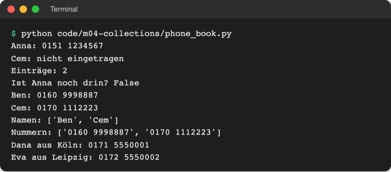
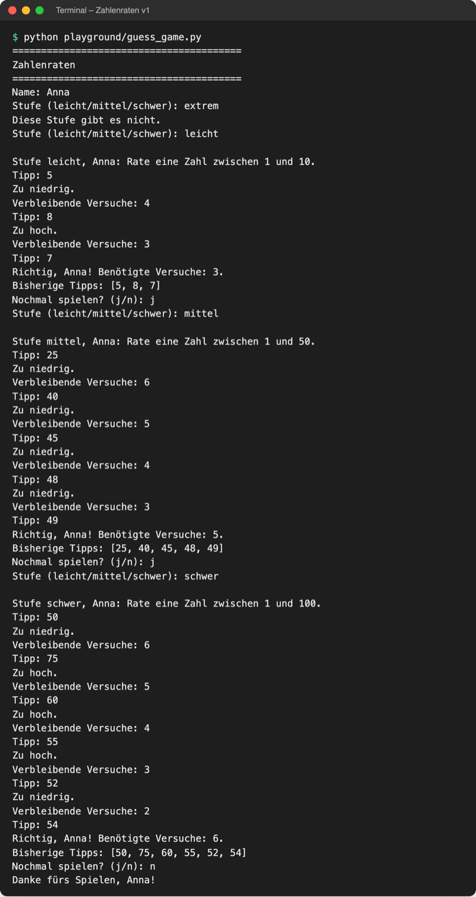

# Lab 4.3: Dictionaries

**Leitfragen:**

<details>
<summary>Wie findet man in einem Telefonbuch eine Nummer, ohne alle Seiten zu lesen?</summary>

Über den Namen: Er führt direkt zur Nummer. Ein Dictionary arbeitet genauso: `phone_book["Anna"]` liefert Annas Nummer, ohne die anderen Einträge zu durchsuchen.

</details>

<details>
<summary>Welche Angaben gehören zu einer Schwierigkeitsstufe?</summary>

Kleinste Zahl, größte Zahl und die Anzahl der Versuche, z. B. „leicht“ = 1 bis 10 mit 5 Versuchen. Der Name der Stufe ist der Schlüssel, die drei Angaben sind der Wert: `"leicht": (1, 10, 5)`.

</details>

<details>
<summary>Was passiert, wenn nach einer Stufe gefragt wird, die es nicht gibt?</summary>

`LEVELS["extrem"]` bricht mit `KeyError: 'extrem'` ab. Vorher mit `in` prüfen oder `get` mit Standardwert verwenden; das Spiel fragt dann erneut.

</details>

- Ein Dictionary ordnet jedem Schlüssel genau einen Wert zu: `{"leicht": (1, 10, 5)}`.
- Gelesen wird über den Schlüssel, nicht über eine Platznummer.

## Begriffe

| Begriff | Bedeutung |
| --- | --- |
| Dictionary (`dict`) | Sammlung von Paaren Schlüssel → Wert; wie ein Telefonbuch: Name → Nummer |
| Schlüssel (Key) | der Name, unter dem ein Wert abgelegt ist; in einem Dictionary eindeutig, meist ein String oder eine Zahl |
| Wert (Value) | das, was unter dem Schlüssel steht; beliebiger Typ, auch Tupel, Liste oder Dictionary |
| Paar (Item) | ein Schlüssel zusammen mit seinem Wert, z. B. `"Anna": "0151 1234567"` |
| Map / Mapping | allgemeiner Name für eine Zuordnung Schlüssel → Wert; in Python heißt sie Dictionary |
| verschachtelt | Sammlung in einer Sammlung, z. B. eine Liste, deren Elemente Dictionaries sind |

## Dictionary anlegen und lesen

Ein Dictionary steht in geschweiften Klammern; jedes Paar hat die Form `Schlüssel: Wert`. `{}` ist ein leeres Dictionary.

```python
phone_book = {
    "Anna": "0151 1234567",
    "Ben": "0160 7654321",
}

print(phone_book["Anna"])                              # 0151 1234567
print(phone_book.get("Cem", "nicht eingetragen"))      # nicht eingetragen
print("Ben" in phone_book)                             # True
```

- `d[key]` liest den Wert; fehlt der Schlüssel, bricht das Programm mit `KeyError` ab.
- `d.get(key, standard)` liefert den Standardwert statt eines Fehlers; ohne Standardwert kommt `None`.
- `key in d` prüft nur die Schlüssel, nicht die Werte.

## Ändern und löschen

Eintragen und ändern sehen gleich aus: Gibt es den Schlüssel noch nicht, entsteht ein neues Paar; gibt es ihn schon, wird der Wert ersetzt.

| Befehl | Wirkung |
| --- | --- |
| `d[key] = wert` | Paar anlegen oder Wert ersetzen |
| `del d[key]` | Paar löschen (`KeyError`, wenn der Schlüssel fehlt) |
| `d.pop(key)` | Paar entfernen und den Wert zurückgeben |
| `len(d)` | Anzahl der Paare |

Die Python-Dokumentation zeigt dieselben Grundoperationen ebenfalls an einem Telefonbuch (`tel`); `>>>` markiert dort Eingaben im interaktiven Modus (Lab 1.2), Stand: 08.11.2026, Python 3.14:

Original: [Python-Dokumentation, Abschnitt 5.5 Dictionaries mit Beispiel tel: anlegen, lesen, KeyError, get, del, list, sorted und in](https://docs.python.org/3.14/tutorial/datastructures.html#dictionaries), Stand 08.11.2026.

## Schleifen über ein Dictionary

Ein Dictionary behält die Reihenfolge, in der die Paare eingetragen wurden (seit Python 3.7). Drei Methoden liefern Schlüssel, Werte oder Paare für eine `for`-Schleife:

| Schleife | Liefert je Durchlauf |
| --- | --- |
| `for name in phone_book:` | den Schlüssel (wie `.keys()`) |
| `for number in phone_book.values():` | den Wert |
| `for name, number in phone_book.items():` | Schlüssel und Wert als Tupel, gleich entpackt (Lab 4.2) |

`list(phone_book.keys())` macht aus den Schlüsseln eine Liste, z. B. für die Ausgabe. Das ganze Beispiel steht in [code/m04-collections/phone_book.py](../../project/code/m04-collections/phone_book.py):

```python
phone_book["Cem"] = "0170 1112223"   # neuer Schlüssel: wird angelegt
phone_book["Ben"] = "0160 9998887"   # vorhandener Schlüssel: wird ersetzt
del phone_book["Anna"]

for name, number in phone_book.items():
    print(f"{name}: {number}")
```



_Quelle: eigener Screenshot, Kurs-Repo, 08.11.2026._

## Verschachtelt: Liste von Dictionaries

Mehrere gleich aufgebaute Datensätze bilden eine Liste, deren Elemente Dictionaries sind, wie Zeilen einer Tabelle mit benannten Spalten:

```python
contacts = [
    {"name": "Dana", "city": "Köln", "number": "0171 5550001"},
    {"name": "Eva", "city": "Leipzig", "number": "0172 5550002"},
]
for contact in contacts:
    print(f"{contact['name']} aus {contact['city']}: {contact['number']}")
```

Die Schlüssel im f-String stehen in einfachen Anführungszeichen; so bleibt sichtbar, wo der f-String mit seinen doppelten Anführungszeichen endet. Dieselbe Form (Liste von Dictionaries) kehrt später als Bestenliste in JSON wieder (Lab 8.2).

## Wann Liste, Tupel, Set oder Dictionary?

| Sammlung | Schreibweise | Geordnet | Veränderbar | Duplikate | Zugriff über | Typischer Einsatz | Im Spiel |
| --- | --- | --- | --- | --- | --- | --- | --- |
| Liste | `[5, 8, 7]` | ja | ja | ja | Index `[0]` | Werte sammeln, deren Anzahl wächst | bisherige Tipps |
| Tupel | `(1, 10)` | ja | nein | ja | Index, Entpacken | feste Gruppe mit Bedeutung je Platz | Bereich, Werte einer Stufe |
| Set | `{5, 8}` | nein | ja | nein | nur `in` | Duplikate vermeiden, schnell prüfen | schon getippte Zahlen |
| Dictionary | `{"leicht": (1, 10, 5)}` | ja (Eintragsreihenfolge) | ja | Schlüssel nein | Schlüssel `["leicht"]` | Werte über einen Namen finden | Schwierigkeitsstufen |

> **Merksatz:** Liste für eine Reihe, Tupel für eine feste Gruppe, Set für „schon gesehen?“, Dictionary für „Name → Wert“.

## Im Spiel: Schwierigkeitsstufen

Jede Stufe hat einen Namen und drei feste Angaben. Das passt zu einem Dictionary, dessen Werte Tupel sind. Es ersetzt `MAX_TRIES` und `NUMBER_RANGE`:

```python
# Stufe -> (kleinste Zahl, größte Zahl, Versuche)
LEVELS = {
    "leicht": (1, 10, 5),
    "mittel": (1, 50, 7),
    "schwer": (1, 100, 7),
}
...
    level = input("Stufe (leicht/mittel/schwer): ").strip().lower()
    while level not in LEVELS:            # unbekannte Stufe: erneut fragen
        print("Diese Stufe gibt es nicht.")
        level = input("Stufe (leicht/mittel/schwer): ").strip().lower()

    low, high, max_tries = LEVELS[level]  # Tupel aus dem Dictionary entpacken
```

`not in` ist die Umkehrung von `in`: Die Schleife läuft, solange die Eingabe kein Schlüssel von `LEVELS` ist. Danach ist `LEVELS[level]` sicher. Mit diesem Schritt ist das Spiel v1 fertig, der Stand am Ende von Tag 1:



_Quelle: eigener Screenshot, Kurs-Repo, 08.11.2026._

## Typische Fehler

| Symptom | Ursache | Lösung |
| --- | --- | --- |
| `KeyError: 'extrem'` | Schlüssel existiert nicht | vorher `in` prüfen oder `get(key, standard)` |
| `KeyError: 'Leicht'` | Schlüssel unterscheiden Groß-/Kleinschreibung | Eingabe mit `.strip().lower()` vereinheitlichen |
| `ValueError: not enough values to unpack (expected 3, got 2)` | Tupel einer Stufe hat nur zwei Werte | jedes Tupel mit drei Werten anlegen |
| ein Eintrag fehlt nach dem Anlegen | derselbe Schlüssel steht zweimal im Dictionary | Schlüssel eindeutig wählen; der spätere Wert überschreibt den früheren |

## Fazit

- Ein Dictionary findet Werte über einen Schlüssel, so wie ein Telefonbuch über den Namen.
- `get` mit Standardwert und `in` verhindern Abstürze bei fehlenden Schlüsseln.
- `keys`, `values` und `items` liefern Schlüssel, Werte oder Paare für Schleifen.
- Die Vergleichstabelle entscheidet, welche Sammlung zu welchen Daten passt.

In der Übung bekommt das Spiel drei Schwierigkeitsstufen aus einem Dictionary und erreicht damit Stand v1.
