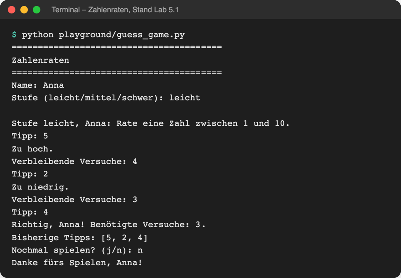

# Lab 5.1 – Lösung: Spielregeln als Funktionen

Fertiger Stand: [project/examples/m05-functions/l01-basics/guess_game.py](../../project/examples/m05-functions/l01-basics/guess_game.py)

## Aufgabe 1: is_guess_correct

```python
def is_guess_correct(guess, secret):
    """Gibt True zurück, wenn der Tipp die Geheimzahl trifft."""
    return guess == secret
```

Der Vergleich `guess == secret` ergibt schon `True` oder `False` (Lab 2.3); `return` gibt diesen Wert direkt zurück. Ein `if … return True else return False` wäre länger und tut dasselbe.

## Aufgabe 2: show_hint

```python
def show_hint(guess, secret):
    """Gibt aus, ob der Tipp zu hoch oder zu niedrig ist."""
    if guess > secret:
        print("Zu hoch.")
    else:
        print("Zu niedrig.")
    # kein return: Prozedur, Ergebnis ist None
```

`show_hint` wird nur nach einem Fehltipp aufgerufen; der Fall „gleich“ ist dann schon ausgeschlossen, deshalb reicht `if`/`else`.

## Aufgabe 3: is_game_over

```python
def is_game_over(tries, max_tries):
    """Gibt True zurück, wenn alle Versuche verbraucht sind."""
    return tries >= max_tries
```

`>=` statt `==`: Die Funktion bleibt richtig, auch wenn `tries` aus Versehen einmal über `max_tries` steigt.

## Aufgabe 4: Hauptablauf ruft die Funktionen auf

```python
    while not is_game_over(tries, max_tries):
        guess = int(input("Tipp: "))

        if guess in tried:
            print("Diese Zahl wurde schon getippt.")
            continue

        tried.add(guess)
        guesses.append(guess)
        tries += 1

        if is_guess_correct(guess, secret):
            print(f"Richtig, {name}! Benötigte Versuche: {tries}.")
            break

        show_hint(guess, secret)

        if is_game_over(tries, max_tries):
            print(f"Keine Versuche mehr. Die Zahl war {secret}.")
        else:
            print(f"Verbleibende Versuche: {max_tries - tries}")
```

| Vorher (v1) | Nachher (Lab 5.1) |
| --- | --- |
| `while tries < max_tries:` | `while not is_game_over(tries, max_tries):` |
| `if guess == secret:` | `if is_guess_correct(guess, secret):` |
| `elif guess > secret: … else: …` | `show_hint(guess, secret)` |
| `if tries < max_tries:` „Verbleibende …“ `else:` „Keine …“ | `if is_game_over(...):` „Keine …“ `else:` „Verbleibende …“ |

Die letzte Zeile der Tabelle dreht die Frage um („noch Versuche übrig?“ → „Spiel vorbei?“), deshalb tauschen die beiden Meldungen die Plätze. Die drei `def`-Blöcke stehen über dem Banner, weil eine Funktion definiert sein muss, bevor sie aufgerufen wird.

## Aufgabe 5: Testlauf

Gewonnene Runde:



_Quelle: eigener Screenshot, Kurs-Repo, 08.11.2026._

Verlorene Runde (Ausschnitt):

```text
Stufe leicht, Anna: Rate eine Zahl zwischen 1 und 10.
Tipp: 1
Zu niedrig.
Verbleibende Versuche: 4
...
Tipp: 6
Zu niedrig.
Keine Versuche mehr. Die Zahl war 10.
Bisherige Tipps: [1, 2, 3, 5, 6]
```

Die Ausgabe ist Zeichen für Zeichen dieselbe wie bei Spiel v1; nur der Code ist anders aufgeteilt.

## Erweiterung

```python
def is_adult(age):
    """Gibt True zurück, wenn age mindestens 18 ist."""
    return age >= 18


def print_line(length):
    """Gibt eine Linie aus length Bindestrichen aus."""
    print("-" * length)


print_line(20)
print("17:", is_adult(17))
print("18:", is_adult(18))
```

```text
--------------------
17: False
18: True
```

`is_adult` liefert einen Wert (Funktion), `print_line` bewirkt eine Ausgabe (Prozedur). Deshalb steht `is_adult` in einem `print`, `print_line` dagegen allein in einer Zeile.
