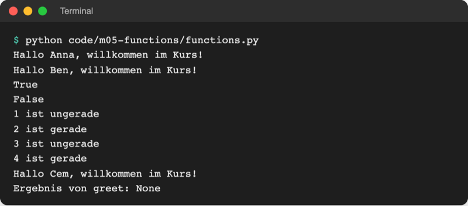
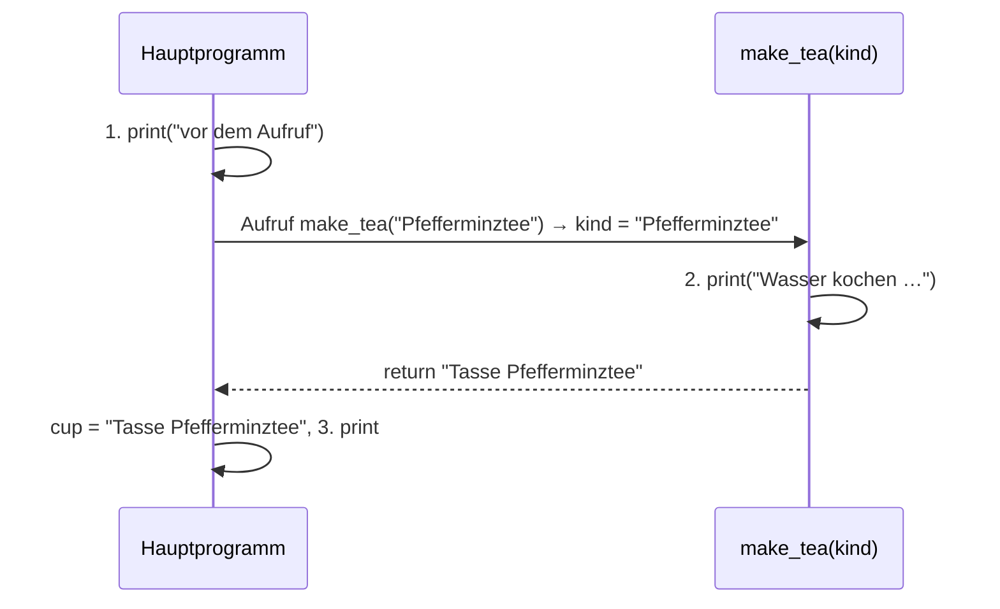
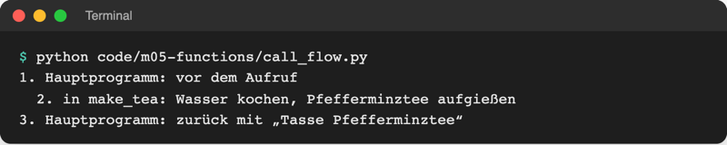

# Lab 5.1: Funktionen definieren und aufrufen

**Leitfragen:**

<details>
<summary>Welche Zeilen des Spiels stehen fast gleich an mehreren Stellen?</summary>

Die Stufenabfrage `input("Stufe (leicht/mittel/schwer): ")` steht zweimal, der Vergleich von `tries` mit `max_tries` ebenfalls. Jede Änderung muss an beiden Stellen passieren; eine Funktion fasst solche Zeilen unter einem Namen zusammen.

</details>

<details>
<summary>Wie würde man einer Kommilitonin „Hinweis geben“ erklären, ohne jedes Detail?</summary>

„Sag ‚zu hoch‘ oder ‚zu niedrig‘.“ Ein kurzer Name steht für mehrere Schritte; wer ihn benutzt, muss die Schritte nicht kennen. Genau das leistet eine Funktion.

</details>

<details>
<summary>Was soll ein Baustein zurückliefern, der prüft, ob ein Tipp stimmt?</summary>

Ein Ja oder Nein, also `True` oder `False`. Mit diesem Wert entscheidet das Programm selbst, was als Nächstes passiert, z. B. in einem `if`.

</details>

- Eine Funktion ist ein benanntes, wiederverwendbares Rezept: einmal mit `def` aufschreiben, danach beliebig oft mit ihrem Namen aufrufen.
- `print`, `input` und `len` sind fertige Funktionen aus Tag 1. Ab jetzt entstehen eigene.

## Begriffe

| Begriff | Bedeutung |
| --- | --- |
| Funktion (eigene) | benannter Block aus Anweisungen, der erst beim Aufruf läuft; wie ein Rezept im Kochbuch, das erst beim Kochen benutzt wird |
| `def` | Schlüsselwort, mit dem eine Funktion definiert (aufgeschrieben) wird |
| Definition | die Zeilen ab `def`: legen fest, was die Funktion tut; führen selbst noch nichts aus |
| Aufruf | Name mit Klammern, z. B. `greet("Anna")`: führt den Funktionskörper jetzt aus |
| Funktionskörper | die eingerückten Zeilen unter der `def`-Zeile |
| Parameter | Platzhalter-Name in der `def`-Zeile, z. B. `name` in `def greet(name):`; wie „Zutat X“ im Rezept |
| Argument | konkreter Wert beim Aufruf, z. B. `"Anna"`; landet im Parameter |
| `return` | beendet die Funktion und gibt einen Wert an die Aufrufstelle zurück |
| Rückgabewert | der Wert, den der Aufruf liefert; lässt sich speichern, ausgeben oder vergleichen |
| Prozedur | Funktion ohne `return`-Wert; sie bewirkt etwas (z. B. eine Ausgabe) und liefert `None` |
| Docstring | Text in dreifachen Anführungszeichen direkt unter `def`; beschreibt in einem Satz, was die Funktion tut |

## Aufbau einer Funktion

Datei: [code/m05-functions/functions.py](../../project/code/m05-functions/functions.py)

```python
def is_even(number):                 # def, Name, Parameter in Klammern, Doppelpunkt
    """Gibt True zurück, wenn number gerade ist."""   # Docstring
    return number % 2 == 0           # Körper: eingerückt; return liefert das Ergebnis


print(is_even(4))                    # Aufruf mit Argument 4 → True
print(is_even(7))                    # derselbe Code, anderes Argument → False
```

| Teil | Beispiel | Regel |
| --- | --- | --- |
| Schlüsselwort | `def` | steht immer am Anfang |
| Name | `is_even` | klein mit `_`, beschreibt die Aufgabe; Prüfungen beginnen oft mit `is_` |
| Parameter | `(number)` | null, einer oder mehrere, durch Komma getrennt; leere Klammern `()` sind erlaubt |
| Doppelpunkt und Einrückung | `:` und 4 Leerzeichen | wie bei `if` und `while` (Lab 3.1, 3.3) |
| Docstring | `"""…"""` | ein Satz, was die Funktion tut; mehrzeilige Strings aus Lab 2.4 |
| `return` | `return number % 2 == 0` | Ergebnis zurückgeben; optional |

PEP 8 verlangt zwei Leerzeilen vor und nach jeder Funktion auf Modulebene; Ruff formatiert das automatisch.

Original: [Python-Dokumentation, Abschnitt 4.8 Defining Functions mit dem Beispiel fib(n) und Erklärung von def](https://docs.python.org/3.14/tutorial/controlflow.html#defining-functions), Stand 08.11.2026.

## Definition und Aufruf

Python liest die Datei von oben nach unten. Bei `def` merkt es sich nur die Funktion unter ihrem Namen; der Körper läuft erst, wenn eine Zeile die Funktion aufruft. Deshalb muss die Definition **über** dem ersten Aufruf stehen.

```python
def greet(name):
    """Gibt eine Begrüßung für name aus."""
    print(f"Hallo {name}, willkommen im Kurs!")


greet("Anna")    # erst hier erscheint die erste Ausgabe
greet("Ben")     # dasselbe Rezept, anderes Argument
```



_Quelle: eigener Screenshot, Kurs-Repo, 08.11.2026._

## Wohin springt das Programm? Der Aufruf-Ablauf

Datei: [code/m05-functions/call_flow.py](../../project/code/m05-functions/call_flow.py)

```python
def make_tea(kind):
    """Bereitet einen Tee zu und gibt die fertige Tasse zurück."""
    print(f"  2. in make_tea: Wasser kochen, {kind} aufgießen")
    return f"Tasse {kind}"


print("1. Hauptprogramm: vor dem Aufruf")
cup = make_tea("Pfefferminztee")
print(f"3. Hauptprogramm: zurück mit „{cup}“")
```

Beim Aufruf springt Python in den Funktionskörper, das Argument landet im Parameter. `return` springt zurück **an die Aufrufstelle**; der Aufruf wird dort durch den Rückgabewert ersetzt.





_Quelle: eigener Screenshot, Kurs-Repo, 08.11.2026._

Wie sich Python merkt, wohin es zurückspringt, zeigt Lab 5.3 (Aufrufstapel).

## return oder print? Funktion und Prozedur

`print` zeigt einen Wert im Terminal; danach ist er weg. `return` gibt ihn an das Programm zurück, das ihn weiterverwenden kann. Datei: [code/m05-functions/return_vs_print.py](../../project/code/m05-functions/return_vs_print.py)

```python
def add_and_print(a, b):
    print(a + b)          # Wirkung: Ausgabe, kein return


def add(a, b):
    return a + b          # Ergebnis: Rückgabewert


x = add_and_print(2, 3)   # zeigt 5, x ist None
y = add(2, 3)             # zeigt nichts, y ist 5
print(y * 10)             # 50
```

| | Funktion mit Rückgabewert | Prozedur |
| --- | --- | --- |
| Zweck | etwas berechnen oder prüfen | etwas bewirken (ausgeben, ändern) |
| letzte Zeile | `return <Wert>` | kein `return` (oder `return` ohne Wert) |
| Aufruf liefert | den Wert, z. B. `True`, `5` | `None` (Lab 2.2: „kein Wert“) |
| Beispiel | `is_even(4)` → `True` | `greet("Anna")` → Ausgabe, `None` |
| typische Verwendung | `if is_even(n):`, `y = add(2, 3)` | eigene Zeile: `greet("Anna")` |

`return` beendet die Funktion sofort; Zeilen darunter im selben Block laufen nicht mehr.

## Kleine Funktionen mit einer Aufgabe

- **Eine Aufgabe pro Funktion:** prüfen **oder** ausgeben, nicht beides. `is_guess_correct` prüft nur, `show_hint` gibt nur aus.
- **Name sagt die Aufgabe:** Verb oder `is_…` für Ja/Nein-Fragen; dann liest sich der Aufruf wie ein Satz: `if is_game_over(tries, max_tries):`.
- **Alles Nötige über Parameter:** Was die Funktion braucht, kommt als Argument hinein, das Ergebnis per `return` heraus.
- **Kurz:** passt eine Funktion nicht auf einen Bildschirm, steckt meist eine zweite darin.

## Im Spiel: drei Spielregeln als Funktionen

Die Regeln wandern in drei Funktionen über dem Hauptablauf; der Ablauf ruft sie nur noch auf (Ausschnitt):

```python
def is_guess_correct(guess, secret):
    """Gibt True zurück, wenn der Tipp die Geheimzahl trifft."""
    return guess == secret


def show_hint(guess, secret):
    """Gibt aus, ob der Tipp zu hoch oder zu niedrig ist."""
    ...  # die if/else-Ausgabe aus Lab 3.1


def is_game_over(tries, max_tries):
    """Gibt True zurück, wenn alle Versuche verbraucht sind."""
    return tries >= max_tries
```

Vorher stand `while tries < max_tries:`, jetzt `while not is_game_over(tries, max_tries):`. Die Ausgabe des Spiels bleibt gleich.

## Typische Fehler

| Symptom | Ursache | Lösung |
| --- | --- | --- |
| Programm startet, gibt aber nichts aus | Funktion nur definiert, nie aufgerufen | Aufruf mit Klammern ergänzen: `greet("Anna")` |
| `NameError: name 'greet' is not defined` | Aufruf steht über der `def`-Zeile | Funktionen oben definieren, unten aufrufen |
| `TypeError: greet() missing 1 required positional argument: 'name'` | Argument beim Aufruf vergessen | Wert in die Klammern schreiben |
| `TypeError: greet() takes 1 positional argument but 2 were given` | mehr Argumente als Parameter | Anzahl angleichen |
| Variable ist `None`, `TypeError: unsupported operand type(s) for +: 'NoneType' and 'int'` | Funktion gibt mit `print` aus statt mit `return` zurück | `return` verwenden |
| `IndentationError: expected an indented block after function definition` | Körper nicht eingerückt | 4 Leerzeichen einrücken |
| Ausgabe `<function greet at 0x…>` | Aufruf ohne Klammern: `print(greet)` | Klammern ergänzen: `greet()` |

## Fazit

- `def name(parameter):` schreibt ein Rezept auf; erst `name(argument)` führt es aus.
- `return` liefert ein Ergebnis an die Aufrufstelle; eine Prozedur ohne `return` bewirkt etwas und liefert `None`.
- Kleine Funktionen mit sprechenden Namen machen den Hauptablauf lesbar wie eine Anleitung.

In der Übung bekommt das eigene Spiel die drei Funktionen `is_guess_correct`, `show_hint` und `is_game_over`.
