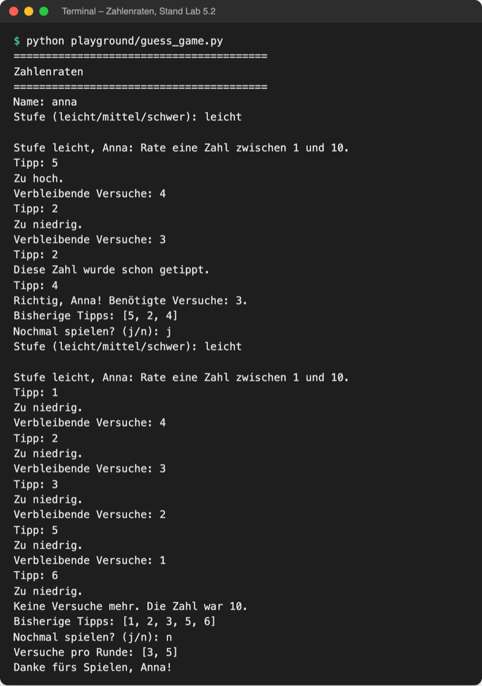

# Lab 5.2 – Lösung: Eine Runde als Funktion

Fertiger Stand: [project/examples/m05-functions/l02-parameters/guess_game.py](../../project/examples/m05-functions/l02-parameters/guess_game.py)

## Aufgabe 1: ask_level

```python
def ask_level():
    """Fragt so lange nach der Stufe, bis es sie gibt, und gibt sie zurück."""
    level = input("Stufe (leicht/mittel/schwer): ").strip().lower()
    while level not in LEVELS:
        print("Diese Stufe gibt es nicht.")
        level = input("Stufe (leicht/mittel/schwer): ").strip().lower()
    return level
```

`ask_level` braucht keinen Parameter: Alles, was sie wissen muss, fragt sie selbst ab. Das Ergebnis geht per `return` an den Aufrufer.

## Aufgabe 2: play_round mit Standardwert und Rückgabewert

```python
def play_round(level="leicht"):
    """Spielt eine Runde und gibt die Anzahl der Versuche zurück."""
    low, high, max_tries = LEVELS[level]
    secret = random.randint(low, high)
    tries = 0
    guesses = []
    tried = set()
    # name kommt von außerhalb der Funktion (Umbau in Lab 5.3)
    print(f"\nStufe {level}, {name}: Rate eine Zahl zwischen {low} und {high}.")

    while not is_game_over(tries, max_tries):
        ...  # unverändert aus Lab 5.1

    print("Bisherige Tipps:", guesses)
    return tries
```

`return tries` steht nach der Schleife, damit die Runde in beiden Fällen etwas meldet: nach einem Treffer (`break`) und nach dem letzten Fehlversuch.

## Aufgabe 3: main sammelt die Versuche

```python
def main():
    """Hauptablauf: Runden spielen, bis niemand mehr will."""
    all_tries = []  # Versuche jeder Runde
    play_again = "j"
    while play_again == "j":
        level = ask_level()
        tries = play_round(level=level)  # Schlüsselwortargument
        all_tries.append(tries)
        play_again = input("Nochmal spielen? (j/n): ").strip().lower()

    print("Versuche pro Runde:", all_tries)
    print(f"Danke fürs Spielen, {name}!")
```

`play_round(level=level)` wäre auch als `play_round(level)` richtig. Mit Namen ist beim Lesen sofort klar, welcher Parameter gemeint ist: links der Parametername, rechts die Variable aus `main`.

## Aufgabe 4: Dateiende

```python
print("=" * 40)
print("Zahlenraten")
print("=" * 40)

# globale Variable: play_round und main lesen sie von außen
name = input("Name: ").strip().title()
main()
```

Oben in der Datei stehen jetzt nur Definitionen; erst die letzte Zeile `main()` startet das Spiel.

## Aufgabe 5: Testlauf

Zwei Runden (Treffer im dritten Versuch, dann fünf Fehltipps):



_Quelle: eigener Screenshot, Kurs-Repo, 08.11.2026._

Mit der Testzeile `play_round()` vor `main()` beginnt das Spiel direkt nach dem Namen mit einer leichten Runde:

```text
Name: Anna

Stufe leicht, Anna: Rate eine Zahl zwischen 1 und 10.
Tipp: 5
Zu hoch.
Verbleibende Versuche: 4
```

Ohne Argument gilt der Standardwert `level="leicht"`. Der Rückgabewert dieser Testrunde wird nicht gespeichert und geht verloren; deshalb die Zeile danach wieder löschen.

## Erweiterung

```python
def order_summary(*prices):
    """Gibt Anzahl und Summe der Preise zurück."""
    return len(prices), sum(prices)


count, total = order_summary(12.5, 7.5, 3.0)
print(f"{count} Artikel, {total} Euro")
```

```text
3 Artikel, 23.0 Euro
```

`prices` ist das Tupel `(12.5, 7.5, 3.0)`; `len` und `sum` aus Tag 1 funktionieren darauf wie auf einer Liste. `return` mit Komma liefert das Tupel `(3, 23.0)`, das die Zuweisung `count, total = …` entpackt.
