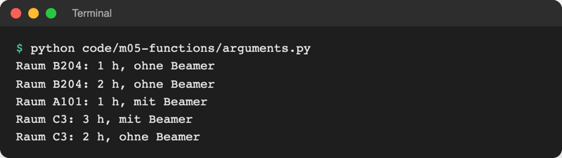
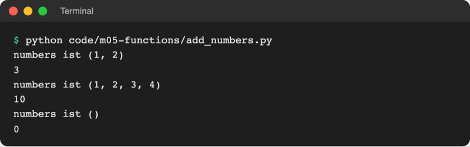
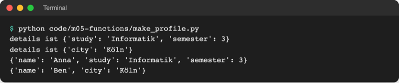

# Lab 5.2: Parameter und Rückgabewerte

**Leitfragen:**

<details>
<summary>Welche Angaben braucht eine Spielrunde, um zu starten?</summary>

Die Stufe; aus ihr folgen Zahlenbereich und Anzahl der Versuche. Für die Meldungen kommt der Name dazu. Alles, was eine Runde von außen braucht, wird zum Parameter.

</details>

<details>
<summary>Welche sollten einen sinnvollen Standard haben?</summary>

Die Stufe: Ohne Angabe ist „leicht“ eine gute Wahl. Ein Standardwert macht die Angabe beim Aufruf freiwillig, `play_round()` spielt dann eine leichte Runde.

</details>

<details>
<summary>Was soll eine Runde am Ende melden?</summary>

Mindestens die Anzahl der Versuche, damit das Hauptprogramm sie sammeln und auswerten kann. Die Meldung geht per `return` zurück, nicht per `print`.

</details>

- Parameter sind die Eingänge einer Funktion, der Rückgabewert ist ihr Ausgang. Lab 5.1 hat beides eingeführt; dieses Lab zeigt die Varianten.
- Argumente lassen sich nach Position oder nach Name übergeben, Parameter können Standardwerte haben, und eine Funktion kann beliebig viele Argumente annehmen.

## Begriffe

| Begriff | Bedeutung |
| --- | --- |
| Positionsargument | Argument, das über seinen Platz zugeordnet wird: erstes Argument → erster Parameter |
| Schlüsselwortargument | Argument mit Namen: `hours=2`; die Reihenfolge ist dann egal, wie ein beschrifteter Umschlag |
| Standardwert | Wert in der `def`-Zeile (`hours=1`), der gilt, wenn der Aufruf nichts angibt |
| `*args` | Parameter mit `*`: sammelt beliebig viele Positionsargumente in einem Tupel |
| `**kwargs` | Parameter mit `**`: sammelt beliebig viele Schlüsselwortargumente in einem Dictionary |
| mehrere Rückgabewerte | `return a, b` liefert ein Tupel `(a, b)`, das sich beim Aufruf entpacken lässt (Lab 4.2) |
| Type Hint | Typangabe wie `level: str` oder `-> int`; reine Dokumentation, Python prüft sie beim Ausführen nicht |
| `main()` | üblicher Name für die Funktion, die den Hauptablauf eines Programms enthält |

## Nach Position oder nach Name

Datei: [code/m05-functions/arguments.py](../../project/code/m05-functions/arguments.py)

```python
def book_room(room, hours=1, projector=False):
    """Gibt eine Raumbuchung aus; hours und projector haben Standardwerte."""
    extra = "mit Beamer" if projector else "ohne Beamer"
    print(f"Raum {room}: {hours} h, {extra}")


book_room("B204")                              # nur die Pflichtangabe
book_room("B204", 2)                           # nach Position: hours = 2
book_room("A101", projector=True)              # nach Name: hours bleibt 1
book_room(room="C3", hours=3, projector=True)  # alles nach Name
book_room(hours=2, room="C3")                  # Reihenfolge egal
```



_Quelle: eigener Screenshot, Kurs-Repo, 08.11.2026._

| Regel | Beispiel |
| --- | --- |
| Parameter ohne Standardwert sind Pflicht | `book_room()` → `TypeError: … missing 1 required positional argument: 'room'` |
| beim Aufruf erst Position, dann Name | `book_room("C3", hours=2)` geht, `book_room(hours=2, "C3")` ist ein `SyntaxError` |
| in der `def`-Zeile erst ohne, dann mit Standardwert | `def f(a, b=1)` geht, `def f(a=1, b)` ist ein `SyntaxError` |
| Schlüsselwort bei Ja/Nein-Werten | `projector=True` liest sich klarer als ein nacktes `True` |

Original: [Python-Dokumentation, Abschnitt 4.9.2 Keyword Arguments mit der Funktion parrot und gültigen und ungültigen Aufrufen](https://docs.python.org/3.14/tutorial/controlflow.html#keyword-arguments), Stand 08.11.2026.

## Beliebig viele Argumente: `*args`

Ein `*` vor dem Parameter sammelt alle Positionsargumente in einem **Tupel** (Lab 4.2). Der Name ist frei; `args` ist nur die übliche Bezeichnung. Datei: [code/m05-functions/add_numbers.py](../../project/code/m05-functions/add_numbers.py)

```python
def add(*numbers):
    """Addiert beliebig viele Zahlen und gibt die Summe zurück."""
    print("numbers ist", numbers)  # ein Tupel aus allen Argumenten
    total = 0
    for number in numbers:
        total += number
    return total


print(add(1, 2))
print(add(1, 2, 3, 4))
print(add())  # kein Argument: leeres Tupel, Summe 0
```



_Quelle: eigener Screenshot, Kurs-Repo, 08.11.2026._

`print` selbst arbeitet so: `print("A", "B", "C")` nimmt beliebig viele Werte.

## Beliebig viele benannte Argumente: `**kwargs`

Zwei `**` sammeln alle Schlüsselwortargumente, die keinem anderen Parameter zugeordnet sind, in einem **Dictionary** (Lab 4.3). Datei: [code/m05-functions/make_profile.py](../../project/code/m05-functions/make_profile.py)

```python
def make_profile(name, **details):
    """Baut ein Profil aus dem Namen und beliebigen weiteren Angaben."""
    print("details ist", details)  # ein Dictionary aus allen Schlüsselwörtern
    profile = {"name": name}
    for key, value in details.items():
        profile[key] = value
    return profile


anna = make_profile("Anna", study="Informatik", semester=3)
ben = make_profile("Ben", city="Köln")
print(anna)
print(ben)
```



_Quelle: eigener Screenshot, Kurs-Repo, 08.11.2026._

| Schreibweise | sammelt | Typ im Funktionskörper | Aufruf |
| --- | --- | --- | --- |
| `def f(*args)` | Positionsargumente | Tupel | `f(1, 2, 3)` |
| `def f(**kwargs)` | Schlüsselwortargumente | Dictionary | `f(city="Köln", semester=3)` |

## Rückgabewerte verwenden, auch mehrere

Ein Rückgabewert lässt sich speichern, vergleichen oder in einer Liste sammeln. Mehrere Werte durch Komma ergeben ein Tupel, das sich direkt entpacken lässt. Datei: [code/m05-functions/grade_stats.py](../../project/code/m05-functions/grade_stats.py)

```python
def grade_stats(grades):
    """Gibt beste Note, schlechteste Note und Durchschnitt zurück."""
    best = min(grades)  # deutsche Noten: kleiner ist besser
    worst = max(grades)
    average = round(sum(grades) / len(grades), 2)
    return best, worst, average


result = grade_stats([1.7, 2.3, 1.0, 3.0])
print("Ergebnis:", result)

best, worst, average = grade_stats([2.0, 1.3, 2.3])  # direkt entpacken
print(f"Beste: {best}, schlechteste: {worst}, Durchschnitt: {average}")
```

```text
Ergebnis: (1.0, 3.0, 2.0)
Beste: 1.3, schlechteste: 2.3, Durchschnitt: 1.87
```

## Type Hints: Typen als Dokumentation

Type Hints schreiben dazu, welche Typen eine Funktion erwartet und zurückgibt:

```python
def play_round(level: str = "leicht") -> int:   # level ist ein String, Rückgabe ist int
    ...
```

- Python ignoriert sie beim Ausführen: `play_round(5)` startet trotzdem (und scheitert erst, wenn `5` als Stufe gesucht wird).
- VS Code zeigt sie beim Überfahren des Funktionsnamens mit der Maus und beim Tippen der Klammer an.
- Warnungen bei falschen Typen gibt es erst nach Umstellen der Einstellung „Python › Analysis: Type Checking Mode“ von `off` (Standard) auf `basic`. Stand: 08.11.2026, Quelle: [VS Code, Python settings reference](https://code.visualstudio.com/docs/python/settings-reference).
- Das Kursspiel bleibt ohne Type Hints, damit der Code für Einsteiger kurz bleibt.

## Im Spiel: eine Runde als Funktion mit Rückgabewert

Die Runde wandert in `play_round(level="leicht")` und gibt die Anzahl der Versuche zurück; `main()` enthält die Runden-Schleife und sammelt die Ergebnisse (Ausschnitt):

```python
def play_round(level="leicht"):
    """Spielt eine Runde und gibt die Anzahl der Versuche zurück."""
    low, high, max_tries = LEVELS[level]
    ...  # Schleife aus Lab 5.1
    return tries


def main():
    """Hauptablauf: Runden spielen, bis niemand mehr will."""
    all_tries = []
    play_again = "j"
    while play_again == "j":
        level = ask_level()
        tries = play_round(level=level)  # Schlüsselwortargument
        all_tries.append(tries)
        ...
    print("Versuche pro Runde:", all_tries)
```

Die Stufenabfrage samt Wiederholung wandert in `ask_level()`, die eine gültige Stufe zurückgibt. Am Ende der Datei steht nur noch der Aufruf `main()`. Neu am Spielende: „Versuche pro Runde: [3, 5]“.

## Typische Fehler

| Symptom | Ursache | Lösung |
| --- | --- | --- |
| `SyntaxError: positional argument follows keyword argument` | Positionsargument nach einem Schlüsselwortargument | erst Position, dann Name |
| `SyntaxError: parameter without a default follows parameter with a default` | in `def` steht ein Pflichtparameter hinter einem mit Standardwert | Pflichtparameter nach vorn |
| `TypeError: book_room() got multiple values for argument 'room'` | derselbe Parameter per Position und per Name belegt | einmal angeben |
| `TypeError: … got an unexpected keyword argument 'level'` | Name beim Aufruf vertippt oder Parameter fehlt in `def` | Namen in `def` und Aufruf angleichen |
| Rückgabewert ist `None` | `return` fehlt oder steht in einem Zweig, der nicht läuft | `return` am Ende der Funktion |
| `add([1, 2, 3])` meldet `TypeError: unsupported operand type(s) for +=: 'int' and 'list'` | die Liste ist **ein** Argument, `numbers` ist `([1, 2, 3],)` | Zahlen einzeln übergeben: `add(1, 2, 3)` |

## Fazit

- Argumente gehen nach Position oder nach Name; Standardwerte machen Parameter freiwillig.
- `*args` sammelt beliebig viele Werte in einem Tupel, `**kwargs` beliebig viele benannte in einem Dictionary.
- `return a, b` liefert ein Tupel; der Aufrufer entpackt es mit `a, b = funktion()`.

In der Übung wird eine Spielrunde zur Funktion `play_round`, die ihre Versuche an `main()` zurückgibt.
