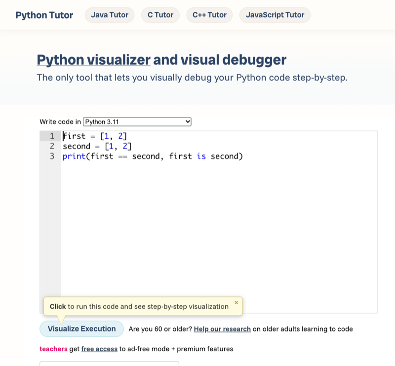

# Lab 5.3 – Übung: Vorhersagen und Spiel ohne globale Variablen

**Dauer:** ca. 17 Minuten
**Ändert die Zahlenraten-Projektbasis?** Ja — `name` wird lokal in `main()` und als Argument an `play_round` übergeben; das Spiel hat danach keine globale Variable mehr. Lab 6.1 baut darauf auf.

**Arbeitsdatei:** `playground/guess_game.py`
**Starter:** `starters/m05-l03-guess_game.py`

## Vorbereitung

- Terminal in VS Code im Ordner `project/`, `.venv` aktiv.
- Das eigene Spiel aus Lab 5.2 liegt in `playground/guess_game.py`. Ohne eigenen Stand: `starters/m05-l03-guess_game.py` öffnen, alles markieren (Strg+A / Cmd+A), kopieren und damit den Inhalt von `playground/guess_game.py` ersetzen. Die Stellen zum Ändern sind mit `# TODO Lab 5.3` markiert.
- Für Aufgabe 3: Browser mit [pythontutor.com](https://pythontutor.com/) (ohne Anmeldung). Ohne Internet: Aufgabe 3 überspringen.

## Die fünf Snippets

Dieselben Snippets stehen in [code/m05-functions/predictions.py](../../project/code/m05-functions/predictions.py). Die Datei erst in Aufgabe 2 starten.

```python
# Snippet 1
a = 3
b = a
b = b + 1
print("Snippet 1:", a, b)

# Snippet 2
x = [1, 2]
y = x
y.append(3)
print("Snippet 2:", x)


# Snippet 3
def double(n):
    n = n * 2


value = 5
double(value)
print("Snippet 3:", value)


# Snippet 4
def add_cheese(items):
    items.append("Käse")


shopping = ["Brot"]
add_cheese(shopping)
print("Snippet 4:", shopping)

# Snippet 5
first = [1, 2]
second = [1, 2]
print("Snippet 5:", first == second, first is second)
```

| Snippet | Vorhersage | Tatsächlich | Stimmt? |
| --- | --- | --- | --- |
| 1 | | | |
| 2 | | | |
| 3 | | | |
| 4 | | | |
| 5 | | | |

## Aufgaben

1. Sage für jedes Snippet die Ausgabe vorher, ohne Code auszuführen, und trage sie in die Spalte „Vorhersage“ ein (Papier oder Kopie der Tabelle).
2. Starte `python code/m05-functions/predictions.py`, trage die echten Ausgaben ein und markiere jede Abweichung.
3. Füge ein Snippet mit Abweichung (sonst Snippet 4) in Python Tutor ein, klicke **Visualize Execution** und gehe mit **Next >** bis zur `print`-Zeile. Suche den Schritt, an dem die Pfeile das Ergebnis erklären.
4. Verschiebe im Spiel Banner und Namensabfrage vom Dateiende an den Anfang von `main()`. Am Dateiende bleibt nur `main()`.
5. Ergänze `name` als ersten Parameter von `play_round` und übergib den Namen in `main()` mit `play_round(name, level=level)`. Spiele eine Runde.



_Quelle: Python Tutor (https://pythontutor.com/), eigener Screenshot vom 08.11.2026, CC BY laut Screenshot-Regel der Seite._

## Checkpoint

- Die Tabelle enthält für alle fünf Snippets Vorhersage und echte Ausgabe.
- Python Tutor zeigt für das gewählte Snippet Frames und Pfeile; der entscheidende Schritt ist gefunden.
- Außerhalb der Funktionen steht im Spiel nur noch `import random`, die Konstante `LEVELS`, die `def`-Blöcke und der Aufruf `main()`.
- Das Spiel läuft wie in Lab 5.2: Begrüßung mit Namen, „Versuche pro Runde: […]“, „Danke fürs Spielen, Anna!“.

## Abschlusskriterien

- Die Vorhersage-Tabelle ist vollständig; jede Abweichung lässt sich mit „zwei Namen, ein Objekt“ oder „Zahl ist unveränderlich“ begründen.
- `playground/guess_game.py` enthält keine globale Variable außer `LEVELS`; `play_round` bekommt den Namen als Parameter.

## Erweiterung

Schreibe in `playground/sum_to.py` eine rekursive Funktion `sum_to(n)`, die 1 + 2 + … + n zurückgibt und bei `n == 0` die Zahl 0 liefert. Prüfe, dass `sum_to(4)` den Wert 10 ergibt, und sieh den Aufrufstapel in Python Tutor an.
