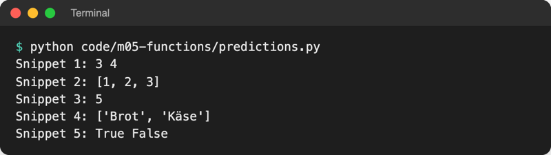

# Lab 5.3 – Lösung: Vorhersagen und Spiel ohne globale Variablen

Fertiger Stand: [project/examples/m05-functions/l03-runtime/guess_game.py](../../project/examples/m05-functions/l03-runtime/guess_game.py)

## Aufgabe 1: Vorhersagen

Die Spalte „Vorhersage“ ist individuell. Die richtigen Werte und die Begründung stehen bei Aufgabe 2.

## Aufgabe 2: Ausführen und vergleichen



_Quelle: eigener Screenshot, Kurs-Repo, 08.11.2026._

| Snippet | Tatsächlich | Warum |
| --- | --- | --- |
| 1 | `3 4` | `b = b + 1` erzeugt ein neues Objekt `4`; `a` zeigt weiter auf `3`. Zahlen sind unveränderlich. |
| 2 | `[1, 2, 3]` | `y = x` hängt ein zweites Etikett an dieselbe Liste; `append` ändert diese eine Liste. |
| 3 | `5` | `n` ist lokal in `double`; `n = n * 2` zeigt nur `n` auf `10`. `value` bleibt `5`, und `double` gibt nichts zurück. |
| 4 | `['Brot', 'Käse']` | `items` und `shopping` zeigen auf dieselbe Liste; `append` in der Funktion ist außen sichtbar. |
| 5 | `True False` | gleicher Inhalt (`==`), aber zwei getrennt angelegte Listen (`is`). |

Häufigste Abweichungen: Snippet 2 („x bleibt `[1, 2]`“) und Snippet 3 („value wird 10“). Beide klärt dieselbe Regel: Zuweisung hängt ein Etikett um, Methoden wie `append` ändern das Objekt.

## Aufgabe 3: Python Tutor

Snippet 4, Schritt nach `items.append("Käse")`: Im Global frame zeigt `shopping` auf die Liste, im Frame `add_cheese` zeigt `items` per Pfeil auf **dieselbe** Liste mit `"Brot"`, `"Käse"`. Das gleiche Bild mit drei Namen zeigt die Theorie ([Lab 5.3](l03-runtime-thx.md#veränderlich-unveränderlich-und-funktionsaufrufe)).

Snippet 3, Schritt nach `n = n * 2`: Der Frame `double` enthält `n = 10`, der Global frame weiter `value = 5`. Nach dem Rücksprung ist der Frame `double` samt `n` verschwunden.

## Aufgabe 4: Banner und Name in main

```python
def main():
    """Hauptablauf: Name fragen, Runden spielen, bis niemand mehr will."""
    print("=" * 40)
    print("Zahlenraten")
    print("=" * 40)

    name = input("Name: ").strip().title()  # lokale Variable von main
    all_tries = []
    play_again = "j"
    while play_again == "j":
        level = ask_level()
        tries = play_round(name, level=level)  # name als Argument übergeben
        all_tries.append(tries)
        play_again = input("Nochmal spielen? (j/n): ").strip().lower()

    print("Versuche pro Runde:", all_tries)
    print(f"Danke fürs Spielen, {name}!")


main()
```

Startet das Spiel nach Aufgabe 4, aber vor Aufgabe 5, bricht es mit `NameError: name 'name' is not defined` in `play_round` ab: `name` ist jetzt lokal in `main` und für `play_round` unsichtbar. Genau das behebt Aufgabe 5.

## Aufgabe 5: name als Parameter

```python
def play_round(name, level="leicht"):
    """Spielt eine Runde und gibt die Anzahl der Versuche zurück."""
    low, high, max_tries = LEVELS[level]
    ...
```

`name` steht vorn, weil Parameter ohne Standardwert vor solchen mit Standardwert stehen müssen (Lab 5.2). Ausgabe nach dem Umbau, identisch zu Lab 5.2:

```text
========================================
Zahlenraten
========================================
Name: anna
Stufe (leicht/mittel/schwer): leicht

Stufe leicht, Anna: Rate eine Zahl zwischen 1 und 10.
Tipp: 5
Zu hoch.
Verbleibende Versuche: 4
Tipp: 2
Zu niedrig.
Verbleibende Versuche: 3
Tipp: 4
Richtig, Anna! Benötigte Versuche: 3.
Bisherige Tipps: [5, 2, 4]
Nochmal spielen? (j/n): n
Versuche pro Runde: [3]
Danke fürs Spielen, Anna!
```

Auf Modulebene bleibt nur `LEVELS`: eine Konstante, die alle Funktionen lesen und keine ändert. Jede Funktion bekommt alles Übrige über Parameter und meldet Ergebnisse per `return`.

## Erweiterung

```python
def sum_to(n):
    """Gibt 1 + 2 + ... + n zurück."""
    if n == 0:  # Abbruchbedingung
        return 0
    return n + sum_to(n - 1)


print(sum_to(4))
```

```text
10
```

In Python Tutor liegen beim tiefsten Schritt fünf Frames `sum_to` übereinander (`n = 4, 3, 2, 1, 0`). Danach gibt jeder Frame sein Ergebnis an den darunter zurück: 0, 1, 3, 6, 10.
