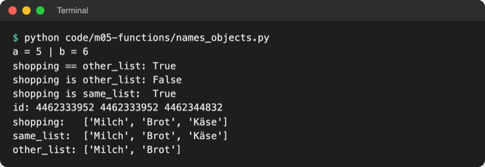
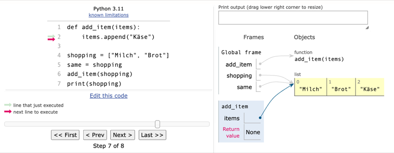
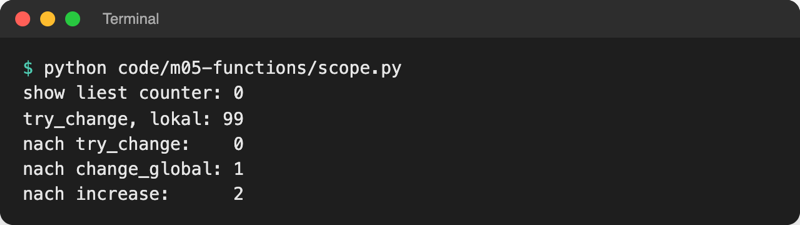
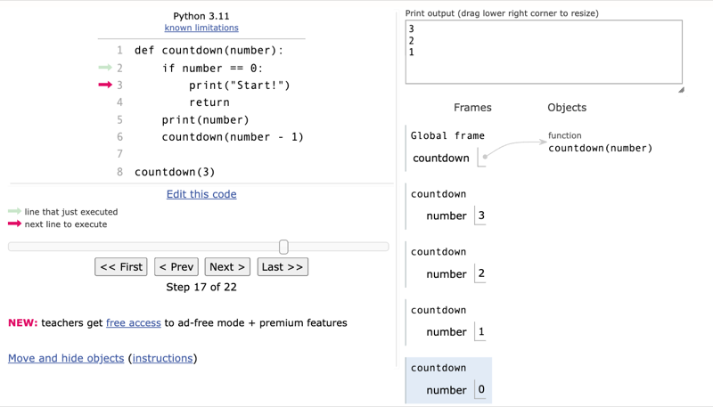
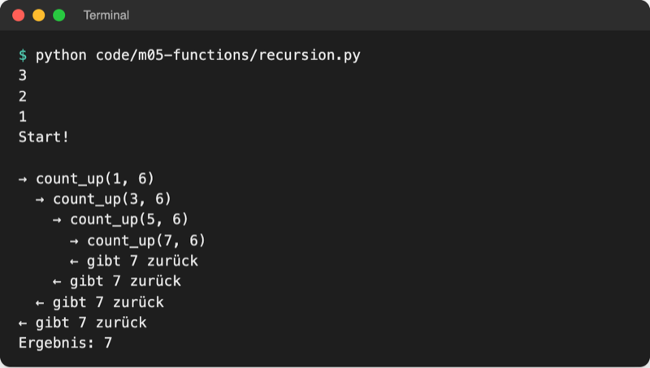

# Lab 5.3: Laufzeitmodell: Namensräume, Aufrufstapel

**Leitfragen:**

<details>
<summary>Zwei Personen haben dieselbe Einkaufsliste in der Hand – was passiert, wenn eine etwas ergänzt?</summary>

Halten beide **denselben** Zettel, sieht die andere den neuen Eintrag sofort. Hat jede eine eigene Kopie, nicht. In Python sind zwei Namen für dieselbe Liste wie zwei Hände am selben Zettel.

</details>

<details>
<summary>Warum ändert sich eine Zahl außerhalb einer Funktion nicht, eine Liste aber schon?</summary>

Eine Zahl lässt sich nicht verändern; `n = n * 2` erzeugt eine neue Zahl, auf die nur der Name in der Funktion zeigt. Eine Liste lässt sich verändern; `append` ändert das eine Objekt, das auch außen sichtbar ist.

</details>

<details>
<summary>Wer „weiß“, wohin ein Programm nach einer Funktion zurückspringt?</summary>

Python selbst: Bei jedem Aufruf legt es einen Eintrag auf den Aufrufstapel, mit Rücksprungstelle und eigenen Variablen. `return` nimmt den obersten Eintrag wieder herunter.

</details>

- Das Laufzeitmodell beschreibt, was Python beim Ausführen im Speicher tut: welche Werte es gibt, welche Namen auf sie zeigen und welche Funktion gerade läuft.
- Wer es kennt, kann vorhersagen, ob eine Funktion eine Liste von außen verändert und warum eine Variable in einer Funktion „verschwindet“.

## Begriffe

| Begriff | Bedeutung |
| --- | --- |
| Laufzeit | die Zeit, in der ein Programm läuft (im Gegensatz zum Schreiben des Codes) |
| Objekt | ein Wert im Speicher mit Typ und Inhalt; in Python ist jeder Wert ein Objekt: Zahl, String, Liste, sogar eine Funktion |
| Referenz | Verweis eines Namens auf ein Objekt; wie ein Etikett mit Schnur an einer Schachtel |
| `id()` | eingebaute Funktion: liefert die Nummer eines Objekts; gleiche Nummer = dasselbe Objekt |
| `is` | prüft, ob zwei Namen auf **dasselbe** Objekt zeigen (`==` prüft gleichen Inhalt) |
| veränderlich (mutable) | Objekt, dessen Inhalt sich ändern lässt: Liste, Set, Dictionary |
| unveränderlich (immutable) | Objekt, das nach dem Anlegen fest ist: Zahl, String, Tupel, `True`/`False`, `None` |
| Gültigkeitsbereich (Scope) | Bereich im Code, in dem ein Name bekannt ist: lokal in einer Funktion oder global in der Datei |
| lokale Variable | Name, der in einer Funktion entsteht; gilt nur während dieses Aufrufs |
| globale Variable | Name auf Modulebene (außerhalb aller Funktionen); überall in der Datei lesbar |
| Aufrufstapel (Call Stack) | Stapel der laufenden Funktionsaufrufe; oben liegt der aktuelle, darunter die wartenden |
| Rekursion | eine Funktion ruft sich selbst auf, jedes Mal mit einer kleineren Aufgabe |
| Abbruchbedingung | Fall, in dem eine rekursive Funktion sich nicht mehr selbst aufruft |

## Namen zeigen auf Objekte

Lab 2.2 hat eine Variable als Etikett an einer Schachtel eingeführt. Genauer: Die Schachtel ist ein **Objekt**, und an einem Objekt können mehrere Etiketten hängen. `b = a` kopiert nichts, sondern hängt ein zweites Etikett an dasselbe Objekt. Datei: [code/m05-functions/names_objects.py](../../project/code/m05-functions/names_objects.py)

```python
a = 5
b = a
b = b + 1                       # neues Objekt 6, nur b zeigt jetzt darauf

shopping = ["Milch", "Brot"]
same_list = shopping            # kein Kopieren: zweites Etikett
other_list = ["Milch", "Brot"]  # neues Objekt mit gleichem Inhalt

print(shopping == other_list)   # True: gleicher Inhalt
print(shopping is other_list)   # False: zwei Objekte
print(shopping is same_list)    # True: dasselbe Objekt
same_list.append("Käse")        # ändert das gemeinsame Objekt
```



_Quelle: eigener Screenshot, Kurs-Repo, 08.11.2026. Die `id`-Nummern sind bei jedem Start anders._

### `==` oder `is`?

| | `==` | `is` |
| --- | --- | --- |
| Frage | gleicher Inhalt? | dasselbe Objekt? |
| `[1, 2] == [1, 2]` / `[1, 2] is [1, 2]` | `True` | `False` (zwei Listen) |
| Einsatz | fast immer: Zahlen, Texte, Listen vergleichen | nur `x is None` (es gibt genau ein `None`) |

Für Zahlen und Strings liefert `is` je nach Situation mal `True`, mal `False`, weil Python gleiche kleine Werte manchmal wiederverwendet. Deshalb dort immer `==`.

## Veränderlich, unveränderlich und Funktionsaufrufe

Beim Aufruf bekommt der Parameter ein Etikett an **dasselbe** Objekt wie das Argument; kopiert wird nichts. Was danach passiert, hängt vom Objekt ab. Datei: [code/m05-functions/mutable_args.py](../../project/code/m05-functions/mutable_args.py)

```python
def add_bonus(points):
    points = points + 10   # neues Objekt, nur der lokale Name zeigt darauf


def add_guess(guesses):
    guesses.append(7)      # ändert das Objekt, auf das auch tips zeigt


score = 50
add_bonus(score)
print("score danach:", score)   # 50

tips = [5, 8]
add_guess(tips)
print("tips danach: ", tips)    # [5, 8, 7]
```

| Objekt | in der Funktion | außen sichtbar? |
| --- | --- | --- |
| Zahl, String, Tupel | `x = x + 10`, `x = x.upper()` erzeugen ein neues Objekt | nein; Ergebnis per `return` zurückgeben |
| Liste, Set, Dictionary | `append`, `add`, `x[0] = …`, `x["key"] = …` ändern das Objekt | ja, sofort |

Python Tutor zeigt den Moment in `add_item`: Drei Namen (`shopping`, `same`, `items`) zeigen per Pfeil auf **eine** Liste.



_Quelle: Python Tutor (https://pythontutor.com/), eigener Screenshot vom 08.11.2026, CC BY laut Screenshot-Regel der Seite._

## Gültigkeitsbereiche: lokal und global

Jeder Aufruf bekommt einen eigenen **Namensraum** (in Python Tutor: ein „Frame“). Namen, die in der Funktion entstehen (Parameter und Zuweisungen), sind lokal und verschwinden mit dem `return`. Datei: [code/m05-functions/scope.py](../../project/code/m05-functions/scope.py)

```python
counter = 0  # global


def show():
    print("show liest counter:", counter)   # Lesen klappt


def try_change():
    counter = 99                            # neue lokale Variable
    print("try_change, lokal:", counter)


def change_global():
    global counter                          # funktioniert, besser vermeiden
    counter = counter + 1


def increase(value):
    return value + 1                        # besser: Wert rein, Ergebnis raus
```



_Quelle: eigener Screenshot, Kurs-Repo, 08.11.2026._

Sucht Python einen Namen, schaut es in dieser Reihenfolge nach (LEGB) und nimmt den ersten Treffer:

| Stufe | Wo | Beispiel |
| --- | --- | --- |
| **L**ocal | in der laufenden Funktion | Parameter `value`, Zuweisung in `try_change` |
| **E**nclosing | in einer äußeren Funktion, wenn Funktionen ineinander stehen | im Kurs selten |
| **G**lobal | auf Modulebene der Datei | `counter`, `LEVELS` |
| **B**uilt-in | eingebaute Namen von Python | `print`, `len`, `list` |

**Warum `global` vermeiden?** Eine Funktion mit `global` ändert Daten, ohne dass der Aufruf es zeigt; Fehler lassen sich dann schwer finden, und die Funktion funktioniert nur zusammen mit genau dieser Variablen. Besser: alles Nötige als Parameter hinein, Ergebnis per `return` heraus. Globale **Konstanten** wie `LEVELS` sind in Ordnung: Sie werden nur gelesen, nie geändert.

## Aufrufstapel und Rekursion

Ruft eine Funktion eine andere auf, wartet sie, bis diese fertig ist. Python legt dafür jeden Aufruf wie einen Teller auf einen Stapel: oben der laufende, darunter die wartenden. `return` nimmt den obersten Teller weg, und die Funktion darunter macht weiter.

Eine **rekursive** Funktion ruft sich selbst auf. Jeder Aufruf bekommt einen eigenen Teller mit eigenen Variablen. Datei: [code/m05-functions/recursion.py](../../project/code/m05-functions/recursion.py)

```python
def countdown(number):
    if number == 0:          # Abbruchbedingung: hier endet die Rekursion
        print("Start!")
        return
    print(number)
    countdown(number - 1)    # gleicher Ablauf mit kleinerer Zahl


countdown(3)
```



_Quelle: Python Tutor (https://pythontutor.com/), eigener Screenshot vom 08.11.2026, CC BY laut Screenshot-Regel der Seite._

Die Funktion `count_up` in derselben Datei rückt jede Ebene ein: Der Stapel wächst mit jedem Aufruf (→) und schrumpft mit jedem `return` (←).



_Quelle: eigener Screenshot, Kurs-Repo, 08.11.2026._

Fehlt die Abbruchbedingung, wächst der Stapel, bis Python nach rund 1000 Ebenen mit `RecursionError: maximum recursion depth exceeded` abbricht. Rekursion ist in Python selten nötig; eine Schleife löst die meisten Aufgaben einfacher.

## Falle: Liste als Standardwert

Ein Standardwert entsteht **einmal**, wenn Python die `def`-Zeile liest, nicht bei jedem Aufruf. Bei einer Liste teilen sich deshalb alle Aufrufe dieselbe Liste. Datei: [code/m05-functions/default_list_trap.py](../../project/code/m05-functions/default_list_trap.py)

```python
def add_tip(tip, tips=[]):       # Falle
    tips.append(tip)
    return tips


print(add_tip(5))   # [5]
print(add_tip(8))   # [5, 8] statt [8]


def add_tip_safe(tip, tips=None):
    if tips is None:             # bei jedem Aufruf ohne Liste: neue Liste
        tips = []
    tips.append(tip)
    return tips
```

Regel: Standardwerte nur unveränderlich (`None`, Zahl, String, Tupel).

## Selbst ansehen: Python Tutor

[Python Tutor](https://pythontutor.com/) führt kurzen Python-Code Schritt für Schritt im Browser aus und zeichnet dabei Frames (Namensräume) und Objekte mit Pfeilen. Stand: 08.11.2026.

1. Seite öffnen, Code in das Eingabefeld einfügen.
2. **Visualize Execution** klicken.
3. Mit **Next >** und **< Prev** Zeile für Zeile vor- und zurückgehen; **Edit this code** führt zurück zum Eingabefeld.

Grenzen: Die Seite nutzt Python 3.11 statt 3.14 (für diese Themen ohne Unterschied), `import` geht nur für einige Standardmodule, und Zahlen und Strings erscheinen direkt im Frame statt als eigenes Objekt (umschaltbar mit „show strings and numbers as objects“). Code nicht mit vertraulichen Daten einfügen. Dasselbe im eigenen Editor zeigt der Debugger von VS Code (Lab 7.4).

## Im Spiel: ohne globale Variablen

Seit Lab 5.2 lesen `play_round` und `main` den Namen aus der globalen Variablen `name`. Jetzt wird `name` lokal in `main()` und reist als Argument zu `play_round` (Ausschnitt):

```python
def play_round(name, level="leicht"):
    """Spielt eine Runde und gibt die Anzahl der Versuche zurück."""
    ...


def main():
    """Hauptablauf: Name fragen, Runden spielen, bis niemand mehr will."""
    ...  # Banner
    name = input("Name: ").strip().title()  # lokale Variable von main
    ...
        tries = play_round(name, level=level)  # name als Argument übergeben
```

Die Datei endet mit `main()`. Auf Modulebene bleibt nur die Konstante `LEVELS`, die alle Funktionen lesen, aber keine ändert. Die Ausgabe des Spiels bleibt gleich.

## Typische Fehler

| Symptom | Ursache | Lösung |
| --- | --- | --- |
| `UnboundLocalError: cannot access local variable 'counter' where it is not associated with a value` | `counter += 1` in einer Funktion macht `counter` lokal, bevor es einen Wert hat | Wert als Parameter übergeben und per `return` zurückgeben |
| `NameError: name 'name' is not defined` in einer Funktion | Variable ist lokal in einer anderen Funktion | als Argument übergeben |
| Liste ändert sich „von selbst“ | zwei Namen zeigen auf dieselbe Liste | mit `.copy()` oder `list(x)` eine eigene Liste anlegen |
| Funktion ändert eine Zahl, außen bleibt sie gleich | Zahl ist unveränderlich, die Zuweisung wirkt nur lokal | `return` und außen zuweisen: `score = add_bonus(score)` |
| `RecursionError: maximum recursion depth exceeded` | rekursive Funktion ohne erreichbare Abbruchbedingung | Abbruchbedingung prüfen, Argument muss kleiner werden |
| `TypeError: 'list' object is not callable` | eingebauter Name überschrieben, z. B. `list = [1, 2]` | Variable umbenennen, z. B. `numbers` |
| `if x is 5:` gibt `SyntaxWarning: "is" with 'int' literal` | `is` statt `==` bei einer Zahl | `==` verwenden |

## Fazit

- Namen zeigen auf Objekte; `b = a` kopiert nichts. `==` vergleicht Inhalte, `is` Objekte (nur für `None`).
- Listen, Sets und Dictionaries lassen sich in einer Funktion verändern, Zahlen, Strings und Tupel nicht.
- Jeder Aufruf hat eigene lokale Namen und einen Platz auf dem Aufrufstapel; Daten reisen über Parameter und `return`, nicht über `global`.

In der Übung werden fünf Snippets erst vorhergesagt, dann ausgeführt, und das Spiel verliert seine letzte globale Variable.
