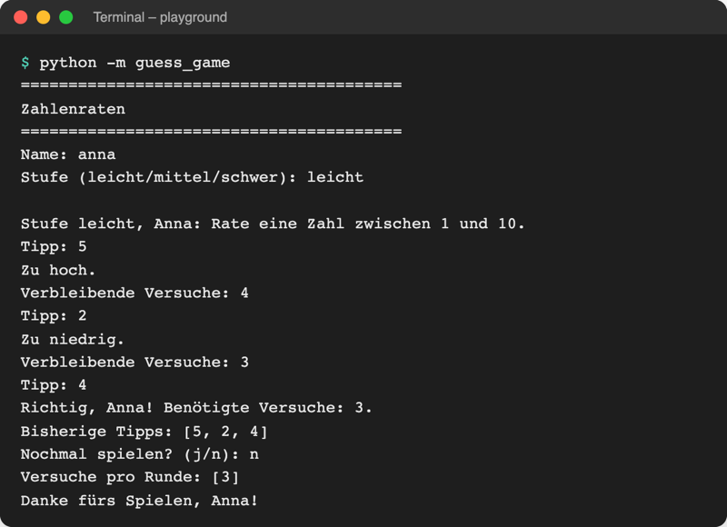

# Lab 6.1 – Lösung: Das Spiel als Paket

Fertiger Stand: [project/examples/m06-modules/l01-modules/guess_game/](../../project/examples/m06-modules/l01-modules/guess_game/)

## Aufgabe 1: Paket anlegen

```text
playground/
├── guess_game/          aus starters/m06-l01-guess_game/ kopiert und umbenannt
│   ├── __init__.py
│   ├── __main__.py
│   ├── logic.py
│   └── ui.py
├── guess_game_old.py    bisherige Datei, umbenannt
└── hello.py
```

Der Ordnername muss exakt `guess_game` heißen: `python -m guess_game` sucht genau diesen Namen. Die Umbenennung der alten Datei verhindert, dass versehentlich die alte Version bearbeitet wird.

`__init__.py` enthält nur einen Docstring:

```python
"""Zahlenraten – Stand Lab 6.1: das Spiel als Paket."""
```

## Aufgabe 2: Regeln nach logic.py

```python
# Spielregeln: Stufen, Geheimzahl, Prüfungen – ohne Ein- und Ausgabe

import random

# Stufe -> (kleinste Zahl, größte Zahl, Versuche)
LEVELS = {
    "leicht": (1, 10, 5),
    "mittel": (1, 50, 7),
    "schwer": (1, 100, 7),
}


def draw_secret(low, high):
    """Gibt eine zufällige Geheimzahl zwischen low und high zurück."""
    return random.randint(low, high)


def is_guess_correct(guess, secret):
    """Gibt True zurück, wenn der Tipp die Geheimzahl trifft."""
    return guess == secret


def is_game_over(tries, max_tries):
    """Gibt True zurück, wenn alle Versuche verbraucht sind."""
    return tries >= max_tries
```

`logic.py` braucht als einzige Datei `import random`. Ohne `input` und `print` lässt sich jede Regel einzeln im interaktiven Modus prüfen.

## Aufgabe 3: Ein- und Ausgabe nach ui.py

Oben der Import, die vier vorgegebenen Funktionen bleiben unverändert. Geändert gegenüber Lab 5.3 sind nur die Zeilen mit `logic.`:

```python
# Ein- und Ausgabe im Terminal: alles, was mit input() und print() zu tun hat

from guess_game import logic


def ask_level():
    """Fragt so lange nach der Stufe, bis es sie gibt, und gibt sie zurück."""
    level = input("Stufe (leicht/mittel/schwer): ").strip().lower()
    while level not in logic.LEVELS:
        print("Diese Stufe gibt es nicht.")
        level = input("Stufe (leicht/mittel/schwer): ").strip().lower()
    return level


def show_hint(guess, secret):
    """Gibt aus, ob der Tipp zu hoch oder zu niedrig ist."""
    if guess > secret:
        print("Zu hoch.")
    else:
        print("Zu niedrig.")


def play_round(name, level="leicht"):
    """Spielt eine Runde und gibt die Anzahl der Versuche zurück."""
    low, high, max_tries = logic.LEVELS[level]
    secret = logic.draw_secret(low, high)
    tries = 0
    guesses = []
    tried = set()
    print(f"\nStufe {level}, {name}: Rate eine Zahl zwischen {low} und {high}.")

    while not logic.is_game_over(tries, max_tries):
        guess = int(input("Tipp: "))

        if guess in tried:
            print("Diese Zahl wurde schon getippt.")
            continue

        tried.add(guess)
        guesses.append(guess)
        tries += 1

        if logic.is_guess_correct(guess, secret):
            print(f"Richtig, {name}! Benötigte Versuche: {tries}.")
            break

        show_hint(guess, secret)

        if logic.is_game_over(tries, max_tries):
            print(f"Keine Versuche mehr. Die Zahl war {secret}.")
        else:
            print(f"Verbleibende Versuche: {max_tries - tries}")

    print("Bisherige Tipps:", guesses)
    return tries
```

`show_hint` steht in derselben Datei wie `play_round` und braucht deshalb kein Präfix. Die Reihenfolge der Funktionen in `ui.py` ist frei; im Beispiel stehen die kurzen Funktionen oben und `play_round` unten.

## Aufgabe 4: main() in __main__.py

```python
# Startpunkt: python -m guess_game führt diese Datei aus

from guess_game import ui


def main():
    """Hauptablauf: Name fragen, Runden spielen, bis niemand mehr will."""
    ui.show_banner()
    name = ui.ask_name()
    all_tries = []
    play_again = "j"
    while play_again == "j":
        level = ui.ask_level()
        tries = ui.play_round(name, level=level)
        all_tries.append(tries)
        play_again = ui.ask_play_again()
    ui.show_goodbye(name, all_tries)


if __name__ == "__main__":  # nur beim Start, nicht beim Import
    main()
```

`main()` liest sich jetzt wie eine Inhaltsangabe des Spiels. Ohne den letzten Block wäre `main()` nur definiert, und `python -m guess_game` würde nichts tun.

## Aufgabe 5: Starten und prüfen

```bash
cd playground
python -m guess_game
```



_Quelle: eigener Screenshot, Kurs-Repo, 08.11.2026 (Eingaben per Skript, Zufalls-Startwert 3)._

Import-Probe im selben Terminal:

```text
$ python -c "from guess_game import logic; print(logic.LEVELS)"
{'leicht': (1, 10, 5), 'mittel': (1, 50, 7), 'schwer': (1, 100, 7)}
```

Gleichwertig im interaktiven Modus: `python`, dann `from guess_game import logic` und `logic.LEVELS`, Ende mit `exit`. Kein Spiel startet, weil nur `logic.py` geladen wird. Nach dem ersten Start liegt in `guess_game/` ein Ordner `__pycache__/`; er wird ignoriert.

## Erweiterung

`playground/text_tools.py`:

```python
# Eigenes Modul: Text laut oder leise machen


def shout(text):
    """Gibt den Text in Großbuchstaben mit Ausrufezeichen zurück."""
    return text.upper() + "!"


def whisper(text):
    """Gibt den Text in Kleinbuchstaben mit drei Punkten zurück."""
    return text.lower() + "..."


if __name__ == "__main__":
    print("Selbsttest:", shout("test"), whisper("TEST"))
```

`playground/use_text_tools.py`:

```python
import text_tools

print(text_tools.shout("hallo"))
print(text_tools.whisper("PSST"))
```

```text
$ python text_tools.py
Selbsttest: TEST! test...
$ python use_text_tools.py
HALLO!
psst...
```

Der Selbsttest erscheint nur beim direkten Start von `text_tools.py`. Beim Import ist `__name__` dort `"text_tools"`, der Block wird übersprungen.
