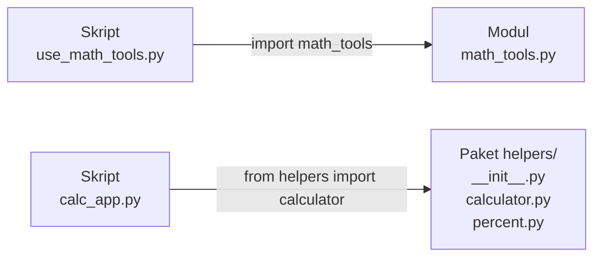
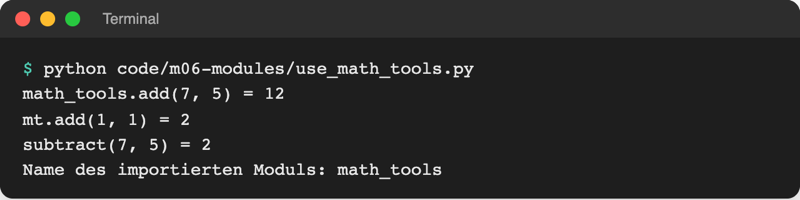
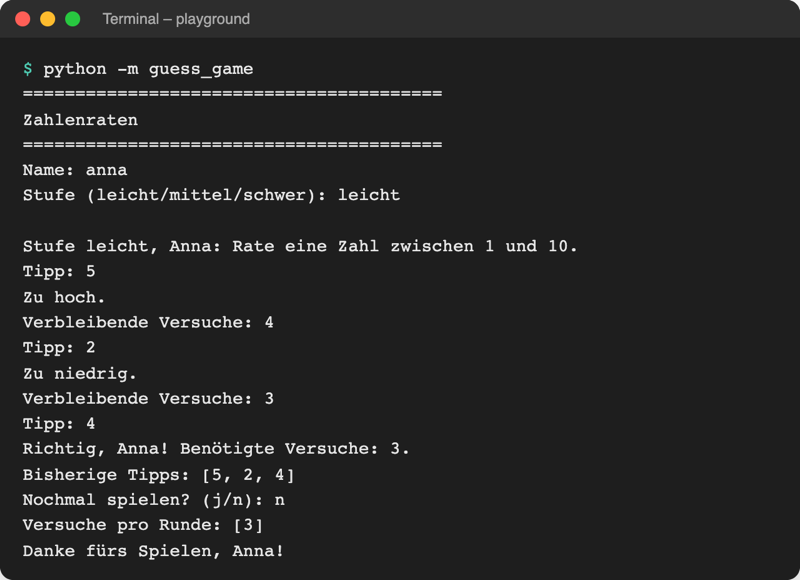
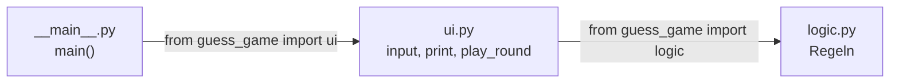
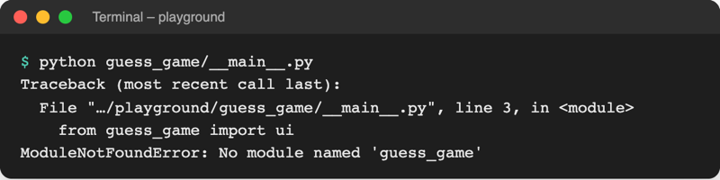

# Lab 6.1: Eigene Module und Pakete

**Leitfragen:**

<details>
<summary>Wie würde man ein 500-Seiten-Handbuch für ein Team aufteilen?</summary>

In Kapitel nach Themen, jedes Kapitel eine eigene Datei, ein Inhaltsverzeichnis verbindet sie. Code lässt sich genauso aufteilen: eine Datei pro Aufgabe, ein Startpunkt, der sie zusammenführt.

</details>

<details>
<summary>Welche Teile des Spiels haben mit dem Terminal zu tun, welche nur mit den Regeln?</summary>

Terminal: Banner, Name und Stufe abfragen, Tipps lesen, Hinweise und Ergebnis ausgeben. Nur Regeln: Stufen, Geheimzahl ziehen, Treffer prüfen, Spielende prüfen. Diese Trennung wird in diesem Lab zu zwei Dateien.

</details>

<details>
<summary>Woher findet <code>import random</code> die Datei, ohne dass ein Pfad angegeben ist?</summary>

Python sucht in einer festen Liste von Ordnern, dem Suchpfad: zuerst im Ordner des gestarteten Programms, dann in der Standardbibliothek, dann bei den installierten Paketen der venv. Der erste Treffer gewinnt.

</details>

- Bisher steht das ganze Spiel in einer Datei mit rund 90 Zeilen. Jede neue Funktion macht sie länger und unübersichtlicher.
- Python verteilt Code auf mehrere Dateien (Module) und Ordner (Pakete). `import` holt sie zusammen, wie bei `import random` aus Lab 3.2.

## Begriffe

| Begriff | Bedeutung |
| --- | --- |
| Modul | jede `.py`-Datei; ihr Inhalt (Funktionen, Konstanten) lässt sich in andere Dateien importieren; wie ein Kapitel eines Handbuchs |
| Paket | Ordner mit Modulen und einer Datei `__init__.py`; wie ein Ordner mit mehreren Kapiteln. Die installierbaren Pakete von PyPI aus Lab 1.2 (z. B. `rich`) sind genau solche Ordner |
| Skript | `.py`-Datei, die direkt gestartet wird, z. B. `python playground/hello.py` |
| `__init__.py` | kennzeichnet einen Ordner als Paket; darf leer sein oder nur einen Docstring enthalten |
| `__main__.py` | Startdatei eines Pakets; läuft bei `python -m <paket>` |
| `python -m <name>` | startet ein Modul oder Paket über seinen Namen statt über einen Dateipfad („m“ für module) |
| `__name__` | Variable, die Python in jedem Modul selbst setzt: `"__main__"` beim direkten Start, sonst der Modulname |
| Suchpfad | Liste der Ordner, in denen Python bei `import` sucht |
| `cd` | Terminal-Befehl „change directory“: wechselt den Ordner, in dem das Terminal arbeitet |
| `__pycache__` | Ordner, den Python beim Import anlegt; enthält vorübersetzte Dateien, darf ignoriert werden |

## Modul, Paket, Skript



| | Modul | Paket | Skript |
| --- | --- | --- | --- |
| Was | eine `.py`-Datei | Ordner mit `__init__.py` und Modulen | eine `.py`-Datei, die gestartet wird |
| Zweck | Funktionen bereitstellen | zusammengehörige Module bündeln | Ablauf starten |
| Beispiel | `math_tools.py`, `random` | `helpers/`, später `guess_game/` | `use_math_tools.py`, `hello.py` |

Dieselbe Datei kann beides sein: Modul, wenn eine andere Datei sie importiert, Skript, wenn sie direkt gestartet wird.

## Ein eigenes Modul: math_tools.py

Datei: [code/m06-modules/math_tools.py](../../project/code/m06-modules/math_tools.py)

```python
def add(a, b):
    """Gibt die Summe von a und b zurück."""
    return a + b


def subtract(a, b):
    """Gibt die Differenz a - b zurück."""
    return a - b
```

Ein Modul braucht nichts Besonderes: Jede `.py`-Datei mit Funktionen ist eines. Der Modulname ist der Dateiname ohne `.py`.

## Drei Formen von import

Datei: [code/m06-modules/use_math_tools.py](../../project/code/m06-modules/use_math_tools.py) liegt im selben Ordner wie `math_tools.py`.

```python
import math_tools  # 1. ganzes Modul, Aufruf mit math_tools.add
import math_tools as mt  # 2. ganzes Modul unter kürzerem Namen
from math_tools import subtract  # 3. nur eine Funktion, Aufruf ohne Präfix

print("math_tools.add(7, 5) =", math_tools.add(7, 5))
print("mt.add(1, 1) =", mt.add(1, 1))
print("subtract(7, 5) =", subtract(7, 5))
```



_Quelle: eigener Screenshot, Kurs-Repo, 08.11.2026._

| Form | Aufruf danach | Wann |
| --- | --- | --- |
| `import math_tools` | `math_tools.add(1, 2)` | Standard: Herkunft steht bei jedem Aufruf dabei |
| `import math_tools as mt` | `mt.add(1, 2)` | langer Modulname, verbreitete Kürzel wie `import pandas as pd` (Lab 19.2) |
| `from math_tools import add` | `add(1, 2)` | wenige Namen, die oft gebraucht werden |
| `from paket import modul` | `modul.funktion()` | Modul aus einem Paket, z. B. `from guess_game import logic` |

`from math_tools import *` holt alle Namen auf einmal. Das ist erlaubt, aber unübersichtlich: Im Code ist nicht mehr zu sehen, woher ein Name kommt.

## `__name__` und `if __name__ == "__main__":`

Beim Import führt Python die ganze Datei einmal von oben nach unten aus. Ein `print` auf oberster Ebene würde also auch beim Import erscheinen. Damit ein Selbsttest nur beim direkten Start läuft, prüft das Modul seinen eigenen Namen:

```python
# Läuft nur, wenn diese Datei direkt gestartet wird, nicht beim Import
if __name__ == "__main__":
    print("__name__ ist:", __name__)
    print("Selbsttest: 2 + 3 =", add(2, 3))
```

| Start | Wert von `__name__` in `math_tools.py` | Selbsttest läuft? |
| --- | --- | --- |
| `python code/m06-modules/math_tools.py` | `"__main__"` | ja |
| `import math_tools` in einer anderen Datei | `"math_tools"` | nein |

```text
$ python code/m06-modules/math_tools.py
__name__ ist: __main__
Selbsttest: 2 + 3 = 5
Selbsttest: 10 - 4 = 6
```

Daraus ergibt sich die übliche Programmstruktur einer Python-Datei: oben `import`, dann Konstanten, dann Funktionen, ganz unten der Startblock `if __name__ == "__main__":`.

## Paket: ein Ordner mit `__init__.py`

Das Paket `helpers` bündelt zwei Module. Datei: [code/m06-modules/calc_app.py](../../project/code/m06-modules/calc_app.py)

```text
code/m06-modules/
├── calc_app.py          Skript, nutzt das Paket
└── helpers/             Paket
    ├── __init__.py      macht den Ordner zum Paket (nur ein Docstring)
    ├── calculator.py    add, subtract, multiply, divide
    └── percent.py       percent_of, nutzt calculator
```

```python
from helpers import calculator  # Modul aus dem Paket
from helpers.percent import percent_of  # Funktion aus einem Modul des Pakets

price = 80
print("80 + 20 =", calculator.add(price, 20))
print("80 / 4 =", calculator.divide(price, 4))
print("15 % von 80 =", percent_of(price, 15))
```

```text
$ python code/m06-modules/calc_app.py
80 + 20 = 100
80 / 4 = 20.0
15 % von 80 = 12.0
```

Der Punkt verbindet Paket und Modul: `helpers.percent` ist „das Modul `percent` im Paket `helpers`“. Auch die Python-Dokumentation erklärt Pakete an einem Ordnerbaum:

Original: [Python-Tutorial Abschnitt 6.4 Packages: Ordnerbaum eines Pakets sound mit __init__.py und Unterpaketen formats, effects, filters](https://docs.python.org/3.14/tutorial/modules.html#packages), Stand 08.11.2026.

## Ein Paket starten: `cd` und `python -m`

Ein Paket ist ein Ordner, kein einzelnes Skript. Gestartet wird es mit `python -m <paketname>`; Python führt dann dessen `__main__.py` aus. Dafür muss das Terminal in dem Ordner stehen, der den Paketordner enthält:

```bash
cd playground            # Terminal wechselt von project/ nach project/playground/
python -m guess_game     # startet playground/guess_game/__main__.py
cd ..                    # bei Bedarf: eine Ebene zurück nach project/
```

- Den aktuellen Ordner zeigt die Eingabezeile, z. B. `(.venv) …\project\playground>` (Windows) oder `(.venv) … playground %` (macOS). Das gilt, bis das Terminal geschlossen wird.
- `python -m` nimmt den aktuellen Ordner in den Suchpfad auf. Nur deshalb findet `from guess_game import ui` das Paket.
- Die venv bleibt nach `cd` aktiv.



_Quelle: eigener Screenshot, Kurs-Repo, 08.11.2026 (Eingaben per Skript, Zufalls-Startwert 3)._

## Wo Python bei import sucht

| Reihenfolge | Ordner | Beispiel |
| --- | --- | --- |
| 1 | Ordner des gestarteten Skripts, bei `python -m` der aktuelle Ordner | `math_tools.py`, `guess_game/` |
| 2 | Standardbibliothek | `random`, `math`, `datetime` |
| 3 | installierte Pakete der aktiven venv (`.venv/…/site-packages`) | `rich` (Lab 6.2) |

Der erste Treffer gewinnt. Deshalb überdeckt eine eigene Datei `random.py` das Modul `random` (Lab 3.2). Die Liste selbst zeigt `python -c "import sys; print(sys.path)"`; `python -c "…"` führt die Python-Zeile in den Anführungszeichen aus, ohne Datei.

## `__pycache__`: ignorieren

Nach dem ersten Import erscheint neben den Modulen ein Ordner `__pycache__/` mit Dateien wie `logic.cpython-314.pyc`. Darin speichert Python die vorübersetzte Fassung jedes Moduls, damit der nächste Start schneller geht. Der Ordner darf ignoriert und jederzeit gelöscht werden; Python legt ihn neu an. `project/.gitignore` schließt ihn aus.

## Im Spiel: vier Dateien statt einer

Seit Lab 5.3 bekommt `play_round` den Namen als Parameter; damit lässt sich jede Funktion ohne globale Variablen in eine eigene Datei verschieben.

```text
playground/
└── guess_game/
    ├── __init__.py    Docstring „Stand Lab 6.1“
    ├── __main__.py    main(): Ablauf, ruft nur ui.-Funktionen auf
    ├── logic.py       LEVELS, draw_secret, is_guess_correct, is_game_over (kein input/print)
    └── ui.py          alle Ein- und Ausgaben, play_round
```



Die Pfeile zeigen nur in eine Richtung: `logic.py` kennt weder `ui.py` noch das Terminal. In `ui.py` steht oben `from guess_game import logic`; in `play_round` tragen die Regeln den Modulnamen davor:

```python
def play_round(name, level="leicht"):
    """Spielt eine Runde und gibt die Anzahl der Versuche zurück."""
    low, high, max_tries = logic.LEVELS[level]
    secret = logic.draw_secret(low, high)
    # ...
    while not logic.is_game_over(tries, max_tries):
        # ...
```

`draw_secret(low, high)` ist neu in `logic.py` und kapselt `random.randint`: Nur `logic.py` braucht dadurch `import random`. Importe innerhalb des Pakets beginnen immer mit dem Paketnamen (`from guess_game import …`).

## Randnotiz: Lazy Imports ab Python 3.15

Python 3.15 (erschienen am 09.10.2026) kennt `lazy import json`: Das Modul wird erst geladen, wenn der Code es zum ersten Mal benutzt. Große Programme starten so schneller. Im Kurs (Python 3.14) gibt es das noch nicht; normale Importe bleiben der Standard. Stand: 08.11.2026, Quelle: PEP 810 (https://peps.python.org/pep-0810/), „What's New in Python 3.15“ (https://docs.python.org/3.15/whatsnew/3.15.html).

## Typische Fehler



_Quelle: eigener Screenshot, Kurs-Repo, 08.11.2026 (Pfad gekürzt)._

| Symptom | Ursache | Lösung |
| --- | --- | --- |
| `ModuleNotFoundError: No module named 'guess_game'` | `__main__.py` direkt als Datei gestartet | `cd playground`, dann `python -m guess_game` |
| `…python: No module named guess_game` | Terminal steht in `project/` statt in `playground/`, oder Ordner heißt anders (z. B. `guess_game 2`) | `cd playground`; Ordner exakt `guess_game` nennen |
| `No module named guess_game.py` | `.py` hinter den Paketnamen geschrieben | `python -m guess_game` ohne `.py` |
| `NameError: name 'logic' is not defined` | `from guess_game import logic` fehlt oben in `ui.py` | Import ergänzen |
| `AttributeError: module 'guess_game.logic' has no attribute 'LEVELS'` | Name nicht nach `logic.py` verschoben oder falsch geschrieben | Name in `logic.py` prüfen (Vorschlag „Did you mean …?“ beachten) |
| `python -m guess_game` startet, aber nichts passiert | `main()` definiert, aber nie aufgerufen | unten in `__main__.py`: `if __name__ == "__main__":` und `main()` |
| Änderungen wirken nicht | alte Datei `playground/guess_game.py` geöffnet statt Paketdatei | alte Datei in `guess_game_old.py` umbenennen |

## Fazit

- Modul = `.py`-Datei, Paket = Ordner mit `__init__.py`; `import modul`, `from paket import modul`, `as` für Kurznamen.
- `if __name__ == "__main__":` trennt „wird gestartet“ von „wird importiert“.
- Ein Paket startet mit `python -m <paket>` aus dem Ordner, der das Paket enthält; im Kurs: `cd playground`, dann `python -m guess_game`.

In der Übung wird das eigene Spiel zum Paket `guess_game/` mit `logic.py`, `ui.py` und `__main__.py`.
