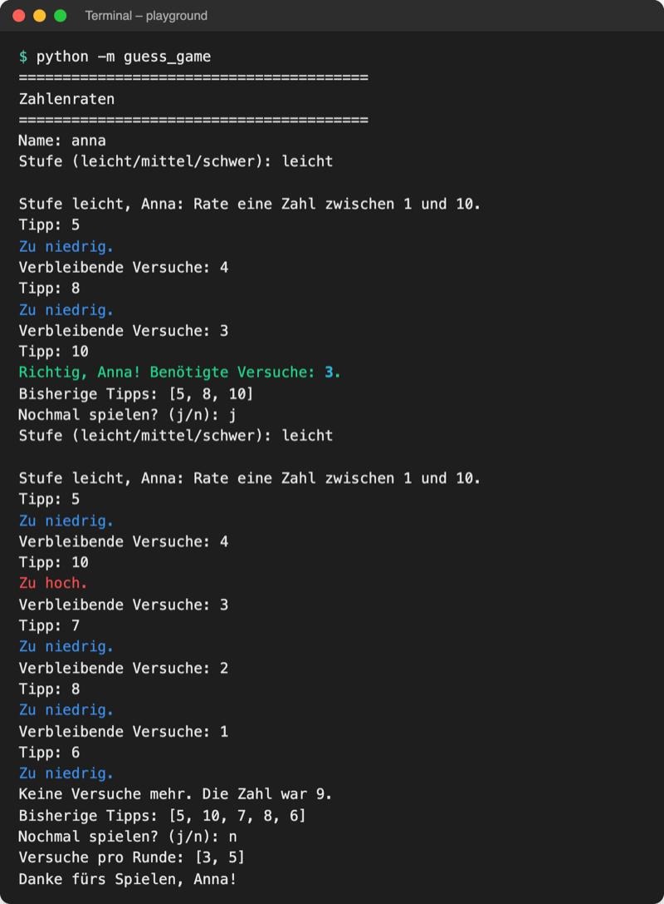

# Lab 6.2 – Lösung: Farbige Hinweise mit rich

Fertiger Stand: [project/examples/m06-modules/l02-pypi/guess_game/](../../project/examples/m06-modules/l02-pypi/guess_game/) (geändert: `ui.py`, Docstring in `__init__.py`)

## Aufgabe 1: rich prüfen

```text
$ pip show rich
Name: rich
Version: 15.0.0
...
License: MIT
Location: …/project/.venv/lib/python3.14/site-packages
Requires: markdown-it-py, pygments
```

`Location` zeigt auf `.venv`: Das Paket gehört zur Projekt-venv. `Requires` nennt die Abhängigkeiten, die pip automatisch mitinstalliert hat.

## Aufgabe 2: Import und Ausgabe-Werkzeug

```python
# Ein- und Ausgabe im Terminal: alles, was mit input() und print() zu tun hat

from rich.console import Console

from guess_game import logic

console = Console()  # druckt farbig, wenn das Terminal Farben kann
```

`console` entsteht einmal auf Modulebene und wird von allen Funktionen in `ui.py` benutzt. Die Leerzeile trennt externe Pakete vom eigenen Paket.

## Aufgabe 3: show_hint in Farbe

```python
def show_hint(guess, secret):
    """Gibt aus, ob der Tipp zu hoch oder zu niedrig ist."""
    if guess > secret:
        console.print("Zu hoch.", style="red")
    else:
        console.print("Zu niedrig.", style="blue")
```

## Aufgabe 4: Gewinnzeile grün

```python
        if logic.is_guess_correct(guess, secret):
            console.print(
                f"Richtig, {name}! Benötigte Versuche: {tries}.", style="green"
            )
            break
```

Der Aufruf ist auf drei Zeilen verteilt, damit keine Zeile länger als 88 Zeichen wird (PEP 8 mit Ruff). `style=` färbt die ganze Zeile; rich hebt die Zahl darin zusätzlich türkis hervor.

## Aufgabe 5: Spielen



_Quelle: eigener Screenshot, Kurs-Repo, 08.11.2026 (Eingaben per Skript, Zufalls-Startwert 3)._

Mit Startwert 3 ist die Geheimzahl erst 10, dann 9. Ohne Farben läuft die Ausgabe nicht in ein Terminal; im Terminal von VS Code erscheinen sie.

## Erweiterung

`playground/levels_table.py`:

```python
# Stufen des Spiels als Tabelle mit rich

from rich.console import Console
from rich.table import Table

from guess_game import logic

console = Console()

table = Table(title="Schwierigkeitsstufen")
table.add_column("Stufe")
table.add_column("Zahlenbereich")
table.add_column("Versuche")

for level, values in logic.LEVELS.items():
    low, high, max_tries = values  # Tupel entpacken (Lab 4.2)
    table.add_row(level, f"{low} bis {high}", f"{max_tries}")

console.print(table)
```

```text
$ python levels_table.py
        Schwierigkeitsstufen
┏━━━━━━━━┳━━━━━━━━━━━━━━━┳━━━━━━━━━━┓
┃ Stufe  ┃ Zahlenbereich ┃ Versuche ┃
┡━━━━━━━━╇━━━━━━━━━━━━━━━╇━━━━━━━━━━┩
│ leicht │ 1 bis 10      │ 5        │
│ mittel │ 1 bis 50      │ 7        │
│ schwer │ 1 bis 100     │ 7        │
└────────┴───────────────┴──────────┘
```

`from guess_game import logic` klappt, weil `levels_table.py` neben dem Ordner `guess_game/` liegt. Eine Zahl direkt in `add_row` führt zu `rich.errors.NotRenderableError: unable to render int`.
