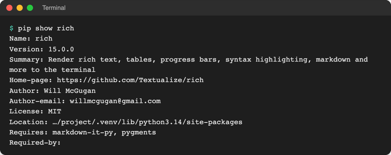
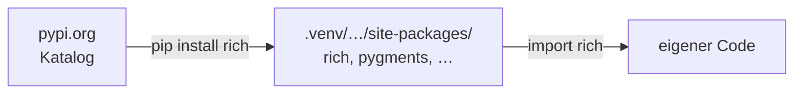
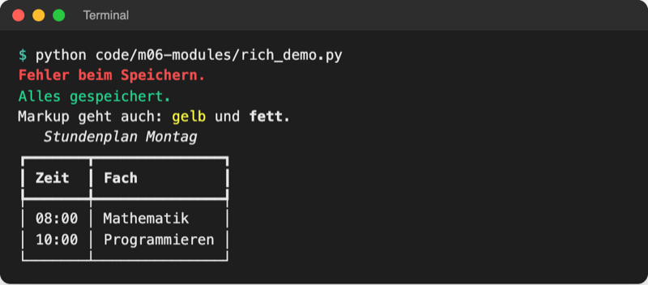

# Lab 6.2: Standardbibliothek, PyPI und pip

**Leitfragen:**

<details>
<summary>Warum programmiert nicht jedes Projekt seine Werkzeuge selbst?</summary>

Weil es Zeit kostet und fertige Werkzeuge von vielen Menschen benutzt und verbessert werden. Python bringt viele davon mit (Standardbibliothek), weitere gibt es kostenlos im öffentlichen Katalog PyPI.

</details>

<details>
<summary>Woran erkennt man, ob einem fremden Paket zu trauen ist?</summary>

An Spuren der Nutzung und Pflege: viele Downloads, eine aktuelle Version, ein öffentlicher Quellcode, eine klare Lizenz. Und am exakt richtig geschriebenen Namen, denn Angreifer laden Pakete mit vertippten Namen hoch.

</details>

<details>
<summary>Wie bekommt eine andere Person genau dieselben Pakete auf ihren Rechner?</summary>

Über eine Liste mit Paketnamen und festen Versionsnummern, im Python-Umfeld die Datei `requirements.txt`. Ein Befehl installiert dann alles: `pip install -r requirements.txt`.

</details>

- Python liefert mit der Standardbibliothek rund 200 Module mit, ohne Installation. Für alles darüber hinaus gibt es Pakete auf PyPI.
- `pip` lädt Pakete von PyPI in die aktive venv; `requirements.txt` hält fest, welche Pakete in welcher Version ein Projekt braucht.

## Begriffe

| Begriff | Bedeutung |
| --- | --- |
| „Batteries included“ | Leitsatz von Python: Wichtiges liegt schon bei, wie Batterien im Karton eines Geräts |
| externes Paket | Paket, das nicht zu Python gehört und erst installiert werden muss, z. B. `rich` |
| PyPI | Python Package Index (pypi.org): öffentlicher Katalog mit über 900.000 Projekten (Stand 08.11.2026: 936.339 laut pypi.org); wie ein App-Store für Python-Pakete, nur ohne Prüfung |
| `pip` | Programm, das Pakete von PyPI herunterlädt und installiert („package installer for Python“) |
| Abhängigkeit | Paket, das ein anderes Paket braucht; `rich` braucht z. B. `pygments`; pip installiert sie automatisch mit |
| Version pinnen | Version fest vorgeben: `rich==15.0.0` statt nur `rich` |
| `requirements.txt` | Textdatei mit einem Paket pro Zeile, meist gepinnt; Einkaufsliste für `pip` |
| `site-packages` | Ordner in `.venv`, in dem installierte Pakete landen |
| Typo-Squatting | Schadpaket mit vertipptem Namen eines bekannten Pakets, z. B. `reqeusts` statt `requests` |

## Batteries included: Rundgang durch die Standardbibliothek

| Modul | Wofür | Beispiel | Im Kurs |
| --- | --- | --- | --- |
| `math` | Mathematik | `math.sqrt(16)` → `4.0` | hier |
| `random` | Zufall | `random.randint(1, 10)` | Lab 3.2 |
| `datetime` | Datum und Uhrzeit | `date.today()` | Lab 6.3 |
| `pathlib` | Pfade und Dateien | `Path("requirements.txt").exists()` | Lab 8.1 |
| `json` | Daten als Text speichern und austauschen | `json.dumps({"tries": 3})` | Lab 8.2 |
| `os` | Betriebssystem: Umgebung, Prozesse | `os.name` → `'nt'` (Windows) oder `'posix'` | Lab 15.1 |

Datei: [code/m06-modules/std_modules.py](../../project/code/m06-modules/std_modules.py)

```python
import json
import math
import os
import random
from datetime import date
from pathlib import Path

print("math.sqrt(16) =", math.sqrt(16))
print("math.pi =", round(math.pi, 4))

random.seed(1)  # fester Startwert: gleiche "Zufallszahl" bei jedem Lauf
print("random.choice:", random.choice(["Stein", "Schere", "Papier"]))
print("Heute:", date.today())
print("requirements.txt vorhanden:", Path("requirements.txt").exists())
print("Betriebssystem-Familie (os.name):", os.name)
text = json.dumps({"name": "Anna", "tries": 3})
print("Als JSON-Text:", text)
```

```text
$ python code/m06-modules/std_modules.py
math.sqrt(16) = 4.0
math.pi = 3.1416
random.choice: Stein
Heute: 2026-11-08
requirements.txt vorhanden: True
Betriebssystem-Familie (os.name): posix
Als JSON-Text: {"name": "Anna", "tries": 3}
```

Die vollständige Liste steht in der Python-Dokumentation unter „The Python Standard Library“ (https://docs.python.org/3.14/library/index.html). `json.dumps` verwandelt ein Dictionary in Text; Details in Lab 8.2.

## PyPI: der Katalog für alles Weitere

Farbige Ausgabe, Excel-Dateien oder Diagramme kann die Standardbibliothek nicht. Dafür gibt es Pakete auf PyPI. Jedes Projekt hat dort eine Seite:

Original: [PyPI-Projektseite von rich 15.0.0 mit Installationsbefehl pip install rich, Badges für Python-Versionen und Downloads, Release-Datum und Projektlinks](https://pypi.org/project/rich/), Stand 08.11.2026.

| Bereich der Seite | Was er zeigt (rich, Stand 08.11.2026) |
| --- | --- |
| Kopf | Name und aktuelle Version: `rich 15.0.0`, Kurzbeschreibung |
| Kasten `pip install rich` | Installationsbefehl zum Kopieren |
| Badges in der Beschreibung | unterstützte Python-Versionen (3.9–3.14), Downloads pro Monat (540 Mio.) |
| „Key dates“ rechts | „Released: Apr 12, 2026“, Hinweis „Latest release“ |
| „Project links“, „Meta“ | Quellcode (GitHub), Dokumentation, Lizenz MIT |
| „Release history“ | alle früheren Versionen |

## Einem Paket trauen?

PyPI prüft hochgeladene Pakete nicht; die Seite sagt selbst, sie sei „a repository for distributing packages, not a service for auditing them“. Vor dem ersten `pip install` lohnt ein kurzer Blick:

| Prüfen | Gutes Zeichen | Warnzeichen |
| --- | --- | --- |
| Name | exakt wie in Doku oder Tutorial | Buchstabendreher oder Zusätze, z. B. `reqeusts` statt `requests` |
| Nutzung | viele Downloads, viele Sterne auf GitHub | kaum Downloads, Seite erst wenige Tage alt |
| Pflege | Version aus den letzten Monaten | letzte Version vor vielen Jahren |
| Quellcode | Link auf ein öffentliches Repository | kein Quellcode, keine Beschreibung |
| Lizenz | bekannte Lizenz (MIT, BSD, Apache) | keine Angabe |

## pip: Pakete installieren und anzeigen

Alle Befehle laufen im Terminal mit aktiver venv; Pakete landen dann in `.venv` und nicht im System-Python.

| Befehl | Wirkung |
| --- | --- |
| `pip install rich` | neueste Version von PyPI installieren (mit Abhängigkeiten) |
| `pip install rich==15.0.0` | genau diese Version installieren |
| `pip install -r requirements.txt` | alle Pakete aus der Datei installieren |
| `pip install --upgrade rich` | auf die neueste Version aktualisieren |
| `pip list` | alle installierten Pakete mit Version |
| `pip show rich` | Details: Version, Lizenz, Speicherort, Abhängigkeiten |
| `pip freeze` | installierte Pakete im Format `name==version` |
| `pip uninstall rich` | Paket entfernen |



_Quelle: eigener Screenshot, Kurs-Repo, 08.11.2026 (Speicherort gekürzt)._

`python -m pip …` ist dasselbe wie `pip …` und garantiert, dass pip zum gerade aktiven `python` gehört.

## requirements.txt: eine Datei für den ganzen Kurs

Die Datei [project/requirements.txt](../../project/requirements.txt) wurde in Lab 1.2 einmal installiert:

```text
# Alle Pakete des Kurses, einmal installieren:  pip install -r requirements.txt
# Stand: 08.11.2026, getestet mit Python 3.14
rich==15.0.0            # farbige Ausgabe im Terminal (Lab 6.2)
requests==2.34.2        # HTTP-Anfragen (Lab 16.1)
beautifulsoup4==4.15.0  # HTML lesen (Lab 17.1)
openpyxl==3.1.5         # Excel-Dateien (Lab 17.2)
regex==2026.11.7        # erweiterte reguläre Ausdrücke (Lab 15.2)
numpy==2.5.4            # Zahlenreihen (Lab 19.2)
pandas==3.1.1           # Tabellen auswerten (Lab 19.2)
matplotlib==3.11.2      # Diagramme (Lab 19.3)
```

- Eine Zeile pro Paket, `==` pinnt die Version, `#` leitet einen Kommentar ein.
- Gepinnt heißt: Alle Teilnehmenden haben dieselben Versionen, und der Code im Kurs ist genau damit getestet. Ohne Pin könnte eine neue Version Verhalten ändern.
- Eine zentrale Datei statt einer pro Lab: einmal installieren, danach fünf Tage ohne Wartezeit und ohne Internet arbeiten.
- `pip freeze > requirements.txt` schreibt die Liste aller installierten Pakete in eine Datei (`>` leitet die Ausgabe in die Datei um). Sie enthält auch Abhängigkeiten wie `pygments`; eine handgeschriebene Datei bleibt kürzer und lesbarer.

## Recap venv: wohin pip installiert



Jedes Projekt hat seine eigene `.venv` (Lab 1.2). Ist sie nicht aktiv, sucht `import rich` im System-Python und findet nichts.

## Ausprobieren im interaktiven Modus

Ob ein Paket da ist und in welcher Version, zeigt der interaktive Modus (`python`, Ende mit `exit`):

```text
>>> import requests
>>> requests.__version__
'2.34.2'
>>> from rich.console import Console
>>> Console().print("rich ist installiert.", style="green")
rich ist installiert.
```

`requests.__version__` ist eine Variable im Modul, die viele Pakete zur eigenen Version setzen. Eine Vorführung aller Fähigkeiten von rich startet `python -m rich`:


_Quelle: rich-Repository, README (https://github.com/Textualize/rich), Bild `imgs/features.png`, Will McGugan, MIT-Lizenz, abgerufen am 08.11.2026._

## rich im eigenen Code

Datei: [code/m06-modules/rich_demo.py](../../project/code/m06-modules/rich_demo.py)

```python
from rich.console import Console
from rich.table import Table

console = Console()  # Ausgabe-Werkzeug von rich

console.print("Fehler beim Speichern.", style="bold red")
console.print("Alles gespeichert.", style="green")
console.print("Markup geht auch: [yellow]gelb[/yellow] und [bold]fett[/bold].")

table = Table(title="Stundenplan Montag")  # Tabelle anlegen
table.add_column("Zeit")
table.add_column("Fach")
table.add_row("08:00", "Mathematik")
table.add_row("10:00", "Programmieren")
console.print(table)
```



_Quelle: eigener Screenshot, Kurs-Repo, 08.11.2026._

- `Console()` erzeugt ein Ausgabe-Werkzeug, `console.print(...)` druckt damit. Wie solche Objekte entstehen, zeigt Lab 9.2; hier genügt: anlegen, dann benutzen.
- `style="red"` färbt die ganze Zeile; Farben: `red`, `green`, `blue`, `yellow`, `magenta`, `cyan`, dazu `bold`, `italic`.
- Markup `[red]…[/red]` färbt Teile einer Zeile. Vorsicht: rich deutet jeden Text in eckigen Klammern als Markup, auch Listen wie `[5, 8]`.
- rich hebt Zahlen in normalen Texten automatisch hervor (fett, türkis).
- `Table` baut eine Tabelle: `add_column` legt Spalten an, `add_row` füllt Zeilen.

## Im Spiel: farbige Hinweise

Nur `ui.py` ändert sich. Oben kommen Import und Ausgabe-Werkzeug dazu, die Hinweise nutzen `console.print` mit `style=`:

```python
from rich.console import Console

from guess_game import logic

console = Console()  # druckt farbig, wenn das Terminal Farben kann


def show_hint(guess, secret):
    """Gibt aus, ob der Tipp zu hoch oder zu niedrig ist."""
    if guess > secret:
        console.print("Zu hoch.", style="red")
    else:
        console.print("Zu niedrig.", style="blue")
```

`style=` statt Markup, weil die Gewinnzeile den Namen enthält und Namen oder Tipplisten eckige Klammern enthalten könnten. Importe stehen in Gruppen, getrennt durch eine Leerzeile: Standardbibliothek, externe Pakete, eigenes Paket.

## Alternative: uv

`uv` (Firma Astral) ist ein Werkzeug, das `pip` und `venv` in einem Programm ersetzt und deutlich schneller installiert. Es verbreitet sich seit 2024 stark. Der Kurs bleibt beim Standardweg, weil `pip` und `venv` mit Python mitkommen und überall dokumentiert sind.

| Aufgabe | Standard (Kurs) | mit uv |
| --- | --- | --- |
| venv anlegen | `python -m venv .venv` | `uv venv` |
| aus Datei installieren | `pip install -r requirements.txt` | `uv pip install -r requirements.txt` |
| Paket zum Projekt hinzufügen | `pip install rich` + Zeile in `requirements.txt` | `uv add rich` (schreibt in `pyproject.toml`) |
| Skript starten | venv aktivieren, `python skript.py` | `uv run skript.py` |

Stand: 08.11.2026, Quelle: uv-Dokumentation (https://docs.astral.sh/uv/). uv muss separat installiert werden.

## Typische Fehler

| Symptom | Ursache | Lösung |
| --- | --- | --- |
| `ModuleNotFoundError: No module named 'rich'` | venv nicht aktiv, oder VS Code nutzt einen anderen Interpreter | venv aktivieren (`(.venv)` vor der Eingabezeile), Interpreter `.venv` wählen (Lab 1.2) |
| `ERROR: No matching distribution found for reqeusts` | Paketname vertippt (oder kein Internet) | Namen auf pypi.org prüfen |
| `error: externally-managed-environment` (macOS, Linux) | `pip install` ohne aktive venv im System-Python | venv aktivieren, Befehl wiederholen |
| Text erscheint ohne Farbe | Ausgabe läuft nicht in ein echtes Terminal (z. B. umgeleitet) | im Terminal von VS Code starten |
| Teile eines Textes fehlen bei `console.print` | eckige Klammern wurden als Markup gedeutet | `style=` statt Markup, oder `print` für diesen Text |
| `pip` meldet „A new release of pip is available“ | nur ein Hinweis | ignorieren; Update mit `python -m pip install --upgrade pip` ist optional |

## Fazit

- Erst in der Standardbibliothek suchen, dann auf PyPI; vor `pip install` Name, Downloads, Pflege und Lizenz prüfen.
- `pip install`, `pip list`, `pip show`, `pip freeze` arbeiten immer in der aktiven venv.
- `requirements.txt` mit `==` macht eine Installation wiederholbar; `uv` ist die schnelle Alternative.

In der Übung bekommen die Hinweise des eigenen Spiels Farben mit `rich`.
