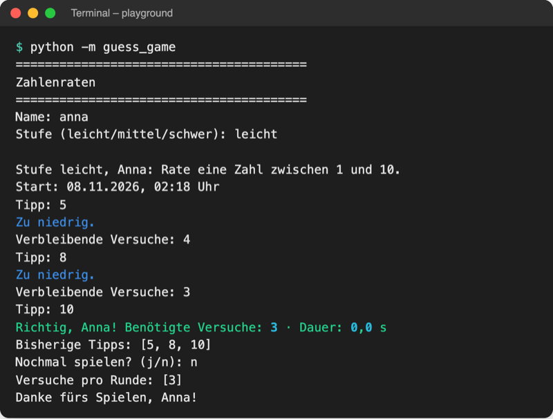

# Lab 6.3 – Lösung: Dauer und Datum jeder Runde

Fertiger Stand: [project/examples/m06-modules/l03-datetime/guess_game/](../../project/examples/m06-modules/l03-datetime/guess_game/) (geändert: `ui.py`, `__main__.py`, Docstring in `__init__.py`)

## Aufgabe 1: Importe und format_seconds

```python
# Ein- und Ausgabe im Terminal: alles, was mit input() und print() zu tun hat

import time
from datetime import datetime

from rich.console import Console

from guess_game import logic
```

```python
def format_seconds(seconds):
    """Gibt Sekunden mit einer Nachkommastelle und deutschem Komma zurück: 12,4."""
    return f"{seconds:.1f}".replace(".", ",")
```

`:.1f` macht aus der Zahl einen Text mit genau einer Nachkommastelle (`12.4`, auch `0.0`), `replace` tauscht den Punkt gegen ein Komma. Die Funktion liefert Text nur für die Anzeige; gespeichert wird die Zahl.

## Aufgabe 2: Startzeit und Stoppuhr

```python
    won = False
    started = datetime.now()  # Datum und Uhrzeit des Starts
    print(f"\nStufe {level}, {name}: Rate eine Zahl zwischen {low} und {high}.")
    print(f"Start: {started.strftime('%d.%m.%Y, %H:%M')} Uhr")
    start = time.perf_counter()  # Stoppuhr starten
```

`datetime.now()` liefert Datum und Uhrzeit für Anzeige und Speicherung, `time.perf_counter()` misst die Dauer.

## Aufgabe 3: Treffer merken, Dauer nach der Schleife

```python
        if logic.is_guess_correct(guess, secret):
            won = True
            break
```

```python
    seconds = round(time.perf_counter() - start, 1)  # Stoppuhr anhalten
    if won:
        duration = format_seconds(seconds)
        console.print(
            f"Richtig, {name}! Benötigte Versuche: {tries} · Dauer: {duration} s",
            style="green",
        )
    print("Bisherige Tipps:", guesses)
```

Die Gewinnzeile steht hinter der Schleife, weil die Dauer erst nach dem Anhalten der Stoppuhr feststeht. Die Schreibweise „Benötigte Versuche: 3 · Dauer: 12,4 s“ vermeidet „1 Versuchen“ bei einem Treffer im ersten Tipp. `round(..., 1)` speichert eine Zahl (`12.4`), `format_seconds` erzeugt den Anzeigetext (`"12,4"`).

## Aufgabe 4: Ergebnis-Dictionary zurückgeben

```python
    return {
        "name": name,
        "level": level,
        "tries": tries,
        "seconds": seconds,
        "won": won,
        "date": started.strftime("%Y-%m-%d"),
    }
```

Ein Ergebnis sieht so aus:

```python
{"name": "Anna", "level": "leicht", "tries": 3, "seconds": 12.4, "won": True, "date": "2026-11-08"}
```

`"date"` steht im ISO-Format: eindeutig und sortierbar, für JSON und CSV in Modul 8.

`main()` in `__main__.py`:

```python
    while play_again == "j":
        level = ui.ask_level()
        result = ui.play_round(name, level=level)
        all_tries.append(result["tries"])
        play_again = ui.ask_play_again()
```

Vollständige Funktion `play_round`:

```python
def play_round(name, level="leicht"):
    """Spielt eine Runde und gibt das Ergebnis als Dictionary zurück."""
    low, high, max_tries = logic.LEVELS[level]
    secret = logic.draw_secret(low, high)
    tries = 0
    guesses = []
    tried = set()
    won = False
    started = datetime.now()  # Datum und Uhrzeit des Starts
    print(f"\nStufe {level}, {name}: Rate eine Zahl zwischen {low} und {high}.")
    print(f"Start: {started.strftime('%d.%m.%Y, %H:%M')} Uhr")
    start = time.perf_counter()  # Stoppuhr starten

    while not logic.is_game_over(tries, max_tries):
        guess = int(input("Tipp: "))

        if guess in tried:
            print("Diese Zahl wurde schon getippt.")
            continue

        tried.add(guess)
        guesses.append(guess)
        tries += 1

        if logic.is_guess_correct(guess, secret):
            won = True
            break

        show_hint(guess, secret)

        if logic.is_game_over(tries, max_tries):
            print(f"Keine Versuche mehr. Die Zahl war {secret}.")
        else:
            print(f"Verbleibende Versuche: {max_tries - tries}")

    seconds = round(time.perf_counter() - start, 1)  # Stoppuhr anhalten
    if won:
        duration = format_seconds(seconds)
        console.print(
            f"Richtig, {name}! Benötigte Versuche: {tries} · Dauer: {duration} s",
            style="green",
        )
    print("Bisherige Tipps:", guesses)
    return {
        "name": name,
        "level": level,
        "tries": tries,
        "seconds": seconds,
        "won": won,
        "date": started.strftime("%Y-%m-%d"),
    }
```

## Aufgabe 5: Spielen

Gewonnene Runde:



_Quelle: eigener Screenshot, Kurs-Repo, 08.11.2026 (Eingaben per Skript, Zufalls-Startwert 3; deshalb Dauer 0,0 s, beim echten Spielen einige Sekunden)._

Verlorene Runde (Ausschnitt, gleicher Lauf mit zweiter Runde):

```text
Stufe leicht, Anna: Rate eine Zahl zwischen 1 und 10.
Start: 08.11.2026, 02:16 Uhr
Tipp: 5
Zu niedrig.
Verbleibende Versuche: 4
...
Tipp: 6
Zu niedrig.
Keine Versuche mehr. Die Zahl war 9.
Bisherige Tipps: [5, 10, 7, 8, 6]
Nochmal spielen? (j/n): n
Versuche pro Runde: [3, 5]
Danke fürs Spielen, Anna!
```

## Erweiterung

`playground/age_in_days.py`:

```python
# Alter in Tagen und Wochentag der Geburt

from datetime import date, datetime, timedelta

WEEKDAYS = ["Montag", "Dienstag", "Mittwoch", "Donnerstag",
            "Freitag", "Samstag", "Sonntag"]

text = input("Geburtstag (TT.MM.JJJJ): ").strip()
birthday = datetime.strptime(text, "%d.%m.%Y").date()

days = (date.today() - birthday).days
weekday = WEEKDAYS[birthday.weekday()]

print(f"Geboren an einem {weekday}.")
print(f"Heute ist Tag {days} seit der Geburt.")
day_10000 = birthday + timedelta(days=10000)
print("Tag 10000:", day_10000.strftime("%d.%m.%Y"))
```

```text
$ python age_in_days.py
Geburtstag (TT.MM.JJJJ): 14.03.2005
Geboren an einem Montag.
Heute ist Tag 7909 seit der Geburt.
Tag 10000: 30.07.2032
```

Lauf am 08.11.2026; die mittlere Zahl wächst jeden Tag um eins. `date - date` ergibt eine Zeitspanne, `date + timedelta` ein neues Datum.
