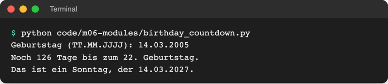

# Lab 6.3: Datum und Zeit

**Leitfragen:**

<details>
<summary>Wie viele Tage liegen zwischen zwei Daten im Februar eines Schaltjahres?</summary>

Vom 01.02.2028 bis zum 01.03.2028 sind es 29 Tage, weil 2028 ein Schaltjahr ist. Von Hand rechnet man hier leicht falsch; Python zieht zwei Daten voneinander ab und kennt den Kalender.

</details>

<details>
<summary>Warum ist „03.04.2026“ nicht überall derselbe Tag?</summary>

In Deutschland steht der Tag vorn (3. April), in den USA der Monat (4. März). Dazu kommen Zeitzonen: Kurz nach Mitternacht in Berlin ist in New York noch der Vortag. Eindeutig ist die ISO-Schreibweise `2026-04-03`.

</details>

<details>
<summary>Wie misst man, wie lange jemand zum Raten braucht?</summary>

Wie mit einer Stoppuhr: beim ersten Tipp den Zeitpunkt merken, beim Treffer noch einmal, dann die Differenz bilden. Python hat dafür eine eigene Stoppuhr-Funktion, `time.perf_counter()`.

</details>

- Das Modul `datetime` der Standardbibliothek speichert Daten und Uhrzeiten, rechnet mit ihnen und wandelt sie in Text und zurück.
- Das Modul `time` misst Dauern. Beides braucht keine Installation.

## Begriffe

| Begriff | Bedeutung |
| --- | --- |
| `date` | ein Kalendertag ohne Uhrzeit, z. B. `date(2026, 11, 8)` |
| `datetime` | Tag und Uhrzeit, z. B. `datetime.now()` für „jetzt“ |
| `timedelta` | Zeitspanne, z. B. `timedelta(days=14)`; entsteht auch, wenn man zwei Daten abzieht |
| `strftime` | „string format time“: Datum → Text in einem gewählten Format |
| `strptime` | „string parse time“: Text → Datum, das Format muss genau passen |
| ISO-Format | internationale Schreibweise Jahr-Monat-Tag, `2026-11-08` (Norm ISO 8601); eindeutig und sortierbar |
| Zeitzone | Region mit derselben Uhrzeit, z. B. `Europe/Berlin`; in Python über das Modul `zoneinfo` |
| Unix-Zeit | Sekunden seit dem 01.01.1970, 00:00 Uhr (UTC); `time.time()` |
| `time.perf_counter()` | Stoppuhr: liefert einen Zählerstand in Sekunden, nur für Differenzen gedacht |
| Formatangabe `:.1f` | im f-String nach dem Doppelpunkt: Zahl als Text mit genau einer Nachkommastelle |

## Drei Typen: date, datetime, timedelta

Datei: [code/m06-modules/datetime_basics.py](../../project/code/m06-modules/datetime_basics.py)

```python
from datetime import date, datetime, timedelta

now = datetime.now()                       # Datum + Uhrzeit, jetzt
today = date.today()                       # nur das Datum
print("Jetzt (Python-Darstellung):", now)
print("Heute:", today)

# Formatieren: Datum -> Text in einem gewünschten Format
print("Deutsch:", now.strftime("%d.%m.%Y, %H:%M Uhr"))
print("ISO-Format:", today.isoformat())

# Rechnen: Datum + Zeitspanne, Datum - Datum
in_two_weeks = today + timedelta(days=14)
print("In zwei Wochen:", in_two_weeks.strftime("%d.%m.%Y"))

exam = date(2027, 2, 15)
print("Tage bis zur Prüfung am 15.02.2027:", (exam - today).days)

# Schaltjahr: 2028 hat einen 29. Februar
span = date(2028, 3, 1) - date(2028, 2, 1)
print("Februar 2028 hat", span.days, "Tage")

# Einlesen: Text -> Datum (Format muss genau passen)
deadline = datetime.strptime("03.04.2026", "%d.%m.%Y")
print("Eingelesen:", deadline.date(), "| Monat:", deadline.month)
```

```text
$ python code/m06-modules/datetime_basics.py
Jetzt (Python-Darstellung): 2026-11-08 02:04:20.099039
Heute: 2026-11-08
Deutsch: 08.11.2026, 02:04 Uhr
ISO-Format: 2026-11-08
In zwei Wochen: 22.11.2026
Tage bis zur Prüfung am 15.02.2027: 99
Februar 2028 hat 29 Tage
Eingelesen: 2026-04-03 | Monat: 4
```

| Rechnung | Ergebnis |
| --- | --- |
| `date + timedelta(days=14)` | neues `date` |
| `date - date` | `timedelta`; `.days` gibt die Tage als Zahl |
| `datetime - datetime` | `timedelta`; `.total_seconds()` gibt Sekunden |
| `date < date` | `True`/`False`: früher oder später |

Der Import heißt `from datetime import datetime`: Das Modul `datetime` enthält einen Typ, der ebenfalls `datetime` heißt. Danach steht `datetime.now()` für „jetzt“.

## strftime: Datum als Text

| Code | Bedeutung | Beispiel (08.11.2026, 14:05) |
| --- | --- | --- |
| `%d` | Tag, zweistellig | `08` |
| `%m` | Monat, zweistellig | `11` |
| `%Y` | Jahr, vierstellig | `2026` |
| `%y` | Jahr, zweistellig | `26` |
| `%H` | Stunde (00–23) | `14` |
| `%M` | Minute (großes M) | `05` |
| `%S` | Sekunde | `00` |
| `%A` | Wochentag (englisch) | `Sunday` |
| `%B` | Monatsname (englisch) | `November` |

Alles, was kein Code ist (Punkte, Komma, „Uhr“), erscheint unverändert. `"%d.%m.%Y"` ergibt `08.11.2026`, `"%Y-%m-%d"` das ISO-Format. Wochentag und Monatsname kommen standardmäßig englisch; für deutsche Namen nutzt das Beispiel unten eine eigene Liste.

Original: [Python-Dokumentation: Tabelle der strftime- und strptime-Formatcodes mit %a, %A, %w, %d, %b, %B, %m, %y, %Y](https://docs.python.org/3.14/library/datetime.html#format-codes), Stand 08.11.2026.

## strptime und ISO-Format: Text als Datum

`datetime.strptime("03.04.2026", "%d.%m.%Y")` liest Text mit demselben Code-Alphabet. Passt der Text nicht genau zum Format, meldet Python `ValueError`. Dasselbe Datum bedeutet je nach Land etwas anderes:


_Quelle: Wikimedia Commons, „Date format by country.svg“ (https://commons.wikimedia.org/wiki/File:Date_format_by_country.svg), TopoChecker, gemeinfrei, abgerufen am 08.11.2026. Mischfarben: mehrere Formate üblich (Grün: Tag-Monat-Jahr und Jahr-Monat-Tag, Rot: Monat-Tag-Jahr und Jahr-Monat-Tag)._

Zum Speichern und Austauschen eignet sich deshalb das ISO-Format `2026-04-03`: weltweit eindeutig, und alphabetisch sortiert ist es zugleich zeitlich sortiert. Zur Anzeige wandelt `strftime` es ins deutsche Format.

## Zeitzonen kurz: zoneinfo

`datetime.now()` liefert die Uhrzeit des eigenen Rechners ohne Zeitzonenangabe. Für mehrere Zeitzonen gibt es `zoneinfo` (Datei: [code/m06-modules/time_zones.py](../../project/code/m06-modules/time_zones.py)):

```python
from datetime import datetime
from zoneinfo import ZoneInfo

berlin = datetime.now(ZoneInfo("Europe/Berlin"))
there = berlin.astimezone(ZoneInfo("America/New_York"))  # gleicher Moment, andere Uhr
```

Die Datei gibt dieselbe Uhrzeit für drei Städte aus:

```text
$ python code/m06-modules/time_zones.py
Berlin:   08.11.2026 02:04
America/New_York: 07.11.2026 20:04
Asia/Tokyo: 08.11.2026 10:04
```

Unter Windows braucht `zoneinfo` die Zeitzonen-Daten aus dem Paket `tzdata` (`pip install tzdata`). Das Spiel braucht keine Zeitzonen.

## Dauer messen: time.time() und time.perf_counter()

Datei: [code/m06-modules/stopwatch.py](../../project/code/m06-modules/stopwatch.py)

```python
import time

print("Sekunden seit dem 01.01.1970 (Unix-Zeit):", round(time.time()))

input("Enter drücken, um die Stoppuhr zu starten ...")
start = time.perf_counter()                # Stoppuhr starten
input("Enter drücken, um sie anzuhalten ...")
seconds = time.perf_counter() - start      # Stoppuhr anhalten: Differenz

print("Rohwert:", seconds)
print(f"Gerundet: {seconds:.1f} s")        # :.1f = eine Nachkommastelle
print("Deutsch:", f"{seconds:.1f}".replace(".", ","), "s")
```

```text
$ python code/m06-modules/stopwatch.py
Sekunden seit dem 01.01.1970 (Unix-Zeit): 1794100537
Enter drücken, um die Stoppuhr zu starten ...
Enter drücken, um sie anzuhalten ...
Rohwert: 2.514243499997974
Gerundet: 2.5 s
Deutsch: 2,5 s
```

| | `time.time()` | `time.perf_counter()` |
| --- | --- | --- |
| liefert | Unix-Zeit, ein echter Zeitpunkt | Zählerstand ohne Bedeutung für sich |
| Verhalten | folgt der Rechneruhr, kann springen, wenn die Uhr gestellt wird | läuft immer gleichmäßig vorwärts, sehr fein aufgelöst |
| wofür | Zeitpunkt speichern, Zeitstempel | Dauer messen: Ende minus Start |

## Kommazahlen schön ausgeben: `:.1f` und Dezimalkomma

Hinter einem Wert im f-String legt ein Doppelpunkt das Format fest. `.1f` heißt: als Kommazahl (`f` für „float“) mit genau einer Nachkommastelle.

| Ausdruck | Ergebnis | Typ |
| --- | --- | --- |
| `f"{12.4321:.1f}"` | `'12.4'` | Text |
| `f"{12.4321:.2f}"` | `'12.43'` | Text |
| `f"{3:.1f}"` | `'3.0'` | Text, immer genau eine Stelle |
| `round(12.4321, 1)` | `12.4` | Zahl (Lab 2.3); zum Weiterrechnen und Speichern |
| `f"{12.4321:.1f}".replace(".", ",")` | `'12,4'` | Text mit deutschem Dezimalkomma |

Python schreibt Kommazahlen immer mit Punkt. Für die Anzeige auf Deutsch ersetzt `str.replace(".", ",")` den Punkt im fertigen Text (Lab 2.4). Gerechnet und gespeichert wird weiter mit der Zahl.

## Beispiel: Tage bis zum nächsten Geburtstag

Datei: [code/m06-modules/birthday_countdown.py](../../project/code/m06-modules/birthday_countdown.py)

```python
from datetime import date, datetime

WEEKDAYS = ["Montag", "Dienstag", "Mittwoch", "Donnerstag",
            "Freitag", "Samstag", "Sonntag"]

text = input("Geburtstag (TT.MM.JJJJ): ").strip()
birthday = datetime.strptime(text, "%d.%m.%Y").date()  # Text -> Datum
today = date.today()

# Geburtstag in diesem Jahr; schon vorbei -> nächstes Jahr
next_birthday = birthday.replace(year=today.year)
if next_birthday < today:
    next_birthday = birthday.replace(year=today.year + 1)

days = (next_birthday - today).days        # Datum - Datum = Zeitspanne
weekday = WEEKDAYS[next_birthday.weekday()]  # 0 = Montag, 6 = Sonntag
```

- `.date()` macht aus einem `datetime` ein `date` (Uhrzeit weg).
- `birthday.replace(year=…)` gibt ein neues Datum mit anderem Jahr zurück; das Original bleibt gleich.
- `.weekday()` liefert den Wochentag als Zahl, die Liste übersetzt sie ins Deutsche.
- Am Ende unterscheidet die Datei „Heute“, „Morgen“ und „Noch n Tage“, damit kein „Noch 1 Tage“ entsteht.



_Quelle: eigener Screenshot, Kurs-Repo, 08.11.2026._

## Im Spiel: Startzeit und Dauer jeder Runde

Nur `ui.py` und eine Zeile in `__main__.py` ändern sich. In `play_round` startet die Stoppuhr direkt nach der Begrüßung:

```python
    started = datetime.now()  # Datum und Uhrzeit des Starts
    print(f"\nStufe {level}, {name}: Rate eine Zahl zwischen {low} und {high}.")
    print(f"Start: {started.strftime('%d.%m.%Y, %H:%M')} Uhr")
    start = time.perf_counter()  # Stoppuhr starten
```

Im f-String stehen die Formatcodes in einfachen Anführungszeichen, weil der f-String selbst doppelte nutzt. Nach der Schleife hält die Stoppuhr an, und `play_round` gibt statt einer Zahl ein Dictionary zurück:

```python
{"name": "Anna", "level": "leicht", "tries": 3, "seconds": 12.4, "won": True, "date": "2026-11-08"}
```

Ein Dictionary kann später weitere Angaben aufnehmen, ohne dass sich der Aufruf ändert; die Dateien in Modul 8 speichern genau dieses Dictionary.

## Typische Fehler

| Symptom | Ursache | Lösung |
| --- | --- | --- |
| `AttributeError: module 'datetime' has no attribute 'now'` | `import datetime` statt `from datetime import datetime` | `from datetime import datetime` oder `datetime.datetime.now()` |
| `ValueError: time data '3.4.26' does not match format '%d.%m.%Y'` | Eingabe passt nicht zum Format | genau `03.04.2026` eingeben oder Format anpassen |
| `ValueError: day 29 must be in range 1..28 for month 2 in year 2027` | Geburtstag 29.02. in einem Nicht-Schaltjahr | mit 28.02. testen; Fehler abfangen folgt in Lab 7.2 |
| `TypeError: unsupported operand type(s) for -: 'datetime.date' and 'datetime.datetime'` | `date` und `datetime` gemischt | beide gleich machen, z. B. `.date()` |
| Uhrzeit zeigt den Monat statt der Minute | `%m` (Monat) statt `%M` (Minute) | Groß- und Kleinschreibung prüfen |
| `ZoneInfoNotFoundError` (Windows) | Zeitzonen-Daten fehlen | `pip install tzdata` |
| Dauer zeigt viele Nachkommastellen | Rohwert ausgegeben | `round(..., 1)` oder `f"{x:.1f}"` |

## Fazit

- `datetime.now()` und `date.today()` liefern „jetzt“; `date - date` ergibt eine `timedelta`, `+ timedelta` verschiebt ein Datum.
- `strftime` macht aus einem Datum Text, `strptime` aus Text ein Datum; gespeichert wird im ISO-Format.
- `time.perf_counter()` misst Dauern; `f"{x:.1f}".replace(".", ",")` zeigt sie mit deutschem Komma.

In der Übung misst das eigene Spiel die Dauer jeder Runde und zeigt Startzeit und Dauer an.
