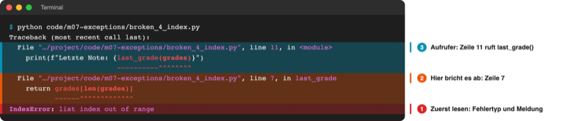

# Lab 7.1 – Lösung: Fehlertabelle

## Ergebnis: ausgefüllte Tabelle

Ergebnis der Aufgaben 1–5:

| Skript | Fehlertyp | Zeile | Ursache in einem Satz | Art |
| --- | --- | --- | --- | --- |
| broken_1_name.py | `NameError` | 6 | `totl` ist vertippt, gemeint ist `total`. | Programmierfehler |
| broken_2_type.py | `TypeError` | 7 | Text und Zahl (`next_age`) werden mit `+` verbunden. | Programmierfehler |
| broken_3_value.py | `ValueError` | 5 | `float()` versteht kein Komma: `"4,99"` ist für Python keine Zahl. | Programmierfehler (Daten im deutschen Format nicht umgewandelt) |
| broken_4_index.py | `IndexError` | 7 (Aufruf in Zeile 11) | `grades[len(grades)]` liest Index 3, die Liste hat nur 0 bis 2. | Programmierfehler |
| broken_5_key.py | `KeyError` | 6 | Schlüssel `"physik"` klein geschrieben, im Dictionary steht `"Physik"`. | Programmierfehler |
| Spiel, Eingabe „sieben“ | `ValueError` | `ui.py` Zeile 72, `play_round` (Starter: Zeile 77) | `int()` kann das Wort „sieben“ nicht in eine Zahl umwandeln. | Eingabe von außen |

## Aufgabe 1: broken_1_name.py

```text
Traceback (most recent call last):
  File "…/project/code/m07-exceptions/broken_1_name.py", line 6, in <module>
    average = totl / len(grades)
              ^^^^
NameError: name 'totl' is not defined. Did you mean: 'total'?
```

Der Vorschlag `Did you mean: 'total'?` trifft hier genau: In Zeile 5 heißt die Variable `total`.

## Aufgabe 2: broken_2_type.py, broken_3_value.py, broken_5_key.py

```text
  File "…/project/code/m07-exceptions/broken_2_type.py", line 7, in <module>
    print(name + " wird bald " + next_age + " Jahre alt.")
          ~~~~~~~~~~~~~~~~~~~~~^~~~~~~~~~
TypeError: can only concatenate str (not "int") to str
```

Die Markierung `^` steht genau unter dem `+` vor `next_age`: Dort trifft Text auf Zahl.

```text
  File "…/project/code/m07-exceptions/broken_3_value.py", line 5, in <module>
    price = float(price_text)
ValueError: could not convert string to float: '4,99'
```

```text
  File "…/project/code/m07-exceptions/broken_5_key.py", line 6, in <module>
    print(f"{subject} findet in Raum {rooms[subject]} statt.")
                                      ~~~~~^^^^^^^^^
KeyError: 'physik'
```

Bei `KeyError` besteht die Meldung nur aus dem fehlenden Schlüssel. Die Schreibweise (`'physik'` klein) verrät die Ursache.

## Aufgabe 3: broken_4_index.py



_Quelle: eigener Screenshot, Kurs-Repo, 08.11.2026 (Pfade gekürzt, Markierungen ergänzt)._

- Abbruch: Zeile 7 in `last_grade`, `return grades[len(grades)]`.
- Aufruf: Zeile 11 auf Modulebene (`<module>`), `last_grade(grades)` im f-String.
- `len(grades)` ist 3, der letzte Index aber 2. Richtig wäre `grades[-1]` oder `grades[len(grades) - 1]`.

## Aufgabe 4: Spiel mit „sieben“

```text
Tipp: sieben
Traceback (most recent call last):
  File "<frozen runpy>", line 198, in _run_module_as_main
  File "<frozen runpy>", line 88, in _run_code
  File "…/playground/guess_game/__main__.py", line 21, in <module>
    main()
    ~~~~^^
  File "…/playground/guess_game/__main__.py", line 14, in main
    result = ui.play_round(name, level=level)
  File "…/playground/guess_game/ui.py", line 72, in play_round
    guess = int(input("Tipp: "))
ValueError: invalid literal for int() with base 10: 'sieben'
```

- Abbruchstelle: `ui.py`, Zeile 72, Funktion `play_round`. Mit dem Starter `m07-l02-guess_game` steht dieselbe Zeile bei 77 (Kopfzeile und TODO-Kommentare verschieben die Nummern); entscheidend ist der Code der Zeile.
- Aufrufkette von oben: `__main__.py` (Start) → `main()` → `ui.play_round()` → `int()`.
- Die beiden `<frozen runpy>`-Zeilen gehören zu Python (`python -m`) und spielen keine Rolle.

## Aufgabe 5: Programmierfehler oder Eingabe?

- Die fünf Skripte enthalten Programmierfehler: Der Code selbst ist falsch und muss korrigiert werden.
- Das Spiel ist richtig programmiert, scheitert aber an einer unerwarteten Eingabe. Solche Fehler lassen sich nicht „wegprogrammieren“, weil niemand die Eingaben vorher kennt; das Programm muss sie abfangen (Lab 7.2).
- Grenzfall `broken_3_value.py`: Der Text `"4,99"` kommt aus Daten (Kassenbon). Der Fehler liegt darin, dass der Code das deutsche Komma nicht berücksichtigt.

## Erweiterung

Reparierte Zeilen:

```python
average = total / len(grades)                                  # broken_1_name.py
print(f"{name} wird bald {next_age} Jahre alt.")               # broken_2_type.py
price = float(price_text.replace(",", "."))                    # broken_3_value.py
return grades[-1]                                              # broken_4_index.py
subject = "Physik"                                             # broken_5_key.py
```

```text
Durchschnitt: 1.75
Anna wird bald 21 Jahre alt.
Drei Stück kosten 14.97 Euro.
Letzte Note: 2.7
Physik findet in Raum C101 statt.
```

Für `broken_5_key.py` ist auch `rooms.get(subject, "unbekannt")` (Lab 4.3) eine Lösung: Dann gibt es keinen Absturz, aber die Ausgabe lautet „physik findet in Raum unbekannt statt.“
