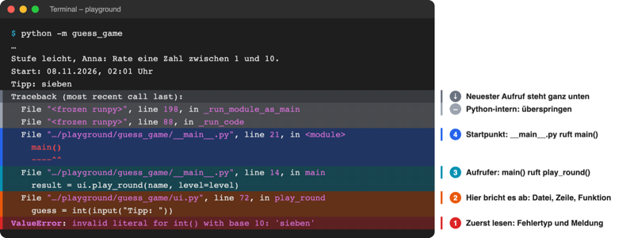
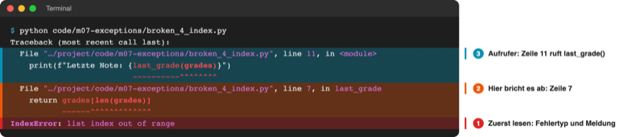
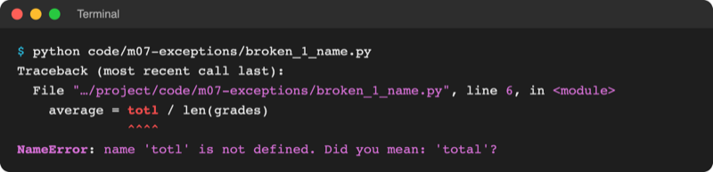

# Lab 7.1: Fehlermeldungen lesen

**Leitfragen:**

<details>
<summary>Was meldet das Spiel bei der Eingabe „sieben“?</summary>

Es bricht ab und druckt einen Block roter Zeilen. Die letzte Zeile sagt, was los ist: `ValueError: invalid literal for int() with base 10: 'sieben'` – `int()` kann aus dem Wort „sieben“ keine Zahl machen.

</details>

<details>
<summary>Welche Zeile einer langen Fehlermeldung ist die wichtigste?</summary>

Die letzte: Sie nennt Fehlertyp und Grund. Direkt darüber steht die Stelle im Code, an der das Programm abgebrochen ist.

</details>

<details>
<summary>Ist jeder Fehler ein Programmierfehler?</summary>

Nein. Ein Tippfehler im Code (`totl` statt `total`) ist einer; die Eingabe „sieben“ dagegen ist ein erwartbarer Fehler von außen, den das Programm abfangen sollte (Lab 7.2).

</details>

- Bricht ein Python-Programm ab, beschreibt es den Grund in einer **Fehlermeldung**. Sie ist keine Strafe, sondern die genaueste Hilfe, die es gibt.
- Wer sie von unten nach oben liest, findet in Sekunden Fehlerart, Datei und Zeile.

## Begriffe

| Begriff | Bedeutung |
| --- | --- |
| Syntaxfehler (`SyntaxError`) | Code ist kein gültiges Python; das Programm startet gar nicht erst, wie ein Satz mit falscher Grammatik |
| Laufzeitfehler | Code ist gültig, aber beim Ausführen geht etwas schief (Wort statt Zahl, Index zu groß); das Programm bricht an dieser Stelle ab |
| Ausnahme (Exception) | Pythons Signal „hier geht es nicht weiter“; jede hat einen Typ wie `ValueError` und eine Meldung |
| Fehlertyp | Name der Ausnahme, z. B. `ValueError` (falscher Wert) oder `KeyError` (Schlüssel fehlt) |
| Traceback | der ganze Fehlerblock: Weg vom Programmstart bis zur Abbruchstelle, Zeile für Zeile; wörtlich „Rückverfolgung“ |
| Aufrufkette | Reihenfolge der Funktionsaufrufe, die zur Abbruchstelle geführt hat (`main` → `play_round` → `int`) |

## Syntaxfehler oder Laufzeitfehler?

| | Syntaxfehler | Laufzeitfehler |
| --- | --- | --- |
| Wann | bevor die erste Zeile läuft | während das Programm läuft |
| Beispiel | `print("Hallo"` – Klammer fehlt | `int("sieben")` |
| Folge | nichts wird ausgeführt | alles bis zur Fehlerzeile lief schon |
| Erste Zeile der Meldung | `File "…", line 2` (ohne „Traceback“) | `Traceback (most recent call last):` |
| Abfangen möglich? | nein, Code korrigieren | ja, mit `try`/`except` (Lab 7.2) |

Syntaxfehler kamen in Lab 2.1 vor. Dieses Lab behandelt vor allem Laufzeitfehler.

## Einen Traceback von unten nach oben lesen

Das Spiel aus Lab 6.3, Eingabe `sieben` statt einer Zahl:



_Quelle: eigener Screenshot, Kurs-Repo, 08.11.2026 (Python 3.14.2, Pfade gekürzt, Markierungen ergänzt)._

`(most recent call last)` heißt: Der **neueste** Aufruf steht **unten**. Darum von unten lesen:

| Schritt | Wo | Was steht da | Hier |
| --- | --- | --- | --- |
| 1 | letzte Zeile | Fehlertyp und Meldung | `ValueError`: `'sieben'` ist keine ganze Zahl |
| 2 | Block darüber | Datei, Zeile, Funktion und Code der Abbruchstelle | `ui.py`, Zeile 72, in `play_round`: `guess = int(input("Tipp: "))` |
| 3 | weiter oben | wer diese Funktion aufgerufen hat | `main()` in `__main__.py`, Zeile 14 |
| 4 | ganz oben | wo alles angefangen hat | `__main__.py`, Zeile 21: `main()` |

- Jeder Block `File "…", line N, in <name>` ist eine Station der Aufrufkette. `<module>` heißt „direkt in der Datei, in keiner Funktion“.
- Zeilen mit `<frozen runpy>` gehören zu Python selbst (Start über `python -m`) und lassen sich überspringen.
- Die Markierung `~~~^^^` unter einer Codezeile zeigt den genauen Teil, der den Fehler ausgelöst hat.

> **Merksatz:** Erst die letzte Zeile lesen (was?), dann die Zeile darüber (wo?), dann nach oben (wie kam es dazu?).

### Zwei Stationen: ein Fehler in einer Funktion

Datei: [code/m07-exceptions/broken_4_index.py](../../project/code/m07-exceptions/broken_4_index.py). Zeile 11 ruft `last_grade()`, in Zeile 7 bricht es ab:



_Quelle: eigener Screenshot, Kurs-Repo, 08.11.2026 (Pfade gekürzt, Markierungen ergänzt)._

Die Ursache liegt nicht immer in der untersten Zeile: Dort zeigt sich der Fehler, verursacht haben kann ihn auch ein falscher Wert, der von weiter oben hereinkam.

## Häufige Fehlertypen

| Fehlertyp | Bedeutung | Beispiel | Typische Ursache |
| --- | --- | --- | --- |
| `NameError` | Name ist unbekannt | `print(totl)` | Tippfehler, Variable noch nicht zugewiesen, `import` fehlt |
| `TypeError` | Operation passt nicht zum Datentyp | `"Alter: " + 20` | Text und Zahl gemischt, falsche Anzahl Argumente |
| `ValueError` | Typ stimmt, Wert nicht | `int("sieben")`, `float("4,99")` | Eingabe ist keine Zahl, Komma statt Punkt |
| `IndexError` | Index gibt es nicht | `[2, 1, 3][3]` | höchster Index ist `len(liste) - 1` |
| `KeyError` | Schlüssel fehlt im Dictionary | `rooms["physik"]` | Groß-/Kleinschreibung, Schlüssel nie angelegt |
| `ZeroDivisionError` | Division durch 0 | `10 / 0` | Nenner ist 0, z. B. leere Liste bei Durchschnitt |
| `SyntaxError` | kein gültiges Python | `print("Hallo"` | Klammer, Doppelpunkt, Anführungszeichen fehlt |
| `IndentationError` | Einrückung falsch | Block nicht eingerückt | Leerzeichen nach `if`/`def` fehlen oder zu viel |
| `ModuleNotFoundError` | Modul nicht gefunden | `import rich` ohne aktive venv | venv aktivieren, falscher Startordner (Lab 6.1) |
| `KeyboardInterrupt` | Programm mit Strg+C abgebrochen | Endlosschleife stoppen | kein Fehler im Code (Lab 3.3) |

Die Liste aller eingebauten Fehlertypen steht in der Python-Dokumentation unter [Built-in Exceptions](https://docs.python.org/3.14/library/exceptions.html).

## Neu seit Python 3.13 und 3.14: Farben und Vorschläge

Stand: 08.11.2026, Quellen: [What's New in Python 3.13](https://docs.python.org/3.14/whatsnew/3.13.html#improved-error-messages), [What's New in Python 3.14](https://docs.python.org/3.14/whatsnew/3.14.html#improved-error-messages).

| Neuerung | Seit | Beispiel |
| --- | --- | --- |
| Tracebacks im Terminal farbig (Fehlertyp, Dateinamen, Fehlerstelle) | 3.13 | siehe Bilder oben |
| Vorschlag bei vertipptem Namen | 3.10 (Import-Hinweis seit 3.12) | `NameError: name 'totl' is not defined. Did you mean: 'total'?` |
| Vorschlag bei falschem Schlüsselwort-Argument | 3.13 | `split(max_split=1)` → `Did you mean 'maxsplit'?` |
| Hinweis, wenn eine eigene Datei ein Modul verdeckt (`random.py`) | 3.13 | `consider renaming '…/random.py'` |
| Vorschlag bei vertipptem Python-Schlüsselwort | 3.14 | `whille True:` → `Did you mean 'while'?` |
| eigene Meldung für `elif` nach `else` | 3.14 | `'elif' block follows an 'else' block` |

Original: [Python-Dokumentation, What's New in Python 3.14, Improved error messages: whille True ergibt SyntaxError invalid syntax. Did you mean while?](https://docs.python.org/3.14/whatsnew/3.14.html#improved-error-messages), Stand 08.11.2026.

So sieht ein Vorschlag im eigenen Terminal aus ([code/m07-exceptions/broken_1_name.py](../../project/code/m07-exceptions/broken_1_name.py)):



_Quelle: eigener Screenshot, Kurs-Repo, 08.11.2026 (Python 3.14.2, Pfad gekürzt)._

Ein Vorschlag ist ein Hinweis, keine Garantie: Er nennt den ähnlichsten bekannten Namen. Ob das der gemeinte ist, entscheidet ein Blick in den Code.

## Im Spiel: wo „sieben“ abstürzt

Die Abbruchstelle aus dem Traceback ist eine einzige Zeile in `play_round` (`ui.py`):

```python
    while not logic.is_game_over(tries, max_tries):
        guess = int(input("Tipp: "))  # "sieben" → ValueError, Spiel endet
```

Das ist kein Tippfehler im Code: Die Zeile ist richtig, nur die Eingabe passt nicht. Solche Fehler fängt das Spiel in Lab 7.2 ab, statt abzustürzen.

## Typische Fehler

| Symptom | Ursache | Lösung |
| --- | --- | --- |
| Fehlermeldung wird nur oben gelesen, Ursache unklar | `Traceback (most recent call last):` oben ist nur die Überschrift | unten anfangen: letzte Zeile, dann die darüber |
| Fehler in einer Python-eigenen Datei vermutet (`<frozen runpy>`, `…/lib/python3.14/…`) | Aufrufkette läuft durch Python selbst | die unterste Zeile mit einer **eigenen** Datei suchen |
| Fehler in der genannten Zeile nicht zu sehen | falscher Wert kam von weiter oben | Variablen der Zeile prüfen: woher kommt der Wert? (Debugger: Lab 7.4) |
| Zeilennummer passt nicht zur Datei | Datei geändert, aber nicht gespeichert | `Strg+S`, erneut starten |
| Vorschlag „Did you mean …“ übernommen, Fehler bleibt | Vorschlag ist nur der ähnlichste Name | prüfen, welche Variable gemeint war |

## Fazit

- Laufzeitfehler brechen das Programm an einer Stelle ab; Syntaxfehler verhindern den Start.
- Traceback von unten lesen: Fehlertyp und Meldung, dann Datei/Zeile/Funktion, dann die Aufrufkette nach oben.
- Seit 3.13/3.14 sind Meldungen farbig und machen oft einen Vorschlag.

In der Übung entsteht eine Fehlertabelle zu fünf vorbereiteten kaputten Skripten und zum Spiel.
