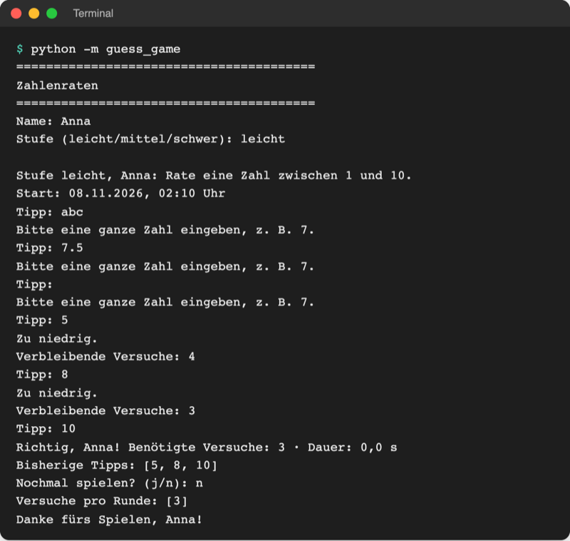
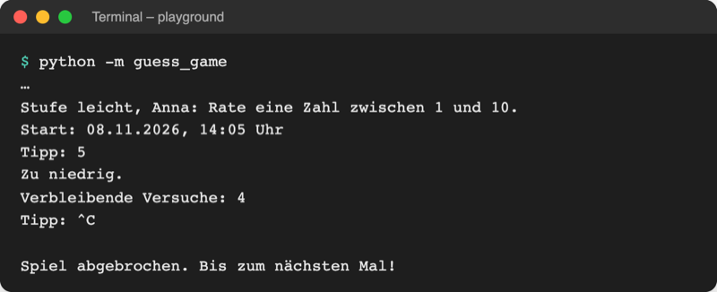

# Lab 7.2 – Lösung: Spiel ohne Absturz bei falscher Eingabe

Fertiger Stand: [project/examples/m07-exceptions/l02-try-except/guess_game/](../../project/examples/m07-exceptions/l02-try-except/guess_game/) (geändert: `ui.py`, `__main__.py`)

## Aufgabe 1: ask_number anlegen

```python
def ask_number(prompt):
    while True:
        text = input(prompt)
        try:
            return int(text)
```

`return` steht im `try`-Block: Gelingt `int(text)`, endet die Funktion sofort mit der Zahl und damit auch die Schleife. Ohne `except` ist der Code noch unvollständig (Aufgabe 2).

## Aufgabe 2: ValueError abfangen

```python
def ask_number(prompt):
    """Fragt so lange, bis eine ganze Zahl eingegeben wird, und gibt sie zurück."""
    while True:
        text = input(prompt)
        try:
            return int(text)
        except ValueError:  # z. B. "abc", "7.5" oder leere Eingabe
            print("Bitte eine ganze Zahl eingeben, z. B. 7.")
```

Nach dem `except`-Block ist der Schleifendurchlauf zu Ende, `while True` fragt erneut. Gezielt `ValueError`, weil genau dieser Typ im Traceback aus Lab 7.1 stand.

## Aufgabe 3: ask_number in play_round verwenden

```python
    while not logic.is_game_over(tries, max_tries):
        guess = ask_number("Tipp: ")

        if guess in tried:
            ...
```

`ask_number` liefert immer eine gültige ganze Zahl; der Rest von `play_round` bleibt unverändert. Weil die Funktion erst zurückkehrt, wenn die Eingabe stimmt, wird für ungültige Eingaben kein Versuch gezählt.

## Aufgabe 4: Strg+C in __main__.py

```python
if __name__ == "__main__":  # nur beim Start, nicht beim Import
    try:
        main()
    except KeyboardInterrupt:  # Strg+C
        print("\nSpiel abgebrochen. Bis zum nächsten Mal!")
```

Ein einziges `try` um `main()` reicht: Strg+C löst `KeyboardInterrupt` in der gerade wartenden `input`-Zeile aus, die Ausnahme wandert durch alle Funktionen nach oben bis zu diesem `except`. `\n` setzt die Meldung in eine eigene Zeile.

## Aufgabe 5: Testen

Falsche Eingaben:



_Quelle: eigener Screenshot, Kurs-Repo, 08.11.2026 (Testlauf mit festem Zufallswert, daher Dauer 0,0 s)._

`Benötigte Versuche: 3` zeigt: Die drei ungültigen Eingaben haben keinen Versuch gekostet.

Strg+C:



_Quelle: eigener Screenshot, Kurs-Repo, 08.11.2026 (Ausgabe eines Testlaufs, Strg+C als `^C` dargestellt)._

Vergleich mit dem fertigen Stand: im Explorer Rechtsklick auf `playground/guess_game/ui.py` → **Select for Compare**, dann Rechtsklick auf `examples/m07-exceptions/l02-try-except/guess_game/ui.py` → **Compare with Selected**.

## Erweiterung

Datei `playground/safe_age.py`:

```python
# Alter sicher abfragen und Geburtsjahr berechnen

current_year = 2026

while True:
    text = input("Alter: ")
    try:
        age = int(text)
    except ValueError:
        print("Bitte das Alter als ganze Zahl eingeben, z. B. 20.")
    else:
        break
    finally:  # läuft nach jedem Versuch, auch vor dem break
        print("Eingabe geprüft.")

birth_year = current_year - age
print(f"Geburtsjahr: {birth_year} oder {birth_year - 1}")
```

```text
Alter: zwanzig
Bitte das Alter als ganze Zahl eingeben, z. B. 20.
Eingabe geprüft.
Alter: 20
Eingabe geprüft.
Geburtsjahr: 2006 oder 2005
```

`finally` läuft auch beim zweiten Versuch, obwohl `else` mit `break` die Schleife verlässt: Python führt `finally` immer noch aus, bevor es den `try`-Block verlässt.
