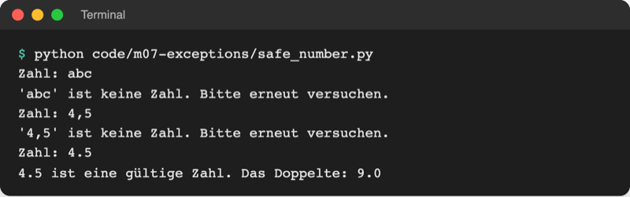
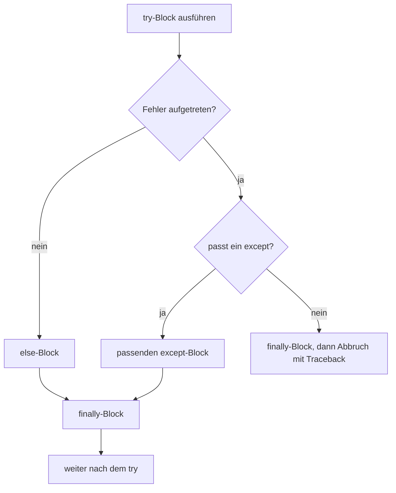
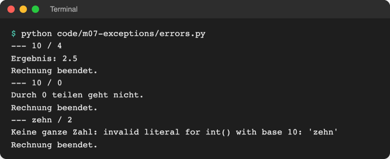

# Lab 7.2: Fehler abfangen

**Leitfragen:**

<details>
<summary>Was soll ein Spiel tun, wenn jemand „abc“ eintippt?</summary>

Nicht abstürzen, sondern freundlich sagen, was erwartet wird, und noch einmal fragen. Genau das erlaubt `try`/`except`: den Fehler auffangen und weitermachen.

</details>

<details>
<summary>Ist es besser, jede Eingabe vorher zu prüfen oder einfach zu versuchen?</summary>

Beides geht. Vorher prüfen übersieht leicht Sonderfälle (`-3`, `" 7"`); einfach versuchen und den Fehler auffangen lässt Python selbst entscheiden, was eine gültige Zahl ist. In Python ist „versuchen“ der übliche Weg.

</details>

<details>
<summary>Was muss passieren, egal ob ein Fehler auftritt oder nicht?</summary>

Aufräumen und Abschließen: etwa „Rechnung beendet.“ melden oder eine geöffnete Datei schließen. Dafür gibt es den Block `finally`.

</details>

- Eine Ausnahme (Lab 7.1) muss das Programm nicht beenden: `try`/`except` fängt sie ab, und das Programm läuft an einer festgelegten Stelle weiter.
- Abgefangen wird gezielt nur der erwartete Fehlertyp; alles andere soll weiterhin sichtbar abbrechen.

## Begriffe

| Begriff | Bedeutung |
| --- | --- |
| `try:` | Block, in dem ein Fehler auftreten darf; wie ein Sicherheitsnetz unter einem Trapez |
| `except ValueError:` | Block, der nur läuft, wenn im `try`-Block ein `ValueError` auftrat; danach geht das Programm normal weiter |
| Ausnahme abfangen | Fehler im `except`-Block behandeln statt das Programm abbrechen zu lassen |
| `except … as error:` | legt die abgefangene Ausnahme unter dem Namen `error` ab; `print(error)` zeigt ihre Meldung |
| `else:` | Block nach allen `except`, läuft nur, wenn **kein** Fehler auftrat |
| `finally:` | Block ganz am Ende, läuft **immer**, mit und ohne Fehler |
| nacktes `except:` | `except` ohne Fehlertyp; fängt wirklich alles, auch Tippfehler und Strg+C – vermeiden |
| `KeyboardInterrupt` | Ausnahme, die Strg+C auslöst (Lab 3.3); lässt sich wie jede andere abfangen |
| LBYL / EAFP | zwei Stile: „Look Before You Leap“ (erst prüfen, dann handeln) und „Easier to Ask Forgiveness than Permission“ (einfach versuchen, Fehler abfangen) |

## Grundform: versuchen und auffangen

Datei: [code/m07-exceptions/safe_number.py](../../project/code/m07-exceptions/safe_number.py)

```python
while True:
    text = input("Zahl: ")
    try:
        number = float(text)  # kann ValueError auslösen
    except ValueError:  # nur dieser Fehler wird abgefangen
        print(f"'{text}' ist keine Zahl. Bitte erneut versuchen.")
    else:  # läuft nur, wenn im try-Block kein Fehler auftrat
        break

print(f"{number} ist eine gültige Zahl. Das Doppelte: {number * 2}")
```



_Quelle: eigener Screenshot, Kurs-Repo, 08.11.2026._

- Tritt in `float(text)` ein Fehler auf, springt Python sofort in den passenden `except`-Block; der Rest des `try`-Blocks wird übersprungen.
- Danach läuft die Schleife weiter und fragt erneut. Ohne Fehler beendet `break` im `else`-Block die Schleife.
- `try`, `except`, `else` und `finally` stehen auf derselben Einrückungsebene, ihre Blöcke sind eingerückt wie bei `if`.

## Ablauf: try, except, else, finally



Datei: [code/m07-exceptions/errors.py](../../project/code/m07-exceptions/errors.py) zeigt alle vier Blöcke an drei Divisionen:

```python
pairs = [("10", "4"), ("10", "0"), ("zehn", "2")]

for a_text, b_text in pairs:
    print(f"--- {a_text} / {b_text}")
    try:
        result = int(a_text) / int(b_text)
    except ZeroDivisionError:
        print("Durch 0 teilen geht nicht.")
    except ValueError as error:  # error enthält die Meldung von Python
        print(f"Keine ganze Zahl: {error}")
    else:  # nur ohne Fehler
        print(f"Ergebnis: {result}")
    finally:  # immer, mit und ohne Fehler
        print("Rechnung beendet.")
```



_Quelle: eigener Screenshot, Kurs-Repo, 08.11.2026._

| Block | Pflicht? | Läuft wann | Typischer Inhalt |
| --- | --- | --- | --- |
| `try` | ja | immer zuerst | nur die Zeile(n), die scheitern können |
| `except Typ` | ja (mind. einer, oder `finally`) | bei genau diesem Fehlertyp | Meldung, Ersatzwert, erneut fragen |
| `else` | nein | wenn kein Fehler auftrat | weiterrechnen mit dem Ergebnis |
| `finally` | nein | immer, auch bei Abbruch | aufräumen, abschließen |

Mehrere `except`-Blöcke werden von oben nach unten geprüft; nur der erste passende läuft.

### `except … as error`: die Meldung behalten

`as error` gibt der abgefangenen Ausnahme einen Namen (frei wählbar, üblich: `error` oder `e`). `print(error)` zeigt ihre Meldung, also den Text nach dem Doppelpunkt der letzten Traceback-Zeile: `invalid literal for int() with base 10: 'zehn'`. Ohne `as` ist der Fehler abgefangen, aber seine Meldung nicht mehr greifbar.

## Gezielt statt nackt abfangen

```python
# schlecht: nacktes except
try:
    number = int(txt)          # Tippfehler: txt statt text → NameError
except:
    print("Keine Zahl.")       # meldet „Keine Zahl.“ – der Tippfehler bleibt unsichtbar

# gut: nur den erwarteten Fehler
try:
    number = int(text)
except ValueError:
    print("Keine Zahl.")
```

| | `except ValueError:` | `except:` (nackt) |
| --- | --- | --- |
| fängt | nur den erwarteten Fehler | alles, auch `NameError`, `TypeError`, Strg+C |
| Tippfehler im Code | bricht sichtbar ab (gut) | wird verschluckt, falsche Meldung |
| Strg+C in einer Schleife | beendet das Programm | fängt den Abbruch ab, Schleife läuft weiter |

Mehrere Typen gleich behandeln: `except (ValueError, ZeroDivisionError):` – die Typen in runden Klammern als Tupel (Lab 4.2).

**Randnotiz Python 3.14 (PEP 758):** Ohne `as` dürfen die Klammern entfallen: `except ValueError, ZeroDivisionError:`. Mit `as error` bleiben sie Pflicht, sonst meldet Python `SyntaxError: multiple exception types must be parenthesized when using 'as'`. In älteren Python-Versionen ist die Schreibweise ohne Klammern ein Syntaxfehler; der Kurs schreibt deshalb die Klammern. Stand: 08.11.2026, Quelle: [What's New in Python 3.14, PEP 758](https://docs.python.org/3.14/whatsnew/3.14.html#pep-758-allow-except-and-except-expressions-without-brackets).

## Erst fragen oder einfach versuchen? (LBYL vs. EAFP)

```python
# LBYL: erst prüfen
if text.isdigit():             # True nur, wenn alle Zeichen Ziffern sind
    number = int(text)
else:
    print("Keine Zahl.")

# EAFP: einfach versuchen
try:
    number = int(text)
except ValueError:
    print("Keine Zahl.")
```

| Eingabe | `text.isdigit()` | `int(text)` | Wer liegt richtig? |
| --- | --- | --- | --- |
| `"7"` | `True` | `7` | beide |
| `"-3"` | `False` | `-3` | EAFP (negative Zahl gültig) |
| `" 7"` | `False` | `7` | EAFP (`int` ignoriert Leerzeichen) |
| `"²"` (hochgestellte 2) | `True` | `ValueError` | EAFP (`isdigit` lässt es durch, `int` scheitert trotzdem) |
| `"abc"` | `False` | `ValueError` | beide |

Die Prüfung vorher muss jeden Sonderfall kennen; `int()` kennt sie schon. Darum gilt in Python EAFP als Normalfall. LBYL passt, wenn ein Fehler teuer oder nicht rückgängig zu machen ist (z. B. vor dem Überschreiben einer Datei prüfen, ob sie existiert).

Original: [Python-Tutorial, Abschnitt 8.3 Handling Exceptions: while True mit try, int(input(...)), break und except ValueError](https://docs.python.org/3.14/tutorial/errors.html#handling-exceptions), Stand 08.11.2026.

## Strg+C freundlich beenden

Strg+C löst überall im Programm `KeyboardInterrupt` aus (Lab 3.3). Ein `try` um den ganzen Programmstart fängt es an einer einzigen Stelle ab, egal bei welcher Eingabe gerade gewartet wird:

```python
try:
    main()
except KeyboardInterrupt:  # Strg+C
    print("\nAbgebrochen.")  # \n: neue Zeile, weil der Cursor noch hinter der Eingabe steht
```

## Im Spiel: eine Eingabe, die nicht abstürzt

Die Abbruchstelle aus Lab 7.1 wird ersetzt. Statt `int(input(...))` ruft `play_round` eine neue Funktion `ask_number(prompt)` in `ui.py` auf, die so lange fragt, bis eine ganze Zahl kommt:

```python
# vorher (ui.py, play_round)
        guess = int(input("Tipp: "))
```

```python
# nachher
        guess = ask_number("Tipp: ")
```

- `ask_number` nutzt das Muster aus `safe_number.py`, mit `int` statt `float` und der Meldung „Bitte eine ganze Zahl eingeben, z. B. 7.“.
- In einer Funktion kann `return` direkt im `try`-Block stehen: `return` beendet die Funktion sofort und damit auch die `while True`-Schleife; ein `break` ist dann nicht nötig.
- In `__main__.py` umschließt `try`/`except KeyboardInterrupt` den Aufruf `main()`.

## Typische Fehler

| Symptom | Ursache | Lösung |
| --- | --- | --- |
| Falsche Eingabe stürzt weiterhin ab | anderer Fehlertyp als abgefangen, z. B. `except TypeError` statt `ValueError` | Fehlertyp aus dem Traceback übernehmen |
| `SyntaxError: expected 'except' or 'finally' block` | `try:` ohne `except` oder `finally` | `except Typ:` direkt nach dem `try`-Block |
| `NameError` nach dem `try`, z. B. `number` | Fehler trat auf, `number` wurde nie zugewiesen, Programm lief trotzdem weiter | nach dem Fehler erneut fragen (Schleife) oder Ersatzwert zuweisen |
| Programm lässt sich mit Strg+C nicht beenden | nacktes `except:` in einer Schleife fängt auch `KeyboardInterrupt` | gezielt `except ValueError:` |
| Tippfehler im Code meldet „Keine Zahl.“ | nacktes `except:` verschluckt `NameError` | gezielt abfangen; `try`-Block klein halten |
| `SyntaxError: multiple exception types must be parenthesized when using 'as'` | `except A, B as error:` | Klammern: `except (A, B) as error:` |

## Fazit

- `try` umschließt die Zeile, die scheitern kann; `except Typ` behandelt genau diesen Fehler; `else` läuft ohne Fehler, `finally` immer.
- Gezielt abfangen, nie nackt; `as error` liefert die Meldung.
- Einfach versuchen (EAFP) ist in Python der Normalfall; `KeyboardInterrupt` beendet ein Programm freundlich.

In der Übung bekommt das eigene Spiel `ask_number()` und einen freundlichen Abschied bei Strg+C.
