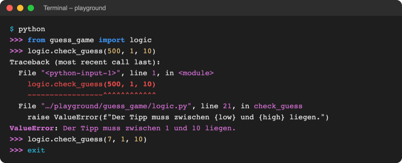
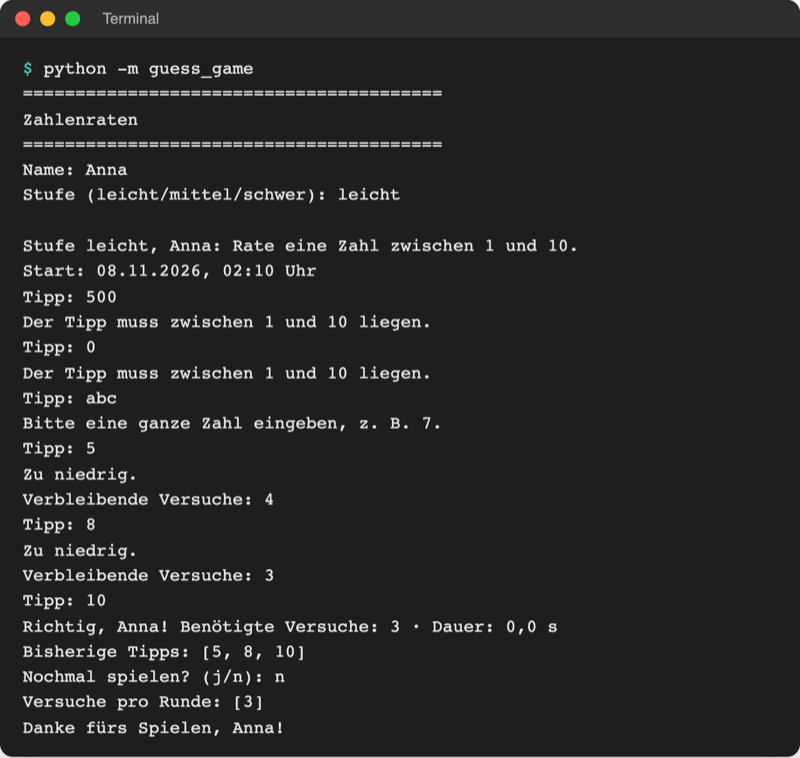

# Lab 7.3 – Lösung: Tipps außerhalb des Bereichs ablehnen

Fertiger Stand: [project/examples/m07-exceptions/l03-raise/guess_game/](../../project/examples/m07-exceptions/l03-raise/guess_game/) (geändert: `logic.py`, `ui.py`)

## Aufgabe 1: check_guess in logic.py

```python
def check_guess(guess, low, high):
    """Löst ValueError aus, wenn der Tipp nicht zwischen low und high liegt."""
    if guess < low or guess > high:
        raise ValueError(f"Der Tipp muss zwischen {low} und {high} liegen.")
```

Die Funktion steht in `logic.py` zwischen `draw_secret` und `is_guess_correct`. Sie gibt nichts zurück: Kehrt sie ohne Fehler zurück, ist der Tipp gültig. Gleichwertig ist `if not low <= guess <= high:` (verketteter Vergleich aus Lab 2.3).

## Aufgabe 2: Prüfung im REPL



_Quelle: eigener Screenshot, Kurs-Repo, 08.11.2026 (Python 3.14.2, Pfad gekürzt)._

Der Traceback zeigt, wo der Fehler entsteht: in `logic.py`, Funktion `check_guess`, in der Zeile mit `raise`. Ohne `except` bricht der Aufruf ab; im REPL geht es danach mit `>>>` weiter.

## Aufgabe 3: check_guess in play_round aufrufen

```python
        guess = ask_number("Tipp: ")
        try:
            logic.check_guess(guess, low, high)
```

Ein `try` allein ist noch kein gültiger Code (`SyntaxError: expected 'except' or 'finally' block`); Aufgabe 4 ergänzt den `except`-Block.

## Aufgabe 4: abfangen, melden, weiter

Ausschnitt aus `play_round` mit Aufgabe 3 und 4:

```python
    while not logic.is_game_over(tries, max_tries):
        guess = ask_number("Tipp: ")
        try:
            logic.check_guess(guess, low, high)
        except ValueError as error:  # Regel verletzt: kein Versuch verbraucht
            print(error)
            continue

        if guess in tried:
            print("Diese Zahl wurde schon getippt.")
            continue

        tried.add(guess)
        guesses.append(guess)
        tries += 1
```

- `low` und `high` kommen aus `logic.LEVELS[level]` am Anfang von `play_round`; dadurch passt die Meldung zur Stufe (`mittel`: 1 und 50).
- `continue` steht vor `tries += 1` und vor `guesses.append(guess)`: Ein ungültiger Tipp kostet keinen Versuch und erscheint nicht in der Liste.
- `print(error)` zeigt den Text aus `logic.py`. Die Meldung steht damit an einer Stelle; `ui.py` muss die Bereichsregel nicht kennen.

## Aufgabe 5: Testen



_Quelle: eigener Screenshot, Kurs-Repo, 08.11.2026 (Testlauf mit festem Zufallswert, daher Dauer 0,0 s)._

```text
Tipp: 500
Der Tipp muss zwischen 1 und 10 liegen.
Tipp: 0
Der Tipp muss zwischen 1 und 10 liegen.
Tipp: abc
Bitte eine ganze Zahl eingeben, z. B. 7.
Tipp: 5
Zu niedrig.
Verbleibende Versuche: 4
...
Richtig, Anna! Benötigte Versuche: 3 · Dauer: 0,0 s
Bisherige Tipps: [5, 8, 10]
```

## Erweiterung

Datei `playground/bank_deposit.py`:

```python
# Geld einzahlen: ungültige Beträge mit raise ablehnen

MAX_DEPOSIT = 10000  # höchster Betrag pro Einzahlung


def deposit(balance, amount):
    """Gibt den Kontostand nach dem Einzahlen zurück; ungültig → ValueError."""
    if amount <= 0:
        raise ValueError(f"Betrag muss größer als 0 sein, nicht {amount}.")
    if amount > MAX_DEPOSIT:
        raise ValueError(f"Höchstens {MAX_DEPOSIT} Euro pro Einzahlung, nicht {amount}.")
    return balance + amount


balance = 100
for amount in [50, 0, 20000, 250]:
    try:
        balance = deposit(balance, amount)
    except ValueError as error:
        print(f"Abgelehnt: {error}")
    else:
        print(f"{amount} Euro eingezahlt. Kontostand: {balance} Euro")
```

```text
50 Euro eingezahlt. Kontostand: 150 Euro
Abgelehnt: Betrag muss größer als 0 sein, nicht 0.
Abgelehnt: Höchstens 10000 Euro pro Einzahlung, nicht 20000.
250 Euro eingezahlt. Kontostand: 400 Euro
```

Die Grenze steht als Konstante oben (GROSSBUCHSTABEN, Lab 3.4); so bleibt sie an einer Stelle änderbar.
