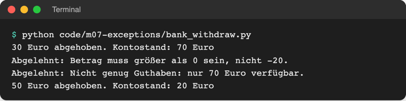
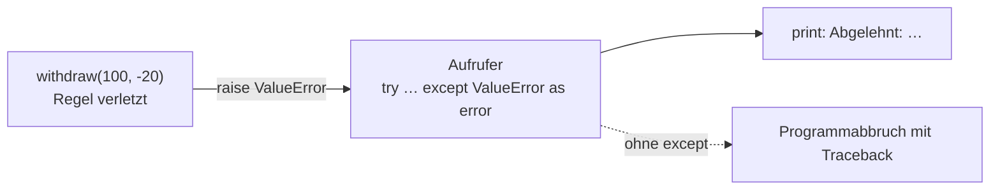

# Lab 7.3: Fehler auslösen

**Leitfragen:**

<details>
<summary>Wer soll entscheiden, was bei einem ungültigen Tipp passiert: die Spielregel oder die Anzeige?</summary>

Beide, mit getrennten Aufgaben: Die Regel (`logic.py`) erkennt „500 liegt nicht zwischen 1 und 10“ und meldet es. Die Anzeige (`ui.py`) entscheidet, was der Mensch davon sieht, und fragt neu.

</details>

<details>
<summary>Was ist schlimmer: ein Absturz oder ein stilles falsches Ergebnis?</summary>

Meist das stille falsche Ergebnis: Ein Absturz fällt sofort auf und nennt die Stelle. Ein falscher Kontostand oder ein verschenkter Versuch fällt vielleicht nie auf und richtet Schaden an.

</details>

- Bisher hat nur Python selbst Fehler ausgelöst. Mit `raise` löst eigener Code einen Fehler aus, sobald ein Wert gegen eine Regel verstößt.
- Wer die Regel kennt, meldet den Fehler; wer mit dem Menschen spricht, fängt ihn ab und zeigt ihn an.

## Begriffe

| Begriff | Bedeutung |
| --- | --- |
| `raise` | löst selbst eine Ausnahme aus; das Programm verlässt die Funktion sofort, wie ein Schiedsrichter, der das Spiel abpfeift |
| `ValueError("…")` | erzeugt eine Ausnahme vom Typ `ValueError` mit eigener Meldung |
| Validieren | Werte gegen eine Regel prüfen, bevor mit ihnen gerechnet wird (Betrag > 0, Tipp im Bereich) |
| Weiterreichen (Propagation) | eine nicht abgefangene Ausnahme wandert die Aufrufkette nach oben, bis ein passendes `except` sie fängt |
| `assert` | Prüfung für die Entwicklung: `assert bedingung, "Meldung"` löst `AssertionError` aus, wenn die Bedingung falsch ist |

## Warum validieren? Still falsch vs. laut abgelehnt

Ohne Prüfung rechnet eine Funktion mit jedem Wert, auch mit unsinnigen:

```python
def withdraw_unchecked(balance, amount):
    return balance - amount


print(withdraw_unchecked(100, -20))  # 120 – Abheben hat Geld vermehrt, niemand merkt es
```

Mit Prüfung und `raise` endet der Aufruf mit einer klaren Meldung, statt ein falsches Ergebnis zurückzugeben:

```python
def withdraw(balance, amount):
    """Gibt den Kontostand nach dem Abheben zurück; ungültig → ValueError."""
    if amount <= 0:
        raise ValueError(f"Betrag muss größer als 0 sein, nicht {amount}.")
    if amount > balance:
        raise ValueError(f"Nicht genug Guthaben: nur {balance} Euro verfügbar.")
    return balance - amount
```

- `raise` beendet die Funktion sofort, wie `return`, aber ohne Rückgabewert: Die Zeile `return balance - amount` wird nicht mehr erreicht.
- Die Meldung beschreibt Regel **und** gefundenen Wert; wer sie liest, versteht das Problem ohne den Code.
- Prüfungen stehen am Anfang der Funktion („früh melden“): Falsche Werte gelangen gar nicht erst in die Rechnung.

## Auslösen an einer Stelle, behandeln an einer anderen

Datei: [code/m07-exceptions/bank_withdraw.py](../../project/code/m07-exceptions/bank_withdraw.py). Die Funktion meldet, der Aufrufer entscheidet:

```python
balance = 100
for amount in [30, -20, 500, 50]:
    try:
        balance = withdraw(balance, amount)
    except ValueError as error:  # Meldung aus raise anzeigen
        print(f"Abgelehnt: {error}")
    else:
        print(f"{amount} Euro abgehoben. Kontostand: {balance} Euro")
```



_Quelle: eigener Screenshot, Kurs-Repo, 08.11.2026._

`except ValueError as error` (Lab 7.2) fängt die Ausnahme aus `raise`; `error` enthält genau den Text aus `ValueError("…")`. Bei einem abgelehnten Betrag bleibt `balance` unverändert, weil die Zuweisung `balance = withdraw(...)` nie stattfindet.



Fehlt beim Aufrufer das `except`, wandert die Ausnahme weiter nach oben (Lab 7.1, Aufrufkette) und beendet zuletzt das Programm mit Traceback. Wer sie fängt, ist frei wählbar; üblich ist die Stelle, die mit dem Menschen spricht.

Original: [Python-Tutorial, Abschnitt 8.4 Raising Exceptions: raise NameError('HiThere') erzeugt einen Traceback mit NameError: HiThere](https://docs.python.org/3.14/tutorial/errors.html#raising-exceptions), Stand 08.11.2026.

## Welcher Fehlertyp?

| Situation | Typ | Beispiel |
| --- | --- | --- |
| Wert hat den richtigen Typ, ist aber ungültig | `ValueError` | Betrag `-20`, Tipp `500` |
| Wert hat den falschen Typ | `TypeError` | Betrag `"zwanzig"` statt Zahl |
| fachlicher Fehler, der eigens erkannt werden soll | eigene Fehlerklasse, z. B. `InsufficientFundsError` | ab Lab 10.1 (braucht Klassen) |

Für den Anfang reicht fast immer `ValueError` mit einer guten Meldung.

## assert: Prüfung für die Entwicklung, nicht für Eingaben

```python
balance = -5
assert balance >= 0, "Kontostand darf nicht negativ sein"
# AssertionError: Kontostand darf nicht negativ sein
```

- `assert` prüft Annahmen über den **eigenen** Code („an dieser Stelle kann der Kontostand nie negativ sein“). Schlägt die Prüfung fehl, steckt ein Programmierfehler im Code.
- Für Eingaben und Daten von außen ist `assert` ungeeignet: Mit `python -O` (optimiert) überspringt Python alle `assert`-Zeilen; die Prüfung wäre dann einfach weg. Dafür ist `if … raise ValueError(...)` da.

## Im Spiel: Tipps außerhalb des Bereichs

Bisher zählt der Tipp `500` bei 1–10 als normaler Fehlversuch („Zu hoch.“). Die Regel „Tipp liegt im Bereich“ gehört in `logic.py`:

```python
def check_guess(guess, low, high):
    """Löst ValueError aus, wenn der Tipp nicht zwischen low und high liegt."""
```

- `check_guess` gibt nichts zurück: Kommt sie ohne Fehler zurück, ist der Tipp gültig.
- `play_round` in `ui.py` ruft sie direkt nach `ask_number` auf, fängt den `ValueError` mit `as error` und zeigt `print(error)`; `continue` (Lab 3.3) springt zum nächsten Tipp, ohne einen Versuch zu verbrauchen.
- So kennt `logic.py` keine Ein-/Ausgabe und `ui.py` keine Bereichsregel (Aufteilung aus Lab 6.1).

## Typische Fehler

| Symptom | Ursache | Lösung |
| --- | --- | --- |
| Programm bricht mit `ValueError: Der Tipp muss …` ab | `raise` ohne passendes `except` beim Aufrufer | Aufruf in `try`/`except ValueError` setzen |
| Ungültiger Tipp kostet trotzdem einen Versuch | Prüfung steht hinter `tries += 1` oder `continue` fehlt | prüfen direkt nach der Eingabe, im `except` mit `continue` weiter |
| `TypeError: exceptions must derive from BaseException` | `raise "Text"` statt `raise ValueError("Text")` | immer einen Fehlertyp auslösen |
| `print(error)` zeigt nichts Hilfreiches | `raise ValueError()` ohne Meldung | Meldung mit Regel und Wert übergeben |
| Prüfung wirkt nicht, Wert geht durch | `return` statt `raise` in der Prüffunktion, Rückgabe wird ignoriert | `raise` verwenden |
| Prüfung mit `assert` fehlt im Betrieb | Start mit `python -O` schaltet `assert` ab | Eingaben mit `if … raise` prüfen |

## Fazit

- `raise ValueError("Meldung")` meldet einen Regelverstoß sofort und laut, statt still falsch weiterzurechnen.
- Die Regel löst aus, der Aufrufer fängt mit `except … as error` und entscheidet, was passiert.
- `assert` nur für eigene Annahmen im Code, nie für Eingaben; eigene Fehlerklassen folgen in Lab 10.1.

In der Übung lehnt das eigene Spiel Tipps außerhalb des Bereichs mit einer verständlichen Meldung ab.
