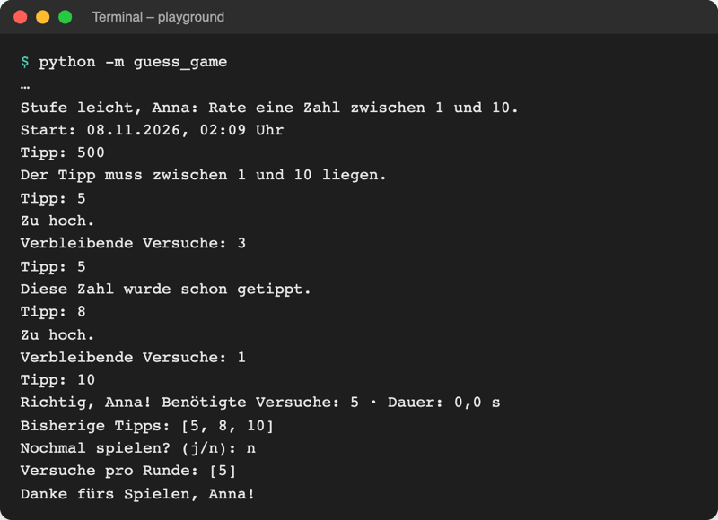
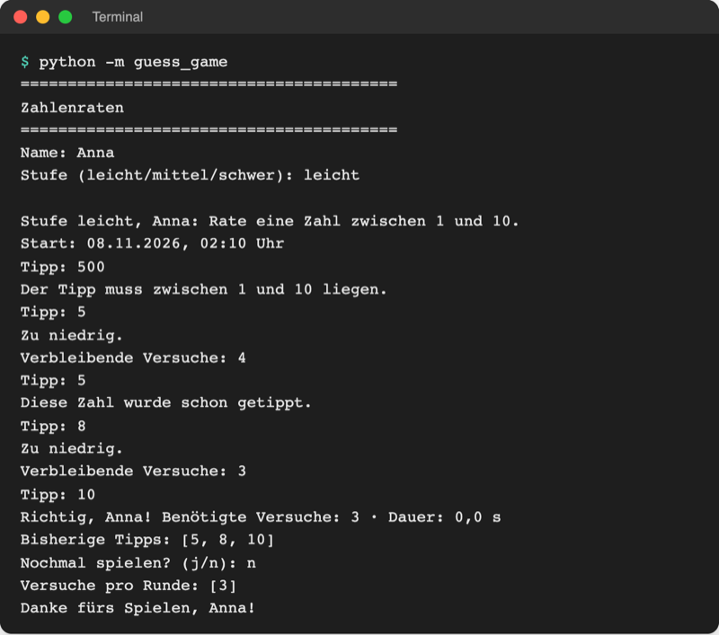

# Lab 7.4 – Lösung: Zwei versteckte Fehler finden

Korrigierter Stand = Stand nach Lab 7.3: [project/examples/m07-exceptions/l03-raise/guess_game/ui.py](../../project/examples/m07-exceptions/l03-raise/guess_game/ui.py)

| Fehler | Zeile in `starters/m07-l04-guess_game/ui.py` | Ursache in einem Satz | Korrektur |
| --- | --- | --- | --- |
| 1: Versuche falsch gezählt | 85: `tries += 1` direkt nach `ask_number` | Der Zähler steigt vor der Bereichs- und Doppelprüfung, also auch bei ungültigen und doppelten Tipps. | Zeile 85 entfernen und `tries += 1` hinter `guesses.append(guess)` setzen |
| 2: Hinweis vertauscht | 53: `if guess < secret:` in `show_hint` | Der Vergleich ist umgedreht, deshalb meldet ein zu kleiner Tipp „Zu hoch.“. | `if guess > secret:` |

## Aufgabe 1: Symptome beobachten



_Quelle: eigener Screenshot, Kurs-Repo, 08.11.2026 (fehlerhafte Version, Testlauf mit Geheimzahl 10)._

- Nach `500` und dem ersten gültigen Tipp `5` steht `Verbleibende Versuche: 3` statt 4; nach dem doppelten `5` und `8` springt der Wert auf 1. Am Ende meldet das Spiel 5 benötigte Versuche für 3 gültige Tipps (`Bisherige Tipps: [5, 8, 10]`).
- Bei Geheimzahl 10 meldet `5` „Zu hoch.“ und `8` ebenfalls „Zu hoch.“, obwohl beide zu niedrig sind.

## Aufgabe 2: Haltepunkt und Watch

Haltepunkt auf Zeile 84 (`guess = ask_number("Tipp: ")`). Beim ersten Halt zeigt Variables unter „Locals“ u. a. `low = 1`, `high = 10`, `max_tries = 5`, `secret = …` (zufällig), `tries = 0`, `guesses = []`, `tried = set()`; Watch zeigt `max_tries - tries: 5`.

## Aufgabe 3: Fehler 1 finden und beheben

Schritte mit Eingabe `500`:

| Halt vor Zeile | Code | `tries` danach | Erwartet |
| --- | --- | --- | --- |
| 84 | `guess = ask_number("Tipp: ")` | 0, `guess = 500` | 0 |
| 85 | `tries += 1` | **1** | 0 – der Tipp ist noch nicht geprüft |
| 86–87 | `try:`, `logic.check_guess(guess, low, high)` | 1, Ausnahme → weiter im `except` | – |
| 88–90 | `except …`, `print(error)`, `continue` | 1 | 0 |

Die erste Zeile, nach der der Wert nicht zur Vorhersage passt, ist Zeile 85. Der Kommentar in Zeile 88 („kein Versuch verbraucht“) widerspricht dem Code direkt darüber. Korrektur:

```python
        guess = ask_number("Tipp: ")
        try:
            logic.check_guess(guess, low, high)
        except ValueError as error:  # Regel verletzt: kein Versuch verbraucht
            print(error)
            continue

        if guess in tried:
            print("Diese Zahl wurde schon getippt.")
            continue

        tried.add(guess)
        guesses.append(guess)
        tries += 1  # erst hier: nur gültige, neue Tipps zählen
```

## Aufgabe 4: Fehler 2 finden und beheben

Mit Tipp `5` bei `secret = 10` zeigt die Debug Console `guess > secret` → `False`. Step Into in `show_hint` hält auf Zeile 53 `if guess < secret:`; ein Step Over springt in die Zeile `console.print("Zu hoch.", style="red")`. Der Vergleich ist verkehrt herum. Korrektur:

```python
def show_hint(guess, secret):
    """Gibt aus, ob der Tipp zu hoch oder zu niedrig ist."""
    if guess > secret:
        console.print("Zu hoch.", style="red")
    else:
        console.print("Zu niedrig.", style="blue")
```

## Aufgabe 5: Nachtest



_Quelle: eigener Screenshot, Kurs-Repo, 08.11.2026 (Testlauf mit Geheimzahl 10)._

Notizen:

- Fehler 1, Zeile 85: `tries += 1` stand vor den Prüfungen, deshalb kosteten ungültige und doppelte Tipps einen Versuch.
- Fehler 2, Zeile 53: In `show_hint` war `>` zu `<` vertauscht, deshalb waren „Zu hoch.“ und „Zu niedrig.“ vertauscht.

Nach der Übung: Der korrigierte Ordner `playground/guess_game/` entspricht dem Stand nach Lab 7.3 und kann bleiben. Alternativ den eigenen Ordner `guess_game_7_3` wieder in `guess_game` umbenennen (vorher den korrigierten Ordner löschen oder umbenennen).

## Erweiterung

- Der bedingte Haltepunkt auf Zeile 16 (`balance = withdraw(balance, amount)`) mit `amount < 0` hält nur im zweiten Durchlauf (`amount = -20`); Variables zeigt `balance = 70`.
- Step Into hält auf Zeile 6 (`if amount <= 0:`), ein Step Over führt zu Zeile 7 (`raise ValueError(...)`). Ein weiterer Step Over verlässt `withdraw` und hält im `except`-Block (Zeile 17/18).
- `balance` bleibt 70: Die Zuweisung in Zeile 16 findet nicht statt, weil `withdraw` mit `raise` statt mit `return` endet.
