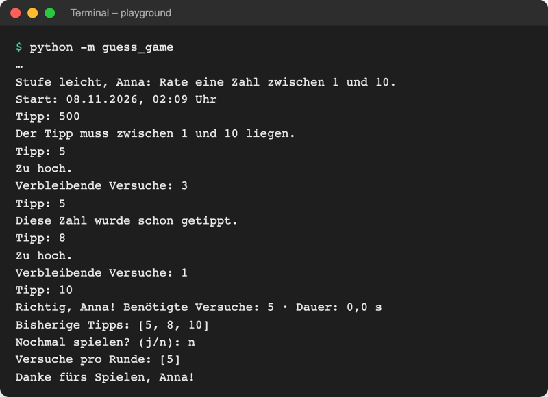

# Lab 7.4: Debuggen in VS Code

**Leitfragen:**

<details>
<summary>Das Spiel läuft, rechnet aber falsch – wie findet man die Stelle ohne Fehlermeldung?</summary>

Ohne Traceback (Lab 7.1) gibt es keinen Hinweis auf die Zeile. Man muss zusehen, welche Werte die Variablen unterwegs haben, und die Stelle suchen, an der ein Wert zum ersten Mal nicht mehr stimmt.

</details>

<details>
<summary>Wie lässt sich ein Programm „anhalten“, um hineinzuschauen?</summary>

Mit einem Haltepunkt: Der Debugger stoppt das Programm vor einer bestimmten Zeile, zeigt alle Variablen und führt danach Zeile für Zeile weiter aus.

</details>

- Fehler mit Traceback zeigen ihre Stelle selbst. **Logikfehler** dagegen laufen ohne Meldung durch und liefern nur ein falsches Ergebnis.
- Ein **Debugger** führt das Programm in Zeitlupe aus: anhalten, Variablen ansehen, Schritt für Schritt weiter. VS Code bringt ihn mit der Erweiterung „Python“ mit (Setup).

## Begriffe

| Begriff | Bedeutung |
| --- | --- |
| Logikfehler (Bug) | Programm läuft ohne Fehlermeldung, tut aber nicht das Gewollte, z. B. zählt falsch |
| Debugger | Werkzeug, das ein Programm anhält und hineinschauen lässt; wie Pause und Einzelbild bei einem Video |
| Haltepunkt (Breakpoint) | roter Punkt links neben einer Zeile: Der Debugger hält **vor** dieser Zeile an |
| Step Over | aktuelle Zeile ausführen, bei einem Funktionsaufruf die Funktion ganz durchlaufen und in der nächsten Zeile wieder halten |
| Step Into | in die aufgerufene Funktion hineinspringen und dort in der ersten Zeile halten |
| Step Out | die aktuelle Funktion zu Ende laufen lassen und beim Aufrufer wieder halten |
| Continue | bis zum nächsten Haltepunkt (oder Programmende) weiterlaufen |
| Variables / Watch | Bereiche links: alle aktuellen Variablen / selbst gewählte Ausdrücke, z. B. `max_tries - tries` |
| Call Stack | Aufrufkette im Moment des Anhaltens (wie im Traceback, Lab 7.1, nur live) |
| Debug Console | Eingabezeile, in der Ausdrücke mit den aktuellen Variablen ausgewertet werden |
| `launch.json` | Datei in `.vscode/`, die festlegt, wie VS Code das Programm im Debugger startet |

## print-Debugging oder Debugger?

| | `print(...)` einfügen | Debugger |
| --- | --- | --- |
| Aufwand | sofort, ohne Werkzeug | einmal einrichten (`launch.json`) |
| Sicht | nur die Werte, an die vorher gedacht wurde | alle Variablen jeder Funktion |
| Ändern während der Suche | Code ändern, neu starten | Haltepunkte verschieben, Ausdrücke in Watch/Debug Console prüfen |
| Aufräumen | jede Zeile wieder entfernen | nichts, der Code bleibt unverändert |
| Gut für | schnellen Blick auf einen Wert | „Wo wird der Wert falsch?“ |

## Der Debugger in VS Code

Debug-Ansicht öffnen: links das Symbol **Run and Debug** (Play-Dreieck mit Käfer), Tastenkürzel Strg+Shift+D (macOS: Cmd+Shift+D). Oben steht die gewählte Konfiguration, daneben der grüne Startknopf.


_Quelle: VS Code Docs, „Python debugging in VS Code“ (https://code.visualstudio.com/docs/python/debugging), CC BY 4.0, abgerufen am 08.11.2026. Das Beispiel zeigt eine andere Datei; Aufbau und Knöpfe sind dieselben._

### launch.json: das Spiel als Paket starten

Das Spiel startet mit `python -m guess_game` im Ordner `playground/` (Lab 6.1). Damit der Debugger es genauso startet, liegt im Kurs-Repo die Datei `project/.vscode/launch.json` bereit. VS Code liest sie automatisch, wenn der Ordner `project/` geöffnet ist:

```jsonc
{
  "version": "0.2.0",
  "configurations": [
    {
      "name": "Spiel debuggen (python -m guess_game)",  // Name in der Auswahlliste
      "type": "debugpy",                // Python-Debugger der Erweiterung „Python“
      "request": "launch",              // Programm neu starten (nicht an laufendes anhängen)
      "module": "guess_game",           // wie python -m guess_game
      "cwd": "${workspaceFolder}/playground",  // Startordner: project/playground
      "console": "integratedTerminal",  // Ein- und Ausgaben im Terminal unten
      "justMyCode": true                // nur eigenen Code anhalten, nicht rich/Python-intern
    },
    {
      "name": "Aktuelle Datei debuggen",
      "type": "debugpy",
      "request": "launch",
      "program": "${file}",             // die gerade geöffnete .py-Datei
      "cwd": "${workspaceFolder}",      // Startordner: project/
      "console": "integratedTerminal",
      "justMyCode": true
    }
  ]
}
```

- `${workspaceFolder}` ist der in VS Code geöffnete Ordner, hier `project/`.
- Die zweite Konfiguration debuggt einzelne Skripte wie `code/m07-exceptions/bank_withdraw.py`.
- Ohne `launch.json` geht es auch: **Run → Start Debugging** (F5) fragt dann nach der Art; „Python File“ debuggt die offene Datei. Für ein Paket wie `guess_game` ist die Konfiguration nötig.
- Quelle für alle Felder: [VS Code Docs, Python debugging](https://code.visualstudio.com/docs/python/debugging), Stand: 08.11.2026.

### Haltepunkt setzen und starten

Klick links neben die Zeilennummer setzt einen roten Punkt (oder Cursor in die Zeile, dann F9). Erneuter Klick entfernt ihn.


_Quelle: VS Code Docs, „Getting Started with Python in VS Code“ (https://code.visualstudio.com/docs/python/python-tutorial), CC BY 4.0, abgerufen am 08.11.2026._

Dann Konfiguration wählen und F5 drücken (**Run → Start Debugging**). Eingaben wie `Name:` oder `Tipp:` erscheinen im **Terminal** unten und werden dort getippt.

### Steuern: die Debug-Leiste

Hält das Programm an, ist die Zeile gelb markiert, und oben erscheint die Debug-Leiste:


_Quelle: VS Code Docs, „Getting Started with Python in VS Code“ (https://code.visualstudio.com/docs/python/python-tutorial), CC BY 4.0, abgerufen am 08.11.2026._

| Knopf (von links) | Taste Windows / macOS | Wirkung |
| --- | --- | --- |
| Continue | F5 | weiter bis zum nächsten Haltepunkt |
| Step Over | F10 | Zeile ausführen, Funktionen nicht betreten |
| Step Into | F11 | in die aufgerufene Funktion hinein |
| Step Out | Shift+F11 | Funktion beenden, zurück zum Aufrufer |
| Restart | Strg+Shift+F5 / Cmd+Shift+F5 | Programm neu starten |
| Stop | Shift+F5 | Debuggen beenden |

Quelle der Tasten: [VS Code Docs, Debug actions](https://code.visualstudio.com/docs/debugtest/debugging), Stand: 08.11.2026. Auf manchen Laptops gehören F-Tasten zusätzlich zur Taste Fn.

### Hineinschauen: Variables, Watch, Call Stack


_Quelle: VS Code Docs, „Getting Started with Python in VS Code“ (https://code.visualstudio.com/docs/python/python-tutorial), CC BY 4.0, abgerufen am 08.11.2026._

- **Variables:** Unter „Locals“ stehen alle Variablen der aktuellen Funktion mit Wert. Nach jedem Schritt sind geänderte Werte hervorgehoben.
- **Watch:** Mit **+** einen Ausdruck eintragen, z. B. `max_tries - tries`; er wird bei jedem Halt neu berechnet.
- **Call Stack:** zeigt, welche Funktion welche aufgerufen hat (`main` → `play_round`). Klick auf eine Zeile zeigt die Variablen dieser Funktion.
- **Debug Console** (Strg+Shift+Y / Cmd+Shift+Y): Ausdrücke mit den aktuellen Variablen auswerten, z. B. `guess < secret`.


_Quelle: VS Code Docs, „Getting Started with Python in VS Code“ (https://code.visualstudio.com/docs/python/python-tutorial), CC BY 4.0, abgerufen am 08.11.2026._

### Bedingte Haltepunkte und `breakpoint()`

- **Bedingter Haltepunkt:** Rechtsklick links neben die Zeile → **Add Conditional Breakpoint…** → Ausdruck eintragen, z. B. `tries == 3`. Der Debugger hält nur, wenn der Ausdruck wahr ist; praktisch in Schleifen.
- **`breakpoint()` im Code:** Die eingebaute Funktion wirkt wie ein Haltepunkt. Im VS-Code-Debugger hält das Programm dort an. Ohne Debugger (normaler Start im Terminal) öffnet sie den Text-Debugger `pdb`: `p tries` zeigt einen Wert, `n` geht eine Zeile weiter, `c` läuft weiter, `q` beendet. Die Zeile danach wieder entfernen.

## Vorgehen bei einem Logikfehler

1. Symptom genau beschreiben: welche Eingabe, welche Ausgabe, was wäre richtig?
2. Vermutung: In welcher Funktion entsteht der falsche Wert?
3. Haltepunkt kurz **vor** der vermuteten Stelle setzen, Debugger starten.
4. Vor jedem Step Over vorhersagen, welchen Wert die Variable danach hat; dann vergleichen.
5. Die erste Zeile, nach der ein Wert nicht zur Vorhersage passt, ist die Fehlerstelle. Korrigieren, erneut testen.

## Im Spiel: zwei versteckte Fehler

Der Starter `starters/m07-l04-guess_game/ui.py` ist `ui.py` aus dem Stand nach Lab 7.3 mit zwei eingebauten Logikfehlern. Das Spiel startet, stürzt nie ab und zeigt doch Unsinn: Die Hinweise passen nicht zum Tipp, und die verbleibenden Versuche stimmen nicht immer.



_Quelle: eigener Screenshot, Kurs-Repo, 08.11.2026 (fehlerhafte Version, Testlauf mit Geheimzahl 10)._

Ein guter Startpunkt ist ein Haltepunkt auf der Zeile `guess = ask_number("Tipp: ")` in `play_round`: Bei jedem Tipp hält das Spiel an, und `guess`, `secret`, `tries` und `max_tries` stehen unter Variables.

## Typische Fehler

| Symptom | Ursache | Lösung |
| --- | --- | --- |
| Konfiguration „Spiel debuggen“ fehlt in der Auswahl | in VS Code ist nicht der Ordner `project/` geöffnet | **File → Open Folder…** → `project/` |
| `No module named guess_game` | Ordner heißt nicht genau `playground/guess_game/` | Ordner umbenennen (F2) |
| `No module named 'rich'` | Debugger nutzt nicht die `.venv` | Statusleiste unten rechts oder **Python: Select Interpreter** → `.venv` |
| Haltepunkt wird nie erreicht, Spiel läuft durch | Haltepunkt in `starters/` oder `examples/` gesetzt, gestartet wird `playground/` | Haltepunkt in `playground/guess_game/ui.py` setzen |
| Debugger scheint zu hängen, nichts passiert | Programm wartet auf eine Eingabe | ins Terminal unten klicken und tippen |
| Step Into landet in fremdem Code | Schritt in eine Bibliotheksfunktion (z. B. `rich`) | Step Out (Shift+F11); `justMyCode: true` lassen |
| Änderung wirkt nicht | Datei nicht gespeichert oder Debugger nicht neu gestartet | Strg+S, dann Restart |

## Fazit

- Logikfehler haben keinen Traceback; der Debugger zeigt, wo ein Wert zum ersten Mal falsch wird.
- Haltepunkt setzen, F5, dann Step Over / Into / Out; Variables, Watch und Debug Console zeigen die Werte.
- `project/.vscode/launch.json` startet das Spiel im Debugger wie `python -m guess_game` in `playground/`.

In der Übung werden die zwei versteckten Fehler der vorbereiteten Spielversion mit dem Debugger gefunden und behoben.
