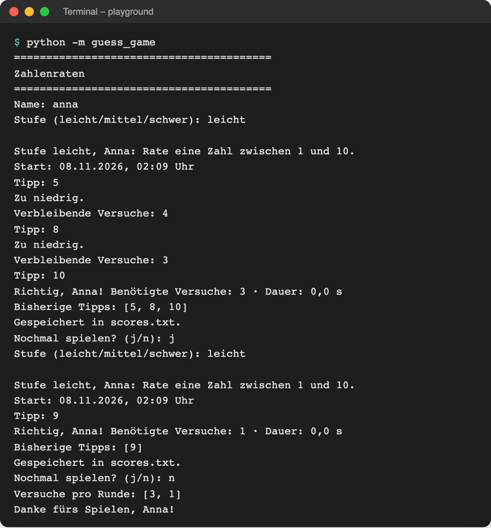
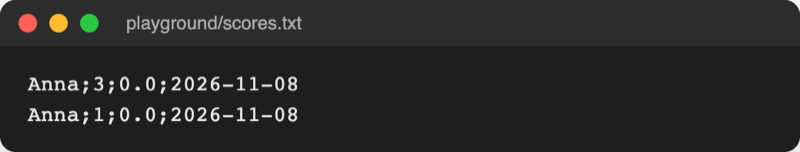

# Lab 8.1 – Lösung: Gewonnene Runden in scores.txt

Fertiger Stand: [project/examples/m08-files/l01-text-files/guess_game/](../../project/examples/m08-files/l01-text-files/guess_game/). Test im Beispiel-Ordner: `cd examples/m08-files/l01-text-files`, dann `python -m guess_game`.

## Aufgabe 1: storage.py anlegen

```python
# Speichern: Ergebnisse in Dateien im aktuellen Ordner ablegen

from pathlib import Path

# relativer Pfad: die Datei landet im Ordner, in dem das Spiel startet
SCORES_FILE = Path("scores.txt")
```

Ein eigenes Modul für Dateien hält `ui.py` (Ein-/Ausgabe) und `logic.py` (Regeln) frei davon. Lab 8.2 und 8.3 ändern nur noch `storage.py`.

## Aufgabe 2: append_score(result)

```python
def append_score(result):
    """Hängt ein Ergebnis als Zeile „Name;Versuche;Sekunden;Datum“ an scores.txt an."""
    line = f"{result['name']};{result['tries']};{result['seconds']};{result['date']}\n"
    # "a": anhängen; gibt es die Datei noch nicht, wird sie angelegt
    with open(SCORES_FILE, "a", encoding="utf-8") as file:
        file.write(line)
```

- `"a"` statt `"w"`: Mit `"w"` stünde nach jeder Runde nur noch die letzte Zeile in der Datei.
- Im f-String stehen die Schlüssel in einfachen Anführungszeichen (`result['name']`), weil der String selbst doppelte nutzt.
- Ein `exists()`-Test ist unnötig: Modus `"a"` legt eine fehlende Datei selbst an.

## Aufgabe 3: __main__.py speichert gewonnene Runden

```python
from guess_game import storage, ui


def main():
    """Hauptablauf: Name fragen, Runden spielen, bis niemand mehr will."""
    ui.show_banner()
    name = ui.ask_name()
    all_tries = []
    play_again = "j"
    while play_again == "j":
        level = ui.ask_level()
        result = ui.play_round(name, level=level)
        all_tries.append(result["tries"])
        if result["won"]:  # nur gewonnene Runden kommen in die Bestenliste
            storage.append_score(result)
            print(f"Gespeichert in {storage.SCORES_FILE}.")
        play_again = ui.ask_play_again()
    ui.show_goodbye(name, all_tries)
```

Der Rest von `__main__.py` (Start mit `try`/`except KeyboardInterrupt`) bleibt wie in Lab 7.3.

## Aufgabe 4: Zwei Gewinne



_Quelle: eigener Screenshot, Kurs-Repo, 08.11.2026 (Testlauf mit festem Zufallswert, daher Dauer 0,0 s)._

Inhalt danach:



_Quelle: eigener Screenshot, Kurs-Repo, 08.11.2026._

Bei einem echten Spiel steht statt `0.0` die gemessene Dauer, z. B. `Anna;3;12.4;2026-11-08`. Die Sekunden behalten den Punkt, weil Python Kommazahlen so in Text verwandelt.

## Aufgabe 5: Neustart

- Die beiden alten Zeilen bleiben, die neue gewonnene Runde kommt als dritte Zeile dazu.
- Die verlorene Runde fehlt: `append_score` läuft nur bei `result["won"]`. Ein Protokoll aller Runden folgt mit `history.csv` in Lab 8.3.
- Die Datei liegt in `playground/`, weil das Terminal dort steht. Startet das Spiel aus einem anderen Ordner, entsteht dort eine zweite `scores.txt`.

## Erweiterung

`playground/show_scores.py`:

```python
# Bestenliste aus scores.txt lesen und lesbar ausgeben

from pathlib import Path

scores_file = Path("scores.txt")

try:
    with open(scores_file, encoding="utf-8") as file:
        for line in file:
            name, tries, seconds, date = line.strip().split(";")
            print(f"{name} · Versuche: {tries} · {date}")
except FileNotFoundError:
    print("Noch keine Ergebnisse gespeichert.")
```

`split(";")` liefert eine Liste mit vier Teilen; die Zeile mit vier Namen links verteilt sie wie beim Entpacken eines Tupels (Lab 4.2).

```text
$ python show_scores.py
Anna · Versuche: 3 · 2026-11-08
Anna · Versuche: 1 · 2026-11-08
```

Ohne `scores.txt` im Ordner:

```text
$ python show_scores.py
Noch keine Ergebnisse gespeichert.
```
