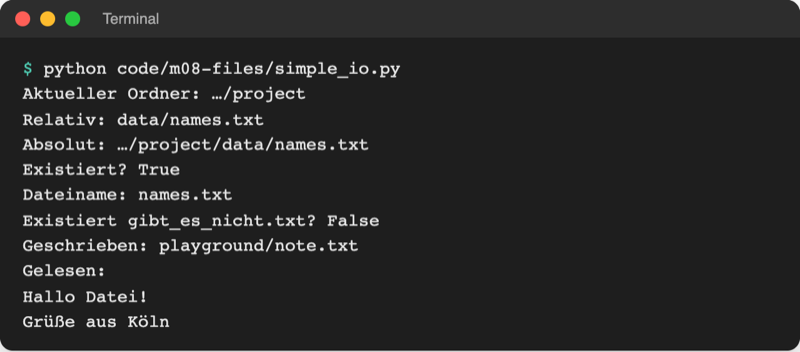

# Lab 8.1: Dateien lesen und schreiben

**Leitfragen:**

<details>
<summary>Wo bleibt ein Spielstand, wenn das Programm endet?</summary>

Nirgends: Variablen leben im Arbeitsspeicher und verschwinden mit dem Programmende. Was den Neustart überleben soll, muss in eine Datei auf der Festplatte.

</details>

<details>
<summary>Was soll passieren, wenn die Datei beim ersten Start noch nicht existiert?</summary>

Das Programm darf nicht abstürzen. Beim Anhängen legt Python die Datei einfach an; beim Lesen vorher mit `exists()` prüfen oder `FileNotFoundError` abfangen.

</details>

<details>
<summary>Warum sehen Umlaute manchmal kaputt aus?</summary>

Eine Datei speichert Bytes, nicht Buchstaben. Liest ein Programm die Bytes mit einer anderen Kodierung, als geschrieben wurde, wird aus „ü“ ein „ü“. Abhilfe: beim Schreiben und Lesen immer `encoding="utf-8"` angeben.

</details>

- Eine Datei ist ein benannter Speicherplatz auf der Festplatte; ihr Inhalt bleibt, wenn das Programm endet.
- Python öffnet eine Datei mit `open()`, liest oder schreibt Text und schließt sie wieder. Den Weg zur Datei beschreibt ein Pfad, in Python ein `Path`-Objekt aus dem Modul `pathlib`.

## Begriffe

| Begriff | Bedeutung |
| --- | --- |
| Textdatei | Datei aus Zeichen und Zeilen, lesbar in jedem Editor (`.txt`, `.py`, `.csv`, `.json`) |
| Pfad | Weg zu einer Datei durch die Ordner, wie eine Wegbeschreibung: `data/names.txt` |
| absoluter Pfad | vollständiger Weg ab dem Laufwerk: `C:\Users\anna\project\data\names.txt` oder `/Users/anna/project/data/names.txt` |
| relativer Pfad | Weg ab dem aktuellen Ordner: `data/names.txt` |
| aktueller Ordner (Arbeitsverzeichnis) | Ordner, in dem das Terminal beim Start des Programms steht; Startpunkt für relative Pfade |
| `pathlib.Path` | Python-Objekt für einen Pfad mit Methoden wie `exists()` und `read_text()` |
| `open()` | öffnet eine Datei und liefert ein Dateiobjekt zum Lesen oder Schreiben |
| Modus | zweites Argument von `open()`: `"r"` lesen, `"w"` schreiben, `"a"` anhängen |
| `with` | Block, nach dem Python die Datei automatisch schließt |
| Kodierung (Encoding) | Regel, wie Zeichen in Bytes übersetzt werden; heute fast immer UTF-8 |
| `FileNotFoundError` | Fehler beim Lesen einer Datei, die es nicht gibt |

## Pfade mit pathlib

Datei: [code/m08-files/simple_io.py](../../project/code/m08-files/simple_io.py)

```python
from pathlib import Path

print("Aktueller Ordner:", Path.cwd())  # dort, wo das Terminal gerade steht

names_file = Path("data") / "names.txt"  # relativer Pfad, / fügt Teile zusammen
print("Absolut:", names_file.absolute())
print("Existiert?", names_file.exists())

note = Path("playground") / "note.txt"
note.write_text("Hallo Datei!\nGrüße aus Köln\n", encoding="utf-8")
text = note.read_text(encoding="utf-8")
```



_Quelle: eigener Screenshot, Kurs-Repo, 08.11.2026 (Pfadanfang durch „…“ gekürzt)._

| Ausdruck | Wirkung |
| --- | --- |
| `Path("data") / "names.txt"` | Pfad zusammensetzen; `/` funktioniert auf Windows, macOS und Linux |
| `Path.cwd()` | aktueller Ordner |
| `pfad.absolute()` | relativen Pfad zum absoluten ergänzen (aktueller Ordner davor) |
| `Path("..") / "data"` | `..` = eine Ordnerebene höher, z. B. von `playground/` nach `project/data/` |
| `pfad.exists()` | `True`, wenn Datei oder Ordner existiert |
| `pfad.read_text(encoding="utf-8")` | ganze Datei als ein String |
| `pfad.write_text(text, encoding="utf-8")` | ganze Datei schreiben; alter Inhalt wird ersetzt |
| `pfad.name` | nur der Dateiname: `names.txt` |

**Relativ heißt: relativ zum Terminal.** Alle Kursprogramme starten im Ordner `project/` (`python code/m08-files/simple_io.py`), deshalb findet `Path("data")` den Ordner `project/data/`. Steht das Terminal woanders, zeigt derselbe relative Pfad ins Leere.

**Steht in älterem Code:** Vor `pathlib` setzte man Pfade mit dem Modul `os.path` zusammen: `os.path.join("data", "names.txt")`, `os.path.exists(pfad)`. Beides funktioniert weiter; neuer Code nutzt `Path`.

## open(), Modi und with

`read_text`/`write_text` erledigen alles in einem Schritt. Für Zeile-für-Zeile-Arbeit und zum Anhängen dient `open()`. Datei: [code/m08-files/open_modes.py](../../project/code/m08-files/open_modes.py)

```python
shopping_file = Path("playground") / "shopping.txt"

with open(shopping_file, "w", encoding="utf-8") as file:  # neu schreiben
    file.write("Milch\n")  # \n = Zeilenumbruch, write setzt keinen selbst
    file.write("Brot\n")

with open(shopping_file, "a", encoding="utf-8") as file:  # anhängen
    file.write("Käse\n")

with open(shopping_file, encoding="utf-8") as file:  # lesen ("r" ist Standard)
    for line in file:
        print("Zeile:", line.strip())  # strip entfernt den Zeilenumbruch
```

```text
Zeile: Milch
Zeile: Brot
Zeile: Käse
readlines: ['Milch\n', 'Brot\n', 'Käse\n']
Fehler: [Errno 2] No such file or directory: 'playground/gibt_es_nicht.txt'
```

| Modus | Bedeutung | Datei fehlt | Datei existiert |
| --- | --- | --- | --- |
| `"r"` (Standard) | lesen | `FileNotFoundError` | wird gelesen |
| `"w"` | schreiben | wird angelegt | **Inhalt wird gelöscht**, dann neu geschrieben |
| `"a"` | anhängen | wird angelegt | neuer Text kommt ans Ende |

**`with` in einem Satz:** `with open(...) as file:` öffnet die Datei für den eingerückten Block und schließt sie danach automatisch, auch wenn im Block ein Fehler auftritt (wie das funktioniert: Lab 13.2). Ohne Schließen kann geschriebener Text verloren gehen.

| Lesen | Ergebnis |
| --- | --- |
| `file.read()` | ganzer Inhalt als ein String |
| `file.readlines()` | Liste aller Zeilen, jede mit `\n` am Ende |
| `for line in file:` | Zeile für Zeile, spart Speicher bei großen Dateien |

Eine fehlende Datei beim Lesen meldet `FileNotFoundError`. Abfangen wie in Lab 7.2:

```python
try:
    with open(Path("playground") / "gibt_es_nicht.txt", encoding="utf-8") as file:
        print(file.read())
except FileNotFoundError as error:
    print("Fehler:", error)
```

Original: [Python-Dokumentation, Tutorial 7.2 Reading and Writing Files: open(filename, mode, encoding), Modi r, w, a und Empfehlung encoding="utf-8"](https://docs.python.org/3.14/tutorial/inputoutput.html#reading-and-writing-files), Stand 08.11.2026.

## Kodierung: immer encoding="utf-8"

Datei: [code/m08-files/encoding.py](../../project/code/m08-files/encoding.py) schreibt „Grüße aus Köln“ als UTF-8 und liest es zweimal: einmal richtig, einmal mit der alten Windows-Kodierung `cp1252`.


_Quelle: eigener Screenshot, Kurs-Repo, 08.11.2026._

- Ohne `encoding=` nimmt Python 3.14 die Kodierung des Betriebssystems: auf macOS und Linux UTF-8, auf Windows mit deutscher Einstellung meist `cp1252`. Dieselbe Datei sieht dann je nach Rechner anders aus.
- Seit Python 3.15 ist UTF-8 überall der Standard (PEP 686, UTF-8-Modus). Die Python-Doku empfiehlt trotzdem, `encoding` immer anzugeben, damit der Code mit allen Versionen gleich arbeitet. Stand: 08.11.2026, Quellen: https://peps.python.org/pep-0686/, https://docs.python.org/3.15/whatsnew/3.15.html

## Beispiel: Namensliste sortieren

Datei: [code/m08-files/sort_names.py](../../project/code/m08-files/sort_names.py). [data/names.txt](../../project/data/names.txt) enthält Namen mit Leerzeichen, Leerzeilen und Kleinschreibung.

```python
source = Path("data") / "names.txt"
target = Path("playground") / "names_sorted.txt"

names = []
with open(source, encoding="utf-8") as file:
    for line in file:
        name = line.strip().title()  # Leerzeichen weg, groß beginnen
        if name != "":  # leere Zeilen überspringen
            names.append(name)

names.sort()

with open(target, "w", encoding="utf-8") as file:
    for name in names:
        file.write(name + "\n")
```


_Quelle: eigener Screenshot, Kurs-Repo, 08.11.2026._

## Im Spiel: gewonnene Runden in scores.txt

Neues Modul `storage.py` im Paket: Es kümmert sich nur ums Speichern. Jede gewonnene Runde wird eine Zeile `Name;Versuche;Sekunden;Datum` (Bestenliste: verlorene Runden zählen hier nicht).

```python
# storage.py
from pathlib import Path

SCORES_FILE = Path("scores.txt")  # landet im Ordner, in dem das Spiel startet


def append_score(result):
    line = f"{result['name']};{result['tries']};..."  # Zeile aus dem Dictionary
    with open(SCORES_FILE, "a", encoding="utf-8") as file:
        file.write(line)
```

`__main__.py` ruft `storage.append_score(result)` nach jeder gewonnenen Runde auf. Da das Spiel mit `cd playground` und `python -m guess_game` startet, entsteht die Datei als `playground/scores.txt`.

## Typische Fehler

| Symptom | Ursache | Lösung |
| --- | --- | --- |
| `FileNotFoundError: ... 'data/names.txt'` | Terminal steht im falschen Ordner, relativer Pfad zeigt ins Leere | mit `cd` in den Ordner `project/` wechseln; `Path.cwd()` ausgeben |
| Datei ist nach dem Start leer oder kürzer | Modus `"w"` statt `"a"` löscht den alten Inhalt | zum Ergänzen `"a"` nehmen |
| Alles steht in einer einzigen Zeile | `write` setzt keinen Zeilenumbruch | `"\n"` ans Ende jeder Zeile |
| Umlaute als `ü` oder `�` | Datei mit anderer Kodierung gelesen als geschrieben | beim Schreiben und Lesen `encoding="utf-8"` |
| `IsADirectoryError` / `PermissionError` | Pfad zeigt auf einen Ordner oder eine geschützte Datei | Pfad und Dateinamen prüfen |

Echte Ausgabe, wenn das Terminal im Ordner `project/code/` statt `project/` steht:

```text
$ python m08-files/sort_names.py
Traceback (most recent call last):
  File "…/project/code/m08-files/sort_names.py", line 9, in <module>
    with open(source, encoding="utf-8") as file:
         ~~~~^^^^^^^^^^^^^^^^^^^^^^^^^^
FileNotFoundError: [Errno 2] No such file or directory: 'data/names.txt'
```

## Fazit

- Dateien halten Daten über das Programmende hinaus; `pathlib.Path` beschreibt den Weg dorthin, relativ zum Ordner des Terminals.
- `open()` mit `"r"`, `"w"` oder `"a"` in einem `with`-Block; `with` schließt die Datei automatisch.
- `encoding="utf-8"` immer angeben; fehlende Dateien melden `FileNotFoundError`.

In der Übung schreibt das eigene Spiel jede gewonnene Runde in `scores.txt`.
