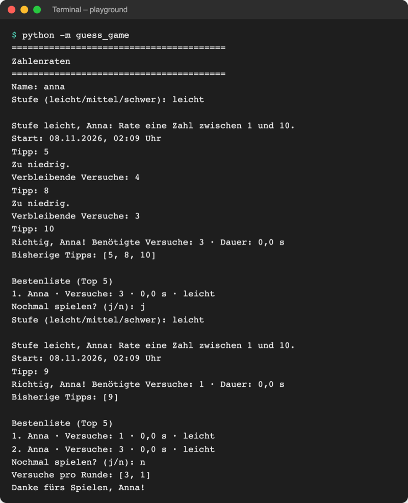
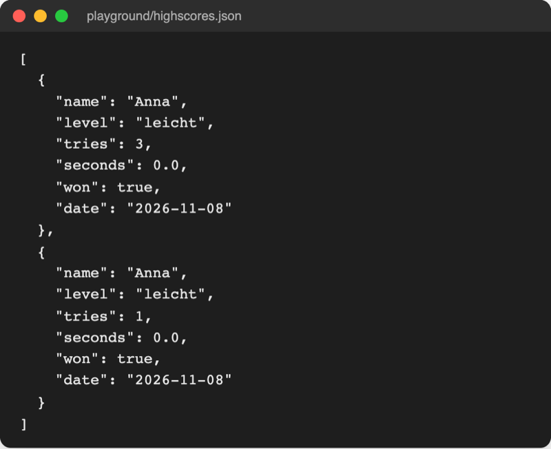

# Lab 8.2 – Lösung: Bestenliste in highscores.json

Fertiger Stand: [project/examples/m08-files/l02-json/guess_game/](../../project/examples/m08-files/l02-json/guess_game/). Test im Ordner `project/`: `cd examples/m08-files/l02-json`, dann `python -m guess_game`.

## Aufgabe 1: load_highscores()

```python
# Speichern: Ergebnisse in Dateien im aktuellen Ordner ablegen

import json
from pathlib import Path

# relativer Pfad: die Datei landet im Ordner, in dem das Spiel startet
HIGHSCORES_FILE = Path("highscores.json")


def load_highscores():
    """Gibt alle gespeicherten Ergebnisse als Liste von Dictionaries zurück."""
    if not HIGHSCORES_FILE.exists():  # erster Start: noch keine Datei
        return []
    with open(HIGHSCORES_FILE, encoding="utf-8") as file:
        return json.load(file)
```

Ohne die `exists()`-Prüfung stürzt der erste Start mit `FileNotFoundError` ab. `return` innerhalb von `with` ist erlaubt: Die Datei wird trotzdem geschlossen.

## Aufgabe 2: save_highscore(result)

```python
def save_highscore(result):
    """Fügt ein Ergebnis zur Bestenliste hinzu und speichert sie als JSON."""
    scores = load_highscores()
    scores.append(result)
    with open(HIGHSCORES_FILE, "w", encoding="utf-8") as file:
        json.dump(scores, file, indent=2, ensure_ascii=False)
```

Modus `"w"`: Eine JSON-Datei ist ein einziger Wert (hier eine Liste) und lässt sich nicht stückweise anhängen. Deshalb laden, ergänzen, komplett neu schreiben.

## Aufgabe 3: get_tries() und top_five()

```python
def get_tries(score):
    """Sortierschlüssel: die Anzahl der Versuche eines Ergebnisses."""
    return score["tries"]


def top_five():
    """Gibt die fünf Ergebnisse mit den wenigsten Versuchen zurück."""
    scores = load_highscores()
    return sorted(scores, key=get_tries)[:5]  # Funktion als Schlüssel, ohne ()
```

Bei gleich vielen Versuchen bleibt die Reihenfolge, in der die Ergebnisse gespeichert wurden: `sorted` vertauscht gleich große Elemente nicht.

## Aufgabe 4: show_highscores(scores)

```python
def show_highscores(scores):
    """Zeigt die Bestenliste mit Platz, Name, Versuchen, Dauer und Stufe."""
    print("\nBestenliste (Top 5)")
    place = 1
    for score in scores:
        seconds = format_seconds(score["seconds"])
        print(
            f"{place}. {score['name']} · Versuche: {score['tries']}"
            f" · {seconds} s · {score['level']}"
        )
        place += 1
```

Zwei f-Strings direkt hintereinander in Klammern ergeben einen String; so bleibt jede Codezeile unter 88 Zeichen.

## Aufgabe 5: __main__.py und Test

```python
        if result["won"]:  # nur gewonnene Runden kommen in die Bestenliste
            storage.save_highscore(result)
            ui.show_highscores(storage.top_five())
```



_Quelle: eigener Screenshot, Kurs-Repo, 08.11.2026 (Testlauf mit festem Zufallswert, daher Dauer 0,0 s)._

`playground/highscores.json` danach:



_Quelle: eigener Screenshot, Kurs-Repo, 08.11.2026._

Nach dem Neustart lädt `top_five()` die Datei erneut; die alten Gewinne stehen wieder in der Liste.

## Erweiterung

`playground/oldest.py`:

```python
# Die drei ältesten Personen aus data/persons.json

import json
from pathlib import Path

persons_file = Path("..") / "data" / "persons.json"  # ".." = eine Ebene höher


def get_age(person):
    """Sortierschlüssel: das Alter."""
    return person["age"]


with open(persons_file, encoding="utf-8") as file:
    persons = json.load(file)

for person in sorted(persons, key=get_age, reverse=True)[:3]:
    print(f"{person['name']} ({person['age']})")
```

```text
$ python oldest.py
Jülide (31)
Petra (25)
Jonas (15)
```
