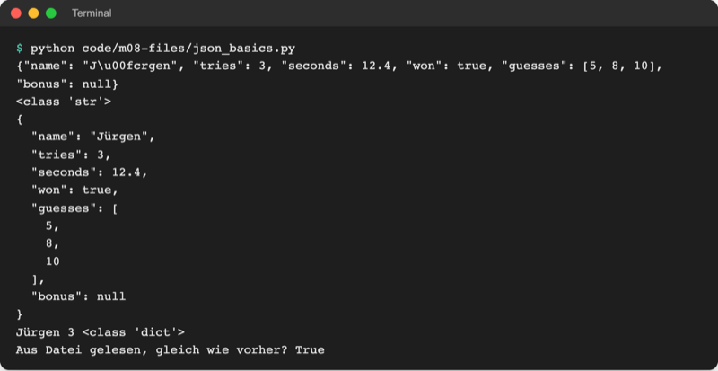
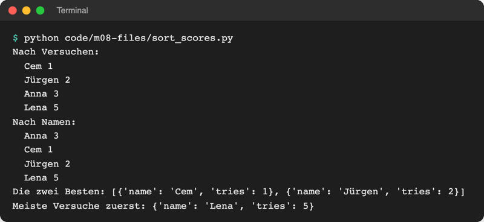
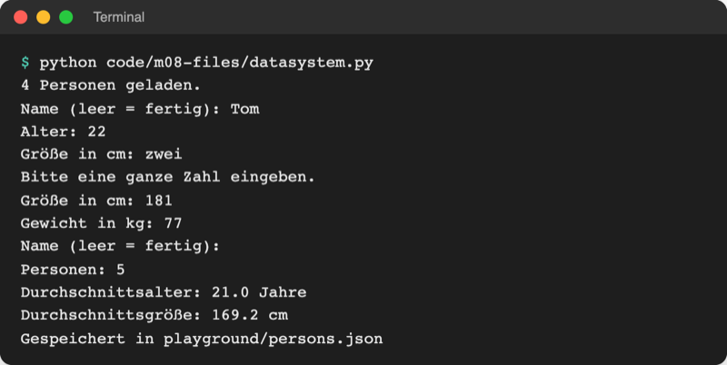

# Lab 8.2: JSON

**Leitfragen:**

<details>
<summary>Was ist am Format „Anna;3;12.4“ unpraktisch, wenn später ein Feld dazukommt?</summary>

Die Bedeutung hängt nur an der Position: Kommt die Stufe dazu, müssen alle Programme, die die Datei lesen, neu zählen, und alte Zeilen passen nicht mehr. Besser ist ein Format, in dem jeder Wert seinen Namen trägt.

</details>

<details>
<summary>Wie könnte ein anderes Programm (z. B. eine Web-App) die Bestenliste lesen?</summary>

Nur über ein Format, das beide Seiten kennen. JSON ist so ein Format: Jede Programmiersprache und jeder Browser kann es lesen und schreiben.

</details>

<details>
<summary>Nach welchem Kriterium ist eine Bestenliste sortiert?</summary>

Beim Zahlenraten nach den wenigsten Versuchen, bei Gleichstand z. B. nach der kürzeren Dauer. Python braucht dafür eine Angabe, welcher Wert eines Eintrags zählt: `sorted(..., key=funktion)`.

</details>

- JSON (JavaScript Object Notation) ist ein Textformat für Listen und Dictionaries. Es sieht fast aus wie Python-Code und ist das Standardformat, mit dem Programme und Web-Dienste Daten austauschen.
- Das Modul `json` aus der Standardbibliothek verwandelt Python-Daten in JSON-Text und zurück.

## Begriffe

| Begriff | Bedeutung |
| --- | --- |
| JSON | Textformat für verschachtelte Daten aus Objekten `{}`, Listen `[]`, Strings, Zahlen, `true`/`false`, `null` |
| Objekt (in JSON) | Paare `"Schlüssel": Wert` in `{}`; in Python ein Dictionary |
| Serialisierung | Daten aus dem Speicher in Text (oder Bytes) verwandeln, damit sie in eine Datei oder übers Netz passen; wie Möbel für den Umzug zerlegen und beschriften |
| Deserialisierung | der Rückweg: Text wieder in Python-Daten verwandeln |
| `json.dump` / `json.load` | in eine Datei schreiben / aus einer Datei lesen |
| `json.dumps` / `json.loads` | in einen String verwandeln / aus einem String lesen (`s` = string) |
| `indent` | Einrückung in Leerzeichen; macht JSON für Menschen lesbar |
| `ensure_ascii=False` | Umlaute bleiben Umlaute statt `ü` |
| Sortierschlüssel (`key=`) | Funktion, die für jedes Element den Wert liefert, nach dem sortiert wird |

## Das Format: Python und JSON nebeneinander

Python-Dictionary:

```python
{"name": "Jürgen", "tries": 3, "seconds": 12.4, "won": True, "guesses": [5, 8, 10], "bonus": None}
```

Dasselbe als JSON-Datei mit `indent=2`:

```json
{
  "name": "Jürgen",
  "tries": 3,
  "seconds": 12.4,
  "won": true,
  "guesses": [
    5,
    8,
    10
  ],
  "bonus": null
}
```

| Python | JSON | Unterschied |
| --- | --- | --- |
| `dict` `{"a": 1}` | Objekt `{"a": 1}` | Schlüssel immer Strings in **doppelten** Anführungszeichen |
| `list` `[1, 2]`, `tuple` `(1, 2)` | Array `[1, 2]` | Tupel werden zur Liste |
| `str` `"Anna"` oder `'Anna'` | String `"Anna"` | nur doppelte Anführungszeichen |
| `int` `3`, `float` `12.4` | Zahl `3`, `12.4` | gleich |
| `True` / `False` | `true` / `false` | klein geschrieben |
| `None` | `null` | anderes Wort |
| `set`, `datetime` | gibt es nicht | `TypeError` beim Speichern |

## dump, load, dumps, loads

Datei: [code/m08-files/json_basics.py](../../project/code/m08-files/json_basics.py)

```python
import json

text = json.dumps(score)  # Dictionary -> JSON-Text (ein String)
pretty = json.dumps(score, indent=2, ensure_ascii=False)  # eingerückt, Umlaute lesbar
back = json.loads(text)  # JSON-Text -> Dictionary

with open(target, "w", encoding="utf-8") as file:
    json.dump(score, file, indent=2, ensure_ascii=False)  # direkt in die Datei

with open(target, encoding="utf-8") as file:
    loaded = json.load(file)  # direkt aus der Datei
```



_Quelle: eigener Screenshot, Kurs-Repo, 08.11.2026._

| Richtung | mit Datei | mit String |
| --- | --- | --- |
| Python → JSON | `json.dump(daten, file)` | `text = json.dumps(daten)` |
| JSON → Python | `daten = json.load(file)` | `daten = json.loads(text)` |

Merkhilfe: Das `s` am Ende steht für *string*. Dateien öffnet `with open(...)` wie in Lab 8.1, mit `"w"` zum Schreiben: Eine JSON-Datei wird immer komplett neu geschrieben, nicht angehängt.

Original: [Python-Dokumentation: Modul json – JSON encoder and decoder, Einleitung und Beispiel json.dumps](https://docs.python.org/3.14/library/json.html), Stand 08.11.2026.

### Grenzen

Datei: [code/m08-files/json_limits.py](../../project/code/m08-files/json_limits.py)

```text
[1, 10]
TypeError: Object of type set is not JSON serializable
TypeError: Object of type datetime is not JSON serializable
[5, 8]
"2026-11-08 14:05"
```

Sets und Datumswerte vorher umwandeln: `sorted(menge)` ergibt eine Liste, `strftime(...)` (Lab 6.3) einen String. Das Spiel speichert das Datum deshalb schon als Text `"2026-11-08"`.

## Sortieren mit key=

`sorted(liste)` (Lab 4.1) sortiert Zahlen und Strings. Eine Liste von Dictionaries weiß nicht, wonach sie sortiert werden soll. `key=` nimmt eine Funktion entgegen, die Python für jedes Element aufruft; sortiert wird nach deren Rückgabewert.

**Funktionen als Argument in einem Satz:** Eine Funktion ist auch ein Wert und lässt sich ohne Klammern übergeben (`key=get_tries`); `sorted` ruft sie dann selbst auf (mehr dazu in Lab 12.2). Datei: [code/m08-files/sort_scores.py](../../project/code/m08-files/sort_scores.py)

```python
def get_tries(score):
    """Sortierschlüssel: die Anzahl der Versuche."""
    return score["tries"]


ranking = sorted(scores, key=get_tries)  # ohne (): die Funktion selbst übergeben
best_two = sorted(scores, key=get_tries)[:2]  # Slicing aus Lab 4.1
worst_first = sorted(scores, key=get_tries, reverse=True)  # absteigend
```



_Quelle: eigener Screenshot, Kurs-Repo, 08.11.2026._

## Beispiel: Personendatenbank

Datei: [code/m08-files/datasystem.py](../../project/code/m08-files/datasystem.py). Lädt [data/persons.json](../../project/data/persons.json), fragt neue Personen ab, berechnet Durchschnittswerte und speichert alles nach `playground/persons.json` (die Beispieldatei bleibt unverändert).

```python
def load_persons():
    """Lädt die eigene Kopie, beim allerersten Start die Beispieldaten."""
    path = TARGET_FILE if TARGET_FILE.exists() else SOURCE_FILE
    with open(path, encoding="utf-8") as file:
        return json.load(file)
```



_Quelle: eigener Screenshot, Kurs-Repo, 08.11.2026._

## Im Spiel: Bestenliste in highscores.json

`storage.py` ersetzt `scores.txt` durch `highscores.json`: eine Liste der Ergebnis-Dictionaries aus `play_round`. Speichern heißt: alles laden, das neue Ergebnis anhängen, alles neu schreiben.

```python
def load_highscores():
    if not HIGHSCORES_FILE.exists():  # erster Start: noch keine Datei
        return []
    with open(HIGHSCORES_FILE, encoding="utf-8") as file:
        return json.load(file)
```

`top_five()` sortiert mit `key=get_tries` und schneidet mit `[:5]` die ersten fünf ab; `ui.show_highscores` gibt sie mit Platznummer aus.

## Typische Fehler

| Symptom | Ursache | Lösung |
| --- | --- | --- |
| `JSONDecodeError: Expecting property name enclosed in double quotes` | JSON von Hand mit `'einfachen'` Anführungszeichen geschrieben | nur `"doppelte"` Anführungszeichen |
| `JSONDecodeError: Expecting value: line 1 column 1 (char 0)` | Datei ist leer | Datei löschen; das Programm legt sie neu an |
| `TypeError: Object of type set is not JSON serializable` | Set, Datum oder eigenes Objekt gespeichert | vorher in Liste oder String umwandeln |
| Umlaute als `ü` in der Datei | `ensure_ascii=False` fehlt | ergänzen (die Daten sind trotzdem korrekt) |
| `TypeError: get_tries() missing 1 required positional argument` | `key=get_tries()` mit Klammern | ohne Klammern: `key=get_tries` |
| Datei enthält nur das letzte Ergebnis | vor dem Schreiben nicht geladen | erst `load`, dann `append`, dann `dump` |

## Fazit

- JSON speichert Listen und Dictionaries als Text mit Namen an jedem Wert; neue Felder brechen nichts.
- `dump`/`load` arbeiten mit Dateien, `dumps`/`loads` mit Strings; `indent=2` und `ensure_ascii=False` machen die Datei lesbar.
- `sorted(liste, key=funktion)` sortiert nach dem Wert, den die Funktion für jedes Element liefert.

In der Übung ersetzt `highscores.json` die Datei `scores.txt`, und das Spiel zeigt nach jedem Gewinn die Top 5.
