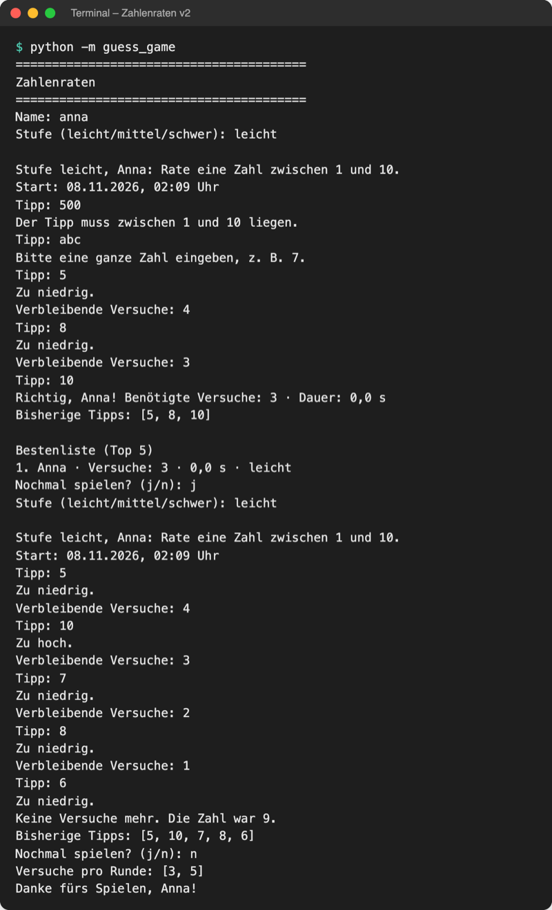
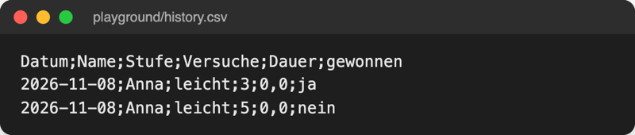

# Lab 8.3 – Lösung: Spielverlauf in history.csv

Fertiger Stand (Spiel v2): [project/examples/m08-files/l03-csv/guess_game/](../../project/examples/m08-files/l03-csv/guess_game/). Test im Ordner `project/`: `cd examples/m08-files/l03-csv`, dann `python -m guess_game`.

## Aufgabe 1: Konstanten

```python
import csv
import json
from pathlib import Path

# relativer Pfad: die Datei landet im Ordner, in dem das Spiel startet
HIGHSCORES_FILE = Path("highscores.json")
HISTORY_FILE = Path("history.csv")
HISTORY_COLUMNS = ["Datum", "Name", "Stufe", "Versuche", "Dauer", "gewonnen"]
```

`HISTORY_COLUMNS` legt Namen und Reihenfolge der Spalten fest. Die Namen sind deutsch, weil die Datei für Menschen in Excel gedacht ist; im Code bleiben die Schlüssel englisch (`result["tries"]`).

## Aufgabe 2 und 3: append_history(result)

```python
def append_history(result):
    """Hängt jede Runde, ob gewonnen oder nicht, als Zeile an history.csv an."""
    is_new = not HISTORY_FILE.exists()  # Kopfzeile nur beim ersten Mal
    row = {
        "Datum": result["date"],
        "Name": result["name"],
        "Stufe": result["level"],
        "Versuche": result["tries"],
        "Dauer": str(result["seconds"]).replace(".", ","),  # Komma für deutsches Excel
        "gewonnen": "ja" if result["won"] else "nein",
    }
    # newline="": das csv-Modul setzt die Zeilenenden selbst
    # utf-8-sig: Excel erkennt so die Umlaute
    with open(HISTORY_FILE, "a", encoding="utf-8-sig", newline="") as file:
        writer = csv.DictWriter(file, fieldnames=HISTORY_COLUMNS, delimiter=";")
        if is_new:
            writer.writeheader()
        writer.writerow(row)
```

- `is_new` muss **vor** `open()` stehen: Modus `"a"` legt die Datei an, danach würde `exists()` immer `True` melden.
- `writerow` wandelt Zahlen selbst in Text um (`3` → `3`); nur die Dauer braucht das Komma von Hand.
- Beim Anhängen mit `utf-8-sig` schreibt Python die BOM nur, wenn die Datei leer ist; sie steht also genau einmal am Anfang.

## Aufgabe 4: __main__.py

```python
    while play_again == "j":
        level = ui.ask_level()
        result = ui.play_round(name, level=level)
        all_tries.append(result["tries"])
        storage.append_history(result)  # jede Runde, auch verlorene
        if result["won"]:  # nur gewonnene Runden kommen in die Bestenliste
            storage.save_highscore(result)
            ui.show_highscores(storage.top_five())
        play_again = ui.ask_play_again()
```

## Aufgabe 5: Gewinn und Verlust

Kompletter Lauf von Spiel v2: Tipp außerhalb des Bereichs, Texteingabe, Gewinn mit Bestenliste, dann eine verlorene Runde.



_Quelle: eigener Screenshot, Kurs-Repo, 08.11.2026 (Testlauf mit festem Zufallswert, daher Dauer 0,0 s)._

`playground/history.csv` danach, im Editor:



_Quelle: eigener Screenshot, Kurs-Repo, 08.11.2026._

Im Tabellenprogramm stehen die Werte in sechs Spalten. Zeigt Excel alles in Spalte A, erwartet es ein anderes Trennzeichen: **Daten → Aus Text/CSV** wählen und „Semikolon“ einstellen.

Zurücklesen in Python liefert Dictionaries mit Strings:

```python
with open("history.csv", encoding="utf-8-sig", newline="") as file:
    print(next(csv.DictReader(file, delimiter=";")))
```

```text
{'Datum': '2026-11-08', 'Name': 'Anna', 'Stufe': 'leicht', 'Versuche': '3', 'Dauer': '0,0', 'gewonnen': 'ja'}
```

`next(...)` holt nur die erste Zeile. Mit `encoding="utf-8"` statt `"utf-8-sig"` hieße der erste Schlüssel `'Datum'`.

## Erweiterung

`playground/win_rate.py`:

```python
# Gewinnquote pro Stufe aus history.csv berechnen

import csv
from pathlib import Path

history_file = Path("history.csv")

played = {}  # Stufe -> gespielte Runden
won = {}  # Stufe -> gewonnene Runden

with open(history_file, encoding="utf-8-sig", newline="") as file:
    for row in csv.DictReader(file, delimiter=";"):
        level = row["Stufe"]
        played[level] = played.get(level, 0) + 1
        if row["gewonnen"] == "ja":
            won[level] = won.get(level, 0) + 1

for level, count in played.items():
    wins = won.get(level, 0)
    rate = round(wins / count * 100)
    print(f"{level}: {wins} von {count} gewonnen ({rate} %)")
```

`get(level, 0)` (Lab 4.3) liefert 0, solange die Stufe noch nicht gezählt wurde. Ausgabe mit drei Runden (Anna leicht gewonnen und verloren, Jürgen mittel gewonnen):

```text
$ python win_rate.py
leicht: 1 von 2 gewonnen (50 %)
mittel: 1 von 1 gewonnen (100 %)
```
